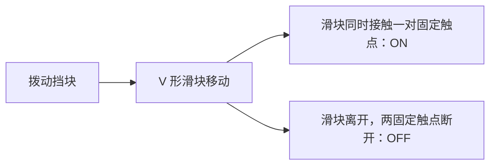

# DIP 滑动拨码开关：挡块推动 V 形滑块，使一对镀金固定触点接通或断开

> [!summary] 一句话概述
> DIP 拨码开关是一排做成像集成电路双列直插（或对应的表面贴装）外形的小型设定开关：每个键位用挡块推动 V 形金属滑块，把基座上的一对固定触点接通或断开，用来在 PCB 上设置模式，而不是给人频繁点击。立创介绍的一般构造是罩盖、挡块、滑块和基座四件；标准端子间距 2.54 mm，另有 1.27 mm 半间距，高度除普通 3.5 mm 外还有 2.2 mm 和 1.55 mm 的低矮型。它既不是钢琴键那种长摆杆按压外形，也不是旋转 BCD 编码开关用一圈档位输出 4 位代码。

## 配图

![[附件/dip-lcsc-types.jpg]]
*图源：[立创商城《开关的基础知识④：DIP开关的基础》，2014-06-12](https://www.szlcsc.com/info/370.html)；DIP 开关按操作方式分为滑动型、琴键型和旋转型，并再按直插或表面贴装分档*

![[附件/dip-lcsc-construction.jpg]]
*图源：同上；一般构造示意：罩盖、挡块、滑块与基座*

![[附件/dip-lcsc-slider.jpg]]
*图源：同上；挡块外形（凸型从罩盖突出，扁平型收在罩盖表面以内）以及与滑块的关系*

![[附件/dip-lcsc-base.jpg]]
*图源：同上；基座把端子和固定触点一体成型，端子在内侧弯成一对固定触点*

> 图片版权归原作者所有，仅作个人学习收藏；出处见文末「来源与核实记录」。

## 结构原理

> 本节所有数字只写来源里给出的；来源没有就写「来源未给出」。

### 堆叠方案

方向：**从上盖操作面到 PCB 焊面（滑动型）**

| 层级 | 零件 | 材料 | 厚度/尺寸 | 固定方式 | 依据 |
| --- | --- | --- | --- | --- | --- |
| L1（最上） | 罩盖 | 树脂射出成型 | 普通高度 3.5 mm；另有 2.2 mm、1.55 mm 低矮型（立创，指整颗高度） | 与基座嵌合，保护内部 | 立创 |
| L2 | 挡块（操作件 / slider knob） | EngineersGarage：聚酰胺（尼龙）。立创未写挡块材料 | 凸型突出罩盖，扁平型不超过罩盖表面；扁平型还可贴密封胶带以便清洗 | 在罩盖导槽里滑动，把压力传给滑块，使触点稳定接触 | 立创；EngineersGarage |
| L3 | 滑块（V 形活动触点） | 弹性金属板加工成 V 形（立创） | 来源未给出厚度 | 随挡块动作，连接或断开基座上的两个固定触点 | 立创 |
| L4 | 基座、固定触点与端子 | 耐热树脂与端子一体成型；固定触点采取镀金等措施。EngineersGarage：接触销为青铜镀金，引出端青铜镀锡；壳体为含阻燃环氧的 PBT | 标准间距 2.54 mm，半间距 1.27 mm。EngineersGarage 所拆为 8 位、共 16 引脚 | 端子直插或表面贴装。盒型产品把基座背面端子与树脂接合部用液体树脂固定，减少助焊剂浸入 | 立创；EngineersGarage |

剖面示意：

立创强调：DIP 一般不频繁操作，厂家会用自清洁（切换时触点瞬间摩擦，清除氧化膜和异物）、提高接触压力、触点镀金等办法，保证长时间放置后仍能可靠接通。人的手指力度往往不够，凸型/扁平型挡块应用镊子等尖细工具操作（立创）。

### 零件清单

| 零件 | 数量 | 功能 | 材料 | 依据 |
| --- | --- | --- | --- | --- |
| 罩盖 | 1 | 保护内部、提供挡块导槽 | 树脂 | 立创 |
| 挡块 | 与位数相同，例如 EngineersGarage 所拆为 8 个 | 把操作力传到滑块并保持接触压力 | 尼龙等（EngineersGarage） | 立创；EngineersGarage |
| V 形滑块 | 与位数相同 | 接通或断开一对固定触点 | 弹性金属 | 立创 |
| 基座 | 1 | 固定端子与触点，承受焊接热 | 耐热树脂 | 立创 |
| 端子 / 固定触点 | 每位 2 个引出端 | 焊接到 PCB，内侧构成固定触点 | 镀金触点；引出端镀锡（EngineersGarage） | 立创；EngineersGarage |

### 装配顺序

来源给出的是构造关系，不是某厂装配工单。按立创构造说明反推：

1. 端子与固定触点在模具里和基座树脂一体成型，内侧弯成一对触点，并做镀金等处理。
2. 需要防助焊剂时，在基座背面接合部点液体树脂（盒型）。
3. 放入 V 形滑块，对准每一对固定触点。
4. 放入挡块，使其压在滑块上，并能在导槽里在 ON/OFF 两个位置停留。
5. 盖上罩盖并嵌合。扁平型若需清洗，再贴密封胶带。
6. 按直插或贴装方式焊到 PCB。立创提到可杆状或带状包装，以便自动封装。

### 受力与运动分析

- **受力路径**：工具拨动挡块 → 挡块向滑块加压 → V 形滑块在一对固定触点上滑移或跨接，实现通断。接触压力由挡块和滑块弹性提供（立创：挡块作用是向滑块加压，使之与触点稳定接触）。
- **运动关系**：每位是独立的 SPST 通断（EngineersGarage 定义为 array of SPST）。滑动过程中的摩擦被立创写成自清洁，而不是要避免的磨损（在设定开关、操作次数很少的前提下）。
- **失效风险**：长期不拨后触点氧化或积尘，会导致接触不良；自清洁和镀金就是针对这件事（立创）。助焊剂从端子根部爬进盒内会造成失效，所以有盒型和灌封对策。用手指大力拨可能打滑或损坏低矮挡块，故立创建议用镊子。操作力和寿命次数两文都未给出。

## 设计要点与参数

| 要点 | 内容 | 依据 |
| --- | --- | --- |
| 端子间距 | 标准 2.54 mm；半间距 1.27 mm | 立创 |
| 高度 | 普通 3.5 mm；低矮型 2.2 mm、1.55 mm | 立创 |
| 操作方式分类 | 滑动型（扁平/凸型）、琴键型（短/长摆杆）、旋转型（扁平/轴，上面或侧面操作） | 立创 |
| 封装 | 直插或表面贴装；可杆状、带状包装自动贴装 | 立创 |
| 接触可靠性措施 | 自清洁摩擦、提高接触压力、触点镀金 | 立创 |
| 清洗 | 扁平型可贴密封胶带后清洗；盒型用树脂固定端子根部防助焊剂 | 立创 |
| 示例位数 | EngineersGarage 所拆为 8 位、16 引脚 | EngineersGarage |
| 操作力 / 寿命 / 额定电流 | 两文均未给出，来源未给出 | — |

## 优缺点

**优点**
- 外形和焊盘按 IC 的 DIP/SMT 习惯设计，便于在 PCB 上做可改的配置
- 每位独立，组合出二进制设定，不必为每种模式改软件或换电阻
- 针对「很少拨但要长期可靠」做了镀金和自清洁，而不是按百万次点击去设计

**缺点 / 代价**
- 不适合当用户频繁按的面板键，挡块小，常用工具拨
- 没有密封或灌封时，洗板和助焊剂是主要风险
- 本篇两则来源没有力值和电气寿命，正式选型仍要打开具体型号数据表

## 可借鉴点

- 先分清三种 DIP：滑动、琴键、旋转编码。只要二进制拨档，用滑动型；要在同一占地输出 0–9 或 0–F，用旋转 BCD 专篇，不要把三种写进同一零件编号。
- 需要洗板，选扁平型加胶带或盒型灌封，不要用敞开的凸型去过波峰。
- 在丝印上标明 ON 的方向和位号，避免现场把 8 位整排拨反。
- 手指不好操作时，按立创的建议预留镊子空间，不要把 DIP 埋在高元件夹缝里。

## 与库中相似案例对比

| 对比项 | 本案例（滑动 DIP） | [[旋转BCD编码开关：编码转子把档位编成4位代码（对照 Nidec SC 与 Omron A6A）]] | [[薄膜开关叠层：面板、间隔层、电路层与开窗排气]] | [[轻触开关壳体封装金属弹片：盖板、推杆与锅仔片反转导通（以 Omron B3F 为例）]] |
| --- | --- | --- | --- | --- |
| 输出 | 每位独立 ON/OFF | 一圈档位编成 4 位 BCD/BCH | 面板上的瞬时或薄膜按键 | 瞬时点击，松开即断 |
| 操作 | 小挡块滑动，常用工具 | 一字/十字槽或旋钮旋转 | 按膜面 | 按推杆 |
| 使用频率 | 设定用，很少拨 | 设定用 | 供人经常按 | 供人经常按 |
| 何时用这篇 | 要在 PCB 上放一排配置开关 | 要用旋转档位输出编码 | 要做薄膜面板 | 要做点击手感的信号键 |

## 相关案例

- [[旋转BCD编码开关：编码转子把档位编成4位代码（对照 Nidec SC 与 Omron A6A）]]
- [[薄膜开关叠层：面板、间隔层、电路层与开窗排气]]
- [[轻触开关壳体封装金属弹片：盖板、推杆与锅仔片反转导通（以 Omron B3F 为例）]]
- 分类索引：[[04-机构与运动 索引]]

## 来源与核实记录

- 主来源：[立创商城，《开关的基础知识④：DIP开关的基础》，2014-06-12](https://www.szlcsc.com/info/370.html)（2026-11-27 打开并下载构造与分类图。四件套构造、间距与高度、自清洁、镀金、盒型防助焊剂和三种操作方式来自该页。）
- 交叉来源：[Ashutosh Bhatt，EngineersGarage，《Insight – How DIP Switch works》，2012-07-27](https://www.engineersgarage.com/insight-how-dip-switch-works/)（2026-11-27 通过页面抓取打开正文。独立第二机构。8 位 16 引脚外形、尼龙挡块、PBT 壳体、青铜镀金触点和镀锡引脚来自该文。后轮直接下载配图返回 403，本篇配图改用立创页已成功保存的结构图，不把未保存的 EngineersGarage 照片写进正文。）
- 核实：2026-11-27 打开上述两处。未把滑动 DIP 写成琴键互锁按键或旋转编码开关，也未编造操作力和寿命。
