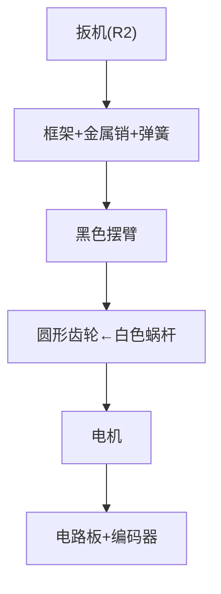

# DualSense 自适应扳机：电机+蜗杆的力反馈机构

> [!summary] 一句话概述
> DualSense 的 R2/L2 扳机在普通「销轴+弹簧」回位之外，加了一套「电机→白色蜗杆→圆形齿轮→黑色摆臂」机构，可由游戏程序控制扳机阻力，编码器测量齿轮转角。

## 配图

![[附件/dualsense-trigger-parts.jpg]]
*iFixit：自适应扳机模块分解*

![[附件/dualsense-trigger.jpg]]
*iFixit：扳机模块与电机*

> 图片版权归原作者所有，仅作个人学习收藏；出处见文末「来源与核实记录」。

## 结构原理

> 本节数字只写来源里给出的；来源没有就写「来源未给出」。

### 堆叠方案

方向：**扳机模块：从操作面到内部**

| 层级 | 零件 | 材料 | 厚度/尺寸 | 固定方式 | 依据 |
| --- | --- | --- | --- | --- | --- |
| L1 | 扳机（R2） | 塑料 | 来源未给出 | 金属销轴铰接 | Step 17；维修指南 Step 5 |
| L2 | 塑料框架 + 金属销 + 弹簧 | 塑料/金属 | 来源未给出 | 实现普通扳机动作 | Step 17 |
| L3 | 黑色摆臂 | — | 来源未给出 | 由圆形齿轮驱动 | Step 16-17 |
| L4 | 圆形齿轮 + 白色蜗杆（白色齿轮箱内） | 塑料（白色） | 来源未给出 | 齿轮箱固定 | Step 17 |
| L5 | 电机 | — | 来源未给出 | 引线焊到扳机模块电路板 | Step 17 |
| L6 | 模块电路板 + 编码器 | — | 来源未给出 | 2 根排线（按键、主板） | Step 17 |

剖面示意：

### 零件清单

| 零件 | 数量 | 功能 | 材料 | 依据 |
| --- | --- | --- | --- | --- |
| 电机 | 1/每侧 | 驱动蜗杆 | — | Step 16 |
| 蜗杆 | 1 | 减速并带动圆形齿轮 | 白色塑料 | Step 16-17 |
| 圆形齿轮 | 1 | 驱动摆臂 | — | Step 17 |
| 摆臂 | 1 | 顶住扳机产生阻力 | 黑色 | Step 16 |
| 编码器 | 1 | 测量圆形齿轮转角 | — | Step 17 |
| R2 两段式传感器 | 1 | 区分半按与全按 | — | Step 17 |
| 金属销 + 弹簧 | 各 1 | 扳机转轴与回位 | 金属 | Step 17 |

### 装配顺序

1. (社区维修指南) 扳机通过金属销装到扳机组件上，下方是导电橡胶和按键膜
2. 合上扳机组件外壳（一侧 3 颗螺丝 + 排线后 1 颗）
3. 扳机组件用 2 颗螺丝固定到中框
4. 中框用 4 颗螺丝与外框连接

> 装配顺序来自 iFixit 社区维修指南（PS5 Controller Trigger Teardown，按拆解反向）。

### 受力与运动分析

- **受力路径**：手指压扳机 → 扳机绕金属销转动；启用时摆臂向上顶住扳机提供阻力，反力经齿轮传到蜗杆（推断：蜗杆传动通常具有一定自锁性，来源未说明）。
- **运动关系**：电机旋转 → 蜗杆 → 圆形齿轮转动 → 摆臂上抬；编码器闭环测量齿轮角度（Step 16-17）。
- **失效风险**：来源未提及；维修指南用于更换扳机按键膜，说明按键膜是易损件（推断）。

## 设计要点与参数

| 要点 | 内容 | 依据 |
| --- | --- | --- |
| 扳机模块占比 | 扳机与触觉马达占手柄内部约一半体积 | Step 15 |
| 螺丝 | 组件 4 颗、组件到中框 2 颗、中框到外框 4 颗 | 维修指南 Step 1-4 |
| 减速比/电机型号/阻力大小 | 来源未给出 | — |

## 优缺点

**优点**
- 阻力可编程，交互丰富
- 不启用时扳机照常工作（机构与普通扳机并联）

**缺点 / 代价**
- 占用大量内部空间
- 零件多、成本高（推断）

## 可借鉴点

- 给手动操作件叠加「可编程阻力」：电机+蜗杆+摆臂+编码器的闭环方案
- 让主动机构与被动功能并联，主动失效时基本功能仍可用

## 相关案例

- [[PS5 免工具侧板与 DualSense 隐藏螺丝]]
- 分类索引：[[04-机构与运动 索引]]

## 来源与核实记录

- 主来源：[PlayStation 5 Teardown（DualSense 部分 Step 12-19）](https://www.ifixit.com/Teardown/PlayStation+5+Teardown/138280)（2020-11-05，Taylor Dixon / iFixit；维修指南作者 vickyjean1007）
- 补充来源：<https://www.ifixit.com/Teardown/PS5+Controller+Trigger+Teardown/158397>
- 核实：2026-11-13 通过 iFixit API 读取 PS5 拆解 Step 15-17 与社区维修指南 8 步原文，核对传动链与零件。
