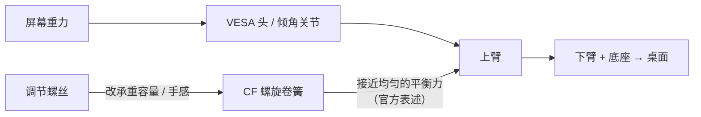

# Ergotron CF 恒力螺旋弹簧支架（对比气弹簧）

> [!summary] 一句话概述
> Ergotron 的 CF（Constant Force）支架不用气弹簧，而用专利的螺旋卷簧：在行程里用接近均匀的力去平衡屏幕，再靠一颗调节螺丝覆盖一个重量区间。和气弹簧臂相比，官方和中文代理都强调「力更耐久、可再调」；代价是机械弹簧可能有噪声，而且售价更高。气弹簧整臂的张力螺丝和悬停调法见 [[显示器气弹簧支架：张力螺丝与悬停平衡]]。

## 配图

![[附件/ergotron-lx-cf-45-241-026.jpg]]
*图源：[中关村在线《必买：这四款显示器支架，可以闭眼买》](https://news.zol.com.cn/780/7809517.html) 配图，爱格升（Ergotron）45-241-026；ZOL 写这是带专利 CF 恒力技术的机械弹簧支架，承重 3.2–11.3 kg，铝合金，自重 3.6 kg，官方 10 年质保。*

![[附件/loctek-d6-mechanical-spring-arm.jpg]]
*图源：同上，乐歌 D6 机械弹簧支架（非 CF 专利）。ZOL 用来对比：机械弹簧「力度变化没有气弹簧流畅，但寿命会比较长」。*

![[附件/monitor-arm-nb-f00a-gas-spring.jpg]]
*图源：同上，NB F00A 气弹簧对照：上臂更粗的气弹簧段、手感被 ZOL 形容为近乎线性、带悬停，但「使用寿命有限」。*

> 图片版权归原作者所有，仅作个人学习收藏；出处见文末「来源与核实记录」。

## 结构原理

> 本节所有数字只写来源里给出的。CF 卷簧的圈数、条料截面、输出牛顿值，来源未给出，不估算。

### 堆叠方案

方向：**与气弹簧整臂相同的外层堆叠，差别在上臂的平衡元件（Ergotron / uview 的原理说明 + ZOL 对 45-241-026 的产品描述）**

| 层级 | 零件 | 材料 | 厚度/尺寸 | 固定方式 | 依据 |
| --- | --- | --- | --- | --- | --- |
| L1 | 桌夹或穿孔底座 | 来源未给出 | 来源未给出 | 夹桌或穿桌孔（具体形式视型号，本批未打开该型号说明书） | 该类支架的通用装法；本型号细节来源未给出 |
| L2–L3 | 下臂、关节 | 铝合金（ZOL 写 45-241-026 为铝合金） | 来源未给出 | 铰接 | ZOL |
| L4 | 上臂内的 CF 螺旋卷簧 + 调节螺丝 | 螺旋弹簧（Ergotron：coiled-spring technology） | 来源未给出 | 「拧一颗螺丝」即可改支架的承重容量，并在行程里保持均匀力 | Ergotron CF 官方页；uview：「用附上的螺丝起子调整摩擦力……加大或减少升力强度」 |
| L5–L6 | VESA 头 + 倾角/旋转关节 | 来源未给出 | 爱格升称全系列符合 VESA FDMI | VESA 螺丝 | uview；Ergotron VESA 页 |

剖面示意：

### 零件清单

| 零件 | 数量 | 功能 | 材料 | 依据 |
| --- | --- | --- | --- | --- |
| CF 螺旋卷簧 | 来源未给出件数 | 在行程中提供接近恒定的平衡力 | 来源未给出弹簧钢号 | Ergotron CF 页 |
| 调节螺丝 / 随附起子 | 1 套 | 按屏幕重量和手感微调升力 | 来源未给出 | Ergotron；uview |
| 上臂、下臂、底座、VESA 头 | 各 1（典型单屏臂） | 与气弹簧臂相同的外层机构 | 45-241-026 为铝合金（ZOL） | ZOL |
| 气弹簧（对照，不是 CF 零件） | — | 用缸内气压平衡重力，密封件会老化 | — | ZOL；uview；Work While Walking |

### 装配顺序

> 本批未打开 45-241-026 的逐步安装 PDF，不编造步序。可确定的调节步骤来自官方/代理说明：

1. 按该型号说明书完成桌夹（或穿孔）和 VESA 挂屏（螺丝规格见 [[VESA MIS-D 75-100 接口与倾角摩擦关节]]）。
2. 用随附起子拧 CF 调节螺丝，按屏幕实际重量加大或减小升力，使屏幕能停在行程中的任意位置（Ergotron：a CF mount’s capacity can be modified by the simple twist of a screw；uview：可依屏幕重量与个人手感微调）。
3. 再调头部倾角/旋转关节的松紧（具体螺丝数量来源未给出）。

### 受力与运动分析

- **受力路径**：屏幕重力 → VESA 头 → 上臂。CF 卷簧在上臂里给出与位移关系较平的平衡力（官方原话：No matter which way you lift, tilt or turn, the effort remains small with a uniform force applied throughout the range of motion）。人手只需克服少量不平衡力和关节摩擦。
- **运动关系**：与气弹簧臂一样，可以升降、伸展、倾斜、旋转；uview 特别写到可以把屏幕转到竖向。
- **失效风险 / 与气弹簧的差异**：
  - Ergotron 官方：CF 的卷簧设计「leapfrogs over conventional gas-spring technology」，强调易调和长期可靠。
  - uview：传统气压式「在长时间的使用下性能会逐渐衰退」，CF 螺旋弹簧「更持久」。
  - ZOL：机械弹簧「理论上可以一直使用，不用担心自然磨损」，但伸缩过程中「可能有噪音」；气弹簧更流畅，寿命有限。
  - Work While Walking（2021-12-12）：把「气活塞」和「金属弹簧」对比为——弹簧更便宜、没有会漏的密封、力更耐久，但不如气缸平滑安静，而且有更快的 kick back（回弹）；气缸更平滑安静，便宜气缸会逐年掉力，高质量气缸他们举例质保 15 年。**注意：** 该文把 Ergotron LX 列为 compression spring 例子，并写「力随弹簧被压缩而线性增加」。这与 Ergotron / uview 对 CF「全程均匀力」的表述不一致。恒力卷簧和普通压缩螺旋弹簧不是同一种力曲线，本文不以该线性曲线作为 CF 的特性。

## 设计要点与参数

| 要点 | 内容 | 依据 |
| --- | --- | --- |
| 平衡原理 | 专利 CF 螺旋卷簧，官方称行程内均匀用力 | Ergotron CF 页 |
| 调节 | 拧一颗螺丝改变支架承重容量，保持均匀力 | Ergotron CF 页；uview |
| 45-241-026 参数 | 适用于 34 寸以下（ZOL 原文「3 4寸以下」按上下文为 34 寸）；承重 3.2–11.3 kg；铝合金；自重 3.6 kg；官方 10 年质保 | ZOL |
| 气弹簧对照（ZOL 概括） | 近乎线性弹性曲线，轻松准确，寿命有限 | ZOL |
| 气缸对照（WW） | 力依赖内压；压缩末端更费力（该文画的是指数/非线性上升）；有回弹控制；密封可能泄漏 | Work While Walking |
| 卷簧圈数、条料厚度、输出牛顿 | 来源未给出 | — |

## 优缺点

**优点**
- 厂商把「均匀力 + 一颗螺丝覆盖重量区间」做成可长期再调的机械方案，不必换气缸
- 没有气弹簧那种密封泄漏路径（官方与 uview 的核心卖点）
- 45-241-026 这类型号有 10 年官方质保（ZOL），可作为寿命承诺的参考，但质保不等于实测寿命曲线

**缺点 / 代价**
- 贵（ZOL 写该型号 879 元，并把它列为主要缺点）
- 机械弹簧可能有噪声，手感不一定比得好的气弹簧「顺」（ZOL）
- 普通压缩簧如果被误当成 CF，力会随压缩线性变大（WW 的一般描述），设计和选型时必须分清「恒力卷簧」和「压缩螺旋簧」

## 可借鉴点

- **要「行程里手感一致」时优先考虑恒力卷簧，而不是普通压缩簧。** 普通压缩簧的力跟变形近似成正比，臂在低位和高位的手感会差一截；恒力卷簧的目标就是把这条曲线削平（以 Ergotron 自己的表述为准）。
- **调节螺丝仍然必要**：恒力不等于「一个弹簧吃所有重量」，CF 也是拧螺丝改预紧/容量，和气弹簧臂的 +/− 张力螺丝是同一类用户接口。
- **用质保年限当寿命线索，但不代替失效模式**：气弹簧要问密封和年漏气率，卷簧要问疲劳和噪声；WW 建议「看质保猜寿命」。
- **不要把「机械弹簧」写成铁板一块**：乐歌 D6 是普通机械弹簧路线，Ergotron CF 是恒力卷簧路线，ZOL 把两者都归在机械弹簧下，但原理不同。
- 整臂的桌夹、VESA 头、倾角螺丝仍按 [[显示器气弹簧支架：张力螺丝与悬停平衡]] 和 [[VESA MIS-D 75-100 接口与倾角摩擦关节]] 来做，CF 只替换上臂里的平衡元件。

## 与库中相似案例对比

| 对比项 | 本案例（CF 恒力卷簧） | [[显示器气弹簧支架：张力螺丝与悬停平衡]] | Work While Walking 所说的普通压缩簧 |
| --- | --- | --- | --- |
| 平衡元件 | 螺旋卷簧（官方称恒力） | 气弹簧 | 压缩螺旋簧，力随压缩线性上升 |
| 调节 | 一颗螺丝改容量 | 上臂 +/− 张力螺丝 | 来源未在本篇对应到具体产品螺丝 |
| 主要失效 | 疲劳、可能的机械噪声 | 密封泄漏、力逐年下降 | 同上（无密封），另有较强 kick back |
| 何时选 | 要长期保持力、接受更高价格和可能的噪声 | 要更顺、更静的手感，并接受日后可能换臂/掉力 | 成本优先的机械臂 |

## 相关案例

- [[显示器气弹簧支架：张力螺丝与悬停平衡]]
- [[VESA MIS-D 75-100 接口与倾角摩擦关节]]
- [[恒扭力摩擦铰链：卡簧过盈产生扭力与「最低扭力 > 盖板力矩」选型]]
- [[旋转阻尼器（缓降盖板）：硅油黏性、水平型与垂直型的扭矩曲线]]
- 分类索引：[[04-机构与运动 索引]]

## 来源与核实记录

- 主来源：[Constant Force™ Technology](https://www.ergotron.com/en-us/company/cf-technology)（Ergotron 官方 CF 技术页）——均匀力、拧螺丝改容量、coiled-spring、对比传统气弹簧
- 补充来源 1：[Learn more about screen mounts / Constant Force 恆力技術](https://www.uview.com.tw/pages/aboutmounts)（台湾代理 uview / 太毅，中文页）——用随附起子调升力、气压式会衰退、全系列符合 VESA FDMI
- 补充来源 2：[必买：这四款显示器支架，可以闭眼买](https://news.zol.com.cn/780/7809517.html)（中关村在线，2021-11-17）——45-241-026 的 3.2–11.3 kg、自重 3.6 kg、10 年质保，以及气弹簧/机械弹簧概括
- 补充来源 3：[What’s the Difference between Gas Piston and Metal Spring Counterbalance Mechanisms in Monitor Arms?](https://www.workwhilewalking.com/whats-the-difference-between-air-cylinder-and-compression-spring-counterbalance-mechanisms-in-monitor-arms)（Work While Walking，2021-12-12）——气缸 vs 金属簧的平滑度、泄漏、kick back；其中「线性上升」针对普通压缩簧，与 CF 官方表述不一致，已在正文标明
- 核实：2026-11-15 打开上述四个页面。未打开 45-241-026 的逐步安装 PDF，故不写夹桌厚度、螺丝扭矩等未出现的数字。
