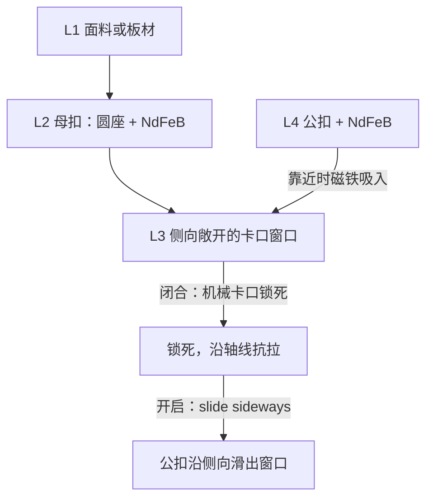

# FIDLOCK SNAP：圆形磁吸按扣侧向滑开（对照 V-BUCKLE 上掀）

> [!summary] 一句话概述
> FIDLOCK SNAP 是一对圆形公母按扣：靠近时钕磁铁把两半吸到一起，机械卡口自动锁死；开启不是上掀，而是沿侧向把公件滑出（规格书统一写 Opening: slide sideways）。它和库内已有的 [[FIDLOCK V-BUCKLE：磁吸引导到位后再由机械扣锁死]] 同属「磁吸引导 + 机械锁、开启方向与闭合方向不同」，但几何完全不同：V-BUCKLE 是织带扣、掀盖/拉片打开，SNAP 是可螺丝或缝纫到面料上的圆形按扣。

## 配图

![[附件/fidlock-snap-female-m-top.jpg]]
*图源：[FIDLOCK Snap Female M Screw 产品照片，规格书型号 05500-000002(BLK)](https://www.fidlock.com/components/sites/default/files/05500_SNAP_female_M_screw_datasheet.pdf)；母扣俯视：圆形座圈中央是供公扣进入的卡口窗口，窗口一侧敞开，供侧向滑出。这不是织带日字扣的外形*

![[附件/fidlock-snap-female-m-ds-1.png]]
*图源：[FIDLOCK Snap Female M Screw 规格书](https://www.fidlock.com/components/sites/default/files/05500_SNAP_female_M_screw_datasheet.pdf)（2016-05-17）；Opening: slide sideways；材料 PC-ABS、PA 66 GF 15、NdFeB；重量 11 g；Load capacity 15 kg。图中给出外径约 Ø40 / Ø27、高度方向 13.5 mm 与 4.4 mm 等尺寸，以及织物开孔 Ø27.2 的裁切图*

![[附件/fidlock-snap-male-m-side.jpg]]
*图源：FIDLOCK SNAP 公扣侧面照片（与母扣规格书同一产品族）；公扣头部要滑入母扣窗口。Extremtextil 产品页说明 SNAP 必须按尺寸把公件和母件成对订购，S / M / L 只在同尺寸内互配*

> 图片版权归原作者所有，仅作个人学习收藏；出处见文末「来源与核实记录」。

## 结构原理

> 本节所有数字只写来源里给出的；来源没有就写「来源未给出」。

### 堆叠方案

方向：**沿按扣轴线，从被安装的面料/板材一侧看到另一半**

| 层级 | 零件 | 材料 | 厚度/尺寸 | 固定方式 | 依据 |
| --- | --- | --- | --- | --- | --- |
| L1（安装基材） | 织物、织带、篷布或板材 | 应用自定 | Extremtextil 对 SNAP Female Screw Low、S 码：适用厚度 0.5–1.5 mm，开孔直径 20 mm。Female M Screw 规格书给出织物裁切 Ø27.2。不同尺寸不要混用这两组孔 | 夹在母扣面圈与螺接底板之间，或缝纫/铆接（视型号） | Extremtextil；05500 规格书 |
| L2 | SNAP 母扣（Female） | Female M Screw：PC-ABS、PA 66 GF 15、NdFeB | Female M Screw：规格书标注重量 11 g，图面有 Ø40、Ø27、高 13.5 mm 等；载荷 15 kg | 螺丝型用带内螺纹的底板从背面拧紧 | 05500 规格书 |
| L3 | 母扣中央卡口窗口 | 与母扣壳体一体 | 窗口一侧敞开，允许公扣侧向滑出（由俯视结构与 Opening: slide sideways 共同说明） | 一体成形 | 05500 规格书图 |
| L4 | SNAP 公扣（Male） | 例：本轮另打开的 Male S Screw Mid 规格书写 PA66 GF（该件重量 2.36 g，载荷 2 kg，适用织物约 1.4–2.9 mm）。M 码公扣材料以对应规格书为准，未打开的型号不编造 | 必须与母扣同一尺寸 S / M / L | 螺丝、缝纫或绳扣等，按型号 | Extremtextil；Male S Screw Mid 规格书（仅用于说明公扣也是「slide sideways」） |
| L5 | 钕磁铁（两半内各有） | NdFeB（官方规格书）；Extremtextil 亦写 neodymium magnets | 来源未给出磁铁尺寸与牌号 | 埋在公母壳体内 | 05500、F6021；Extremtextil |

剖面示意：

和 V-BUCKLE 的几何差异（对照已有篇，不重复收录）：

- SNAP：圆形按扣，安装在面料或板上，开启是侧向滑动。
- V-BUCKLE：织带日字/梯扣外形，开启是上掀金属盖或拉片；而且该篇写明载荷越大越难打开（自锁倾向）。SNAP 规格书没有把「载荷越大越难侧滑」写成同一条自锁逻辑，不能把两套开启力学当成一种。

### 零件清单

| 零件 | 数量 | 功能 | 材料 | 依据 |
| --- | --- | --- | --- | --- |
| SNAP Female（母扣） | 1 | 提供卡口窗口和一侧磁铁 | Female M Screw：PC-ABS、PA 66 GF 15、NdFeB | 05500 规格书 |
| SNAP Male（公扣） | 1，须同尺寸 | 插入窗口，提供另一侧磁铁 | 视型号；S 码螺丝中间型规格书写 PA66 GF | Extremtextil；Male S 规格书 |
| 螺接底板或缝纫翻边 | 按型号 1 | 把扣体夹紧或缝在基材上 | Female M 规格书图中有环形底板 | 05500 图；Extremtextil 写 Screw 型由带内螺纹的底板拧紧 |
| NdFeB 磁铁 | 公母各有，具体块数来源未给出 | 自动吸合、引导进入卡口 | NdFeB | 官方规格书；Extremtextil |

另：F6021 SNAP buckle 20 是把 SNAP 做成 20 mm 织带扣外形的变体，Opening 仍为 slide sideways，材料 PA66-GF30 / PA66-GF15 / NdFeB / Epoxy，重量 12.7 g，Load capacity 550 N，并注明不适用于摩托车头盔。它说明 SNAP 家族可以接到织带上，但开启方式仍是侧滑，不是 V-BUCKLE 的上掀。

### 装配顺序

1. 按尺寸选同一码的公母件，分别下单（Extremtextil 强调必须分开订购、同尺寸才可互配）。
2. 在基材上按规格书或经销商说明开孔：Extremtextil 写 S 码 Screw Low 需 Ø20 mm 孔；M 码 Female Screw 规格书给出 Ø27.2 织物裁切。不要把 S 的孔用到 M 上。
3. 螺丝型：把母扣正面放入孔中，背面用带内螺纹的底板拧紧。Extremtextil 提到可用专用 TOOL 3 辅助拧紧。缝纫型则按对应规格书缝合（本篇主型号为螺丝型）。
4. 同样安装公扣。
5. 使用时只需把两半靠近，磁铁吸合后机械卡口自动锁死（Extremtextil）。打开时沿侧向推动/滑出，而不是沿轴线硬拉（官方 Opening: slide sideways）。

> 规格书没有逐步工厂装配节拍；安装要点来自规格书图面和 Extremtextil 安装说明。

### 受力与运动分析

- **受力路径**：沿扣轴线的拉开力由已经咬合的机械卡口传到圆座和安装底板，再传到面料或板材。磁铁负责把公扣吸进窗口并保持对中，不是把「轴向拉脱强度」写成只靠磁力（Extremtextil：机械卡口自动锁紧；官方给出的 Load capacity / Breaking 是整扣指标）。Female M Screw 的 Load capacity 为 15 kg；SNAP buckle 20 为 550 N。这两项分属不同型号，不能合成一个数。
- **运动关系**：闭合是沿轴线靠近，几乎不用对准（磁铁引导）。开启是垂直于轴线的侧向滑动，公扣沿母扣窗口的敞开侧滑出。这正是「闭合方向与开启方向不同」。V-BUCKLE 的开启则是掀盖方向，不是侧滑。
- **失效风险**：用错尺寸的公母会装不上或锁不牢（Extremtextil）。侧滑方向若在使用中经常被沿窗口敞开侧撞击，可能比轴向更先打开（推断；规格书未给侧向保持力）。F6021 明确写 SNAP buckle 20 不适合摩托车头盔，不能把圆形按扣或侧滑织带扣用到安全头盔约束上。磁铁靠近敏感设备和起搏器等需要另外评估（Extremtextil 提醒注意磁场）。

## 设计要点与参数

| 要点 | 内容 | 依据 |
| --- | --- | --- |
| 开启方式 | slide sideways（侧向滑开） | 05500、F6021 规格书栏位 Opening |
| Female M Screw 材料与载荷 | PC-ABS、PA 66 GF 15、NdFeB；11 g；15 kg | 05500 规格书 |
| Female M Screw 关键尺寸 | 规格书 1:1 图：外轮廓约 Ø40 / Ø27，高度方向标有 13.5 mm、6.5 mm、4.4 mm 等；织物裁切 Ø27.2 | 05500 规格书 |
| SNAP buckle 20 | 12.7 g；550 N；PA66-GF30 / PA66-GF15 / NdFeB / Epoxy；不用于摩托车头盔 | F6021 规格书 |
| 公母成对、分尺寸 | S / M / L，同尺寸公母可组合，须分别订购 | Extremtextil |
| S 码螺丝矮型安装 | 开孔 Ø20 mm；基材厚度 0.5–1.5 mm；该页写重量 5.4 g、直径 32.7 mm、Breaking Strength 2 kg（仅适用于该 S 码型号，不要和 Female M 的 15 kg 混用） | Extremtextil |
| 与 V-BUCKLE 的差别 | SNAP：圆形按扣，侧滑打开。V-BUCKLE：织带扣，上掀打开，且已有专篇 | 本规格书 Opening 栏；库内 V-BUCKLE 篇 |
| 磁铁尺寸、侧向开启力、疲劳次数 | 来源未给出 | — |

## 优缺点

**优点**
- 圆形按扣可以装在袋盖、布面或薄板上，不必占用一条织带，这是 V-BUCKLE 做不到的安装面。
- 闭合靠磁铁自动吸入，单手或戴手套也能对上；轴向载荷由机械卡口承担。
- 开启方向与主承力方向分开，日常不容易被沿轴线的拉力拉开。
- 同一尺寸公母可以按安装方式混搭（螺丝、缝纫、绳扣），便于在不同部件上各选一种固定。

**缺点 / 代价**
- 侧向是设计开启方向，如果产品在这一方向上经常被刮碰，需要额外遮挡或改用其它开启几何。
- 载荷数字因尺寸差异很大（S 码与 M 码、按扣与 buckle 20 都不是同一个数），选型必须看对应规格书。
- 明确排除摩托车头盔等安全约束用途（buckle 20 规格书）。
- 磁场对周围器件的影响要单独评估。

## 可借鉴点

- 同一「磁吸引导 + 机械锁」家族里，要用开启几何来区分产品：侧滑圆扣、上掀织带扣、旋转或翻转，不要只写一句「磁吸锁」。
- 规格书把 Opening 写成固定栏位（slide sideways / lift / rotate），比在广告语里讲「轻松一开」更有用。
- 公母分件、按尺寸互配，可以把安装方式（螺丝/缝纫）从锁合几何里拆出来单独选型。
- 在母扣窗口上留出敞开侧，是侧滑开启的几何前提；画结构时先把「哪一侧是滑出方向」标出来。
- 安全约束（头盔、攀岩、儿童座椅等）不要直接套用生活按扣的载荷数字。

## 与库中相似案例对比

| 对比项 | 本案例（FIDLOCK SNAP） | [[FIDLOCK V-BUCKLE：磁吸引导到位后再由机械扣锁死]] | [[橱柜磁吸门吸：只有磁力保持、没有机械锁死（对照 FIDLOCK）]] | [[Peak Design SlimLink：方形陶瓷凹槽磁吸预定位与弹簧卡舌硬锁]] |
| --- | --- | --- | --- | --- |
| 外形 | 圆形公母按扣，可上板或上布 | 织带扣 | 点状门吸 | 方形板式接口 |
| 开启 | 侧向滑开 | 上掀盖/拉片 | 沿法向拉开 | 按两侧按键退卡舌 |
| 机械锁 | 有，卡口自动锁死 | 有，且该篇强调载荷越大越难打开 | 无 | 有，弹簧卡舌 |
| 何时用这篇 | 要在袋盖或面板上做侧滑圆形磁吸按扣 | 要在织带上做上掀磁吸扣 | 只要磁力保持 | 要做手机/板式硬锁快拆 |

## 相关案例

- [[FIDLOCK V-BUCKLE：磁吸引导到位后再由机械扣锁死]]
- [[橱柜磁吸门吸：只有磁力保持、没有机械锁死（对照 FIDLOCK）]]
- [[Peak Design SlimLink：方形陶瓷凹槽磁吸预定位与弹簧卡舌硬锁]]
- [[GoPro 快拆卡扣与指旋螺母：两爪弹性卡入和螺钉夹紧是两套锁]]
- 分类索引：[[04-机构与运动 索引]]

## 来源与核实记录

- 主来源：[FIDLOCK Snap Female M Screw 规格书，文章编号 05500-000002(BLK)，2016-05-17](https://www.fidlock.com/components/sites/default/files/05500_SNAP_female_M_screw_datasheet.pdf)（2026-11-26 重新下载 PDF。Opening: slide sideways，材料、11 g、15 kg 及图面尺寸均来自该页）
- 同一机构补充：[FIDLOCK SNAP buckle 20 规格书 F6021-000002(BLK)，2020-06-25](https://www.fidlock.com/components/sites/default/files/F6021-SNAP-buckle-20-datasheet.PDF)（2026-11-26 重新下载。同为 slide sideways，载荷 550 N，不用于摩托车头盔。用于说明 SNAP 家族还有织带形态，但开启仍不是 V-BUCKLE 的上掀）
- 交叉来源：[Extremtextil, SNAP FEMALE SCREW LOW size S](https://www.extremtextil.de/en/snap-female-screw-low-size-s-magnetic-fastener-for-0-5-1-5mm-material/71371)（2026-11-26 打开。德国技术面料零售商，独立于 FIDLOCK。用于核对照：钕磁铁自动吸合、机械卡口锁死、沿正确方向轻推打开、公母分件与 S/M/L 互配、S 码开孔 20 mm 及厚度范围。该页 Breaking Strength 2 kg 只用于其 S 码型号。零售商页中复述的官方概念，未当作另一份原厂规格）
- 核实：Carryology 原文页本轮持续 403，虽有 Wayback 快照但正文未稳定解析出 SNAP 专述，故不引用。未把 SNAP 写成 V-BUCKLE 的尺寸变体，也未重复「又一个织带磁吸搭扣」。
