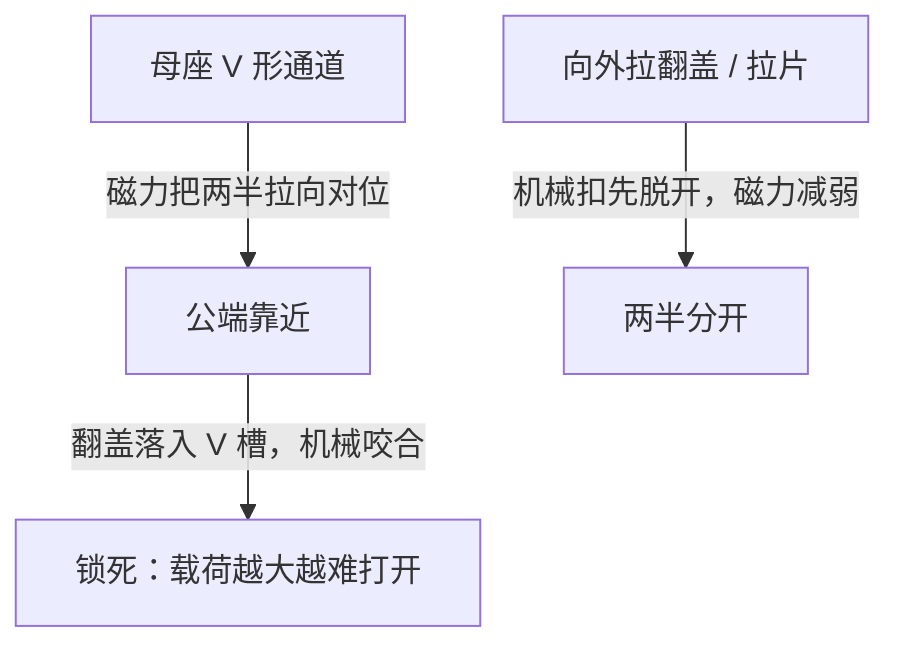

# FIDLOCK V-BUCKLE：磁吸引导到位后再由机械扣锁死

> [!summary] 一句话概述
> FIDLOCK 的核心不是「用磁力抓住负荷」，而是：磁铁把公母拉到对位，弹簧/机械扣再咬死；打开时先把机械扣错开，磁力随之减弱，两半才能分开。V-BUCKLE 把这套概念做成一块不锈钢 V 形翻盖：合上时磁吸引导自动扣上；拉开翻盖上的拉片即可打开；而且载荷越大越难打开（官网所称 self-securing）。这和 [[任天堂 Switch 2 Joy-Con 2 磁吸连接]] 那种「磁铁定位 + 电触点」、主要靠磁力保持的连接不是同一件事。

## 配图

![[附件/fidlock-v-buckle-explosion.jpg]]
*图源：[FIDLOCK V-BUCKLE 产品页](https://www.fidlock.com/components/en/products/v-buckle)；母座上的 V 形槽与公端不锈钢翻盖分离，拉片连在翻盖上。图为产品渲染，不是专利附图*

![[附件/fidlock-v-buckle-perspective.jpg]]
*图源：同上；扣合状态，翻盖落在母座的 V 形通道里，拉片朝上便于向外拉起*

> 图片版权归原作者所有，仅作个人学习收藏；出处见文末「来源与核实记录」。

## 结构原理

> 本节所有数字只写来源里给出的；来源没有就写「来源未给出」。

### 堆叠方案

方向：**从母座（官网称 female / bottom）到公端（male / top，带金属翻盖）**

| 层级 | 零件 | 材料 | 厚度/尺寸 | 固定方式 | 依据 |
| --- | --- | --- | --- | --- | --- |
| L1 | 母座壳体 + 织带孔 | PA66GF（25 mm 规格产品页） | 25 mm 规格外形：72.0 × 34.0 × 14.0 mm | 织带穿过单杆或梯扣 | 官网产品页；介绍页写织带宽度可选 20–40 mm |
| L2 | 母座上的 V 形通道 / 锁面 | 与壳体一体（来源未另给材料） | 来源未给出槽宽 | 一体 | 产品爆炸图；Ripstop：不锈钢翻盖向外倾斜即可打开 |
| L3 | 磁铁与衔铁（位置按专利概念，量产零件拆解来源未给出） | 来源未给出牌号与尺寸 | 来源未给出 | 埋在公母两半里 | 专利：magnet / armature；官网：magnets guide the parts |
| L4 | 不锈钢翻盖（机械锁） | 不锈钢 | 来源未给出板厚 | 可向外翻起；拉片孔 4 × 2 mm（产品页） | 官网；产品页 |
| L5 | 拉片 | 来源未给出 | 可选配 | 穿在翻盖的孔里 | 官网：pull on the tap on the metal flap |
| L6 | 公端织带孔（单杆或梯扣等） | PA66GF | 与母座同系列混配（不含名称带 S 的尺寸） | 织带装配 | 产品页 |

剖面示意：

专利 US8430434B2（权利人 Fidlock GmbH）对一般「机械-磁连接」的表述是：

- 锁定装置：弹簧锁元件 + 锁件，负责真正锁住两个模块；
- 磁铁 / 衔铁：合拢时把两半拉向彼此，并把弹簧锁推过锁件直到咬合；
- 打开时：先把锁件移到不锁合的位置，磁力再减弱，模块才能分开。

V-BUCKLE 是这一概念的产品形态。官网没有把磁铁尺寸、翻盖转轴和内部弹簧画成量产剖视图，因此上表里磁铁一层标为专利概念，不把它写成已核实的量产零件图。

### 零件清单

| 零件 | 数量 | 功能 | 材料 | 依据 |
| --- | --- | --- | --- | --- |
| 母座 | 1 | 提供 V 形锁面和织带连接 | PA66GF | 官网产品页 |
| 公端 + 不锈钢翻盖 | 1 | 磁力对位后机械锁死；拉起即开 | PA66GF + 不锈钢 | 官网 |
| 拉片 | 可选 1 | 方便向外拉翻盖 | 来源未给出 | 官网 |
| 磁铁 / 衔铁 | 来源未给出数量 | 引导合拢、合上时辅助保持 | 来源未给出 | 专利；官网只说 magnets |
| 织带 | 25 mm 规格对应 25 mm 宽（产品页）；系列还有 20–40 mm | 承受工作载荷 | 来源未给出 | 官网 |

### 装配顺序

日常开合（官网 + Ripstop）：

1. 把公母带到大致对正的位置（不必像普通插扣那样精确瞄准插口）。
2. 磁力把两半拉到位，翻盖落入 V 形通道，「啪」地扣上。
3. 打开时抓住金属翻盖上的拉片（或翻盖本身）向外拉 / 向外倾斜，机械锁先脱开，然后两半分开。

织带安装（官网）：按单杆或梯扣组合，可以做成一侧可调、两侧可调或不可调。Ripstop 所售为单侧可调、单独出售，配 1" 织带或织带条。Brooks Review 还写过一种分体杆（split bar）版本，可在不缝织带的情况下换到现有环上——该文几乎不写内部锁结构，只作装配方式补充，不计入开合原理的主要依据。

### 受力与运动分析

- **受力路径**：工作载荷沿织带进入壳体，再由已经咬合的金属翻盖和 V 形槽承担。官网写：载荷越大，打开所需的力越大（self-securing）。磁力主要用于对位和合上瞬间，而不是长期独自扛载荷（与专利「机械锁承锁、磁力负责拉近与打开时减弱」一致；量产里磁力承担多大份额，来源未给出）。
- **运动关系**：合上是接近 + 磁力吸合 + 翻盖落入；打开是翻盖绕其转轴向外翻（Ripstop：tilting the stainless steel flap outwards）。专利还概括：打开过程中，锁件先到非锁合位置，磁力再减弱。
- **失效风险**：把这种扣用在需认证的安全场合前，产品页写要进行适用性测试；明确写「不能用于狗绳」，狗项圈也要厂商自己测过再用。第三方评测（Ripstop 用户 Con Newman）说即使松弛、扭转时仍然锁得住，拉片才能打开——这是使用体验，不是实验室数据。

## 设计要点与参数

| 要点 | 内容 | 依据 |
| --- | --- | --- |
| 25 mm 规格外形 | 72.0 × 34.0 × 14.0 mm | 官网产品页，仅此规格 |
| 重量 | 官网约 25 g；Ripstop 写 22 g（零售页，与官网不完全相同，两数并存） | 官网；Ripstop |
| 材料 | PA66GF，不锈钢 | 官网；Ripstop 写 Nylon PA66-GF and stainless steel |
| 静态破断负荷 | 686 N（产品页「Static breaking load N」） | 官网产品页，不是本仓库实测，也不是专利值 |
| 织带宽度 | 该规格 25 mm；介绍页写系列 20–40 mm | 官网 |
| 拉片孔 | 4 × 2 mm | 官网产品页 |
| 混配 | 所有 V-BUCKLE 母座可配所有公端；名称带 S 的除外 | 官网 |
| 自锁特性 | 载荷越大越难打开 | 官网；Ripstop 转述同样的话 |
| 开合 | 磁铁引导自动扣合；拉金属翻盖 / 拉片打开 | 官网；Ripstop |

## 优缺点

**优点**
- 对位要求低：磁力把两半「吸进」正确位置，单手、戴手套时比对准插扣轻松（官网强调 intuitive）
- 真正承力的是机械咬合，而且载荷会反过来让它更难打开
- 打开动作明确：翻起金属片，不是靠拉开磁铁硬掰

**缺点 / 代价**
- 零件比普通侧释插扣多（磁铁、不锈钢翻盖、可选拉片），成本和厚度都更高（25 mm 规格厚 14.0 mm）
- 官网与第三方对重量的数字不完全一致（25 g vs 22 g），选型要以对应规格书为准
- 安全相关用途要自己做适用性测试；不能想当然用在牵狗绳一类场合

## 可借鉴点

- **磁力当「导向和助力」，机械扣当「锁」**：长期载荷不要交给吸力。打开顺序也要设计成「先解锁、再让磁力变弱」，避免一边还咬着一边硬掰磁铁。
- **用几何做成自锁**：V 形槽 + 翻盖在受拉时越拉越紧，比再加一套复杂棘轮更简单（官网对 V-BUCKLE 的描述）。
- **合上要允许「大概靠近就能吸到位」**，降低对瞄准的要求；打开则要一个明确的手动动作，避免误开。
- **产品参数和专利实施例分开写**：686 N、72 × 34 × 14 mm 只属于被打开的那款产品页；不要把专利摘要里的概念尺寸当成这只扣的实测。

## 与库中相似案例对比

| 对比项 | 本案例 | [[任天堂 Switch 2 Joy-Con 2 磁吸连接]] | [[微软 Surface Book 形状记忆合金（肌肉线）电控分离锁]] |
| --- | --- | --- | --- |
| 磁力的角色 | 引导合拢，锁主要靠机械翻盖 | 主机磁铁 + 手柄钢件当衔铁，主要靠磁吸保持并带电触点 | 也有磁吸导向，锁是锁舌 + 滚子，打开靠加热肌肉线 |
| 打开 | 向外拉翻盖，载荷越大越难开 | 拉开磁力（来源未给吸力值） | 按键通电，丝收缩把滚子拉开 |
| 承力 | 产品页静态破断 686 N（25 mm 规格） | 来源未给吸力 | 专利实施例，不等于量产实测 |
| 电连接 | 无（本产品是纯机械扣） | 有可换触点模块 | 锁本身是机械，另有系统电气 |

## 相关案例

- [[任天堂 Switch 2 Joy-Con 2 磁吸连接]]
- [[微软 Surface Book 形状记忆合金（肌肉线）电控分离锁]]
- [[侧向释放插扣（ITW SR 1）：双弹性卡臂、母座侧窗与中间翼]]
- 分类索引：[[04-机构与运动 索引]]

## 来源与核实记录

- 主来源：[FIDLOCK: V-BUCKLE – a self-securing magnetic fastener](https://www.fidlock.com/components/en/v-buckle)（介绍页：磁铁引导合拢、拉金属翻盖打开、载荷越大越难开、织带 20–40 mm）
- 补充来源 1：[FIDLOCK V-BUCKLE 产品页（25 mm 规格）](https://www.fidlock.com/components/en/products/v-buckle)（PA66GF + stainless steel，72.0 × 34.0 × 14.0 mm，约 25 g，686 N，拉片孔 4 × 2 mm；与介绍页同属 FIDLOCK）
- 补充来源 2：[US8430434B2 Mechanical-magnetic connecting structure](https://patents.google.com/patent/US8430434B2/en)（发明人 Joachim Fiedler，权利人 Fidlock GmbH，授权 2013-04-30；弹簧锁 + 磁铁/衔铁的一般结构。专利不等于量产 V-BUCKLE 的内部零件图）
- 补充来源 3：[Ripstop by the Roll: Fidlock V-Buckle](https://ripstopbytheroll.com/products/fidlock-v-slider-buckle)（独立零售/说明：向外倾斜不锈钢翻盖打开、载荷越大越难开、磁铁自动吸合；材料 PA66-GF + 不锈钢；重量写 22 g）
- 核实：2026-11-17 打开上述页面并下载专利 PDF 首页与摘要。中文专利 CN101925313B 未作为主要引用。Brooks Review 只涉及换扣方式，不作为锁结构的主要来源。
