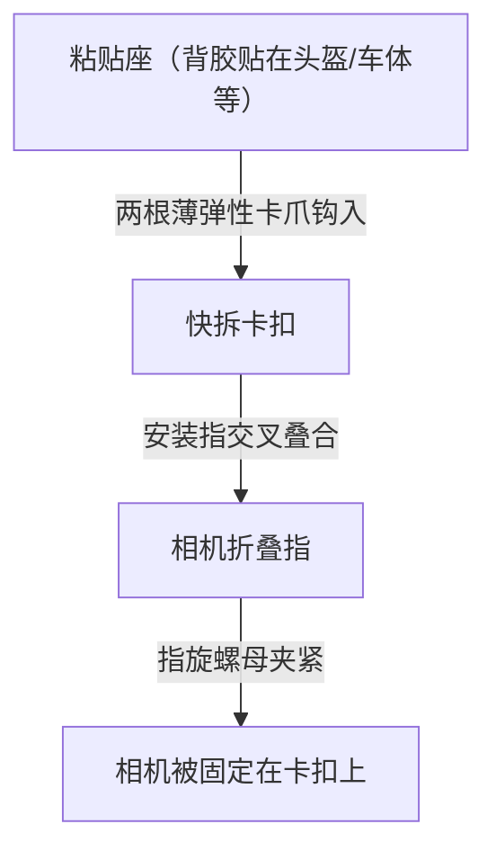

# GoPro 快拆卡扣与指旋螺母：两爪弹性卡入和螺钉夹紧是两套锁

> [!summary] 一句话概述
> GoPro 的安装接口其实是两套锁，不要混成一件事：一套是卡扣底部两根又薄又有弹性的卡爪，推入粘贴底座（或同类底座）卡住，用来在底座和卡扣之间快拆；另一套是相机（或卡扣）上的折叠安装指交叉叠好后，用指旋螺母穿过去夹紧。社区测量螺纹多为 M5×0.8，牙长大约 18–20 mm；官方规格两篇测量文都写「厂家没公布」。本篇写的是安装接口，不是机身防水，对照见 [[GoPro Hero4 Session 免外壳防水机身]]。

## 配图

![[附件/gopro-thumb-screw-in-mount.jpg]]
*图源：[actioncameras.tech: GoPro Thumb Screw](https://actioncameras.tech/gopro-thumb-screw/)；指旋螺母正穿进交叉叠好的安装指螺孔，下面是已卡在底座上的快拆卡扣（可见卡扣上的锁舌盖板）*

![[附件/gopro-thumb-screw-size.jpg]]
*图源：同上；长、短两种指旋螺母并排，对比牙长与头部长度*

![[附件/gopro-buckle-broken-claw.jpg]]
*图源：[UnderPowerMotors，2016-04-03](https://www.underpowermotors.com/entry/2016/04/03/134843)；左侧卡扣两爪完整，右侧左爪已折断——作者写这两根爪为了弹性做得很薄，是易损件*

> 图片版权归原作者所有，仅作个人学习收藏；出处见文末「来源与核实记录」。

## 结构原理

> 本节所有数字只写来源里给出的；来源没有就写「来源未给出」。

### 堆叠方案

方向：**从被粘贴的表面到相机（典型曲面粘贴座 + 快拆卡扣 + 相机）**

| 层级 | 零件 | 材料 | 厚度/尺寸 | 固定方式 | 依据 |
| --- | --- | --- | --- | --- | --- |
| L1（最外 / 被贴面） | 曲面（或平面）粘贴座 | 来源未给出 | 来源未给出 | 背胶，需提前至少 24 小时、干净干燥光滑表面 | HERO11 用户手册转载页「USING THE ADHESIVE MOUNTS」 |
| L2 | 快拆卡扣的两根弹性卡爪 | 塑料 | 来源只说「为了弹性特意做薄」，无尺寸 | 推入底座后钩住 | UnderPowerMotors |
| L3 | 卡扣本体 + 安装指（两片或成组的指，带螺孔） | 塑料 | 螺孔需通过 M5 或接近的 10-32 牙 | 与卡爪一体 | actioncameras 照片；手册：卡扣上的 mounting fingers |
| L4 | 相机上的折叠安装指 | 来源未给出（机身或框架上） | 来源未给出 | 先翻到安装位置，再与卡扣的指交叉叠合 | HERO11 手册「USING THE MOUNTING FINGERS」 |
| L5 | 指旋螺母（螺杆 + 头 + 常见的盖形螺母） | 螺杆金属；头多为黑色 ABS，售后有铝头 | 螺纹 M5×0.8（社区测量）；牙长常见 18–20 mm，建议不超过 20 mm | 穿过叠合的指后拧紧 | actioncameras；Storyteller 实测牙长 18.5–19 mm |

剖面示意：

这两套锁是串联的：卡爪管「卡扣 ↔ 底座」的快拆；螺母管「相机 ↔ 卡扣（或直接到带指的底座）」的夹紧。有的底座本身就带安装指、不需要卡扣（UnderPowerMotors：头带、滚笼等不附卡扣，因为连接部已经做在底座上）。

### 零件清单

| 零件 | 数量 | 功能 | 材料 | 依据 |
| --- | --- | --- | --- | --- |
| 粘贴座 | 1（典型包装） | 提供卡槽给卡扣 | 来源未给出 | HERO11 手册：Curved Adhesive Mount |
| 快拆卡扣 | 1 | 快拆连接底座，并提供安装指 | 塑料 | 手册；UnderPowerMotors |
| 弹性卡爪 | 2 | 钩住底座 | 薄截面塑料 | UnderPowerMotors |
| 折叠安装指（相机侧） | 来源未给出具体片数 | 与卡扣指交叉 | 来源未给出 | 手册 |
| 指旋螺母 | 1 | 夹紧交叉的指 | 金属牙 + ABS 头（原厂常见） | actioncameras |
| 盖形螺母 / O 形圈（售后套装常见） | 套装内常见 | 锁紧、防松 | 来源未给出 | actioncameras 推荐替换套装含 acorn nuts 与 O-rings |

### 装配顺序

按 HERO11 Black 用户手册转载页「USING THE MOUNTING FINGERS」：

1. 把相机上的折叠指翻到安装位置。
2. 与卡扣上的安装指交叉叠合。
3. 用指旋螺母把相机固定到卡扣上。
4. 再把卡扣装到底座上。

卡扣从底座上取下（UnderPowerMotors）：轻轻把两根爪的钩解开，不要把力集中在薄爪上硬掰。爪靠弹性锁住，不是靠摩擦力；如果插拔发涩，作者建议略喷硅油，而不是硬拔。

粘贴座（手册）：至少提前 24 小时粘；只贴光滑表面，不要贴多孔或带纹理的面；用力压实；表面要干净干燥，有蜡、油、灰尘会削弱粘结；在干燥、室温下粘，冷或湿的环境/表面贴不牢。

### 受力与运动分析

- **受力路径**：相机所受的振动、冲击和气动力，先由指旋螺母把交叉指夹成一叠来承担；再经卡扣传到两根卡爪，由卡爪钩在底座槽里；最后由背胶把底座留在附着面上。
- **运动关系**：指旋螺母松开后，相机可相对卡扣取下或改变指的叠合角度（来源未给出可调角度值）。卡爪解锁后，卡扣可从底座滑出。两套运动彼此独立。
- **失效风险**：薄爪易折，UnderPowerMotors 作者反复在左爪处断裂，怀疑自己总是左侧用力过大；原厂卡扣一度不单卖，坏了只能买配件包。ABS 螺母头长期紫外线和进水后会变脆（actioncameras）。牙太长（超过约 20 mm）会拧不到头，相机在座上晃甚至把指掰坏。M5 和 10-32 接近但不能混配（例如把 M5 拧进 10-32 盖形螺母）。把螺母装在电池仓门一侧会挡住开仓，换电池还得先拧下来。

## 设计要点与参数

| 要点 | 内容 | 依据 |
| --- | --- | --- |
| 螺纹规格（非官方） | 公制 M5×0.8；英制最接近 10-32（直径 3/16" = 4.76 mm，与 5 mm 接近但不同） | actioncameras；Storyteller 同样写 M5×0.8 / 10-32，并称官方未公布 |
| 牙长 | actioncameras：常见 18–20 mm，建议自制不超过 20 mm；Storyteller 自己的安装螺丝测得 18.5–19 mm，并提醒 20 mm 售后件要小心 | 两篇独立测量/对照文 |
| 头的材料 | 原厂常见黑色 ABS；长期 UV 和水会变脆，作者建议换成铝头 | actioncameras |
| 卡爪 | 2 根，靠弹性钩住；截面特意做薄，过载易折 | UnderPowerMotors |
| 粘贴等待 | 至少提前 24 小时 | HERO11 手册转载页 |
| 机身防水（对照，非本接口） | HERO11 在仓门锁好时防水到 33 ft（10 m） | 同一手册页「USING YOUR GOPRO IN + AROUND WATER」，与本接口不是同一结构 |

> GoPro 官方螺纹尺寸在已打开的手册转载页中未给出；上表螺纹和牙长都是社区测量，不是厂标。

## 优缺点

**优点**
- 把「天天拆相机」和「偶尔换底座」分成两套锁：螺母管夹紧，卡爪管快拆，不必每次都撕背胶
- 交叉指 + 一颗手拧螺钉，结构简单，第三方容易做兼容件
- 短、长螺母可以按是否挡手、是否挡电池仓来选

**缺点 / 代价**
- 快拆爪是消耗件，薄截面换来手感，也换来折断
- 螺纹没有公开厂标，M5 与 10-32 混用有乱牙风险
- 夹紧力全靠手拧（或扳手再半圈），振动场合需要 O 形圈或额外防松（actioncameras 的建议，不是官方规范）

## 可借鉴点

- **快拆和夹紧不要做在同一个弹性零件上**：GoPro 用薄爪只锁「座」，用螺钉锁「相机」。若让薄爪同时抗振动夹紧，断爪就是丢相机。
- **手拧螺钉要规定最大牙长**：太长拧不到头，等于没夹紧。社区经验是大约 18–20 mm 这一档，设计自己的兼容座时应用卡尺对实物复核，不要只抄一个名义 M5。
- **弹性卡爪要当易损件设计**：可单卖、截面不要为了手感再减到一掰就断；取下时力要作用在本体上，而不是撬钩尖。
- **螺钉布置要避开仓盖、接口和手指经常摸到的位置**。
- 接近但不相同的牙型（M5 与 10-32）禁止混配。

## 与库中相似案例对比

| 对比项 | 本案例 | [[GoPro Hero4 Session 免外壳防水机身]] | [[Framework Desktop 免工具面板与标准件模块化]] |
| --- | --- | --- | --- |
| 写的是什么 | 安装接口的两套锁 | 机身防水：O 形圈 + 胶粘外套 | 手拧螺丝、卡扣面板 |
| 快拆原理 | 两爪钩座 + 指旋螺母夹指 | 不涉及支架卡扣 | D 形拉环手拧螺丝 |
| 不能混为一谈的点 | 卡扣易折 ≠ 机身进水 | 防水做到了但内部只能破坏性拆开 | 标准件可替换 |

## 相关案例

- [[GoPro Hero4 Session 免外壳防水机身]]
- [[Framework Desktop 免工具面板与标准件模块化]]
- [[Mac Pro 2019 旋转把手外壳锁与免工具模块锁]]
- 分类索引：[[04-机构与运动 索引]]

## 来源与核实记录

- 主来源：[GoPro Thumb Screw – Resource Guide（actioncameras.tech）](https://actioncameras.tech/gopro-thumb-screw/)（Rob Johnston，页上日期 2022-06-16 / 更新 2022-10-24；M5×0.8、10-32 对照、牙长 18–20 mm、ABS 头变脆、勿混牙）
- 补充来源 1：[GoProのクイックリリースバックルだけは大事にしないといけない理由（UnderPowerMotors）](https://www.underpowermotors.com/entry/2016/04/03/134843)（2016-04-03；两爪钩住、薄截面易折、取下手法、部分底座不附卡扣）
- 补充来源 2：[GoPro Screw Size（Storyteller Tech）](https://storytellertech.com/gopro-screw-size/)（Bryan Haines，更新 2023-09-18；独立测得牙长 18.5–19 mm，同样写官方未公布规格）
- 补充来源 3：[GoPro HERO11 Black User Manual: Mounting Your GoPro](https://usermanual.com/support/gopro/web-manual/hero11-black/mounting-your-gopro)（用户手册转载；折叠指交叉、指旋螺母固定、再把卡扣装到座上；背胶 24 小时等。官方手册 PDF 本批未能直接下载，转载页内容按已打开文本引用）
- 核实：2026-11-17 打开上述页面。未把未打开的开源 CAD 尺寸当数据。
