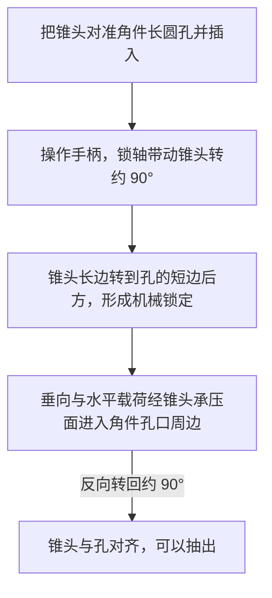

# ISO 集装箱角件扭锁：锁头插入椭圆孔后旋转约 90° 卡住

> [!summary] 一句话概述
> 集装箱扭锁的锁头（锥头）插入 ISO 角件上的长圆孔，再旋转约 90°，锁头的长边转到孔的短边后面，从而卡住，用于箱与箱、箱与车辆或甲板之间的连接。它和面板上的四分之一转快锁虽然都是「转大约 90° 锁住」，但这里对的是 ISO 1161 角件标准孔和大载荷锥头，不是按总材料厚度选钉长的凸轮钉。角件孔口尺寸以厂商按 ISO 1161 标注的图纸为准：顶、底面长圆孔约 101.5 mm × 63.5 mm。ISO 1161:2016 给角件规定了材料最低值和设计载荷（例如顶部角件扭锁起吊 195 kN）；NIST 对半自动扭锁与角件组装的拉伸试验表明，破坏往往发生在角件孔口而不在锁轴，组装最大试验载荷约 408–710 kN。

## 配图

![[附件/hz-twistlock-and-corner-castings.jpg]]
*图源：[HZ CONTAINERS「扭锁与角件」](https://hz-containers.com/zh/%E8%A8%8A%E6%81%AF/%E6%89%AD%E9%94%81%E4%B8%8E%E8%A7%92%E4%BB%B6/)（2026-04-23）。左为带上下锥头和手柄的扭锁，右为带长圆孔与侧面孔的角件实物照片*

![[附件/vandoorn-iso1161-corner-fitting.jpg]]
*图源：[Van Doorn Container Parts《Dimensions according the ISO 1161 norm》RVS 图样](https://www.containerparts.nl/wp-content/uploads/2020/09/RVS.pdf)（2020-11-09，材料 AISI 316，重量 11 kg，单位 mm）。顶角件（B）与底角件（A）的外形和孔口：顶、底面长圆孔长度 101.5 mm、宽度 63.5 mm，外形约 179±2 × 161±4 × 120±5*

![[附件/nist-semi-automatic-twistlocks.jpg]]
*图源：[NIST IR 6557](https://nvlpubs.nist.gov/nistpubs/Legacy/IR/nistir6557.pdf) Figure 3.1、3.2。半自动扭锁实物：上为 All Set Marine C5AM，下为 MacGregor-Conver CV-20/2；可见壳体、上下锥头和操作手柄/拉索。报告写半自动扭锁由带上下锥头的整根钢轴装在钢壳里，两锥头方位不同，以便分别进入上、下角件*

> 图片版权归原作者所有，仅作个人学习收藏；出处见文末「来源与核实记录」。

## 结构原理

> 本节所有数字只写来源里给出的；来源没有就写「来源未给出」。来自不同机构的外形和载荷不要互相换算或取平均。

### 堆叠方案

方向：**沿箱角垂直方向，从一个集装箱的底角件，经过扭锁，进入另一个集装箱的顶角件（或底盘/甲板支座）**

| 层级 | 零件 | 材料 | 厚度/尺寸 | 固定方式 | 依据 |
| --- | --- | --- | --- | --- | --- |
| L1（上箱） | 上箱底角件 | ISO 1161:2016：原材料屈服 275 MPa、抗拉 480 MPa 等，见参数表；Van Doorn 不锈钢图样为 AISI 316 | Van Doorn RVS 图：外形 179±2（长）× 161±4（宽）× 120±5（高），底面长圆孔 101.5 × 63.5 等。HZ 文写标准尺寸 178 × 162 × 118 mm、壁厚 10 mm——与 Van Doorn 公差带接近但不是同一组数，分开记录 | 焊在箱角立柱上（ISO 与 NIST 均把角件作为箱体连接点；焊缝细节来源未在本篇展开） | Van Doorn 图样；HZ；ISO 1161:2016 材料与强度条款 |
| L2 | 扭锁上锥头（lock head / cone） | 与锁轴一体或固定在轴端（NIST：上下锥头在同一根轴上） | 须能插入 101.5 × 63.5 的长圆孔，旋转约 90° 后卡在孔短边背后；具体锥头长宽来源在已打开的这几份里未给出完整公差表 | 插入上箱底角件孔后旋转锁定 | HZ：插入后旋转 90°；NIST：锥头转入角件，与内表面形成承压面 |
| L3 | 扭锁壳体与锁轴 | NIST：半自动扭锁是单件钢轴装在钢壳里；材料按试样，抗拉见试验表 | 锁轴直径来源未给出完整规格；NIST 做材料拉伸时把轴车到约 26 mm（1 in）取样，这是试样尺寸，不是产品公称直径 | 壳体坐在两只角件之间（或箱与底盘之间） | NIST 3.0、4.4 |
| L4 | 操作件（手柄、拉索或自动机构） | 来源未给出牌号 | 来源未给出力臂长度 | 把锁轴转约 90°；HZ 将类型分为手动、半自动、全自动 | HZ；NIST 照片中可见手柄或拉索 |
| L5（下箱或底盘） | 下箱顶角件，或底盘/甲板上的支座孔 | 同 L1 的角件要求 | 顶面同样是长圆孔 101.5 × 63.5（Van Doorn） | 下锥头插入后旋转锁定 | Van Doorn；HZ；NIST |
| L6 | 每个集装箱的其余角件 | 同上 | 每箱 8 个：顶 4、底 4（HZ；ISO 1161 规定左右对称的顶、底角件） | 焊于八角 | HZ；ISO 1161:2016 3.1.1 |

剖面示意：

独立来源对同一动作的表述：

- HZ CONTAINERS：锥形头部嵌入角件空心开口，操作员将手柄旋转 90°，销头从铸件开口处偏移，形成机械锁定，防止垂直、水平和横向移动。卸货时反向旋转，使销头重新对准开口再取出。
- NIST IR 6557：半自动扭锁的轴上有方位不同的上、下锥头，分别进入上、下角件。报告还指出：为了在试验里得到最大承压面，特制夹具把上、下锥头都转到与孔口成 90°；而实际使用中，自动锁入上角件的那个锥头旋转不到 90°，承压面小于这个最大值。
- 对照 [[Southco、DZUS 四分之一转快锁：90° 凸轮与按总材料厚度选钉长]]：都是约 90° 转位锁紧，但四分之一转快锁是面板凸轮钉按 TMT 选钉长，载荷在百牛顿到千牛顿量级的检修盖；本篇是集装箱角件标准孔与大载荷锥头，设计载荷以百千牛顿计。

### 零件清单

| 零件 | 数量 | 功能 | 材料 | 依据 |
| --- | --- | --- | --- | --- |
| 角件（顶/底，左/右镜像） | 每箱 8 | 起吊、堆叠、固定的标准接口 | ISO 最低机械性能见参数表；Van Doorn 不锈钢图样 AISI 316，重量 11 kg | ISO 1161:2016；Van Doorn；HZ |
| 扭锁锁轴与上下锥头 | 每只扭锁 1 根轴、两端锥头 | 插入并旋转后承压 | 锻钢或铸钢（NIST 对这类连接件的概括） | NIST |
| 扭锁壳体 | 每只 1 | 定位于两角件之间，约束轴的转动与对中 | 钢壳体（NIST 半自动扭锁） | NIST |
| 手柄 / 拉索 / 自动机构 | 按类型 | 把锥头转到锁定或打开位置 | 来源未给出 | HZ；NIST 照片 |
| 桥式夹具等其他绑扎件 | 按作业 | 与角件配合的其它锁具，本篇不展开 | 来源未给出 | HZ 提及桥式夹具 |

### 装配顺序

按 HZ 的操作步骤，加上 ISO/NIST 对孔与锥头配合的说明（不是某一码头的作业指导书）：

1. 确认角件孔口完好、未被压塌或过度磨损。尺寸依据以按 ISO 1161 标注的图纸为准（本篇用 Van Doorn 图：101.5 × 63.5 mm）。
2. 按作业选择手动、半自动或全自动扭锁（HZ 的分类）。半自动与全自动的具体触发几何，来源在已打开的这几份里没有给出可核对的毫米触发尺寸，本文不补写。
3. 把扭锁放入下箱顶角件或底盘支座（或按该型扭锁的安装方向）。吊具或起重机将上箱落下，使角件对准锥头，靠重力或人工引导插入。
4. 将手柄旋转约 90°（或由半自动/自动机构完成），使锥头与孔口错开并贴到角件内表面。HZ 写此时销头承受集装箱重量，防止各种形式的移动。
5. 吊装或运输前检查锁定位置。NIST 提醒：实际锁入角度若不到 90°，承压面会小于试验里转到直角时的最大值。
6. 解锁：反向旋转约 90°，使锥头与长圆孔重新对齐，再吊离或取出扭锁。

### 受力与运动分析

- **受力路径**：箱重、堆叠、绑扎和起吊载荷经角件孔口周边的承压面传到锥头，再进入锁轴和另一端角件。ISO 1161:2016 按 ISO 1496-1 和 ISO 3874 给出角件设计载荷，例如顶部角件用扭锁、钩或卸扣起吊为 195 kN，底部角件平支堆叠为 1200 kN，偏置堆叠为 942 kN 等，见参数表。NIST 在组装拉伸中观察到：破坏由角件孔口的永久变形和/或孔口周边剪切引起，锥头承压面较小会把力集中在孔边，锥头甚至会剪穿角件顶板；锁轴本身的抗拉往往高于这个组装薄弱点。
- **运动关系**：锁轴带动锥头在角件内腔旋转，工作行程约 90°。打开时锥头长边与长圆孔长边对齐，可以插入或抽出；锁紧时锥头转到孔短边后方。上下锥头方位不同（NIST），以便同时对入一只顶角件和一只底角件。
- **失效风险**：NIST 结论：连接的拉伸能力受「扭锁—角件组装」控制，而组装强度与锥头在角件上的承压面积密切相关。孔口被剪穿或严重变形后，锁轴可能连带承受弯矩而断裂。半自动扭锁若未转到位，承压面不足。HZ 文把单个扭锁的拉伸最小破断载荷说成通常约为 500 kN；这与 NIST 组装拉伸 408–710 kN 是不同口径（一个是该文的概括破断值，一个是带角件的试验最大载荷），不能当成同一指标，也不能用来「验证」或「修正」对方。ISO 预览中的 195 kN 是顶部角件扭锁起吊的设计载荷，更不能和破断试验值直接画等号。

## 设计要点与参数

下列数字全部按来源分开写，不合并、不换算。

| 要点 | 内容 | 依据 |
| --- | --- | --- |
| 动作 | 插入长圆孔后旋转约 90° 锁定，反向转回后取出 | HZ；NIST 亦以 90° 作为最大承压面对齐 |
| 孔口（Van Doorn 按 ISO 1161 标注） | 顶、底面长圆孔长度 101.5 mm，宽度 63.5 mm；图上还有 51、79.5、28.5、89、Ø124、R5/R10、6.5×45° 等局部尺寸 | Van Doorn RVS 与 Standard 图样 |
| 外形（Van Doorn 同一图样） | 179±2 mm、161±4 mm、120±5 mm；不锈钢图样材料 AISI 316，重量 11 kg，2020-11-09 | Van Doorn RVS |
| 外形（HZ 文，另一组数） | 标准尺寸 178 × 162 × 118 mm，厚度 10 mm 的高强度钢；每箱 8 个角件 | HZ 文中表格 |
| 角件材料最低值（ISO 1161:2016 预览） | Yield Strength 275 MPa；Tensile strength 480 Mpa（原文如此大小写）；Impact Energy at −20°C：27 KV (Joule)；at −40°C：21 KV (Joule)；Elongation 25%；Reduction of area 40%。铸件须热处理。预览把冲击单位写成 KV 并在括号注明 Joule，本文按原文照录，不改写 | ISO 1161:2016 预览第 4 章 |
| 设计载荷（ISO 1161:2016 预览，5.1） | 堆叠：顶角件偏置 942 kN；顶中间件偏置 423 kN；底角件平支 1200 kN；底中间件平支 560 kN；底角件偏置 942 kN。起吊：顶角件扭锁/钩/卸扣 195 kN；底角件吊索与水平成 30° 为 390 kN。纵向约束（两只底角件承力）300 kN（文中注 2 g × 1 R）。垂向约束 250 kN | ISO 1161:2016 预览 5.1.2–5.1.5 |
| 试验载荷举例（同预览 8.3，不是现场作业值） | 冲击试验 150 kN；绑扎杆试验 300 kN；误对中试验 150 kN（模拟 15 mm 半径扭锁头）；轨道固定试验 360 kN | ISO 1161:2016 预览 8.3.9–8.3.12 |
| NIST 锁轴单独拉伸 | 极限 562–802 kN（新件等，见表 5.1 范围叙述） | NIST 5.1 |
| NIST 扭锁+角件组装拉伸 | 扭锁组装 408–710 kN；闩锁（latch lock）100% 伸出 309 kN，76% 为 203 kN，57% 为 90 kN。破坏主要是角件孔口变形或剪切 | NIST 表 5.2 与 5.2 节 |
| NIST 组装压缩（开始失效/最大试验载荷） | 表 5.3：445–756 kN（各试样不同）；结论中写开始失灵约 445–756 kN | NIST 表 5.3 与结论 |
| NIST 轴材料抗拉强度 | 约 792–1065 MPa（表 5.4 范围） | NIST 5.4 |
| ISO 顶部角件起吊设计值（NIST 引用的当时版本） | NIST 引 ISO 1161 第四版（1984）：顶部角件按 150 kN 起吊载荷设计；并指出锁轴极限远大于该值。注意：2016 第五版预览中顶部扭锁起吊设计载荷为 195 kN，两版不要混用 | NIST 5.1；对照 ISO 1161:2016 预览 5.1.3 |
| HZ 文中的破断载荷说法 | 「拉伸最小破断载荷通常约为 500 kN——相当于承受超过 50 吨的重量」 | HZ，仅作为该文表述，不与 NIST 或 ISO 设计载荷对表 |

## 优缺点

**优点**
- 孔和头都按同一国际标准接口，不同厂家的箱和扭锁可以互换使用（ISO 1161 的存在理由；NIST 也写角件按该标准制造，各类连接器都能进入）
- 约 90° 转位就能锁住，作业快，不必在每个角拧大螺栓
- 上下锥头可以同时对入两只角件，适合堆叠和吊双箱
- 载荷路径清楚：锥头承压、角件孔口传力，标准和试验都围绕这个界面写

**缺点 / 代价**
- 真正的薄弱点常常是角件孔口而不是看起来更粗的锁轴，孔边磨损或扩孔后，锁头可能转不到承压面或「假锁」
- 实际锁入角度若不到 90°，承压面积下降，不能拿「转到直角」的试验值当现场能力
- 外形和载荷在不同文本里的数字不完全相同（178×162×118 与 179±2×161±4×120±5，500 kN 与 408–710 kN，150 kN 与 195 kN），选型必须回到对应年版的标准和该型扭锁的试验
- 半自动、全自动机构增加了未到位、未解锁就起吊的风险，公开资料里缺少可直接照抄的触发尺寸

## 可借鉴点

- **「转 90° 就锁住」要同时规定孔的长宽和头转到位后的承压面**：只有转角、没有孔口和承压面积，锁可能只是「手柄看起来已经转到锁位」。
- **试验要带上被连接件**：NIST 把轴单独拉和「轴+角件」一起拉，结论完全不同。做大载荷快锁时，夹具或框架往往比锁头先坏。
- **版本和口径不要混**：设计载荷、破断载荷、带框架的最大试验载荷是三件事；1984 版和 2016 版的起吊设计值也不一样。
- **和面板四分之一转快锁分清使用域**：轻载检修盖走 TMT 选钉长的凸轮钉；集装箱这种标准孔、大偏载，走角件孔口和锥头承压。
- 现场检查应看孔口是否被剪扩、锥头是否翻边，而不是只看手柄是否在「锁定」位置。

## 与库中相似案例对比

| 对比项 | 本案例 | [[Southco、DZUS 四分之一转快锁：90° 凸轮与按总材料厚度选钉长]] | [[Sony E 卡口：三爪、18 mm 法兰距与锁销磨损]] |
| --- | --- | --- | --- |
| 动作 | 锥头插入 ISO 长圆孔后转约 90° 卡住 | 凸轮钉转约 90°，爬搭扣斜面并落入凹坑 | 三爪旋转卡入机身卡口 |
| 接口 | ISO 1161 角件孔，约 101.5 × 63.5 mm | 按系列的搭扣孔，钉长由 TMT 决定 | 18 mm 法兰距的事实标准卡口 |
| 载荷量级 | 设计与试验以百千牛顿计 | 手册用 Medium/High 拉力档，须按系列试验 | 相机载荷，与集装箱不在同一量级 |
| 典型失效 | 角件孔口被剪扩或未转到承压面 | TMT 与钉长不配，或振动回转 | 锁销和爪的磨损、间隙 |

## 相关案例

- [[Southco、DZUS 四分之一转快锁：90° 凸轮与按总材料厚度选钉长]]
- [[Sony E 卡口：三爪、18 mm 法兰距与锁销磨损]]
- [[Arca-Swiss 38 mm 燕尾快装板：事实标准与跨品牌混用风险]]
- 分类索引：[[04-机构与运动 索引]]

## 来源与核实记录

- 主来源：[HZ CONTAINERS：扭锁与角件](https://hz-containers.com/zh/%E8%A8%8A%E6%81%AF/%E6%89%AD%E9%94%81%E4%B8%8E%E8%A7%92%E4%BB%B6/)（2026-04-23。约 90° 旋转锁定、操作步骤、手动/半自动/全自动分类、该文给出的 178 × 162 × 118 mm、10 mm 壁厚、每箱 8 个角件、约 500 kN 破断载荷表述。中文主来源）
- 补充来源 1：[Van Doorn Container Parts，RVS 图样「Dimensions according the ISO 1161 norm」](https://www.containerparts.nl/wp-content/uploads/2020/09/RVS.pdf)（2020-11-09，AISI 316，11 kg。孔口 101.5、63.5 及外形公差。另下载同系列 [Standard 碳钢图样](https://www.containerparts.nl/wp-content/uploads/2014/09/Standard.pdf) 核对孔口尺寸一致。独立厂商图纸）
- 补充来源 2：[ISO 1161:2016 预览 PDF](https://cdn.standards.iteh.ai/samples/65553/9cbe9363321542b3aa4511911f64d230/ISO-1161-2016.pdf)（第五版，2016-07-15。材料最低值、5.1 设计载荷、8.3 部分试验载荷。该预览 12 页未包含 Figures 1–4，因此官方孔口尺寸不以预览插图为准，只引用已印出的文字条款）
- 补充来源 3：[NIST IR 6557 Strength Evaluation of Connectors for Intermodal Containers](https://nvlpubs.nist.gov/nistpubs/Legacy/IR/nistir6557.pdf)（H. S. Lew, Fahim Sadek, Erik D. Anderson；2000。半自动扭锁结构、与角件的拉伸/压缩试验、破坏发生在孔口、表 5.1–5.4 的载荷与强度。独立政府试验报告）
- 核实：2026-11-22 用 curl 下载 Van Doorn 两份图纸、ISO 预览和 NIST PDF，并用 pdftotext / pdftoppm 抽文字和配图；WebFetch 打开 HZ 页面并下载实物照片。未把 containermaterial.com 一文中难以核对的现场统计当作参数来源。
