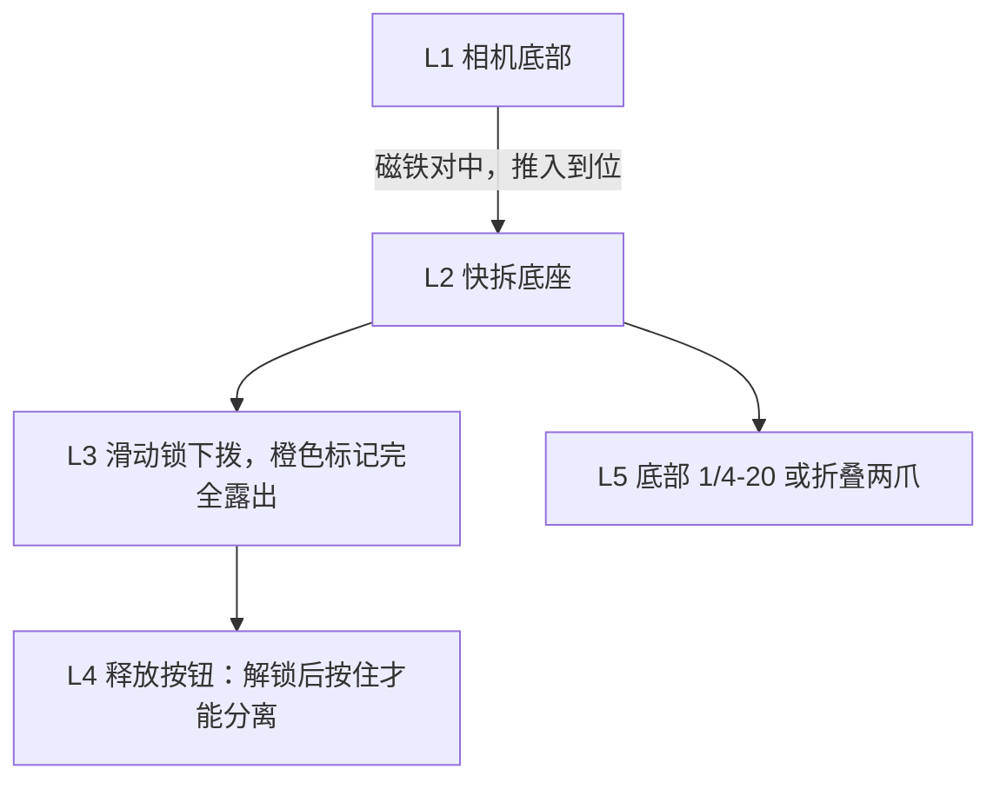

# Insta360 磁吸快拆配件 2.0：磁铁对中后由滑动锁承力

> [!summary] 一句话概述
> Insta360 磁吸快拆配件 2.0（CINSEAVP）用磁铁把底座吸到相机底部的正确位置，真正承力的是必须拨到位的滑动锁：橙色标记完全露出才算锁死；拆卸要先把滑锁拨回，再按住侧面释放按钮才能拉开。官网明确警告：不要在剧烈振动、高频冲击（如越野骑行）中使用，否则可能跌落损坏相机。

## 配图

![[附件/insta360-archisite-1.jpg]]
*图源：[Archisite インスタ360 クイックリリースマウント 2.0 产品页](https://archisite.co.jp/products/insta360/quick-release-mount-2/)；上方是带 1/4"-20 螺钉的相机快装板，下方是快拆底座：顶面有对接齿/磁吸面，侧面是带防滑的释放按钮，前方是带橙色指示的滑动锁，底部为可折叠两爪接口*

![[附件/insta360-archisite-2.jpg]]
*图源：同上 Archisite 产品页；快装板已装到底座上。滑动锁上的橙色块外露，对应说明书「下拨到锁定位置，确认橙色指示完全可见」；右侧为释放按钮。拆卸时须先把滑锁上拨到解锁位置，再按住释放按钮向外拉*

![[附件/insta360-qrm-hero.jpg]]
*图源：[Insta360 官方商城 磁吸快拆配件 2.0](https://store.insta360.com/cn/product/quick-release-mount-2) 页面主图；官方要点：新款磁吸快拆、1/4" 与两爪接口可切换、轻薄以在全景画面中隐形、锁定卡扣防误触，并警告勿用于剧烈振动场景*

> 图片版权归原作者所有，仅作个人学习收藏；出处见文末「来源与核实记录」。

## 结构原理

> 本节所有数字只写来源里给出的；来源没有就写「来源未给出」。

### 堆叠方案

方向：**从相机机身底部向下到自拍杆/配件**

| 层级 | 零件 | 材料 | 厚度/尺寸 | 固定方式 | 依据 |
| --- | --- | --- | --- | --- | --- |
| L1（相机） | 兼容机身底部接口 | 来源未给出机身材料 | 来源未给出接口尺寸 | 快拆底座推入到底，直到发出咔哒声（Archisite 使用方法） | Archisite；官网列出磁吸快拆 |
| L2 | 快拆底座（Quick Release Base） | 不锈钢、硅胶 | 40.8 × 20.8 × 13.5 mm；46.5 g（含该规格的产品） | 磁吸对位 + 滑动锁锁死 | Archisite 规格表；Action Cam Gear HQ 转述同一组官方规格 |
| L3 | 滑动锁与橙色指示 | 来源未单独给出 | 下拨为锁定，橙色标记须完全露出 | 滑槽内拨动 | Archisite 使用方法 |
| L4 | 释放按钮 | 来源未单独给出 | 位于底座侧面 | 解锁后须按住才能把底座从相机上拉开 | Archisite |
| L5 | 底部双接口：折叠两爪 + 1/4"-20 螺孔 | 来源未单独给出 | 可在两种接口间切换 | 连接到自拍杆、胸带或其它配件 | 官网；Archisite；Action Cam Gear HQ |
| L6（可选） | 相机快装板（带 1/4"-20 螺钉）+ 防滑垫圈 | 来源未单独给出 | 来源未给出板厚 | 螺钉固定到相机或通过快装板使用；防滑圈用于减少晃动 | Archisite 装箱：底座、快装板、手拧扳手、防滑垫圈 |

剖面示意：

Action Cam Gear HQ 把这一点写得很清楚：磁铁的任务不是在载荷下把相机吸住，而是快速对位；承力的是必须真正拨上的滑动安全锁。不要把本配件理解成「只靠磁铁挂相机」。

### 零件清单

| 零件 | 数量 | 功能 | 材料 | 依据 |
| --- | --- | --- | --- | --- |
| 快拆底座 CINSEAVP | 1 | 相机侧快拆，磁吸对位 + 滑动锁 | 不锈钢、硅胶 | Archisite；Action Cam Gear HQ |
| 滑动锁（带橙色指示） | 1 | 锁死，并提供可视锁定确认，防误触 | 来源未单独给出 | 官网「锁定卡扣，安全防误触」；Archisite 步骤 |
| 释放按钮 | 1 | 防止滑锁打开后底座仍被卡住或意外脱落；须按住才能分离 | 来源未单独给出 | Archisite |
| 相机快装板 | 1（带板套装） | 用 1/4"-20 螺钉连接到相机或兔笼 | 来源未给出 | Archisite 装箱；Action Cam Gear HQ 写官方套装含四件 |
| 手拧扳手、防滑垫圈 | 各有配置 | 安装螺钉；减少晃动或异响 | 来源未给出 | Archisite：若相机晃动，可在底座底部装两个防滑圈 |
| 折叠两爪与 1/4"-20 螺孔 | 一体在底座底部 | 接入 GoPro 风格两爪生态或三脚架螺纹 | 来源未给出 | 官网；Archisite |

型号对照（Action Cam Gear HQ）：现行 2.0 为 CINSEAVP；旧款 CINSAAVH 同为「磁吸对位 + 滑动锁」，但不兼容 X5，且授权渠道已停售。本篇只写 2.0。

### 装配顺序

按 Archisite 使用方法（X 系列与 Ace 系列步骤相同）：

1. 把快拆底座对准相机底部，推入直到发出咔哒声。
2. 把滑动锁拨到锁定位置，确认橙色指示完全可见，再轻轻回拉底座检查是否锁死。
3. 用底座底部的 1/4"-20 或两爪，连接到自拍杆、柔性粘贴支架或其它配件。
4. 拆卸：先把滑动锁拨回解锁位置，按住释放按钮，再把底座从相机上拉开。
5. 若出现晃动或异响，按说明在底座底部加防滑圈。

> 官网没有逐步配图，上述步骤来自 Archisite 产品页「使用方法」。Action Cam Gear HQ 对「先对位、再上锁」的机械逻辑与此一致。

### 受力与运动分析

- **受力路径**：相机重力、运动加速度经机身底部接口传到已锁死的滑动锁和底座壳体，再经 1/4"-20 或两爪传到杆/支架。磁铁只在推入阶段对中，不作为主承力件（Action Cam Gear HQ）。
- **运动关系**：安装时底座相对相机有轴向推入；滑动锁是沿底座一个方向的滑动自由度，有锁定/解锁两个位置。释放按钮是必须按住的第二道操作，避免滑锁被意外拨开后底座立刻掉落。底部两爪可折叠，与 1/4"-20 切换。
- **失效风险**：官网与 Archisite、Action Cam Gear HQ 都保留同一条安全边界：不要在剧烈振动、高频冲击（如公路或越野骑行）中使用，强振动和冲击可能导致配件失效、相机损坏。橙色标记未完全露出就当锁死，是误用风险（Archisite 要求确认标记并回拉检查）。只靠磁铁、不上滑动锁，会把承力路径丢掉（由结构直接推出，评测亦强调这一点）。

## 设计要点与参数

| 要点 | 内容 | 依据 |
| --- | --- | --- |
| 两级锁 | 磁吸对位 + 必须拨到位的滑动锁；锁是承力件 | Action Cam Gear HQ；官网「锁定卡扣」 |
| 可视锁定 | 滑动锁下拨，橙色指示须完全露出，并回拉检查 | Archisite 使用方法 |
| 双重操作才能拆 | 先解锁滑动锁，再按住释放按钮拉开 | Archisite |
| 尺寸与重量 | 40.8 × 20.8 × 13.5 mm，46.5 g | Archisite；Action Cam Gear HQ |
| 材料 | 不锈钢、硅胶 | Archisite；Action Cam Gear HQ |
| 底部接口 | 可切换 1/4"-20 与折叠两爪 | 官网；Archisite |
| 兼容（Archisite 列举） | X6、X5、X4 Air、Ace Pro 2、X4、Ace Pro、Ace、X3 等；官网页未在已打开正文中列全型号，兼容名单以已打开的 Archisite / Action Cam Gear HQ 为准 | Archisite；Action Cam Gear HQ 另列 Luna Ultra、ONE X2 等，本表不把未在已打开官方页核对的型号写成官网原文 |
| 安全边界 | 禁止剧烈振动、高频冲击如越野骑行 | 官网原文；Archisite 与评测转述 |
| 磁铁牌号、锁舌尺寸、保持力牛顿数 | 来源未给出 | — |

## 优缺点

**优点**
- 把对中和承力分开，避免「磁吸快拆」被理解成只靠磁力挂相机。
- 橙色标记是廉价但有效的锁定确认，比纯手感更不易误判。
- 拆卸需要「滑锁 + 按钮」两步，降低误触。
- 底部同时给出 1/4"-20 和两爪，能接到三脚架和大量运动相机配件，而不把相机侧接口做成开放标准。

**缺点 / 代价**
- 厂商自己把高振动骑行排除在外，不能当越野相机锁用。
- 相机侧接口是专有磁吸/锁面，不能直接接到 GoPro 机身（评测亦强调两套生态）。
- 官方中文页对尺寸和材料写得很少，设计复用时要查规格表或说明书，不能从广告语估计锁合力。

## 可借鉴点

- 磁铁只做「吸准」，锁做「承力」，并在锁上加一个必须露出的颜色标记。
- 高风险拆卸用两步操作：先开锁，再按释放键，避免一步到位的误开。
- 若产品有明确不适用的振动环境，把警告写在产品要点第一屏，而不是只藏在说明书末页。
- 底部用成熟的 1/4"-20 / 两爪对接生态，把专有部分限制在相机侧，减少配件重复开发。
- 对照 [[GoPro 快拆卡扣与指旋螺母：两爪弹性卡入和螺钉夹紧是两套锁]]：两爪是底座往下的接口，不是本篇的相机侧锁。

## 与库中相似案例对比

| 对比项 | 本案例（Insta360 2.0） | [[GoPro 快拆卡扣与指旋螺母：两爪弹性卡入和螺钉夹紧是两套锁]] | [[FIDLOCK V-BUCKLE：磁吸引导到位后再由机械扣锁死]] | [[Peak Design SlimLink：方形陶瓷凹槽磁吸预定位与弹簧卡舌硬锁]] |
| --- | --- | --- | --- | --- |
| 磁铁 | 对中，不承力 | 经典两爪方案无磁铁（本篇评测另提及 GoPro Magnetic Latch 是另一套，不作本篇主角） | 引导织带扣到位 | 预定位，硬锁时不主承力 |
| 机械锁 | 滑动锁 + 释放按钮 | 两爪弹性卡入，或指旋螺母夹紧 | 扣舌/盖板锁死 | 弹簧卡舌咬方形凹槽 |
| 适用边界 | 厂商禁止高振动骑行 | 运动相机通用底座，按具体配件而定 | 织带闭合 | 手机车把硬锁等 |
| 何时用这篇 | 相机底部专有磁吸+滑锁 | 要接到两爪或指旋生态本身 | 织带扣 | 手机板式快拆 |

## 相关案例

- [[GoPro 快拆卡扣与指旋螺母：两爪弹性卡入和螺钉夹紧是两套锁]]
- [[FIDLOCK V-BUCKLE：磁吸引导到位后再由机械扣锁死]]
- [[Arca-Swiss 38 mm 燕尾快装板：事实标准与跨品牌混用风险]]
- [[橱柜磁吸门吸：只有磁力保持、没有机械锁死（对照 FIDLOCK）]]
- 分类索引：[[04-机构与运动 索引]]

## 来源与核实记录

- 主来源：[Insta360 官方商城「磁吸快拆配件 2.0」](https://store.insta360.com/cn/product/quick-release-mount-2)（2026-11-26 重新打开中文页；确认官方品名含「磁吸」、锁定卡扣防误触，以及不可用于剧烈振动/越野骑行的警告。该页正文未列出完整尺寸表）
- 交叉来源：[Action Cam Gear HQ, Insta360 Quick Release Mounts Explained (2026)](https://actioncamgearhq.com/blog/insta360-quick-release-mounts-explained)（2026-09-09 发表，2026-09-20 更新；2026-11-26 重新打开。独立配件评测站点。磁铁对位、滑动锁承力、CINSEAVP 规格 40.8×20.8×13.5 mm / 46.5 g、高振动警告，均来自已打开全文）
- 规格与步骤补充：[Archisite クイックリリースマウント 2.0](https://archisite.co.jp/products/insta360/quick-release-mount-2/)（2026-11-26 重新打开；日本经销商产品页，给出 CINSEAVP、材料、尺寸、装箱和滑动锁/释放按钮步骤。经销商复述官方规格，不单独当作第二独立机构，只用于补全官网页未展开的说明书级步骤）
- 核实：已对照官方警告与评测、经销商页三者一致的安全边界。未把无磁的纯卡扣运动相机座写成磁吸，也未把 GoPro Magnetic Latch 另开成一篇。
