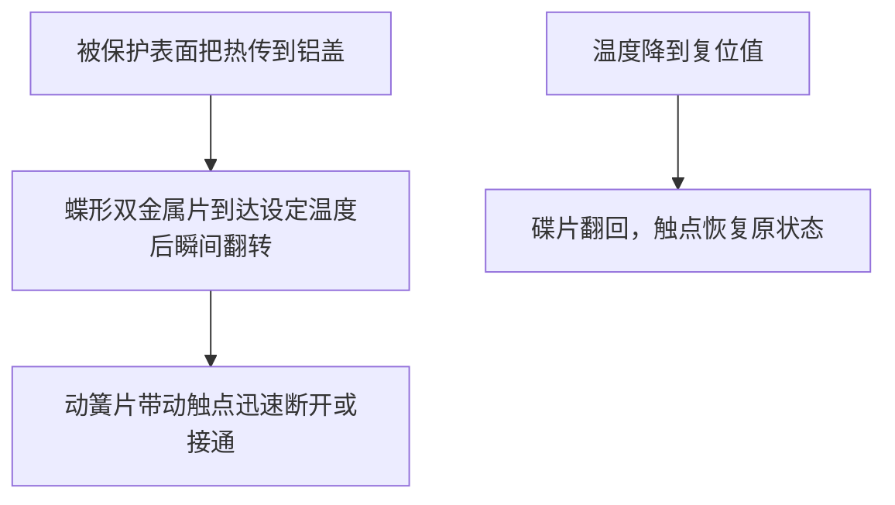

# KSD301 突跳式温控器：蝶形双金属片到位后瞬间切换触点

> [!summary] 一句话概述
> KSD301 把一片蝶形双金属片装在带铝盖的电木或陶瓷壳里：温度到达设定值时，碟片瞬间翻转到另一侧，带动动簧片使触点迅速断开或接通，冷却后再翻回。创华维规格书给出动作温度范围 −20～255 °C，额定电流 5 / 8 / 10 / 15 / 16 A，电气寿命在额定功率、功率因数 0.8 下动作 10000 次后，温度变化应在初始值的 ±7 °C 以内。它不是电子探头加继电器，也不是缓慢弯曲、触点慢慢分开的非突跳双金属条。

## 配图

![[附件/ksd-chuanghuawei-structure.png]]
*图源：[深圳市创华维科技《KSD301 302 系列温控器技术规格书》](https://dfsimg2.hqewimg.com/group5/M00/00/C9/wKhk3WJ-HDqABsILAASACtyqrvA451.pdf)「外形和结构」页*

![[附件/ksd-chuanghuawei-spec.png]]
*图源：同上，性能页；额定电流、动作温度范围、端子规格和自动/手动复位分档*

![[附件/ksd-bimetal-02.jpg]]
*图源：[bimetalfuse，《Bimetallic KSD series temperature control switch structure and components》，2019-12-29](https://www.bimetalfuse.com/Bimetallic_KSD_series_temperature_control_switch_structure_and_components.html)；KSD301 结构零件分解配图*

![[附件/ksd-hcet-03.jpg]]
*图源：[海川温控 KSD301 系列产品页](https://www.hcet.cn/products/ksd3016597.html)；产品实物照片，仅作外观对照，参数以创华维规格书为准*

> 图片版权归原作者所有，仅作个人学习收藏；出处见文末「来源与核实记录」。

## 结构原理

> 本节所有数字只写来源里给出的；来源没有就写「来源未给出」。

### 堆叠方案

方向：**从受热面（铝盖）到接线端子**

| 层级 | 零件 | 材料 | 厚度/尺寸 | 固定方式 | 依据 |
| --- | --- | --- | --- | --- | --- |
| L1（受热面） | 铝盖 | 铝（bimetalfuse） | 来源未给出厚度 | 盖在壳体上，起传热和保护作用 | bimetalfuse |
| L2 | 蝶形双金属片 | 双金属，具体牌号来源未给出 | 来源未给出直径和料厚 | 温度到位时瞬间翻转 | 创华维；bimetalfuse |
| L3 | 动簧片与动/静触点 | 来源未给出牌号 | 来源未给出触点直径 | 铆接在壳内，随碟片翻转而通断 | bimetalfuse |
| L4 | 壳体 | 电木或陶瓷（KSD301） | 来源未给出外形公差，见规格书外形图 | 容纳内部零件 | 创华维；bimetalfuse |
| L5 | 端子 | 创华维：187#（4.8 mm）、250#（6.3 mm）或 2.8 mm；平、弯或 45° 斜端子 | 宽度见上 | 铆接引出 | 创华维；bimetalfuse 亦写 6.3 mm、4.8 mm |

剖面示意：

创华维把常闭型定义为温度上升触点断开、下降接通；常开型相反。另有自动复位和手动复位两种。复位温度按规格书写为「动作温度减 10 °C～100 °C」，具体差值按订货，不在本文估算。

### 零件清单

| 零件 | 数量 | 功能 | 材料 | 依据 |
| --- | --- | --- | --- | --- |
| 壳体 | 1 | 绝缘支撑、确定安装姿态 | 电木或陶瓷 | 创华维；bimetalfuse |
| 铝盖 | 1 | 传热并保护碟片 | 铝 | bimetalfuse |
| 蝶形双金属片 | 1 | 感温并突跳 | 双金属 | 创华维；bimetalfuse |
| 动簧片、动触点、静触点、铆钉 | 各来源未给出更细数量 | 执行通断 | 来源未给出 | bimetalfuse |
| 端子 | 通常 2 个（规格书未写死数量，给出宽度分档） | 接线 | 来源未给出牌号 | 创华维 |

### 装配顺序

来源没有给出工厂装配步骤，只有安装注意事项（创华维）：

1. 产品应与被保护部件有效紧密接触，或直接面向升温敏感区。
2. 安装时防止外壳变形或损坏，不允许用尖锐工具或重力抵压、锤压。
3. 用电弧焊接连线时，焊接电流不得通过本产品触点。
4. 断开温度检测的升温速率应控制为 1 °C/min（试验条件）。
5. 使用中不能承受强烈冲击和压迫；避免强酸强碱、灰尘、硫磺、硅及其他腐蚀氧化环境，也避免过湿导致电弧。

### 受力与运动分析

- **受力路径**：热流经铝盖传到蝶形双金属片 → 碟片内部热应力在设定点失稳翻转 → 推动动簧片改变触点压力，完成通断。创华维强调「动作干脆、不拉弧」，指的是突跳而不是触点慢慢拉开。
- **运动关系**：碟片在两个几何稳态之间跳跃，温度回到复位窗口后再跳回。手动复位型在规格书中单列，复位方式的具体按钮结构该规格书未展开，来源未给出内部杠杆尺寸。
- **失效风险**：外壳被敲变形会改变碟片预加载，动作温度漂移（创华维禁止锤压）。焊接电流经过触点会破坏触点（创华维）。寿命试验要求 10000 次后动作温度仍在初始值 ±7 °C 以内，超出这个窗口应视为超差，而不是把 10000 次当成可以随便过载的次数。

## 设计要点与参数

以下为创华维规格书数值。

| 要点 | 内容 | 依据 |
| --- | --- | --- |
| 额定电流 | 5 A、8 A、10 A、15 A、16 A | 创华维 |
| 电压 | 12 V / 24 V DC，110 / 250 V AC；最大承受电压 380 V | 创华维 |
| 动作温度 | −20 °C～255 °C，分档见规格书列表 | 创华维 |
| 复位温度 | 动作温度减 10 °C～100 °C | 创华维 |
| 动作精度 | ±2、±3、±4、±5、±8、±10 °C 可选 | 创华维 |
| 接触电阻 | ≤80 mΩ | 创华维 |
| 绝缘电阻 | ≥100 MΩ | 创华维 |
| 耐压 | AC 50 Hz 2500 V、1 min，带电金属与非带电部件之间无闪络、无击穿 | 创华维 |
| 寿命试验 | 额定功率、功率因数 0.8，外部热源动作 10000 次，温度变化应在初始值 ±7 °C 以内 | 创华维 |
| 端子 | 187# 4.8 mm、250# 6.3 mm、2.8 mm；平 / 弯 / 45° | 创华维 |
| 壳体与复位 | 电木或陶瓷；自动或手动 | 创华维 |
| 试验升温速率 | 1 °C/min | 创华维 |
| 保存温度 | −10 °C–40 °C；包装相对湿度不大于 90% | 创华维 |

## 优缺点

**优点**
- 不用电路也能在设定温度突跳通断，结构简单，适合电热器具的超温保护或定温控制
- 规格书把电流、温度窗口、精度和 10000 次后的漂移写全，便于写进零件图
- 端子和壳体分档清楚，可按安装空间选电木或陶瓷、平端子或弯端子

**缺点 / 代价**
- 必须贴紧热源，安装变形就会跑温度
- 精度以 ±2 °C 到 ±10 °C 分档，做不到电子温控那种细调节
- 手动复位的内部机构本规格书没有拆开画，不能只凭「有手动复位」去设计复位按钮行程

## 可借鉴点

- 把铝盖所在面当作传热面来设计压紧和导热硅脂或弹性压片，不要只靠周围空气加热。
- 在零件图上同时写动作温度、复位窗口和精度档，不要只写一个「大约 85 度」。
- 装配禁令要进作业指导书：不准锤外壳，不准拿温控器当焊接回路的一部分。
- 需要更精细的温度控制，改用传感器加电路，不要把 KSD 当成可调PID。

## 与库中相似案例对比

| 对比项 | 本案例（KSD301 突跳温控） | [[机械式膜片与活塞压力开关：预紧弹簧设定动作点并触发微动开关]] | [[磁浮子液位开关：浮子内磁铁与管内簧管磁耦合]] | [[轻触开关壳体封装金属弹片：盖板、推杆与锅仔片反转导通（以 Omron B3F 为例）]] |
| --- | --- | --- | --- | --- |
| 触发量 | 温度使蝶形双金属片翻转 | 压力克服设定弹簧后推微动 | 液位带动磁铁接近干簧管 | 手指按压力使金属弹片翻转 |
| 执行件 | 碟片直接带动触点 | 膜片或活塞 + 单独的微动开关 | 簧管触点 | 封装锅仔片 |
| 何时用这篇 | 要为电热器具选定温突跳保护 | 要做压力设定开关 | 要做液位开关 | 要做按键，不是温控 |

## 相关案例

- [[机械式膜片与活塞压力开关：预紧弹簧设定动作点并触发微动开关]]
- [[轻触开关壳体封装金属弹片：盖板、推杆与锅仔片反转导通（以 Omron B3F 为例）]]
- 分类索引：[[04-机构与运动 索引]]

## 来源与核实记录

- 主来源：[深圳市创华维科技有限公司，《KSD301 302 系列温控器技术规格书》](https://dfsimg2.hqewimg.com/group5/M00/00/C9/wKhk3WJ-HDqABsILAASACtyqrvA451.pdf)（2026-11-27 下载并提取「外形和结构」与性能页。电流、温度、寿命、绝缘、端子和安装禁令来自该 PDF。规格书中的编制人员姓名与公司地址电话不写入正文。）
- 交叉来源：[bimetalfuse，《Bimetallic KSD series temperature control switch structure and components》，2019-12-29](https://www.bimetalfuse.com/Bimetallic_KSD_series_temperature_control_switch_structure_and_components.html)（2026-11-27 打开。独立第二机构。KSD301 的电木/陶瓷壳、铝盖、端子、触点、铆钉、静触点、动簧片和双金属片分解来自该页。）
- 交叉来源：[海川温控 KSD301 系列产品页](https://www.hcet.cn/products/ksd3016597.html)（2026-11-27 打开并下载产品照片，仅作外观对照。）
- 核实：2026-11-27 打开上述来源。数码之家拆解帖已打开正文，但配图下载到的是站点脚本而不是照片，故不把该帖图片写入本篇。未编造双金属层的合金牌号。
