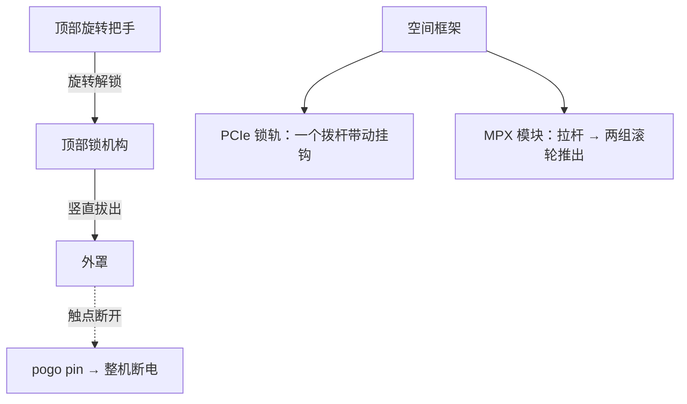

# Mac Pro 2019 旋转把手外壳锁与免工具模块锁

> [!summary] 一句话概述
> 2019 款 Mac Pro 顶部第三个把手是外罩的锁：旋转把手后直接向上拔，整个外罩滑出，没有螺丝和胶；外罩一拿掉，电源键下的 pogo pin 与外罩上的触点断开，整机断电（安全互锁）。机内再用「一个拨杆锁住全部 PCIe 卡」「拉杆带两组滚轮推出 MPX 模块」等免工具锁扣，iFixit 给出 9/10 可维修分。

> [!note] 与已收录案例的区别
> [[PS5 免工具侧板与 DualSense 隐藏螺丝]] 靠侧板滑出 + 卡扣；本篇是**旋转锁 + 整罩竖直拔出 + 电气互锁**，以及一个拨杆同时锁多张板卡的「联动锁轨」，属于锁扣与快拆机构。

## 配图

![[附件/macpro-2019-twist-handle.jpg]]
*图源：iFixit Mac Pro 2019 Teardown Step 4；旋转顶部把手（把手上有指示圆点）*

![[附件/macpro-2019-lock-mechanism.jpg]]
*图源：同上 Step 5；外罩取下后看到的顶部锁机构*

![[附件/macpro-2019-pogo-pins.jpg]]
*图源：同上 Step 5；电源键下的 pogo pin，对应外罩上的触点*

> 图片版权归原作者所有，仅作个人学习收藏；出处见文末「来源与核实记录」。

## 结构原理

> 本节数字只写来源里给出的；来源没有就写「来源未给出」。

### 堆叠方案

方向：**从外到内**

| 层级 | 零件 | 材料 | 厚度/尺寸 | 固定方式 | 依据 |
| --- | --- | --- | --- | --- | --- |
| L1 | 外罩（含「刨丝器」孔面） | 来源未写明具体零件材料（外观提到不锈钢与精铣铝板） | 来源未给出 | 由顶部旋转锁锁定，竖直滑出；无螺丝无胶 | Step 2、4、5 |
| L2 | 顶部旋转把手 + 锁机构 | 来源未写明 | 旋转角度来源未给出 | 旋转解锁 | Step 2、4、5 |
| L3 | pogo pin（电源键下）↔ 外罩触点 | — | 来源未给出 | 弹簧针压接 | Step 5 |
| L4 | 空间框架 + 4 个脚（每个 1 颗 M5×0.8 螺丝，螺丝在框架内为防丢） | 来源未给出 | 螺丝露出底部铝板约 4–4.5 mm，长度估计 15–20 mm | 螺丝 | Step 7 |
| L5 | I/O 板、显卡模块、电源（同一侧取出） | — | — | 手拧十字螺丝 / 一个拨杆锁轨 / 单颗 T8 | Step 8、9 |
| L6 | 三风扇组 | — | — | 6 颗螺丝，与主板用弹簧触点连接 | Step 12 |

剖面示意：

### 零件清单

| 零件 | 数量 | 功能 | 材料 | 依据 |
| --- | --- | --- | --- | --- |
| 顶部旋转把手 | 1 | 外罩锁 + 提手 | 来源未写明 | Step 2、4 |
| 外罩 | 1 | 外壳 | 来源未写明 | Step 4、5 |
| pogo pin + 外罩触点 | 来源未给出 | 外罩在位检测/断电互锁 | — | Step 5 |
| PCIe 锁定拨杆 + 带小挂钩的锁轨 | 1 套 | 一次锁住全部 PCIe 卡（机身标「第 2 步」） | — | Step 8 |
| MPX 显卡模块释放拉杆 + 两组滚轮 | 1 套/模块 | 同时脱开插槽并把模块推离主板 | — | Step 10 |
| 内存盖拨扣 | 来源未给出 | 免工具打开内存盖，盖内印有插法示意 | — | Step 6 |
| 脚螺丝 M5×0.8 | 4 | 固定脚/轮，螺丝防丢 | — | Step 7 |

### 装配顺序

按拆解顺序反推（外罩部分）：
1. 外罩从上方套入框架。
2. 旋转顶部把手锁定外罩。
3. 外罩触点压住 pogo pin，整机才能通电。

### 受力与运动分析

- **受力路径**：整机提起时载荷走把手 → 空间框架（推断：来源称有两个主把手，第三个在顶部）。外罩只受自重和外部碰撞，靠顶部锁与框架定位。
- **运动关系**：把手绕竖直轴旋转解锁 → 外罩沿竖直方向滑出（单自由度）；PCIe 拨杆平移锁轨，挂钩同时卡住所有板卡；MPX 拉杆通过滚轮把「拔出」动作转为两点同步推离。
- **失效风险**：来源未给出。外罩可无工具打开，靠 pogo pin 互锁保证开盖断电。

## 设计要点与参数

| 要点 | 内容 | 依据 |
| --- | --- | --- |
| 开盖方式 | 旋转 + 上拔，全程徒手，无专有螺丝、无胶 | Step 4、5 |
| 安全互锁 | pogo pin 与外罩触点，外罩离开即断电 | Step 5 |
| 一锁多卡 | 单个拨杆驱动带挂钩锁轨锁住所有 PCIe 卡 | Step 8 |
| 模块弹出 | 拉杆联动两组滚轮，同时脱开并推出模块 | Step 10 |
| 操作顺序标注 | 机内印有步骤编号、内存盖内印插法图 | Step 6、9 |
| 脚螺丝 | M5×0.8，防丢；长度 iFixit 估计 15–20 mm | Step 7 |
| 可维修评分 | 9/10 | Step 18 |
| 锁的内部结构、旋转角度、锁紧力 | 来源未给出 | — |

## 优缺点

**优点**
- 维修/升级入口零工具，开盖动作直观（旋转—上拔）
- 开盖自动断电，把「免工具」带来的安全风险用互锁解决
- 一个拨杆锁多张卡，减少螺丝数量与操作步骤

**缺点 / 代价**
- 外罩需要整罩取下，占用上方空间（推断）
- SSD 虽模块化但与 T2 芯片绑定，用户无法自行更换（Step 11）

## 可借鉴点

- 免工具外壳 + 电气互锁（pogo pin / 微动开关）是一对：方便打开，就要保证开盖即断电
- 多个同类模块用「一根联动锁轨」统一锁定，而不是每个模块一颗螺丝
- 大模块拔出用杠杆 + 滚轮同步推离，避免单边受力别坏连接器
- 在机内直接标出拆装顺序编号

## 相关案例

- [[PS5 免工具侧板与 DualSense 隐藏螺丝]]
- [[Framework 笔记本模块化扩展卡与磁吸边框]]
- [[苹果 AirTag 旋转后盖与内部卡扣]]（同为旋转解锁）
- 分类索引：[[04-机构与运动 索引]]

## 来源与核实记录

- 主来源：[Mac Pro 2019 Teardown](https://www.ifixit.com/Teardown/Mac+Pro+2019+Teardown/128922)（iFixit 官方拆解，Jeff Suovanen，发布于 2019-12-17）
- 核实：2026-11-13 通过 iFixit API 读取全部 18 步原文，核对把手、锁、pogo pin、PCIe 锁轨、MPX 拉杆、脚螺丝和评分。
