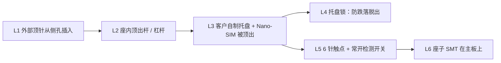

# Nano-SIM 针顶出托盘（Pin-eject）：外部顶针把客户自制托盘顶出

> [!summary] 一句话概述
> Nano-SIM 的针顶出（Pin-eject / Push-Eject）卡座不是心形槽推推机构：用户把顶针插入壳体侧孔，推动座内的顶出杆/杠杆，把**托盘**顶出；托盘常常由客户按手机外观自制，座子负责触点、检测开关和顶出机构。JAE SF70：高 1.25 mm、宽 13.3 mm、长 14.8 mm，6 针，0.5 A / 10 V，插拔寿命最多 5,000 次，检测开关为常开，并有防跌落的托盘锁。对照已收录的 SD/microSD 推推卡座：那是心形槽滑块、卡片自己当撞销；本篇不要写成 JAE SF72 那种推推式 SIM 座。

## 配图

![[附件/jae-sf70-datasheet.jpg]]
*图源：[JAE SF70S006VBAR2000 数据表](https://resources.ampheo.com/static/datasheets/jae-electronics/sf70s006vbar2000.pdf)（经 Ampheo 转存的 JAE 图纸，2026-11-21 GET 为 PDF）；给出 SF70 外形、焊盘和包装相关视图。具体尺寸以图纸为准，不从图上估读新闻未写出的细部。*

![[附件/molex-504520-pin-eject.jpg]]
*图源：[Molex 504520-0691 产品信息单](https://xonstorage.z8.web.core.windows.net/pdf/molex_5045200691_apr22_xonlink.pdf)（生成日期 2019-12-06）；nano-SIM、Pin-Eject Type、Tray Capable。页面两次写明 “Tray is customer sourced.”（托盘由客户提供）。6 回路、检测开关 Open、耐久 2000 次、顶出侧为 Left、节距 1.00 mm、SMT。*

> 图片版权归原作者所有，仅作个人学习收藏；出处见文末「来源与核实记录」。JAE 新闻配图在 jae.com 上返回 403，故改用已打开的数据表页。

## 结构原理

> 高度、外形、寿命等只写打开资料中的型号值。JAE 新闻与 SF70 数据表是同一公司，算一个来源加补充；独立第二来源是 Molex 504520。

### 堆叠方案

方向：**从设备外侧的顶针孔，到托盘，再到卡座触点。以 JAE SF70 为主，Molex 作对照。**

| 层级 | 零件/区域 | 材料 | 厚度/尺寸 | 固定方式 | 依据 |
| --- | --- | --- | --- | --- | --- |
| L1 | 设备侧墙与顶针孔 | 壳体（客户设计） | 来源未给出针孔直径 | 外部顶针由此插入 | JAE 新闻（侧面设置、可自行设计托盘） |
| L2 | 顶出杆 / 顶出杠杆 | SF70：Eject-Bar、Eject-Lever 为不锈钢 | 来源未给出行程毫米数 | 被顶针推动，把托盘向外顶 | JAE 新闻材料表 |
| L3 | 托盘（常为客户自制） | 客户件；座子提供锁与导向 | 要与座子的防误插和托盘锁配合 | 托盘带着 Nano-SIM 滑入滑出 | JAE 新闻；Molex “Tray is customer sourced.” |
| L4 | 托盘锁 | JAE 称“独特的锁构造，防跌落” | 来源未给锁紧力 | 防止跌落时 SIM 从托盘脱落 | JAE 新闻 |
| L5 | 信号触点 + 检测开关 | 铜合金，接触部镍上镀金；检测开关常开（Normal Open / Open） | SF70 与 Molex 均为 6 PIN | SMT 到主板上；卡/托盘到位后导通检测 | JAE 新闻；Molex |
| L6 | 壳体与盖框 | 合成树脂 + 不锈钢盖框 | SF70 外形 1.25 × 13.3 × 14.8 mm（高×宽×长），面积 196.8 mm² | SMT；新闻称贴片后可目视检查端子焊接部 | JAE 新闻 |

剖面示意：

与推推式的关键差别：没有心形槽、不是按一下卡片/托盘再弹出来；动力来自外部顶针。JAE 另有 SF72 推推式（弹出量 3.9 mm），本篇只把它当作对照，不作为主角。

### 零件清单

| 零件 | 数量 | 功能 | 材料 | 依据 |
| --- | --- | --- | --- | --- |
| 针顶出 Nano-SIM 卡座（如 SF70 或 Molex 504520） | 1 | 触点、检测、顶出机构、托盘导向与锁 | 见上表 | JAE、Molex |
| 托盘 | 1 | 承载 SIM，决定外观侧缝和推入手感 | 客户自制（两源都按这个前提） | JAE、Molex |
| Nano-SIM（4FF） | 1 | 用户卡 | 标准卡 | JAE 新闻 |
| 顶针（用户工具） | 1 | 从壳外把托盘顶出 | 来源未给规格 | 结构需要 |

### 装配顺序

1. 卡座 SMT 到主板（两源都是表面贴装；SF70 新闻强调可目视检查焊点，并支持压纹编带自动贴片）。
2. 整机装配时预留侧孔，并保证顶针、顶出杆、托盘在一条运动线上（推断：来源未给孔位公差，但机构如此）。
3. 将客户托盘（已装或未装 SIM）插入座中，直到托盘锁扣住、检测开关动作。
4. 取卡：从侧孔插入顶针，推动顶出杆，锁释放，托盘被顶出一段，再手抽出。不要按推推卡座的“再按一下弹出”来设计。

### 受力与运动分析

- **受力路径**：顶针力 → 顶出杆/杠杆 → 克服托盘锁 → 托盘向外移动。插入时则是手推力克服锁的倒钩或弹力，把托盘推到位；触点靠自身弹力压在 SIM 金手指上。
- **运动关系**：托盘相对座子是直线抽拉；顶出杆是被顶针驱动的中间件。SIM 相对托盘还应被锁住，否则跌落时卡先飞出（JAE 特别强调这一点）。
- **失效风险**：托盘是客户件，尺寸或锁配合稍差就会出现插不到底、检测开关不亮、或跌落掉卡。顶针孔与座子不对齐会顶弯杆。寿命按型号：SF70 最多 5,000 次，Molex 504520-0691 为 2000 次，不能混用。

## 设计要点与参数

| 要点 | 内容 | 依据 |
| --- | --- | --- |
| JAE SF70 外形 | 高 1.25 mm，宽 13.3 mm，长 14.8 mm，面积 196.8 mm²；新闻称为该类型中最薄、面积最小（发布当时的表述） | JAE 新闻 |
| SF70 电气 | 6 PIN；0.5 A/端子；10 V/端子；接触电阻 100 mΩ 以下；耐电压 AC 500 V r.m.s. 1 分钟以下 | JAE 新闻 |
| SF70 环境与寿命 | −25 °C～+85 °C；插拔寿命最多 5,000 次 | JAE 新闻 |
| SF70 功能 | 防误插；检测开关 Normal Open；托盘锁防跌落；多点定位柱与强化接地以改善 EMI | JAE 新闻 |
| SF70 材料 | 信号触点与检测触点：铜合金，接触部镍上镀金，接线部镍上闪镀；Housing 合成树脂；Cover Frame 不锈钢（接线部闪镀）；Eject-Lever、Eject-Bar 不锈钢 | JAE 新闻 |
| Molex 504520-0691 | Pin-Eject，Tray Capable；**托盘由客户提供**；6 回路；检测开关 Open；前插；耐久 2000 次；顶出在左侧（Ejector Button Side: Left）；节距 1.00 mm；铜合金触点，配合面镀金覆镍；LCP 树脂；不锈钢外壳；净重 364.710 mg；SMT；−25 至 +85 °C；0.5 A，10 V AC(RMS)/DC | Molex 信息单（2019-12-06） |
| 对照：不要写成主角的 SF72 | 推推式；1.25×11.2×14.3 mm；SIM 弹出 3.9 mm；同样 6 PIN、0.5 A、5,000 次。机构是 Push-Push，不是针顶出 | JAE 新闻 |

## 优缺点

**优点**
- 侧面针顶出适合把卡座放在机身最薄的侧区，外观只留一个针孔
- 托盘可由结构自定义（颜色、强度、止挡、防水唇边），座子复用
- 有检测开关和防误插，SF70 还强调跌落时卡不脱离托盘

**缺点 / 代价**
- 必须设计顶针孔、托盘和锁的整条尺寸链，责任在整机而不全在连接器厂
- 用户要带顶针，应急体验不如推推
- 不同厂家寿命和外形并不通用（5000 次 vs 2000 次）
- 打开的 Molex 信息单没有给出与 SF70 同等详细的外形毫米数，选 Molex 时还要另下正式图纸

## 可借鉴点

- 方案阶段先定机构类型：**针顶出还是推推**，不要用推推卡座的心形槽行程去画针顶出托盘
- 把托盘当成结构件出图：导向、锁量、防掉卡、与侧孔/按键的间隙，都写在整机图上；连接器规格书往往只保证座子
- 检测开关常开/常闭、顶出在左还是右，必须和 PCB 与壳体侧别一起锁
- 寿命按具体型号写进可靠度清单，不要写“SIM 座都是 5000 次”
- 对照已有推推卡座笔记，避免把 SF72 的 3.9 mm 弹出量抄到本结构

## 与库中相似案例对比

| 对比项 | 本案例（Nano-SIM 针顶出托盘） | [[SD 与 microSD 推推式卡座：心形槽滑块与卡片当撞销]] |
| --- | --- | --- |
| 解锁动力 | 外部顶针推动座内顶出杆 | 再按一下，走心形槽 |
| 撞销/被推对象 | 托盘（常由客户自制） | 卡本身常当撞销 |
| 侧面外观 | 一个顶针孔 | 卡口外露或留按入空间 |
| 主角型号例子 | JAE SF70；Molex 504520-0691 | 该篇的 JAE ST5 等 |
| 不要混淆 | 不要把同新闻里的 SF72 推推式当本篇结构 | 心形槽不是针顶出 |

## 相关案例

- [[SD 与 microSD 推推式卡座：心形槽滑块与卡片当撞销]]
- [[Nifco 经典心形槽 Push-Push：U 形销与片簧（对照 ITW 防变形版）]]
- 分类索引：[[04-机构与运动 索引]]

## 来源与核实记录

- 中文主来源：[JAE《业界最薄・面积最小的 nano SIM 卡座连接器……顶针式「SF70 系列」／推推式「SF72 系列」》](https://www.jae.com/zh_cn/releases/detail/id=1689)（2026-11-21 GET，HTTP 200。SF70 外形、电气、寿命、材料、托盘可自行设计、托盘锁和检测开关。页脚注明内容为发布当时信息。）
- 同公司补充：[SF70S006VBAR2000 数据表 PDF](https://resources.ampheo.com/static/datasheets/jae-electronics/sf70s006vbar2000.pdf)（2026-11-21 GET，HTTP 200。外形与包装图；与新闻计为同一厂家来源。）
- 独立第二来源：[Molex 504520-0691 产品信息单](https://xonstorage.z8.web.core.windows.net/pdf/molex_5045200691_apr22_xonlink.pdf)（2019-12-06；2026-11-21 GET，HTTP 200。明确 Pin-Eject、Tray Capable、Tray is customer sourced，以及 2000 次寿命等。）
- 核实：2026-11-21 打开上述 URL。Molex 官方设计指南与部分 molex.com PDF 未能下载（000 或被拦），故以已打开的 504520 信息单为准。未把 SF72 当主角。JAE 新闻产品图 403，改用数据表截图。
