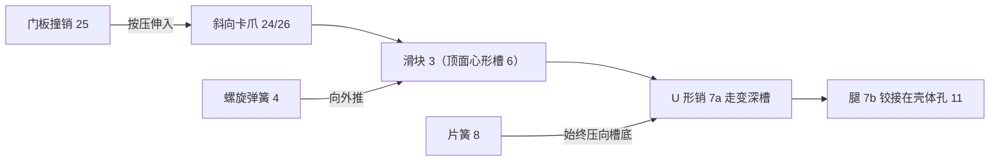

# Nifco 经典心形槽 Push-Push：U 形销与片簧（对照 ITW 防变形版）

> [!summary] 一句话概述
> Nifco 专利 US4660871 把按压弹跳做成「平面心形变深槽 + 金属 U 形销 + 片簧」：U 形销一端走滑块顶面的心形槽，另一端铰接在壳体孔里，片簧始终把销压向槽底；槽底深浅台阶逼销单向绕心形走一圈，按一下锁、再按一下弹开。滑块下方还有斜向卡爪去抓门板上的撞销。这和 ITW 用塑料随动件加导槽强制开合夹爪、以及按动笔用同轴旋转分度凸轮，都不是同一套零件。

## 配图

![[附件/nifco-us4660871-exploded.png]]
*图源：[US4660871](https://patentimages.storage.googleapis.com/pdfs/US4660871.pdf) Fig.1；爆炸图：壳体 2、滑块 3、心形槽 6、U 形销 7（7a 入槽、7b 入壳体孔）、推出用螺旋弹簧 4、把销压向槽底的片簧 8*

![[附件/nifco-us4660871-heart-groove.png]]
*图源：同上 Fig.2–4；Fig.2 为心形槽各区段（深路径 30、前进路径 31、锁定停段 33、逃逸段 34、返回路径 35）；Fig.3/4 可见滑块下方斜向卡爪 24 与楔形钩 26*

![[附件/nifco-us4660871-section.png]]
*图源：同上 Fig.5/6；Fig.5 俯视剖面：U 形销 7 一端走槽、一端插在壳体后壁孔 11，片簧 8 压销；Fig.6 侧视：卡爪 24/26 抓住门板撞销 25*

> 图片版权归原作者所有，仅作个人学习收藏；出处见文末「来源与核实记录」。专利附图为公开文献。

## 结构原理

> 本节数字只写来源里给出的；来源没有就写「来源未给出」。专利描述的是设计方案，不等于某款量产产品。Nifco 现产品 37A7 页未给出行程、载荷等数值。

### 堆叠方案

方向：**从壳体后壁（安装端）到敞口（撞销进入端）**

| 层级 | 零件 | 材料 | 厚度/尺寸 | 固定方式 | 依据 |
| --- | --- | --- | --- | --- | --- |
| L1 | 壳体 2：一端封闭、一端开口 5，顶面开口 10、斜向缺口 12，后壁孔 11 | 塑料注塑 | 来源未给出具体尺寸 | 装到本体 20 上（安装细节见 Fig.6 的安装板） | US4660871 说明书 |
| L2 | 片簧 8：上部 8a 压在销的铰接腿上，下部 8b 卡入壳体开口 16，棘爪 37 防脱落 | 金属片簧（专利称 retainer spring） | 来源未给出 | 卡入壳体 | 说明书；Fig.1、Fig.5/6 |
| L3 | U 形销 7：腿 7a 落入心形槽，腿 7b 可转动地插在孔 11 | 金属（专利称 latch pin，权利要求写 substantially U-shaped） | 来源未给出线径 | 经缺口 12 装入壳体 | 摘要、权利要求 1、说明书 |
| L4 | 螺旋弹簧 4：一端套在后壁凸台 13 上，把滑块向外推 | 来源未给出，图示为压簧 | 来源未给出 | 夹在壳体后壁与滑块之间 | 说明书 |
| L5 | 滑块 3：顶面心形槽 6（变深），下方斜向卡爪 24 + 楔形钩 26 | 塑料注塑 | 来源未给出 | 在壳体内轴向滑动 | 说明书；Fig.2–4 |
| L6 | 门板撞销 25 | 来源未给出 | 来源未给出 | 从门 38 背面伸出，被卡爪抓住 | 说明书；Fig.6 |

剖面示意：

### 零件清单

| 零件 | 数量 | 功能 | 材料 | 依据 |
| --- | --- | --- | --- | --- |
| 壳体 2 | 1 | 导向滑块、铰接 U 形销、容纳弹簧 | 塑料 | 说明书：「Both members are plastic moldings」指壳体与滑块 |
| 滑块 3（含卡爪 24） | 1 | 心形变深槽提供锁/开逻辑；卡爪抓住撞销 | 塑料 | 说明书 |
| U 形销 7 | 1 | 随动件：一端走槽、一端在壳体里转动 | 金属销 | 摘要、权利要求 1 |
| 片簧 8 | 1 | 把销始终压在槽底，保证走深浅台阶而不浮起 | 片簧 | 摘要、说明书 |
| 螺旋弹簧 4 | 1 | 把滑块向外推，提供弹出与保持锁定的预紧 | 来源未给出材质 | 说明书 |
| 撞销 25 | 1（在门上） | 把滑块推进去，并被卡爪锁住 | 来源未给出 | 说明书 |

### 装配顺序

按说明书与 Fig.1 拆件关系整理（专利未给工厂装配工时）：

1. 把螺旋弹簧 4 套到壳体后壁凸台 13 上。
2. 将 U 形销的铰接腿 7b 经顶面斜向缺口 12 放入，插入后壁孔 11；走槽腿 7a 留在开口 10 一侧。
3. 装入片簧 8：上部压在 7b 上，下部 8b 卡进开口 16，棘爪 37 钩住开口边缘，防止片簧脱落。
4. 将滑块 3 从敞口 5 推入壳体，使 7a 落入心形槽 6；片簧此时已把 7a 压向槽底。
5. 壳体装到本体 20；门板上的撞销 25 对准滑块入口。

### 受力与运动分析

- **受力路径**：关门时撞销 25 先顶开/钩住斜向卡爪 24 的楔形钩 26，再把滑块 3 推进壳体，压缩螺旋弹簧 4。锁定后，螺旋弹簧的回复力经滑块底座与卡爪传到撞销，把门保持关闭。再按时，同样先有一段过行程，销离开锁定停段，释放后弹簧把滑块连同撞销向外推。
- **运动关系**：滑块只做轴向往复；U 形销不绕自身轴线旋转，而是以 7b 为铰，让 7a 在心形槽里摆动并沿槽底走一圈。槽底深浅变化是单向阀：销从浅处掉进深处后，回不去原路。Kapy CAD 把同一原理概括为「心形闭环轨道 + 槽底台阶 + 持续压向槽底的预紧」；并强调如果槽底一样深，销在回程时可能原路返回，就锁不住。
- **失效风险**：专利背景写到，较早结构若销不能可靠贴着槽底走，会转错方向、锁不稳。Kapy CAD 补充（针对通用心形槽，含打印件）：台阶太低或被磨圆会「按了不锁」；弹簧过弱或销浮起则时锁时不锁；销与槽间隙过紧会卡死，过松会跳槽。这些是教学文的失效模式，不是 Nifco 量产失效数据。专利未给出寿命或力值。

心形槽单向循环（据说明书 Fig.2 与动作段）：

1. 休止：销在深路径 30 的盲端附近，滑块伸出，门开。
2. 第一次按到底：销沿前进路径 31 走到最深附近的停段 33（比末端 32 更深，回不去 32）。
3. 松手：弹簧外推滑块，销落入锁定停段并被钩住——门保持关闭。
4. 再按到底：销从停段下方离开，进入逃逸段 34（比 33 浅）。
5. 再松手：销沿返回路径 35，经过最浅处 35' 回到深路径 30，滑块弹出，卡爪放开撞销。

## 设计要点与参数

| 要点 | 内容 | 依据 |
| --- | --- | --- |
| 随动件形式 | 金属 U 形销：一腿走槽、一腿铰接在壳体，不是塑料滑块上的一体销，也不是自由放置的随动块 | US4660871 摘要、权利要求 1 |
| 保持贴槽 | 片簧始终把走槽端压向槽底，使深浅台阶起「单向阀」作用 | 摘要；说明书「urged against the bottom… by a retainer spring」 |
| 槽底变深 | 锁定停段 33 深于末端 32，返回路径有最浅处 35'；深浅差强迫单向绕行 | 说明书动作段；Fig.2 |
| 抓门方式 | 滑块下方斜向卡爪 24 + 楔形钩 26 与门板撞销 25 互锁，不是靠心形槽自己去抓门 | 说明书；Fig.3、Fig.6 |
| 推出弹簧 | 螺旋弹簧夹在壳体后壁与滑块之间，向外推滑块 | 说明书 |
| 行程 / 弹出力 / 寿命 | 来源未给出（专利无数值；Nifco 37A7 产品页只写「按压锁定/解锁、可与阻尼器组合」，无规格表） | 37A7 产品页 |
| 槽底台阶高度（打印件经验） | Kapy CAD 建议单向台阶要有若干完整层高，大约 0.5–1.5 mm，太低会打滑；这是 FDM 打印建议，不是 Nifco 量产公差 | Kapy CAD |
| 打印件配合 | Kapy CAD：销—槽间隙要按实测槽宽做滑动配合，过紧卡死、过松跳台阶；长期用建议金属销 + 润滑。不适用于本专利量产件验收 | Kapy CAD |

## 优缺点

**优点**
- 零件少：壳体、滑块、一根 U 形销、片簧、压簧，就能做双稳态按压锁
- 片簧压槽底，比「销只靠自身弹性贴槽」更不容易浮起走错路（这正是该专利相对其引证先前技术要解决的问题）
- 抓门的卡爪和走逻辑的心形槽分开，撞销形状可以相对独立设计

**缺点 / 代价**
- 心形槽的平面形状和槽底深浅都要准，任一处圆角或深度不够，就会出现「按了不锁」或时锁时不锁
- 专利没有给出力值、行程、寿命，选型不能直接抄本篇
- 塑料滑块上的斜向卡爪长期受力时，仍可能出现蠕变或磨损（本专利未像 ITW EP1596030 那样用导槽强制开合来对抗夹爪变形）

## 可借鉴点

- **把「逻辑」和「抓取」分开**：心形槽只负责锁/开状态，斜向卡爪负责抓撞销；改门板撞销时不必重画整条凸轮槽
- **槽底必须变深，而且要有持续压向槽底的力**：只画心形轮廓不够；用片簧或等效弹性把随动件压在台阶上
- **U 形销一端铰接在壳体**，走槽端的运动是摆动而不是整根销平移，壳体上预留装入缺口 12 和防脱落片簧
- **过行程是切换的前提**：锁定位置不是按到底的最深处，松手后才掉进心形凹口；设计门缝和按压行程时要留出这段过行程
- 若做打印样件，按 Kapy CAD 把槽做成对开的明槽、台阶给够层高、用金属压簧，不要用长期受压的塑料弹性臂当回位簧

## 与库中相似案例对比

| 对比项 | 本案例（Nifco US4660871） | [[防变形静音 Push-Push 按压弹跳锁（ITW 专利 EP1596030）]] | [[按动圆珠笔：旋转凸轮的按压伸缩机构]] |
| --- | --- | --- | --- |
| 状态逻辑 | 平面心形变深槽，U 形销绕槽走一圈 | 同样是心形循环轨道，但随动件是塑料滑条 + 背面销 | 同轴旋转分度凸轮，每按一次转一格 |
| 随动件 | 金属 U 形销，一端铰接壳体，片簧压向槽底 | 塑料随动件被外壳弹性墙夹住 | 凸轮体本身转动，没有平面心形槽 |
| 抓取/输出 | 滑块下方斜向卡爪抓门板撞销 | 滑块两侧夹爪抓撞销板；夹爪上的销走外壳斜向导槽，强制开合，针对塑料蠕变 | 凸轮落在挡块上或滑进间隙，锁定笔芯伸出/缩回 |
| 要解决的问题 | 销贴槽不可靠、走错方向 | 夹爪长期闭合后「定形」张不开、刮噪甚至打不开 | 按压转成旋转分度 |
| 参数 | 专利无量产数值 | 专利同样几乎无量产数值 | 文章以机构说明为主 |

## 相关案例

- [[防变形静音 Push-Push 按压弹跳锁（ITW 专利 EP1596030）]]
- [[按动圆珠笔：旋转凸轮的按压伸缩机构]]
- 分类索引：[[04-机构与运动 索引]]

## 来源与核实记录

- 主来源：[US4660871 A — Cam groove latch device](https://patentimages.storage.googleapis.com/pdfs/US4660871.pdf)（Nifco, Inc.；发明人 Masaru Arakawa、Yoshio Kaneko；申请 1986-03-24，授权 1987-04-28；日本优先权 1985-04-01）
- 同一专利页面：[Google Patents US4660871A](https://patents.google.com/patent/US4660871A/en)（与 PDF 为同一件，不另算独立来源）
- 独立第二来源：[Push-push latching button with a heart cam](https://kapycad.com/en/academy/joints/push-push-latching-button)（Kapy CAD，页面标注 Updated Jun 2026）——讲解心形槽四步循环、槽底台阶单向、回位簧预紧及打印失效模式；不是该专利的镜像
- 补充（同一公司，不算独立来源）：[Nifco 37A7 Push Latch](https://www.nifcodamper.com/en/product/37a7-push-latch/)——只写按压锁定/解锁、可与阻尼器组合，打开时未见规格数值
- 核实：2026-11-17 下载专利 PDF 全文并核对 Fig.1–6 与权利要求 1；打开 Kapy CAD 与 Nifco 37A7 产品页。未把打印建议写成 Nifco 量产参数。Sugatsune 推拉锁目录页打开后为动态商品列表、无可用结构参数，不引用。
