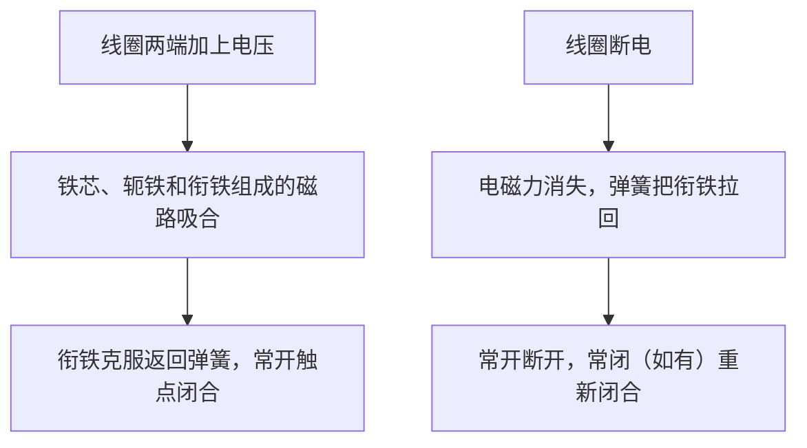

# PCB功率继电器：线圈吸合衔铁带动触点，线圈与触点高压隔离（以 Omron G2R 为例）

> [!summary] 一句话概述
> 电磁继电器用线圈里的电流建立磁路，让衔铁克服返回弹簧被吸向铁芯，再带动触点闭合或转换；线圈断电后弹簧把衔铁拉回，触点回到原来的常闭或常开状态，从而实现用较小的控制电流去开关另一路负载。芯三七把典型结构分成电磁系统（铁芯、轭铁、衔铁、线圈）、接触系统和传动复原机构。Omron G2R 把这一结构做成印制板功率继电器：单极 10 A、双极 5 A，线圈与触点之间的耐压 5,000 V，浪涌耐受 10,000 V，动作时间最多 15 ms。它不是热磁断路器，也不是已经单独成篇的交流接触器。

## 配图

![[附件/relay-omron-g2r-p1-01.png]]
*图源：[Omron G2R 规格书](https://omronfs.omron.com/en_US/ecb/products/pdf/en-g2r.pdf) 首页：单极 10 A、双极 5 A，线圈与触点间 5,000 V 耐压*

![[附件/relay-omron-g2r-p2-02.png]]
*图源：同上，型号与外形页*

![[附件/relay-chip37-01.jpg]]
*图源：芯三七，《电磁继电器的结构、原理以及应用》典型结构图：电磁系统、接触系统与返回机构*

![[附件/relay-omron-g2r-p8-08.png]]
*图源：Omron G2R 规格书特性页之一，动作/释放时间等条目以正文已摘录者为准，不从插图估读未识别数字*

> 图片版权归原作者所有，仅作个人学习收藏；出处见文末「来源与核实记录」。

## 结构原理

> 本节所有数字只写来源里给出的；来源没有就写「来源未给出」。一般结构来自芯三七，额定值来自 G2R，不混用。

### 堆叠方案

方向：**从线圈磁路到触点**

| 层级 | 零件 | 材料 | 厚度/尺寸 | 固定方式 | 依据 |
| --- | --- | --- | --- | --- | --- |
| L1 | 线圈 | 来源未给出线径和匝数 | 来源未给出 | 套在铁芯上，通电建立磁通 | 芯三七；G2R 分交流和直流线圈 |
| L2 | 铁芯与轭铁 | 软磁材料（芯三七） | 来源未给出 | 构成磁路 | 芯三七 |
| L3 | 衔铁 | 软磁材料 | 来源未给出行程 | 被吸向铁芯，带动触点 | 芯三七 |
| L4 | 返回弹簧 | 来源未给出 | 来源未给出刚度 | 断电后把衔铁拉回 | 芯三七 |
| L5 | 动触点与静触点（常开 / 常闭） | 来源未给出牌号 | 来源未给出开距 | 由衔铁或与衔铁相连的簧片传动 | 芯三七 |

剖面示意：

芯三七写明：只要在线圈两端加上一定电压，线圈中就会有电流并产生电磁效应，衔铁克服返回弹簧的拉力吸向铁芯，带动动触点与常开静触点吸合；断电后电磁力消失，弹簧使动触点回到原来的常闭静触点。它把继电器明确分成控制回路（输入）和被控制回路（输出）。

G2R 在这一通用机构上给出可核对的隔离和速度指标：线圈与触点之间介电强度 5,000 V，浪涌耐受 10,000 V；动作时间 15 ms 以下；释放时间交流 10 ms 以下、直流 5 ms 以下；绝缘电阻至少 1,000 MΩ。线圈电压表给出必须动作电压为额定的 80% 以下、必须释放电压为额定的 30% 以上（表头写于 23 °C 附近，具体行随交流/直流和封装变化，本文只引用这两个百分比阈值，不抄录每一档的毫安和欧姆）。最高动作频率：机械 18,000 次/小时，电气 1,800 次/小时。单极负载 10 A、双极 5 A，是系列首页的概括，具体额定负载还要看对应型号行，本文不把不同电压栏目拼在一起。

### 零件清单

| 零件 | 数量 | 功能 | 材料 | 依据 |
| --- | --- | --- | --- | --- |
| 线圈 | 1 | 建立控制磁通 | 来源未给出 | 芯三七；G2R |
| 铁芯、轭铁 | 各 1 | 磁路 | 软磁材料 | 芯三七 |
| 衔铁 | 1 | 把磁力变成位移 | 软磁材料 | 芯三七 |
| 返回弹簧 | 1 | 断电复位 | 来源未给出 | 芯三七 |
| 触点组 | 按 1 极或 2 极 | 切换负载 | 来源未给出牌号 | G2R 分 G2R-1 / G2R-1A / G2R-2 / G2R-2A 等 |
| 绝缘与壳体 | 1 套 | 把线圈回路和触点回路隔开 | 来源未给出 | G2R 强调 5,000 V 隔离 |

### 装配顺序

来源没有给出工厂装配步骤。应用要点（结合两份已打开资料）：

1. 分清线圈端子和触点端子，不要把负载接到线圈上。
2. 线圈电压按交流或直流选型，驱动电压应能达到「必须动作」阈值，断电后应低于「必须释放」阈值。
3. 负载电流按单极 10 A、双极 5 A 的系列上限再对表选型，而不是一律按 10 A。
4. 需要绝缘和抗浪涌时，核对该型号的 5,000 V / 10,000 V 条件，不要用普通信号继电器去切电网。
5. 动作频率不要超过机械 18,000 次/小时或电气 1,800 次/小时（G2R）。

### 受力与运动分析

- **受力路径**：线圈电流 → 磁路吸力 → 衔铁克服弹簧 → 触点闭合。分断时主要靠返回弹簧，而不是靠负载电流。
- **运动关系**：衔铁只有吸合和释放两个稳态；触点跟随衔铁，可以是常开、常闭或转换。动作和释放时间以毫秒计，比热磁断路器的过载延时短得多，也没有自由脱扣锁钩。
- **失效风险**：线圈电压不足造成触点「似接非接」；触点过载熔焊；把继电器当成断路器去分断短路；忽视线圈与触点之间的爬电和隔离。已打开的 G2R 表中有至少 100,000 次这一量级的寿命栏，但分栏对应机械还是某一负载条件需要对照原表，本文不擅自写成「10 A、250 V、10 万次」。

## 设计要点与参数

以下为 Omron G2R 规格书已读条目。

| 要点 | 内容 | 依据 |
| --- | --- | --- |
| 系列额定 | 单极 10 A，双极 5 A | G2R 首页 |
| 线圈–触点耐压 | 5,000 V | G2R 首页 |
| 浪涌耐受 | 10,000 V | G2R 首页 |
| 动作时间 | 15 ms 以下 | G2R |
| 释放时间 | 交流 10 ms 以下；直流 5 ms 以下 | G2R |
| 绝缘电阻 | 至少 1,000 MΩ | G2R |
| 必须动作电压 | 额定电压的 80% 以下 | G2R 线圈表 |
| 必须释放电压 | 额定电压的 30% 以上 | G2R 线圈表 |
| 最高动作频率 | 机械 18,000 次/小时；电气 1,800 次/小时 | G2R |
| 触点电阻 | 规格书有 30 mΩ max. 与 50 mΩ max. 等分档，需对照型号，本文不合并 | G2R |

## 优缺点

**优点**
- 用一组线圈控制另一组触点，弱电和强电在机构上分开，G2R 还给出明确的耐压和浪涌指标
- 结构经典，动作和释放时间都在十几毫秒量级，适合板上切换
- 单极、双极和交直流线圈可以按回路选

**缺点 / 代价**
- 不是过流保护器件，短路分断要另做
- 触点寿命和额定负载必须按型号表，不能用首页的 10 A 一概而论
- 机械噪声、线圈功耗和安装高度在已读页没有全部展开

## 可借鉴点

- 把「必须动作 / 必须释放」百分比写进驱动电路设计，不要只写一个额定电压。
- 需要隔离时优先看线圈–触点耐压和爬电，而不是只看能切多少安培。
- 电气动作频率按 1,800 次/小时这一类指标校核，不要按机械空载频率去切负载。
- 需要配电级分断时改用断路器，不要把继电器和热磁脱扣混成一个零件。

## 与库中相似案例对比

| 对比项 | 本案例（PCB 功率继电器） | [[热磁脱扣断路器：双金属片过载延时、电磁铁短路瞬时，经自由脱扣机构分断触头]] | [[KSD301 突跳式温控器：蝶形双金属片到位后瞬间切换触点]] | [[轻触开关壳体封装金属弹片：盖板、推杆与锅仔片反转导通（以 Omron B3F 为例）]] |
| --- | --- | --- | --- | --- |
| 输入 | 线圈电压 | 过载或短路电流 | 温度 | 手指按压力 |
| 执行 | 衔铁带动触点，靠隔离分回路 | 锁扣释放 + 灭弧分断主电路 | 碟片直接改触点 | 锅仔片导通信号回路 |
| 何时用这篇 | 要在电路板上用弱电切负载 | 要做配电保护 | 要做温控开关 | 要做轻触按键 |

## 相关案例

- [[热磁脱扣断路器：双金属片过载延时、电磁铁短路瞬时，经自由脱扣机构分断触头]]
- [[轻触开关壳体封装金属弹片：盖板、推杆与锅仔片反转导通（以 Omron B3F 为例）]]
- 分类索引：[[04-机构与运动 索引]]

## 来源与核实记录

- 主来源：芯三七，《电磁继电器的结构、原理以及应用》（2026-11-27 打开。磁路、触点和返回弹簧的一般结构来自该文。完整栏目地址以已保存 html 为准。）
- 交叉来源：[Omron G2R 规格书](https://omronfs.omron.com/en_US/ecb/products/pdf/en-g2r.pdf)（2026-11-27 下载并提取。独立第二机构。额定电流、隔离、时间、频率和 80% / 30% 阈值来自该 PDF。）
- 核实：2026-11-27 打开上述来源。未把接触器或未核对的寿命行写入参数表。
