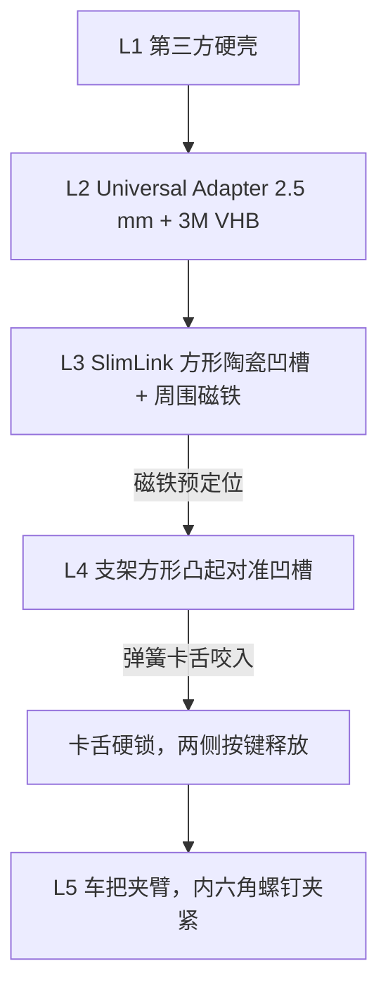

# Peak Design SlimLink：方形陶瓷凹槽磁吸预定位与弹簧卡舌硬锁

> [!summary] 一句话概述
> Peak Design 的 SlimLink 把「磁铁预定位」和「机械硬锁」做在同一套方形接口里：手机壳或 Universal Adapter 背面有带陶瓷边缘的方形凹槽，凹槽周围藏磁铁；对接到 Out Front 这类硬锁支架时，磁铁先把接口吸准，两侧弹簧卡舌咬入凹槽锁死，按任意一侧按键即可释放。磁铁不是骑行时的主承力件。

## 配图

![[附件/pd-adapter-face.jpg]]
*图源：[Peak Design Universal Adapter 产品页配套照片，亦见于 Light and Matter 评测配图体系](https://www.peakdesign.com/products/universal-adapter)；粘在第三方硬壳背面的 Universal Adapter：织物包覆的方形贴片，中央是 SlimLink 方形凹槽（评测写凹槽边缘为陶瓷，磁铁藏在凹槽周围）*

![[附件/pd-outfront-mount.jpg]]
*图源：[Light and Matter, Review of the Mobile product line by Peak Design](https://www.lightandmatter.org/2022/equipment-reviews/mobile-by-peak-design/) 评测实拍（Bernard Dery）；Out Front 车把支架的对接面：中央方形凸起对应 SlimLink 凹槽，左右两侧可见弹簧卡舌。评测写这两侧卡舌完成主要锁死，两侧按键任一即可释放*

![[附件/pd-universal-adapter-back.jpg]]
*图源：同上 Light and Matter 评测实拍；Mobile 产品线包装：Out Front Bike Mount、Stand Wallet、Universal Adapter、Wall Mount。评测明确区分：钱包、墙挂等配件「只用磁铁保持」，Out Front 则是磁铁加上方形凹槽与弹簧卡舌的硬锁*

> 图片版权归原作者所有，仅作个人学习收藏；出处见文末「来源与核实记录」。

## 结构原理

> 本节所有数字只写来源里给出的；来源没有就写「来源未给出」。

### 堆叠方案

方向：**从手机后壳外侧到车把（以 Universal Adapter + Out Front Bike Mount 硬锁为例）**

| 层级 | 零件 | 材料 | 厚度/尺寸 | 固定方式 | 依据 |
| --- | --- | --- | --- | --- | --- |
| L1（手机侧） | 第三方硬质手机壳 | 官网建议硬塑料或金属等光滑、非纹理、非多孔表面；不推荐硅胶或皮革 | 来源未给出壳厚 | Universal Adapter 用 3M VHB 粘在壳背，不建议直接贴在手机上 | Peak Design Universal Adapter 产品页 |
| L2 | Universal Adapter（内含 SlimLink） | 织物包覆；凹槽边缘为陶瓷（评测）；磁铁藏在凹槽周围（评测） | 官网写厚度仅 2.5 mm | 背胶粘贴 | Peak Design；Light and Matter |
| L3 | SlimLink 方形凹槽 + 周围磁铁 | 陶瓷边缘（评测）；磁铁材料牌号来源未给出 | 凹槽为方形，可横拍或竖拍对接（评测） | 与适配器/官方手机壳一体 | Light and Matter |
| L4 | Out Front 支架对接面：方形凸起、弹簧卡舌、释放按键 | 机加工阳极氧化铝（官网） | 来源未给出卡舌尺寸 | 磁铁引导到位后，弹簧卡舌咬入凹槽 | Peak Design Out Front Bike Mount V2；Light and Matter |
| L5 | 车把夹持臂 | 与支架同为金属件（评测写 Out Front 整体为金属） | 有多种车把直径转接（评测） | 内六角螺钉夹紧；也提供拇指螺钉，评测认为内六角更牢 | Light and Matter |

剖面示意（硬锁路径）：

同一套 SlimLink 还有「只靠磁铁」的用法：Light and Matter 写钱包、墙挂、三脚架等配件 listed so far only use magnets to hold the phone；Out Front 才把方形凹槽和弹簧卡舌用上。不要把两种保持方式写成同一套承力路径。

### 零件清单

| 零件 | 数量 | 功能 | 材料 | 依据 |
| --- | --- | --- | --- | --- |
| Universal Adapter | 1（贴在壳上） | 给没有官方 SlimLink 壳的手机提供接口，并兼容 MagSafe 配件（官网） | 织物包覆；厚 2.5 mm | Peak Design 产品页 |
| SlimLink 方形凹槽与隐藏磁铁 | 与适配器或官方壳一体 | 磁铁预定位并对软锁配件提供吸力；凹槽给硬锁卡舌提供咬合几何 | 陶瓷边缘（评测）；磁铁牌号来源未给出 | Light and Matter |
| Out Front Bike Mount V2 支架本体 | 1 | 硬锁对接，并可把手机翻起拍摄骑行（官网） | 机加工阳极氧化铝 | Peak Design Out Front 产品页 |
| 弹簧加载卡舌 | 评测写两侧各有，具体件数来源未给出 | 锁死手机，承担骑行载荷 | 来源未给出 | Light and Matter |
| 释放按键 | 两侧各一 | 按任意一侧即可释放 | 来源未给出 | Light and Matter |
| 车把夹紧螺钉 | 1 套 | 把支架固定到车把 | 评测对比内六角螺钉与所附拇指螺钉 | Light and Matter |

### 装配顺序

1. 把 Universal Adapter 用所附定位引导对准，粘到光滑硬质第三方手机壳背面（官网）。粘前可先把适配器放在手机上确认无线充电是否仍可用；官网提醒装上后无线充电可能不可用或效果变差，并称磁铁可能干扰三星 S-Pen 一类手写笔。
2. 用内六角螺钉（或所附拇指螺钉）把 Out Front 支架夹到车把，必要时加直径转接（评测）。
3. 把手机 SlimLink 面对准支架：磁铁先把方形凹槽吸到凸起上，可横拍或竖拍（评测）。
4. 弹簧卡舌咬入凹槽，完成硬锁。评测写磁铁负责引导并增加一层保险，卡舌承担主要锁紧。
5. 取下时按支架任意一侧按键，卡舌退出，再把手机拿开。

> 官方产品页没有逐步工厂装配节拍；以上使用步骤按官网说明与评测观察整理。

### 受力与运动分析

- **受力路径**：骑行振动、刹车惯性首先作用在手机和适配器上，经 SlimLink 凹槽传到弹簧卡舌，再经支架本体和夹臂传到车把。磁铁在硬锁状态下只起预定位和辅助保持，不是主承力件（评测原文：the magnets guide the phone and add a level of security, but the tabs do the bulk of the work）。软锁配件（墙挂、钱包等）则完全走磁力路径，评测把它们与 Out Front 明确分开。
- **运动关系**：对接时手机相对支架有一个垂直靠近的自由度，方形几何把方位限制在横/竖两个离散位置。锁死后相对支架无工作自由度，直到按下释放键。Out Front 另有把手机翻起拍摄的转动（官网），转轴细节来源未给出。
- **失效风险**：背胶只适合光滑硬壳，硅胶或皮革不推荐，直接贴在手机上也不推荐（官网）。软锁配件不能当骑行硬锁用（评测对比）。卡舌或按键进沙、磨损可能导致锁不牢或难释放（推断；来源未给寿命循环次数）。磁铁可能干扰手写笔（官网）。

## 设计要点与参数

| 要点 | 内容 | 依据 |
| --- | --- | --- |
| 接口名称与复合锁 | SlimLink 是做在官方壳和 Universal Adapter 里的 magnetic/mechanical lock | Peak Design Universal Adapter、Out Front 产品页 |
| 适配器厚度与背胶 | Universal Adapter 厚 2.5 mm，3M VHB 粘接 | Peak Design Universal Adapter |
| 凹槽几何 | 方形凹槽，边缘为陶瓷；磁铁藏在凹槽周围；可横拍或竖拍 | Light and Matter |
| 硬锁执行件 | 两侧弹簧加载卡舌咬入凹槽；两侧按键任一即可释放 | Light and Matter |
| 支架主体 | Out Front Bike Mount V2 为机加工阳极氧化铝，官方称 ultra-strong magnetic/mechanical mounting technology (SlimLink) | Peak Design Out Front 产品页 |
| 车把固定 | 内六角螺钉夹紧，评测认为比拇指螺钉更牢；有不同直径转接 | Light and Matter |
| 软锁与硬锁分工 | 钱包、墙挂等只用磁铁；Out Front 才用凹槽+卡舌硬锁 | Light and Matter |
| 限制 | 不推荐软质/硅胶/皮革表面；不建议直接贴手机；可能影响无线充电；磁铁可能干扰 S-Pen；不为平板或折叠机设计 | Peak Design Universal Adapter |
| 卡舌尺寸、磁铁牌号、保持力牛顿数 | 来源未给出 | — |

## 优缺点

**优点**
- 磁铁只负责「吸准」，硬锁由卡舌承担，适合把手机放到会振动的车把上，而不把骑行安全完全交给磁铁。
- 同一套方形接口可以兼容只用磁铁的日常配件，换手机时通常只需换壳或适配器，支架可继续用（评测与官网都强调生态系统延续）。
- 释放是按键，不必旋转手机。

**缺点 / 代价**
- 硬锁只存在于部分支架（评测点名自行车、摩托车支架和 Creator Kit）；买错成纯磁配件会误判安全性。
- 适配器依赖 3M VHB 和壳的表面状态，软壳或不平整表面不适用。
- 官方产品页几乎不给卡舌尺寸、磁铁牌号或保持力数字，设计复用时要以实测或拆解补数，不能从广告文案推算。

## 可借鉴点

- 把「预定位」和「承力锁死」拆开：磁铁对中，机械卡舌承力。不要让磁铁同时当唯一锁。
- 方形（或正多边形）凹槽可以在不多增加厚度的前提下提供两个正交方位，适合横/竖切换。
- 双侧按键冗余：单手从左边或右边都能开，避免骑行时够不到唯一按键。
- 若产品线里同时有软锁和硬锁配件，必须在外形或标识上让用户分得清，说明书也要写清哪种场景不能只用磁铁。
- 背胶方案要把基材限制写清楚（硬、光滑、非多孔），并提醒磁铁对其它传感器/手写笔的干扰。

## 与库中相似案例对比

| 对比项 | 本案例（SlimLink） | [[FIDLOCK V-BUCKLE：磁吸引导到位后再由机械扣锁死]] | [[橱柜磁吸门吸：只有磁力保持、没有机械锁死（对照 FIDLOCK）]] | [[Arca-Swiss 38 mm 燕尾快装板：事实标准与跨品牌混用风险]] |
| --- | --- | --- | --- | --- |
| 磁铁做什么 | 预定位，并在软锁配件上单独保持 | 引导织带扣到位，再由机械扣锁死 | 唯一保持力，没有机械锁 | 无磁铁，靠燕尾夹紧 |
| 机械锁几何 | 方形陶瓷凹槽 + 弹簧卡舌，按键释放 | 织带扣的扣舌/盖板锁死，上掀或拉片开启 | 无 | 燕尾槽 + 夹钳 |
| 典型载荷场景 | 手机车把硬锁，或桌面/墙面软锁 | 背包、婴儿背带等织带 | 柜门轻保持 | 相机快装板 |
| 何时用这篇 | 要做板式、薄型、可横竖切换的磁吸+卡舌快拆 | 要做织带扣，开启方向与受力方向分离 | 只要轻保持、允许徒手拉开 | 要兼容相机云台燕尾生态 |

## 相关案例

- [[FIDLOCK V-BUCKLE：磁吸引导到位后再由机械扣锁死]]
- [[橱柜磁吸门吸：只有磁力保持、没有机械锁死（对照 FIDLOCK）]]
- [[Arca-Swiss 38 mm 燕尾快装板：事实标准与跨品牌混用风险]]
- [[GoPro 快拆卡扣与指旋螺母：两爪弹性卡入和螺钉夹紧是两套锁]]
- [[自行车花鼓快拆杆：空心轴、调节螺母与偏心凸轮过中心夹紧]]
- 分类索引：[[04-机构与运动 索引]]

## 来源与核实记录

- 主来源：[Peak Design Universal Adapter](https://www.peakdesign.com/products/universal-adapter)（厂商产品页，2026-11-26 重新打开；SlimLink 为 magnetic/mechanical lock，厚 2.5 mm，3M VHB，使用限制与 MagSafe 兼容说明均来自该页）
- 同一机构补充：[Peak Design Out Front Bike Mount V2](https://www.peakdesign.com/products/out-front-bike-mount)（2026-11-26 重新打开；机加工阳极氧化铝，SlimLink magnetic/mechanical mounting）
- 交叉来源：[Bernard Dery, Review of the Mobile product line by Peak Design, Light and Matter, 2022-05-20](https://www.lightandmatter.org/2022/equipment-reviews/mobile-by-peak-design/)（2026-11-26 重新打开全文。独立摄影评测机构。方形陶瓷边缘凹槽、周围隐藏磁铁、Out Front 弹簧卡舌承力、两侧按键释放、软锁与硬锁配件的区分，均来自这篇评测）
- 核实：2026-11-26 用浏览器 UA 重新下载并阅读上述三个页面。peakdesign.pl 的 SlimLink 专页返回 403，未引用其中未被本轮打开的「四颗磁铁 / 氧化锆环厚度」等数字。未把本结构写成 MagSafe 充电环或又一个织带磁扣。
