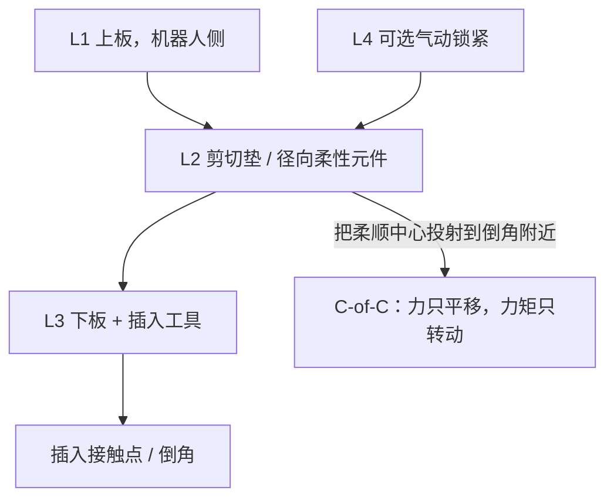

# RCC 远程柔顺手腕：把柔顺中心配置到装配孔口附近实现倒角自动对中

> [!summary] 一句话概述
> 远程柔顺手腕（RCC / Remote Center Compliance）不用电机力控去“找孔”，而是把弹性元件布置成：接触力作用在一个位于或靠近插入倒角的远程柔顺中心时，只产生平移、不产生转动；力矩则只产生转动、不产生平移。这样倒角上的接触力会自动把轴与孔对齐。ATI 9116 系列用上下板之间的剪切垫把这个中心投射到工具侧以外；Draper 的 US 4,098,001 则用沿会聚半径布置的柔性元件，把中心放到插入件端部附近。它不是气弹簧重力平衡，也不是微动台里的直线导轨。

## 配图

![[附件/ati-rcc-center-of-compliance.jpg]]
*图源：[ATI Compensator 安装与操作手册 9610-15-1000-17](https://ati.novanta.com/wp-content/uploads/sites/2/2025/05/9610-15-1000.pdf) 第 8 页 Figure 2.1；上板接机器人，下板接工具，剪切垫在两板之间提供侧向、偏摆（cocking）、轴向和扭转柔顺。柔顺中心（Center-of-Compliance）投射在下板之外，靠近插入接触点*

![[附件/ati-rcc-family.jpg]]
*图源：同上手册抽出的产品族图；9116 系列不同外形尺寸的补偿器，可见上下板、中间弹性元件和可选管路*

![[附件/draper-rcc-us4098001-fig.jpg]]
*图源：[US 4,098,001 Remote Center Compliance System](https://image-ppubs.uspto.gov/dirsearch-public/print/downloadPdf/4098001) 首页图；固定件 18 与可动件 22 之间有柔性元件 24、26、28，它们沿会聚半径 42、44、46 指向远程中心 50，该中心位于插入杆 16 的端部附近*

> 图片版权归原作者所有，仅作个人学习收藏；出处见文末「来源与核实记录」。

## 结构原理

> 本节所有数字只写来源里给出的；来源没有就写「来源未给出」。

### 堆叠方案

方向：**从机器人侧（上板）经过弹性元件到工具侧（下板），再沿插入轴到工件倒角；柔顺中心在插入接触点附近**

| 层级 | 零件 | 材料 | 厚度/尺寸 | 固定方式 | 依据 |
| --- | --- | --- | --- | --- | --- |
| L1 | 上板（Top Plate，机器人侧） | 来源未给出牌号 | 外形随 9116 系列 000/100/200/400 而变，具体外径见手册第 8 节表，本篇不把未完整核对的列抄全 | 与机器人或装配机接口连接 | ATI 术语表与 Figure 2.1 |
| L2 | 剪切垫（shear pad）或专利中的径向柔性元件 | ATI：Neoprene 或 Nitrile，视 HCL 型号；工作温度 −29 至 82 °C | 数量：−A/−B 型号 3 个，−C 为 6 个，−D 为 12 个。侧向刚度举例：HCL-01A2 为 6 lb/in（Very Low），HCL-02A 为 28 lb/in（High） | 螺钉固定在上下板之间；ATI 还有过载销限制行程 | ATI 术语表、注释 2、Table 8.2 |
| L3 | 下板（Bottom Plate，工具侧） | 来源未给出牌号 | 到插入接触点的距离记为 L，用来选柔顺中心位置 | 与工具、被插入零件连接 | ATI Figure 2.1 与 2.2.2 节 |
| L4 | 可选锁紧（Lock-up）及锁紧检测 | 气动锁紧把锁紧螺钉拉入下板；传感器为接近开关 | 锁定传感器额定工作距离 1.5 mm（0.059 in）；000/100 系列气缸力系数 0.25 lb/psi（15 N/bar），200/400 为 0.4 lb/psi（28 N/bar） | 气动；用于加速移动时把手腕锁硬，减轻剪切垫磨损，并减轻水平使用时的下垂 | ATI 术语表、第 8 节与 2.2.1 节 |
| L5 | 插入件与孔口倒角 | 应用自定 | 至少一侧要有倒角作为导入；总间隙须大于装配误差 | 接触点即 Insertion Contact Point | ATI 2.2.2 节；专利摘要 |

Draper 专利的对应关系：第一构件固定于装配机，第二构件相对第一构件可动，至少三个转动连接元件沿从远程中心发出的球面半径布置（图中 24、26、28 与半径 42、44、46，中心 50）。

剖面示意：

和已有案例的差别：

- [[显示器气弹簧支架：张力螺丝与悬停平衡]]、[[Ergotron CF 恒力螺旋弹簧支架（对比气弹簧）]] 解决的是重力平衡，不是轴孔对中。
- [[平行板簧直线导轨与双平行四边形：对称构型抵消寄生横向位移]] 是微动台导轨，不是装配手腕。

### 零件清单

| 零件 | 数量 | 功能 | 材料 | 依据 |
| --- | --- | --- | --- | --- |
| 上板 | 1 | 接机器人 | 来源未给出牌号 | ATI 术语表 |
| 下板 | 1 | 接工具 | 来源未给出牌号 | ATI 术语表 |
| 剪切垫 | 3、6 或 12，视型号后缀 | 提供侧向、偏摆、轴向、扭转柔顺 | Neoprene 或 Nitrile | ATI 注释 2 与 Table 8.2 |
| 过载销 | 手册图中示出 3 个（9116 Series 100 示例） | 限制柔顺行程，防止过载损坏 | 来源未给出 | ATI Figure 8.1 标签 |
| 锁紧螺钉 / 衬套 / 传感器（可选） | 视选项 | 把手腕锁硬，并检测锁定 | 来源未给出锁紧件牌号 | ATI 术语表 |

### 装配顺序

按 ATI 手册的使用与选型步骤（不是拆解反推）：

1. 确认应用是竖直方向的轴孔插入。手册写：水平使用时剪切垫会随时间产生下垂（sag），橡胶有记忆；若必须水平用，建议加 Lock-up。
2. 做误差与间隙核算：装配误差（机器定位、供料、工具重复度、孔位公差，再加上补偿器在竖直位置的重复度 ±0.002 in）必须小于总间隙（两侧倒角与最不利间隙之和），否则两平行面会先碰上。
3. 量出下板到初始接触点的距离 L（计入转接板）。选柔顺中心（C-of-C）在 L 的 30% 以内的型号；宁可让 C-of-C 在接触点下方，也不要在上方。若配合较松，允许放到 L 的 60% 以内。
4. 按载荷选垫和型号：竖直工况的拉伸载荷容量按工具加零件的重量取；高冲击用 HCL-13A；加速惯性大时用锁紧；过盈压配需要更高的压缩载荷容量。200 系列可用 6 个垫、400 系列可用 12 个垫把载荷容量加倍。
5. 把上板装到机器人，下板装到工具，按手册完成气路、锁紧传感器间隙（若有）后再投入插入作业。
6. 维护时按手册更换剪切垫，注意垫的翅片朝外等定向要求。

### 受力与运动分析

- **受力路径**：插入时倒角接触力从工件传到工具和下板，再经剪切垫（或专利中的径向柔性元件）传到上板和机器人。如果 C-of-C 就在接触点附近，接触力几乎只让手腕平移对中，力矩只让它绕该中心转，从而把轴的轴线转到与孔一致（ATI 术语表与第 2 节；专利摘要）。
- **运动关系**：未锁紧时，下板相对上板有侧向、偏摆、轴向、扭转四个柔顺方向。锁紧后装置变刚性，用于快速搬运。远程中心是被弹性几何「投射」出去的，不在垫的几何形心上。
- **失效风险**：C-of-C 离接触点太远或跑到接触点上方，对中会变差甚至越对越歪（手册建议宁可偏下）。水平长期悬挂造成剪切垫下垂。过载但不靠过载销限位，可能损坏垫或板（推断，手册设过载销就是为了防这一点）。没有倒角或间隙小于误差时，RCC 也救不了。

## 设计要点与参数

| 要点 | 内容 | 依据 |
| --- | --- | --- |
| 柔顺中心定义 | 在该点，接触力只引起平移不引起转动，力矩只引起转动不引起平移 | ATI 术语表；第 2 节 |
| 选 C-of-C 相对 L | 选在距离 L 的 30% 以内，最好略低于接触点；松配合可放到 60% 以内 | ATI 2.2.2 节第 2 步 |
| 重复度 | 竖直位置 ±0.002 in，计入装配误差预算 | ATI 2.2.2 节 |
| 剪切垫数量 | −A、−B 用 3 个，−C 用 6 个，−D 用 12 个 | ATI 第 8 节注释 2 |
| 剪切垫刚度举例（Table 8.2） | HCL-01A2：侧向 6 lb/in，轴向 2329 lb/in，Neoprene，配 000 系列；HCL-02A：侧向 28 lb/in，轴向 10498 lb/in，Nitrile，配 000 系列。其它 HCL-11A/12A/13A 见原表。工作温度均为 −29 至 82 °C | ATI Table 8.2 |
| 型号与 C-of-C 举例（Table 8.1 已看清的行） | 9116-001-A：C-of-C 23 mm（0.9 in）；9116-111-B：122 mm（4.8 in）；9116-112-B：69 mm（2.7 in）；9116-113-B：61 mm（2.4 in）。载荷与刚度列以手册原表为准，本篇不把未逐项核对单位的数全部重抄 | ATI Table 8.1 开头几行 |
| 专利结构 | 至少三个柔性连接沿从远程中心出发的半径布置，中心可在机构之外、插入件端部附近或更远处 | US 4,098,001 摘要、说明书与首页图 |
| 锁紧气缸力系数 | 000/100：0.25 lb/psi（15 N/bar）；200/400：0.4 lb/psi（28 N/bar） | ATI 第 8 节 |
| 水平使用 | 剪切垫会下垂，建议用 Lock-up | ATI 2.2.1 节 |

## 优缺点

**优点**
- 对中靠接触力和弹性几何自动完成，不需要在插入瞬间做精细力控。
- 柔顺中心可以投射到手腕本体以外，正好放在倒角处。
- 商品系列把 C-of-C 距离、载荷、垫的刚度和锁紧做成可选，维护时可只换垫。

**缺点 / 代价**
- 必须有倒角和足够间隙，它不是万能对中器。
- 水平或长期偏载会让弹性垫下垂，改变中心位置。
- 锁紧、传感器和更多剪切垫都会增加结构复杂度和气路/电路。

## 可借鉴点

- 设计或选型时先画 L（工具侧安装面到倒角接触点），再把 C-of-C 放到 L 的 30% 以内、略偏下。
- 先算装配误差和总间隙，间隙不够就加倒角，不要指望 RCC 去挤过两个平行面。
- 竖直插入是默认工况；水平使用要按手册考虑下垂和锁紧。
- 不要把这套「远程中心」写成气弹簧支架或微动台导轨。

## 与库中相似案例对比

| 对比项 | 本案例：RCC 远程柔顺手腕 | [[显示器气弹簧支架：张力螺丝与悬停平衡]] / [[Ergotron CF 恒力螺旋弹簧支架（对比气弹簧）]] | [[平行板簧直线导轨与双平行四边形：对称构型抵消寄生横向位移]] | [[恒扭力摩擦铰链：卡簧过盈产生扭力与「最低扭力 > 盖板力矩」选型]] |
| --- | --- | --- | --- | --- |
| 目的 | 轴孔插入时自动对中 | 平衡重力、悬停 | 微动台直线导向 | 盖板保持力矩 |
| 核心几何 | 把柔顺中心投射到倒角附近 | 弹簧力–重力力矩 | 对称平行四边形抵消 eᵧ | 摩擦过盈 |
| 是否已有 | 本篇新收 | 已有，本篇只对照，不再写卷簧恒力 | 本轮另篇，不是装配手腕 | 已有摩擦铰 |
| 关键参数 | L 与 C-of-C 的 30%/60% 规则、垫的刚度与数量 | 张力螺丝、力曲线 | L/P/M、eᵧ | 最低扭力 |

## 相关案例

- [[平行板簧直线导轨与双平行四边形：对称构型抵消寄生横向位移]]
- [[显示器气弹簧支架：张力螺丝与悬停平衡]]
- [[Ergotron CF 恒力螺旋弹簧支架（对比气弹簧）]]
- [[恒扭力摩擦铰链：卡簧过盈产生扭力与「最低扭力 > 盖板力矩」选型]]
- 分类索引：[[04-机构与运动 索引]]

## 来源与核实记录

- 主来源：[ATI Industrial Automation, Compensator 9116 Series 000, 100, 200, and 400 Installation and Operation Manual, Document #9610-15-1000-17](https://ati.novanta.com/wp-content/uploads/sites/2/2025/05/9610-15-1000.pdf)（公开安装手册。术语表、Figure 2.1、选型步骤、Table 8.1/8.2 与剪切垫规格。手册页脚带公司地址与邮箱，本文不把这些联系方式当作结构参数抄入正文）
- 补充来源：[US 4,098,001, Remote Center Compliance System](https://image-ppubs.uspto.gov/dirsearch-public/print/downloadPdf/4098001)（发明人 Paul C. Watson；受让人 The Charles Stark Draper Laboratory, Inc.；1978-07-04。首页图与说明书中的远程中心、会聚半径柔性元件。独立第二机构）
- 核实：2026-11-22 下载并打开上述两份 PDF。彭商贤中文 RCC 论文与浙江大学学报相关综述本次未能打开全文，不写入引用。专利 200610118384 打开后是滚珠丝杠加弹簧的另一种被动柔顺，不是本篇的远程中心手腕，已排除。
