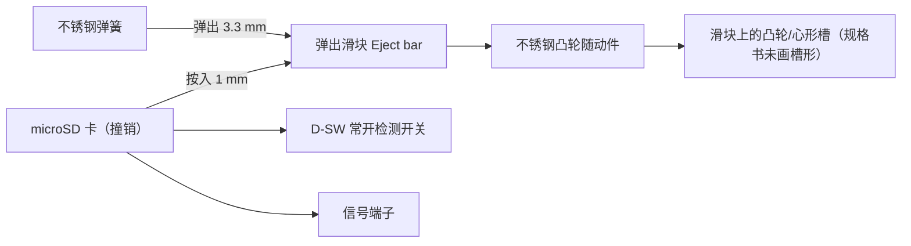

# SD 与 microSD 推推式卡座：心形槽滑块与卡片当撞销

> [!summary] 一句话概述
> 推推式 SD / microSD 卡座把心形槽或凸轮槽做在卡座滑块上，存储卡本身就是撞销：推进去锁住，再按一下弹出。行程和弹出距离是连接器规格，不是家具锁的门缝。以 JAE ST5 为例，microSD 侧是反向安装的 push-push，按入行程 1 mm、弹出 3.3 mm，并带半锁和防飞卡；零件清单里明确有不锈钢凸轮随动件（cam follower）。

## 配图

![[附件/jae-st5-microsd-sim-combo.jpg]]
*图源：[JAE ST5 Series 规格书](https://media.digikey.com/pdf/Data%20Sheets/JAE%20PDFs/ST5_Series.pdf) 第 1 页（MB-0167-1，2007-03）；左为连接器外形，右为插入 microSD 与 SIM 后的示意。特性写明 1 mm push stroke、3.3 mm card eject length*

![[附件/moarconn-sd-card-connector.jpg]]
*图源：[带自锁功能的SD卡座连接器机械原理深度剖析](https://www.moarconn.cn/blog/b7647) 页面配图（东莞市摩凯电子）；金属罩壳 + 树脂座体的推入式卡座外观，文章用来说明 Push-Push 自锁卡座，并非 JAE ST5 本体照片*

> 图片版权归原作者所有，仅作个人学习收藏；出处见文末「来源与核实记录」。

## 结构原理

> 本节把「摩凯文中的通用/转述结构」和「JAE ST5 规格书中的具体型号」分开写，不把不同厂家的高度、寿命写成同一只卡座。

### 堆叠方案

方向：**从 PCB 向上到卡片（以 ST5 的 microSD push-push 侧为主）**

| 层级 | 零件 | 材料 | 厚度/尺寸 | 固定方式 | 依据 |
| --- | --- | --- | --- | --- | --- |
| L1 | PCB 焊盘 / SMT 端子 | 铜合金；接触区 Ni 底镀 Au ≥ 0.5 µm，端子 Au flash | 来源未给出端子厚度 | SMT，规格书写兼容二次回流、卷带供料 | ST5 Materials and Finishes；Features |
| L2 | 树脂壳体（Housing） | 合成树脂，UL94V-0 | 整座高 2.8 mm，深 17.35 mm，宽 19.2 mm（含卡后 19.2 mm × 26 mm） | 与罩壳组成外框 | ST5 Features、Materials |
| L3 | 弹出滑块（Eject bar）+ 弹簧 + 凸轮随动件（Cam follower）+ 锁（Lock） | 滑块：合成树脂；弹簧、锁、凸轮随动件：不锈钢 | 按入行程 1 mm；弹出长度 3.3 mm | 在壳体内滑动；卡片插入时推动滑块 | ST5 零件表与 Features |
| L4 | 信号端子 + 检测开关端子（D-SW） | 与信号端子相同镀层；D-SW 为常开 | 14 pos. + 2 pos.（D-SW） | 固定在壳体，卡到位时闭合 | ST5 |
| L5 | 不锈钢罩框（Cover frame） | 不锈钢，端子区 Ni 底 Au flash | 来源未给出板厚 | 四点接地，用于屏蔽 | ST5 Features：「4 ground connection points」 |
| L6 | microSD 卡（当撞销） | 卡体（规范不在本规格书展开） | 来源未给出卡厚（遵循 microSD 标准） | 反向安装推入；半锁 + 防飞卡 | ST5 Features |

摩凯文把同类自锁概括为：滑块带导向槽（文中举例专利 CN204793406U 的「Y」或「Λ」形槽），挂钩沿斜坡与多级台阶走到限位槽完成锁定；再按则挂钩脱离，弹簧把滑块反向推，把卡弹出。台阶高度差保证单向解锁。这是该文对一类结构的描述，不是 ST5 的开槽图纸。

剖面示意：

### 零件清单

| 零件 | 数量 | 功能 | 材料 | 依据 |
| --- | --- | --- | --- | --- |
| Signal contact | 14 | microSD 与 SIM 共用信号接触 | 铜合金，接触区 Au ≥ 0.5 µm | ST5 |
| D-SW contact | 2 | 插卡检测，常开 | 镀层同信号端子 | ST5 |
| Housing | 1 | 绝缘座体、滑道 | 合成树脂 UL94V-0 | ST5 |
| Cover frame | 1 | 屏蔽与结构罩 | 不锈钢 | ST5 |
| Eject bar | 1 | 被卡片推动的滑块 | 合成树脂 | ST5 |
| Spring | 1 | 储能弹出 | 不锈钢 | ST5 |
| Lock | 1 | 半锁 / 锁止（规格书列零件，未展开几何） | 不锈钢 | ST5 |
| Cam follower | 1 | 走凸轮槽的随动件 | 不锈钢 | ST5 |

摩凯文补充的通用件（不计入 ST5 数量）：复位弹簧与自锁弹簧可用磷青铜；双触点端子提高抗振；侦测端子做热插拔识别。

### 装配顺序

规格书是成品连接器数据表，没有给出工厂装配步骤。按零件关系反推使用侧顺序：

1. 连接器以 SMT 贴到 PCB（卷带，兼容二次回流）。
2. 插入 microSD：卡体推动 eject bar，凸轮随动件走槽，滑块被锁在内侧；D-SW 由常开变为闭合，设备识别「卡已到位」。
3. 再按卡尾：滑块继续内移越过锁点，弹簧释放，按规格弹出 3.3 mm；半锁与防飞卡结构限制卡片被弹簧直接弹飞。
4. 抽出卡片。SIM 侧为滑入式（slide type GSM11.11 plug-in SIM），不是同一套 push-push。

摩凯文对通用 Push-Push 的文字顺序与此相同：插入锁定 → 二次按压解锁弹出；并用台阶梯度避免误解锁。

### 受力与运动分析

- **受力路径**：手指通过卡体把力传到 eject bar 和弹簧；锁定后，卡体被滑块/锁保持在位，信号端子提供接触正压力（规格书未给正压力数值）。弹出时弹簧力经滑块传到卡尾。
- **运动关系**：卡只做插入方向的平动，同时充当撞销。逻辑在「滑块 + 凸轮随动件」上，和家具用的心形槽推推锁是同一类，只是行程是毫米级连接器规格。
- **失效风险**：规格书特别写了防飞卡（prevent the card from popping out）和半锁，说明弹出能量如果不管，卡可能飞出。摩凯文提到工业场景要抗振，并用双触点改善接触。寿命以规格书为准：ST5 写 5,000 / 10,000 次（同一栏两个数字，未在本页解释对应哪一档或哪一侧卡）；摩凯文转述 GCT 某 MicroSD 座循环寿命高达 5000 次，不能直接当成 ST5 的单值。

## 设计要点与参数

| 要点 | 内容 | 依据 |
| --- | --- | --- |
| 按入 / 弹出（ST5 microSD 侧） | 按入行程 1 mm，弹出长度 3.3 mm | ST5 Features |
| 外形（ST5） | 高 2.8 mm，深 17.35 mm，宽 19.2 mm；含卡后 19.2 mm × 26 mm | ST5 Features |
| 电性能（ST5） | 额定 0.5 A/针、10 V/针；接触电阻 100 mΩ max；耐压 AC 500 V r.m.s. 1 分钟；绝缘电阻 1000 MΩ min；温升 30 ℃ max | General Specifications |
| 寿命（ST5） | 5,000 / 10,000 次（原文如此并列，未在本页拆分条件） | ST5 |
| 温度（ST5） | 工作 −25 ℃ ~ +85 ℃；储存 −10 ℃ ~ +60 ℃ | ST5 |
| 检测开关 | D-SW，常开；卡完全插入后闭合 | ST5；摩凯文亦强调侦测端子做热插拔识别 |
| 屏蔽 | 四点接地 | ST5 |
| 摩凯文转述的其它产品（非 ST5） | GCT 某 MicroSD 座高度仅 1.28 mm、安装面积不足 200 mm²、寿命高达 5000 次；端子磷青铜镀金；壳体 LCP 或 SUS 304，耐 260 ℃ 以适应 SMT | 摩凯 2025/5/23 文。只作对照，不要写成 ST5 |
| 摩凯文对导向槽的举例 | 专利 CN204793406U 的 Y / Λ 形槽 + 多级台阶单向解锁 | 同上，非 ST5 图纸 |

## 优缺点

**优点**
- 卡外露很少，适合薄设备；不用在外壳再做单独的推杆或拨杆
- 带检测开关，系统能知道卡是否到位
- 半锁 + 防飞卡，弹出可控
- 二合一（ST5）可同时容纳 microSD 与 SIM，省板面积

**缺点 / 代价**
- 行程只有 1 mm 量级，外壳开孔、卡尾露出量和手指按压位置都要按连接器规格画，几乎没有「再调一调」的余地
- 内部滑块、凸轮随动件、弹簧、锁都在金属罩里，损坏后通常整座更换
- 规格书未给出凸轮槽形和锁点力值，不能按家具心形槽的经验直接缩放

## 可借鉴点

- **在连接器里复用心形/凸轮槽时，把卡当作撞销**，不要再在卡上做挂钩；行程、弹出量写进规格，壳体开孔按弹出量让位
- **防飞卡要单独设计**，不能只靠弹簧把卡推出来；ST5 把「半锁」和「防弹出」并列为特性
- **插到位一定要有检测开关**（常开/常闭在规格里写死），避免系统在半插状态读写
- 选座时把「高度、按入、弹出、寿命、回流次数」当成一组数：摩凯文转述的 1.28 mm 超薄座和 ST5 的 2.8 mm 二合一座不是同一设计空间
- 凸轮随动件用不锈钢（ST5 零件表），与树脂滑块配对，比全塑料随动更耐磨——这是规格书给出的材料选择，不是推断出的寿命公式

## 与库中相似案例对比

| 对比项 | 本案例（卡座 Push-Push） | [[Nifco 经典心形槽 Push-Push：U 形销与片簧（对照 ITW 防变形版）]] | [[Blum TIP-ON 按压弹开抽屉：柜体轨弹簧单元与抽屉锁止模块]] | [[按动圆珠笔：旋转凸轮的按压伸缩机构]] |
| --- | --- | --- | --- | --- |
| 撞销是谁 | 存储卡本身 | 门板上的专用撞销 | 关闭模块与轨上驱动件啮合，不是一根小撞销 | 无撞销，凸轮与挡块配合 |
| 行程量级 | ST5：按入 1 mm、弹出 3.3 mm | 专利未给数值，属舱门/柜门级 | 弹出一段后再手拉；纯 TIP-ON 手册未给毫米数 | 笔芯伸缩 |
| 逻辑零件位置 | 卡座滑块 + 凸轮随动件 | 滑块顶面心形槽 + U 形销 | 轨上弹簧单元 + 底板锁止模块 | 同轴旋转凸轮 |
| 额外功能 | 电接触、检测开关、屏蔽接地 | 纯机械锁 | 同步杆、门缝调节 | 写字 |

## 相关案例

- [[Nifco 经典心形槽 Push-Push：U 形销与片簧（对照 ITW 防变形版）]]
- [[Blum TIP-ON 按压弹开抽屉：柜体轨弹簧单元与抽屉锁止模块]]
- [[按动圆珠笔：旋转凸轮的按压伸缩机构]]
- 分类索引：[[04-机构与运动 索引]]

## 来源与核实记录

- 主来源（中文）：[带自锁功能的SD卡座连接器机械原理深度剖析](https://www.moarconn.cn/blog/b7647)（东莞市摩凯电子有限公司，文首标注 2025/5/23）——Push-Push 自锁流程、导向槽台阶、检测端子；文中 GCT、ODU、SD-006M 等参数均标注为该文转述
- 独立第二来源：[JAE ST5 Series — microSD Memory Card and SIM Card Combo Connector](https://media.digikey.com/pdf/Data%20Sheets/JAE%20PDFs/ST5_Series.pdf)（Japan Aviation Electronics，MB-0167-1，March 2007，经 Digi-Key 转存）——1 mm / 3.3 mm、外形、材料表、电性能与寿命
- 核实：2026-11-17 打开摩凯页面并下载 ST5 PDF 全文核对。未引用 moarconn.com 英文同文。计划中的专利补充页 US20060046572A1 本轮未打开，不引用其内容。
