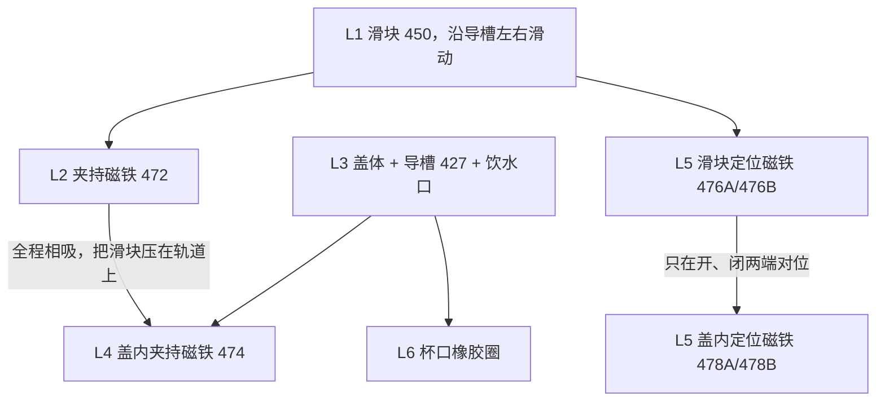

# YETI MagSlider 杯盖磁吸滑盖：滑块与盖内磁铁夹持，开闭两端保持

> [!summary] 一句话概述
> YETI MagSlider 在杯盖顶面的凹槽轨道里放一块可滑动的盖板：滑块和盖内都有磁铁，磁力把滑块吸在轨道上，并在打开、关闭两端把滑块稳住；沿轨道一推即可露出或盖住饮水口，整块滑块还可以克服磁力向上拔下来清洗。它不是螺纹旋盖，也不是只能吸住、不能滑动的门吸。

## 配图

![[附件/yeti-magslider-lid-top.jpg]]
*图源：[Hunting Waterfalls，《How To Clean a Yeti MagSlider Lid: 8 Steps With Pictures》](https://huntingwaterfalls.com/how-to-clean-a-yeti-magslider-lid/) 所用实物俯视照片。透明杯盖顶面有一条凹槽，黑色滑块停在饮水口一侧；盖周有一圈装配用的环形槽，盖缘带饮用唇。作者 Ryan McLean，页面可见日期 2023-06-18。*

![[附件/yeti-magslider-removing.jpg]]
*图源：同上文步骤“Pull Off Magslider With Your Fingers”配图。作者用手把滑块从凹槽里向上掀离，说明滑块在使用中并不是被卡死在轨道里，而是可以被磁力以外的拉力取下；盖周黑色橡胶圈仍在槽内。*

![[附件/yeti-magslider-us11021304-fig23.png]]
*图源：[US11021304B2，YETI Coolers, LLC](https://patents.google.com/patent/US11021304B2/en) 说明书附图 FIG. 23（Sheet 13 of 20，授权 2021-06-01）。滑块 450 位于盖体导槽 427 中；滑块内的第一夹持磁铁 472 与盖内更长的第二夹持磁铁 474 相对，箭头表示二者沿厚度方向相吸，在整个开闭行程中把滑块压在轨道上。*

> 图片版权归原作者/专利权人所有，仅作个人学习收藏；出处见文末「来源与核实记录」。

## 结构原理

> 本节所有数字只写来源里给出的；来源没有就写「来源未给出」。专利里有多组实施例（弹性卡腿、夹持磁铁、定位磁铁），下面把与市售 MagSlider 清洁照片相符的磁吸夹持方案作为主线，弹性卡腿方案单独注明，避免把不同实施例说成同一个实物剖视。

### 堆叠方案

方向：**沿饮水口到滑块行程的纵向剖面，从上到下（对应 US11021304B2 FIG. 23 的磁吸夹持实施例，零件号 400 系列）**

| 层级 | 零件 | 材料 | 厚度/尺寸 | 固定方式 | 依据 |
| --- | --- | --- | --- | --- | --- |
| L1（最外） | 滑块 450：顶面有手柄/盖帽，两端翼板可盖住或让开饮水口 | 聚合物（专利列举 ABS、PP、PE、PS、PVC、尼龙、PC 或丙烯酸等，未指定市售件牌号） | 来源未给出外形毫米值 | 沿盖上导槽 427 滑动；由夹持磁铁吸在盖上，可整块拔下 | 专利 FIG. 20、FIG. 23；Hunting Waterfalls 实物 |
| L2 | 第一夹持磁铁 472，在滑块内 | 来源未给出牌号 | 专利写它比盖内第二磁铁短，使开、闭两个位置都仍对着盖内磁铁 | 可包胶注塑后充磁，或超声波焊接、盖板固定 | 专利 FIG. 23 及夹持磁铁段落 |
| L3 | 盖体导槽 427 / 凹槽 126，以及饮水口 412/112、可选通气孔 | 与盖体同材。另一实施例（FIG. 22）盖体可由 410A/410B/410C 多层注塑，层间有隔热气囊 402 | 来源未给出槽宽 | 导槽限制滑块的左右位置和行程 | 专利 FIG. 2、FIG. 23 |
| L4 | 第二夹持磁铁 474，在盖内、沿行程布置 | 来源未给出牌号 | 专利写其长度应能在滑块全程与 472 相互作用 | 三射/四射注塑时包在盖内磁铁组件中，或后装 | 专利 FIG. 23 |
| L5（开闭保持，同系列 FIG. 24） | 滑块内定位磁铁 476A、476B；盖内定位磁铁 478A、478B | 来源未给出牌号 | 来源未给出间距 | 滑到两端时对应磁铁对位，把滑块保持在开或关 | 专利 FIG. 24 及定位磁铁段落 |
| L6 | 盖周可拆密封圈，卡在盖外侧槽里，与杯口配合 | Hunting Waterfalls 称为橡胶垫圈，外侧有沟槽 | 来源未给出截面尺寸 | 用手或（必要时小心地用）餐刀从槽中撬出，清洗后压回 | Hunting Waterfalls 步骤 2、8 |

剖面示意：

早期实施例（FIG. 1A–8）还给出不依赖磁铁夹持的机械方案：滑块有一对弹性腿 154a/154b，腿端凸缘伸进盖上的导引 134a/134b 下面，用卡扣把滑块留在导槽里，并用凹坑/凸起在开、闭位锁住。Hunting Waterfalls 所拍的市售盖在清洁时“只用手往上拔”，并写 “It's only held on with magnets”，与 FIG. 23 的磁吸夹持更相符；本篇不以弹性腿当作该实物的已证实内部结构，只把它作为同一专利中的另一种保持方式。

专利还写：夹持磁铁沿厚度方向充磁，让大面积平行表面产生主要吸力/斥力；盖内第二磁铁更长，所以无论滑块正向还是对调放置，472 在开、闭两端都仍位于 474 上方。这与 Hunting Waterfalls 写的“滑块怎样放回去都可以吸住”一致。FIG. 25 另有用侧向导引磁铁代替实体导槽、以及用限位磁铁阻止滑过打开位的方案，属于再一实施例，来源未说明市售件是否采用。

### 零件清单

| 零件 | 数量 | 功能 | 材料 | 依据 |
| --- | --- | --- | --- | --- |
| 杯盖本体 | 1 | 提供饮水口、导槽、通气孔，并容纳盖内磁铁 | 聚合物，具体牌号来源未给出 | 专利；实物照片 |
| 滑块（MagSlider） | 1 | 滑动开闭饮水口，可拆下清洗 | 聚合物；内藏磁铁 | 专利；Hunting Waterfalls |
| 夹持磁铁副 | 滑块内至少 1，盖内至少 1（474 更长） | 全程把滑块吸在盖上，拔出时需克服该力 | 牌号来源未给出 | 专利 FIG. 23 |
| 定位磁铁 | 滑块两端各一、盖内对应各一（476/478） | 在打开位和关闭位保持滑块 | 牌号来源未给出 | 专利 FIG. 24 |
| 杯口橡胶圈 | 1 | 盖与杯口之间的密封，可拆洗 | 橡胶（Hunting Waterfalls 用语） | Hunting Waterfalls |
| 通气孔 | 专利示例为 132a/132b 两个 | 滑块打开时与滑块上的槽对齐以通气 | 与盖一体 | 专利 FIG. 2、FIG. 22 |

### 装配顺序

按专利对磁吸夹持盖的形成与使用，以及 Hunting Waterfalls 的拆装清洗（清洗顺序即拆解顺序，再反向装回）：

1. 盖体成形：专利一例是先注塑盖体 410A，再注塑板部并把磁铁组件（含 474 等）包在盖内，必要时用第四射做层间密封，层间可留下气囊 402。磁铁也可以后装再盖板或超声波焊。
2. 滑块成形：把 472 及定位磁铁放入滑块后包胶，再充磁；或用盖板/焊缝固定。
3. 把滑块放到导槽 427 上，472 与 474 相吸即就位。因为对称，滑块有两个朝向都可放（专利；Hunting Waterfalls：“doesn't really matter which way you put the magslider on”）。
4. 把橡胶圈压进盖周槽，再把整盖扣到杯口。Hunting Waterfalls 只描述圈要压回去，未在已打开正文里写出上下唇的朝向。
5. 拆洗时：用手克服夹持磁力把滑块向上拔下；再把橡胶圈从槽中取出；分件清洗、完全干燥后再吸回滑块、压回胶圈。专利写拔出或扭转滑块，只要超过 472 与 474 的夹持力即可。

> Hunting Waterfalls 转述 YETI 在 Amazon 商品页的说法：MagSlider 盖抗泼溅、抗摔，可进洗碗机；并建议把小滑块放到餐具篮、盖放到上层。本篇作者未能打开 YETI 官网（返回 403），该洗碗机说明只作为该站对商品页的转述，不当作官方页原文。

### 受力与运动分析

- **受力路径**：手推滑块手柄，滑块沿导槽移动。夹持磁铁副在整个行程中把滑块压向盖面，抵抗颠簸时滑块跳离轨道。移到打开或关闭端时，定位磁铁对位，增加一个把滑块留在该端的力；专利还写到位时盖与滑块的相互作用会发出提示声。打开位时滑块翼板让开饮水口，关闭位时盖住饮水口以减少泼出。要把整块滑块取下，拉力（或扭转）必须超过夹持磁铁的吸力。专利给出的力区间：夹持磁铁 472 与 474 产生的力在一个具体例子中为 0.25–2.0 lbs；开或关滑块所需的力在某些情形下为 0.25–3 lbs。来源未给出市售某一型号的实测值。
- **运动关系**：滑块相对盖体主要是沿导槽的一维滑动，另有一个可拆卸的法向自由度（向上拔出）。导槽限制横向走偏。定位磁铁（或早期实施例里的凹坑/凸起）限制它在两端的停留。没有螺纹旋合，也不绕杯口旋转。
- **失效风险**：Hunting Waterfalls 指出滑块和胶圈下面会积污长霉，若不拆洗，盖在洗碗机里也去不掉这些霉。夹持力过小则滑块易掉；过大则推动费力、拆洗困难。定位不可靠时，走路颠簸可能让滑块离开关闭位而洒出——该盖被描述为减少泼洒，来源并未把它写成完全防漏。磁铁包胶若开裂，磁铁会暴露或松动（推断，来源未给出失效统计）。专利未给出磁铁耐热等级；洗碗机是否损伤磁铁，已打开的专利正文未写。

## 设计要点与参数

| 要点 | 内容 | 依据 |
| --- | --- | --- |
| 轨道 | 盖顶凹槽/导槽 427，滑块在其中直线移动，覆盖或露出饮水口 | 专利 FIG. 1A、FIG. 2、FIG. 23 |
| 夹持磁铁 | 滑块内 472 + 盖内更长的 474，沿厚度充磁，全程相吸，允许滑块对调放置 | 专利 FIG. 23 |
| 开闭保持 | 滑块 476A/476B 与盖内 478A/478B 在两端对位；到位可发声 | 专利 FIG. 24 |
| 可拆 | 向上拔或扭转，超过夹持力即可取下清洗，再放回吸住 | 专利；Hunting Waterfalls |
| 夹持力例子 | 0.25–2.0 lbs（472 与 474 之间） | 专利正文 |
| 开闭推力例子 | 某些情形下 0.25–3 lbs | 专利正文 |
| 材料 | 专利列举多种聚合物；未指定市售盖的牌号。胶圈为橡胶（清洁文用语） | 专利；Hunting Waterfalls |
| 成形 | 磁铁可包胶后充磁；盖可用三射/四射注塑包住磁铁并留隔热气囊 | 专利 |
| 通气 | 打开时滑块上的槽与盖上通气孔对齐 | 专利权利要求与 FIG. 2 |
| 对称 | 滑块两向都可安装 | 专利；Hunting Waterfalls |
| 市售磁铁牌号、滑块外形毫米、防漏等级测试值 | 来源未给出。清洁文转述商品页为 spill- and shatter-resistant，不是 leak-proof | — |

## 优缺点

**优点**
- 单手推动即可开闭饮水口，比旋盖快，也比无磁滑盖更不容易在颠簸中自己滑开或掉下来。
- 夹持磁铁和定位磁铁分工：一个管“别离开轨道”，一个管“停在开或关”。
- 滑块可整块拔下，胶圈可拆，便于清洗滑块下方的积污。
- 对称设计降低装回时的方向错误。

**缺点 / 代价**
- 不是完全防漏结构，只减少泼洒；倒放或高压差时不能当作密封旋盖用。
- 滑块下方和胶圈槽是霉斑盲区，不拆洗会累积。
- 磁铁必须可靠包在塑料里，增加注塑和充磁工序。
- 夹持力要落在“能推动、能拔下、又不易自行脱落”的窄区间，专利只给出示例范围，没有代替具体型号验证。

## 可借鉴点

- 需要“可滑动又要随时吸住”时，把夹持磁铁做成全程重叠（盖内磁铁比滑块磁铁长），再另用一对定位磁铁做两端保持，不要指望同一对磁铁同时完成全程夹持和末端锁位而不加说明。
- 把可拆清洗写成结构目标：保持力必须小于用手拔出的力，大于预期振动。
- 滑块做成两向对称，可降低装配和用户装回的错误。
- 若采用包胶磁铁，先放入再注塑、后充磁，避免成型温度破坏已充磁的磁体（专利给出的工艺顺序）。
- 对照橱柜门吸：门吸只有法向保持；这里必须在法向夹持的同时保留一维滑动，并在行程两端给出可感知的到位。

## 与库中相似案例对比

| 对比项 | 本案例（MagSlider 磁吸滑盖） | [[橱柜磁吸门吸：只有磁力保持、没有机械锁死（对照 FIDLOCK）]] | [[冰箱门磁封条：挤出胶套内嵌磁条闭环吸合，兼作闭合与密封（对照橱柜门吸）]] | [[FIDLOCK SNAP：圆形磁吸按扣侧向滑开（对照 V-BUCKLE 上掀）]] |
| --- | --- | --- | --- | --- |
| 主要运动 | 沿盖面导槽直线滑动，并可向上拔出 | 门扇转动，法向拉开 | 门扇转动，整圈吸合 | 按扣侧向滑开 |
| 磁力干什么 | 全程把滑块压在轨道上，并在开、闭两端保持 | 只保持门扇关闭 | 把密封唇压到箱口 | 引导并对中，打开靠侧向滑移 |
| 是否螺纹盖 | 否 | 否 | 否 | 否 |
| 密封角色 | 滑块盖住饮水口以减少泼洒；杯口另靠橡胶圈 | 基本不密封 | 整圈密封隔热 | 不作为密封件 |
| 何时用这篇 | 杯盖要单手滑开、可拆洗、两端要停住 | 柜门点状保持 | 门周连续密封 | 织带或服饰快拆按扣 |

## 相关案例

- [[橱柜磁吸门吸：只有磁力保持、没有机械锁死（对照 FIDLOCK）]]
- [[FIDLOCK SNAP：圆形磁吸按扣侧向滑开（对照 V-BUCKLE 上掀）]]
- [[冰箱门磁封条：挤出胶套内嵌磁条闭环吸合，兼作闭合与密封（对照橱柜门吸）]]
- [[Apple Pencil 2 侧边磁吸充电：线性排列的五颗磁铁与感应线圈]]
- 分类索引：[[04-机构与运动 索引]]

## 来源与核实记录

- 主来源：[US11021304B2, Closure and lid and method of forming closure and lid](https://patents.google.com/patent/US11021304B2/en)（YETI Coolers, LLC，发明人 Seiders、Tolman、Nichols；申请号 16/922,516，授权 2021-06-01。2026-11-27 已下载 Google Patents PDF，核对 FIG. 1A、2、4–8、20–25 及夹持磁铁、定位磁铁、0.25–2.0 lbs / 0.25–3 lbs、三射注塑与可拆说明。专利 PDF 文本为扫描件，部分栏间阅读时已对照 HTML 文本。）
- 交叉来源：[Ryan McLean / Hunting Waterfalls，《How To Clean a Yeti MagSlider Lid: 8 Steps With Pictures》](https://huntingwaterfalls.com/how-to-clean-a-yeti-magslider-lid/)（页面日期 2023-06-18。2026-11-27 打开并下载实物照片，核对滑块仅靠磁力吸着、用手拔下、任意朝向吸回、橡胶圈可拆及积霉位置。与 YETI 为不同机构。）
- 未打开：https://www.yeti.com/drinkware/drinkware-accessories/rambler-magslider-lid.html 与 https://www.yeti.com/rambler-cleaning.html 均返回 403，不引用为已核实的官网原文。文中涉及洗碗机的表述仅作为 Hunting Waterfalls 对 Amazon 商品页的转述。
