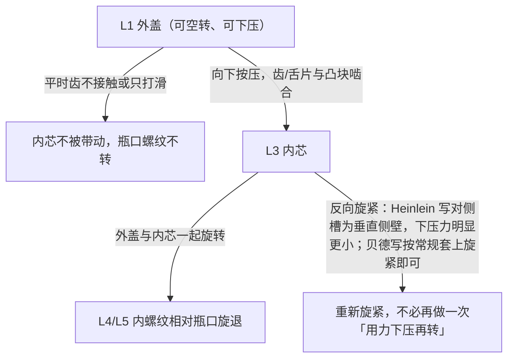

# 儿童安全瓶盖压旋锁：外盖与内芯齿平时不啮合，按下后啮合再旋转

> [!summary] 一句话概述
> 压旋式儿童安全盖（push-down-and-turn CRC）把瓶盖做成可相对转动、轴向可压合的外盖和内芯：平时两圈齿不啮合，只转外盖会空转或发出嗒嗒声，带内螺纹的内芯不会被带动；向下按压后齿（或舌片与凸块）啮合，再旋转才能把内芯从瓶口旋下。ISO 8317 和美国 16 CFR §1700.20 规定的是整包开启测试方法，不是齿形、下压力或扭矩的结构尺寸。

## 配图

![[附件/heinlein-crc-push-turn-caps.jpg]]
*图源：[Heinlein Plastik-Technik《Child-Resistant Closures》白皮书](https://catalogue.heinlein-plastik.de/assets/files/download/Whitepaper_Kindersicherheit_EN.pdf)（2024-09 修订）Overview 页，型号标注为 CRC-TE 18 / 28；盖顶模出向下按并旋转的图示（德英对照 PUSH DOWN / DRÜCKEN + TURN / DREHEN）*

![[附件/epa-crc-outer-inner-figure1.jpg]]
*图源：美国环保署（EPA）对 Gerresheimer Boleslawiec S.A. 型号 91176 Child-Resistant Tamper-Evident 封盖的说明文件 Figure 1，https://www.epa.gov/sites/default/files/2014-05/documents/gerrbol91176crteclosure.pdf ；该文件把它归为 ASTM Type IA。标注了 Outer Closure（外盖）与 Inner Closure（内盖），瓶颈部还有斜面棘轮（Ramped Ratchets）。防盗环是这一型号的附加功能，不是所有压旋盖都有*

![[附件/epa-crc-inner-castellations-figure2.jpg]]
*图源：同上 Figure 2；从内盖底部看：内盖一周城垛状凸起（Castellations on Inner Closure），防盗环上有斜面凸耳（Ramped Tabs on Ring），用来与瓶颈根部的斜面棘轮锁合。开盖仍须下压并同时逆时针旋转*

> 图片版权归原作者所有，仅作个人学习收藏；出处见文末「来源与核实记录」。

## 结构原理

> 本节所有数字只写来源里给出的；来源没有就写「来源未给出」。ISO 8317 的儿童/老人测试通过率不是结构参数，不写入下表尺寸栏。

### 堆叠方案

方向：**从瓶盖外侧到瓶口螺纹（由外到内、由上到下）**

| 层级 | 零件 | 材料 | 厚度/尺寸 | 固定方式 | 依据 |
| --- | --- | --- | --- | --- | --- |
| L1（最外） | 外盖（over cap / 外层大盖） | 贝德检测：聚乙烯注塑；Heinlein 白纸未给出树脂 | 来源未给出具体壁厚、外径 | 套在内芯外，可相对转动并轴向下压；外沿常有直纹便于捏转，盖顶常模出「下压+旋转」图示 | 贝德检测；Paramount；Heinlein 产品图 |
| L2 | 外盖内侧的齿 / 舌片 | 与外盖一体（来源按此描述） | 来源未给出齿高、齿数、齿距 | 不按压时与内芯齿分离或只能打滑；下压后顶住内芯端部凸块并使牙齿嵌合 | 贝德：外盖内的舌片顶住内盖端部的凸块并使牙齿嵌合；Paramount：两件 toothed edges，像尚未啮合的齿轮；鑫富达：最底下有一圈齿轮，正对外盖向下的齿轮 |
| L3 | 内芯 / 内盖（inner cap） | 贝德检测：聚丙烯注塑 | 来源未给出 | 与外盖二片叠合套装，可被外盖在啮合后带动旋转 | 贝德检测；Paramount；EPA 91176 也是 two-piece |
| L4 | 内盖内螺纹 | 与内盖一体 | 来源未给出螺距、牙型；须与瓶口螺纹匹配 | 旋合在瓶口外螺纹上，这才是真正「打开/旋紧」的螺纹副 | Paramount：inner piece typically has a thread that matches the thread on the container；EPA 91176：continuous threads |
| L5 | 瓶口外螺纹（及可选的颈部斜面棘轮、防盗环） | 鑫富达示例瓶体为高密度聚乙烯；EPA 示例为滴眼剂瓶，材料来源未给出 | 来源未给出 | 螺纹承受开合扭矩；EPA 91176 在颈根另有 ramped ratchets，供内盖底部防盗环的斜面凸耳锁入——这是该型号的附加防盗，不是压旋啮合本身 | 鑫富达；EPA Figure 1–2 |

剖面示意：

独立来源对同一动作的表述：

- Paramount：外盖和内盖都有对应的齿边，像两只尚未啮合的齿轮；只拧不按时两圈齿转而不碰，盖子会继续空转；向下施压把两件塑料压到一起后齿才啮合，再旋转就能带动内盖螺纹旋下。
- 贝德检测：打开时必须把外盖和内盖紧压，使外盖内的舌片顶住内盖端部的凸块，并让牙齿嵌合，同时旋转；否则只有嗒嗒的响声而无法打开。旋紧时只按常规套上瓶口旋紧即可。该文把这种压旋式儿童安全盖归为 ASTM D 3475-1995 中的 IA 型。EPA 对 91176 的文件也写 ASTM Type: IA。
- 鑫富达：里面一个小盖、外面一个可活动的大盖，最底下有一圈齿轮正对外盖向下的齿轮；不向下按，两个齿轮就不会相接，怎么转也打不开。
- Heinlein：制药用压转盖多为两件式，儿童安全基于擒纵/卡齿机构（catch mechanism）；只有在开启方向上同时施加稳固下压力并扭转时，两件才能啮合。重新旋上时所需压力明显更小，因为相反一侧的槽是垂直侧壁（vertically flanked），扭转更容易。可选附加功能包括「关闭时不需要轴向力」和「开启方向有可听见的咔嗒声」。家用化学品上还常见一件式压转盖，不要和两件式齿啮合结构混写成同一种零件清单。

### 零件清单

| 零件 | 数量 | 功能 | 材料 | 依据 |
| --- | --- | --- | --- | --- |
| 外盖 | 每盖 1 | 供手捏、下压和空转；把开启动作拆成「轴向+旋转」两步 | 贝德：聚乙烯 | 贝德；Paramount；Heinlein |
| 内芯/内盖 | 每盖 1 | 带瓶口螺纹，真正完成旋开/旋紧 | 贝德：聚丙烯 | 同上 |
| 啮合齿 / 舌片与凸块 | 外、内各一组 | 只有受压时才传递扭矩 | 与盖体一体，具体牌号来源未给出 | 贝德；Paramount；鑫富达 |
| 瓶口螺纹 | 1 | 与内盖螺纹旋合，密封和保持由瓶口结构及可选垫片承担 | 鑫富达示例：配高密度聚乙烯瓶；垫片「多种可选」，具体材料来源未给出 | 鑫富达；Paramount |
| 防盗环及颈根棘轮 | 可选（如 EPA 的 91176） | 首次开启断裂，留下可目视证据；与「儿童安全」不是同一功能 | 来源未给出 | EPA 91176；Paramount 也强调 tamper-evident 与 child-resistant 不是一回事 |
| 开启图示/文字 | 常见 | 提示成人「下压并旋转」 | 模塑在盖顶，Heinlein 产品图可见 | Heinlein；EPA Figure 5 也描述了盖顶向下箭头和逆时针箭头 |

### 装配顺序

按各厂对结构的说明归纳（不是某一灌装线的工艺卡）：

1. 分别注塑外盖和内芯（贝德：外盖 PE、内芯 PP）。
2. 把外盖套叠到内芯上，形成可相对转动、轴向可压合的二片套盖。两件如何卡死防掉、轴向游隙取多少，来源未给出。
3. 如需防盗环，按该型号把环留在内盖底部（EPA 91176：tamper-evident ring attached to the inner closure）。
4. 若有内垫片，按包材厂选项装入内盖（鑫富达写「多种垫片可选」，未给出厚度和材质）。
5. 灌装后把整盖按常规旋到瓶口上旋紧。贝德写旋紧不必再做下压啮合；Heinlein 写回旋方向因槽的垂直侧壁，所需下压力明显更小。可选设计甚至允许「关闭时不需要轴向力」。
6. 开启：向下按外盖，使齿或舌片-凸块啮合，同时按开启方向旋转，内芯螺纹退出瓶口。EPA 91176 还要求逆时针旋转，并在首次开启时拉断防盗环。

> 以上 1–2 步是按「二片叠合套盖」的结构反推装配，来源没有给出工装或卡接力数值。

### 受力与运动分析

- **受力路径**：成人手的轴向力先把外盖压向内芯，使两圈齿（或舌片与凸块）进入啮合；随后的扭转力矩经啮合面传到内芯，再由内芯螺纹变成沿螺旋的轴向退出力。不按压时，扭转只消耗在外盖空转或棘轮打滑（贝德所写的嗒嗒声）上，瓶口螺纹副不受开启扭矩。Heinlein 指出回旋方向槽壁更直，传递关闭扭矩所需的轴向力更小——这是刻意的方向不对称，不是同一齿形正反一样用。
- **运动关系**：外盖相对内芯有两个自由度：轴向压合（有限行程，具体行程来源未给出）和绕盖轴转动。只有这两个动作同时发生，外盖才能带动内芯。内芯相对瓶口只沿螺纹旋进旋出。EPA 91176 另有防盗环与颈根棘轮的周向锁合，首次开启被拉断后不再参与儿童安全啮合。
- **失效风险**：把 ISO 8317 或 CPSC 测试的「儿童打不开的比例」当成齿高、下压力或扭矩去设计——这些标准测的是整包在规定受试程序下的表现，不给出结构尺寸（推断：尺寸须由厂自己做机构设计和整包认证）。齿或舌片磨损、轴向游隙过大，可能未下压就偶尔带转，或下压后啮合不可靠（推断）。Heinlein 强调儿童安全盖不是「儿童完全打不开」，只是最后一道防线，且必须兼顾老年人能打开并重新关好；把开启做得过难，会在「senior-friendly」测试中失败，也可能导致成人把盖子改掉或不再盖严。Paramount 也区分 child-resistant 与 child-proof，并指出对部分残障使用者不友好。

## 设计要点与参数

| 要点 | 内容 | 依据 |
| --- | --- | --- |
| 双动作才能开启 | 必须先（或同时）下压，再旋转；只转外盖不能带动内芯 | Paramount；贝德；鑫富达；Heinlein |
| 齿的默认状态 | 不按压时两圈齿不啮合（空转或打滑发声） | Paramount；鑫富达；贝德 |
| 关闭方向不对称 | Heinlein：回旋侧槽为垂直侧壁，所需下压力明显更小；贝德：按常规套上旋紧即可 | Heinlein 白纸；贝德检测 |
| 材料组合（中文检测所/包材厂给出的常见做法） | 内芯 PP、外盖 PE；示例瓶体 HDPE | 贝德；鑫富达 |
| ASTM 分类 | 压旋式常见归类为 ASTM D 3475 的 IA 型 | 贝德检测；EPA 91176 文件写 ASTM Type IA |
| 认证标准是测试方法，不是结构尺寸 | 欧盟常用 DIN EN ISO 8317（可重复盖包装的要求和测试程序）；美国市场为 16 CFR §1700.20。Heinlein 写 ISO 8317 须每两年测试、十年后全面再认证；图标本身不能证明已通过认证。这些通过率条件不得当作齿形或力值 | Heinlein 白纸（2024-09） |
| 与防盗的区别 | 防盗要留下可见破坏证据；儿童安全要让幼童难以完成双动作。二者可以做在同一只盖上（如 91176），但功能不是同一个 | Paramount；EPA 91176 |
| 一件式与两件式 | Heinlein：家化常用一件式压转盖；制药玻璃/塑料瓶上其长项是两件式。不要把两种零件清单写成一种 | Heinlein 白纸 |
| 下压力、扭矩、齿数、壁厚 | 来源未给出 | 已打开的各页均无这些结构尺寸 |

## 优缺点

**优点**
- 把「旋转打开」拆成儿童不易同时完成的轴向按压加旋转，不改变瓶口螺纹这一成熟密封/保持方式
- 关闭方向可以做得比开启轻松（垂直侧壁或「按常规旋紧」），兼顾回封
- 外盖空转或打滑发声，给旁边成人一个可听见的提示（贝德；Heinlein 可选咔嗒声）
- 可与防盗环叠用，但两者分工清楚

**缺点 / 代价**
- 对握力不足的成人和部分残障使用者不友好，设计必须做整包认证，而不是只看「孩子打不开」
- 二件套增加零件和叠装工序；轴向游隙和齿磨损会直接改变空转/啮合边界
- ISO 8317 等标准不给结构尺寸，不能靠抄通过率来定齿高和弹簧（如有） 
- 一件式家化盖和两件式药瓶盖原理相近、零件不同，不能混用同一张装配图

## 可借鉴点

- **「平时不传递、受压才啮合」是一种可复用的双动作锁**：默认空转，避免单一旋转被误打开。库里的灶具旋钮也是先轴向解锁再旋转，但那里解锁的是阀芯约束，这里解锁的是扭矩传递路径。
- **正反方向不要做成同一齿形**：开启要费力，回封要容易，否则老人或护理者会关不严。Heinlein 用「开启侧需下压啮合、回旋侧垂直侧壁」把这个不对称做进齿槽。
- **不要把测试方法标准当成零件图**：ISO 8317 回答的是「这只包装在规定受试程序里表不表现得足够儿童安全且老人可开」，不回答齿高、下压力和扭矩。结构参数只能来自机构设计和整包实测。
- **儿童安全 ≠ 防盗 ≠ 密封**：螺纹和垫片管密封，齿啮合管开启门槛，防盗环管首次开启证据。做产品说明和失效分析时要分开写。
- 盖顶把「下压+旋转」做成凸起图示，比只靠说明书更可靠。

## 与库中相似案例对比

| 对比项 | 本案例 | [[灶具旋钮轴向解锁：先推或拉解除转动约束，阀芯压紧与解锁分工]] | [[Southco、DZUS 四分之一转快锁：90° 凸轮与按总材料厚度选钉长]] |
| --- | --- | --- | --- |
| 双动作 | 先（或同时）下压，齿啮合后再旋转 | 先推或拉，解除转动约束后再转阀 | 约 90° 旋转，凸轮爬斜面拉紧 |
| 默认状态 | 外盖空转，扭矩传不到螺纹 | 转不动，阀芯保持压紧 | 未转到凹坑则未锁死 |
| 真正做功的结构 | 内芯与瓶口的螺纹 | 阀芯与阀体 | 凸轮+搭扣+弹簧预紧 |
| 标准角色 | ISO 8317 是整包测试，不是齿的尺寸标准 | 来源按灶具安全结构说明 | 按 TMT 选钉长，系列手册给偏差和拉力档 |

## 相关案例

- [[灶具旋钮轴向解锁：先推或拉解除转动约束，阀芯压紧与解锁分工]]
- [[Southco、DZUS 四分之一转快锁：90° 凸轮与按总材料厚度选钉长]]
- [[翻盖式按键防误触：铰链、自动回盖弹簧与独立按钮]]
- 分类索引：[[04-机构与运动 索引]]

## 来源与核实记录

- 主来源：[贝德检测：ASTM D 3475 防止儿童打开（压旋式儿童安全盖结构说明）](https://www.beide.com/prod_view.aspx?FId=t3%3A140%3A3&Id=317&TypeId=140)（页面正文；深圳市贝德技术检测有限公司。PP 内芯 + PE 外盖、舌片顶凸块、牙齿嵌合、不压则嗒嗒声、ASTM D 3475 IA 型。该页「图1/图2」在打开时已换成企业证书，结构图未能下载，故配图改用下方独立来源）
- 补充来源 1：[鑫富达医药包装：压旋盖瓶与普通瓶有何区别](https://xfdyb.com/show-1025.html)（石家庄鑫富达；双层盖、底部齿轮正对、不按则不相接。独立包材厂，不与贝德算同一机构）
- 补充来源 2：[Paramount Global: Guide to Child Resistant Caps & Closures](https://www.paramountglobal.com/knowledge/child-resistant-closures/)（Hayley Chesshir，2022-08-11 发布，页面显示 Last updated: 2026-01-30；over cap + inner cap、齿如未啮合齿轮、只转会空转。该文也写了 CPSC 测试通过率，本文不把那些比例当作结构参数）
- 补充来源 3：[Heinlein Plastik-Technik CRC 白皮书（英文，last amended: September 2024）](https://catalogue.heinlein-plastik.de/assets/files/download/Whitepaper_Kindersicherheit_EN.pdf)（已下载 PDF；两件式 catch mechanism、回旋侧垂直侧壁、ISO 8317 为认证测试而非尺寸标准、一件式与两件式分工、1985 年起做 push-and-turn）
- 补充来源 4：[US EPA 文件：Gerresheimer 91176 CRTE closure](https://www.epa.gov/sites/default/files/2014-05/documents/gerrbol91176crteclosure.pdf)（已下载；Figure 1–5 实物标注，ASTM Type IA，下压并逆时针旋转，防盗环与颈根棘轮。用作配图和 IA 型互证，不把该滴眼剂瓶的防盗细节写成所有 CRC 的必要零件）
- 核实：2026-11-22 实际打开上述页面并下载 Heinlein、EPA 两份 PDF。讯科标准（xktest）也有压旋原理短述，与贝德相近，仅作旁证。紫荆包装页面文字与贝德高度同质，不另计独立机构。未能打开的 iczhiku 转载页不引用。
