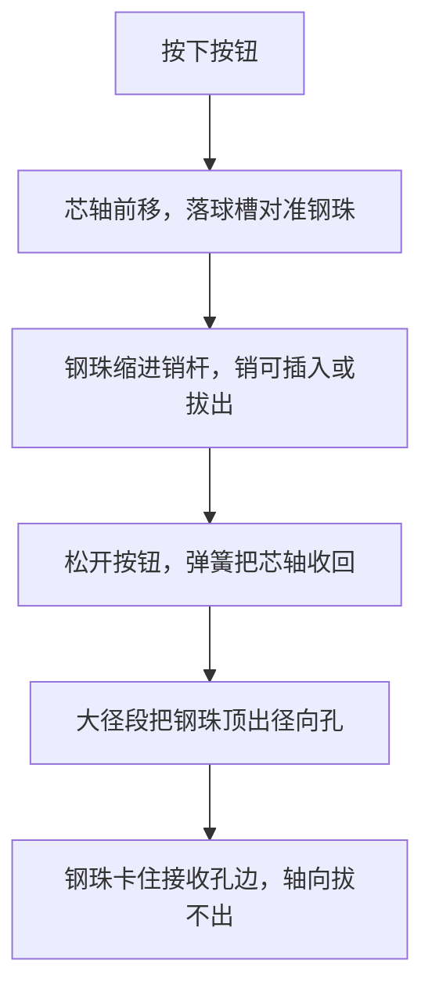

# 单动式球头快卸销：按按钮收钢珠，松手后钢珠弹出锁紧

> [!summary] 一句话概述
> 单动式球头快卸销在销杆端部用弹簧把芯轴的大径段顶到钢珠背后，把钢珠从径向孔里顶出，卡住被连接件；按下按钮时芯轴前移，落球槽对准钢珠，钢珠缩进销杆，销才能插入或拔出。松开按钮后机构自动回到锁紧，不需要再转凸轮或拧螺钉。航空规范型号如 Halder 4212 按 MS17986 / NAS1333–1343 制造、按 NAS 1332 试验，钉长按夹紧长度 L 选取，不能和工业目录里的同名义直径抗力混用。

## 配图

![[附件/halder-4212a20-product.jpg]]
*图源：[Halder 4212.A20 数据表](https://www.halder.com/eng/file-download/object_file_ds4212a20_en) 第 1 页产品图；单动式 L 手柄球头快卸销，顶端是按压按钮，手柄带挂环，销杆端部可见伸出的锁紧钢珠*

![[附件/halder-4212a20-drawing.jpg]]
*图源：同上数据表第 2 页 Drawing；L 为夹紧长度，øA 为名义直径，端部倒角 15°–30°，钢珠所在处标 øE，手柄处标 øD、G、H、K 等*

![[附件/halder-4212a20-order-table.jpg]]
*图源：同上第 2 页订货表；4212.A20 名义直径 3/16 in，夹紧长度 L = 2 in，双剪最小抗力 5,150 lbf，对应 MS17986C320 / NAS1333A5C20D*

> 图片版权归原作者所有，仅作个人学习收藏；出处见文末「来源与核实记录」。

## 结构原理

> 本节所有数字只写来源里给出的；来源没有就写「来源未给出」。

### 堆叠方案

方向：**沿销轴，从手柄/按钮端到插入端（球端）**

| 层级 | 零件 | 材料 | 厚度/尺寸 | 固定方式 | 依据 |
| --- | --- | --- | --- | --- | --- |
| L1（手柄端最外） | 按压按钮 | Halder：CRES 303，钝化（ASTM A484/484M） | 来源未给出按钮行程 | 轴向按压，驱动芯轴 | Halder 4212.A20 材料表；Carr Lane 解剖页：按钮伸出为锁紧、按下为解锁 |
| L2 | L 手柄与挂环 | 手柄：铝合金 A380，黑色阳极氧化（ASTM B85/B85）；挂环：CRES 302，钝化 | 挂环钢丝直径数据表标 ø.100 min.；内侧相关尺寸标 ø.050 min. | 手柄与销体组装；挂环穿在手柄上 | Halder 4212.A20 材料表与 Drawing |
| L3 | 压缩弹簧 | CRES 302，钝化（ASTM-A-313） | 来源未给出弹簧刚度和圈数 | 装在芯轴/按钮一侧，把芯轴拉回手柄方向 | Halder 材料表；Carr Lane：弹簧持续把按钮向外推、把芯轴收回手柄端 |
| L4 | 芯轴（spindle） | CRES 17-4PH，沉淀硬化，钝化（AMS5643）；热处理 Rc. 40 min.（AMS2759，Condition H900） | 有大径段和缩径的落球槽（ball drop） | 在销体内轴向滑动 | Halder 材料/热处理；Carr Lane 解剖页 |
| L5 | 销体（body / shank） | CRES 17-4PH，沉淀硬化，钝化（AMS5643）；热处理 Rc. 40 min. | 4212.A20：A min. 0.187 in，A max. 0.1885 in；夹紧长度 L = 2 in（公差 +0.02 / 0） | 插入接收孔 | Halder 4212.A20 订货表 |
| L6 | 锁紧钢珠与径向孔 | 钢珠：CRES 440C，沉淀硬化，钝化（AMS5630）；热处理 Rc. 58–62 min. | 钢珠处尺寸在表中对应 E 等栏目（4212.A20：E max. 0.5 in，B = 0.22 in ±0.005） | 钢珠在径向孔内径向进出 | Halder 材料/热处理与订货表；Carr Lane：钢珠通常 2、3 或 4 颗 |
| L7 | 接收件（孔或槽） | 应用自定 | Carr Lane 给了各名义直径的推荐孔径与抗拉、双剪强度，见表「设计要点」；Halder 未在该页给推荐孔径 | 钢珠伸出后卡在孔边或槽里 | Carr Lane 强度表 |

剖面示意：

独立来源对同一动作的表述：

- Halder 4212 数据表 Operation：单动式球头销是自锁的，需要按一下按钮才能释放钢珠（self-locking and require a push of the button to release the balls）。
- Carr Lane 解剖页把动作分成三态：按钮松开时弹簧把芯轴收回，大径段把钢珠顶出，为自然锁紧态；按下按钮时芯轴前移，落球槽让钢珠内收，销可进出；再松开按钮，钢珠被重新顶出。若此时钢珠还顶在孔壁上、没有对准槽或孔，钢珠会暂时半缩回，对准后会弹入。

二者说的是同一套「按按钮收珠、松手弹珠」的单动机构。Carr Lane 另一篇总述里曾把「按下」和「松开」的锁/解锁写反，与该司解剖页和 Halder 都不一致，本文不以那几句为准。

### 零件清单

| 零件 | 数量 | 功能 | 材料 | 依据 |
| --- | --- | --- | --- | --- |
| 销体 | 每销 1 | 承剪、容纳钢珠和芯轴 | 见上表，Halder 为 17-4PH | Halder 4212 |
| 芯轴 | 每销 1 | 用大径段或落球槽控制钢珠径向位置 | 17-4PH | Halder；Carr Lane |
| 钢珠 | 每销通常 2、3 或 4（Carr Lane） | 伸出后阻止轴向拔出 | Halder：440C | Carr Lane 解剖页；Halder 材料表 |
| 压缩弹簧 | 每销 1 | 默认把机构保持在锁紧 | CRES 302 | Halder；Carr Lane |
| 按压按钮 | 每销 1 | 把芯轴推到解锁位置 | CRES 303 | Halder |
| L 手柄 | 每销 1（本系列） | 握持、安装按钮 | A380 铝，黑阳极氧化 | Halder |
| 挂环 | 每销 1（本系列） | 防掉、系绳 | CRES 302 | Halder |
| 接收孔/板 | 应用自定 | 提供钢珠的挡边或槽 | 来源未给出单一材料 | Carr Lane |

### 装配顺序

按目录的结构与操作逻辑（不是某一现场工艺卡）：

1. 销体上先加工径向孔，装入钢珠、芯轴和弹簧，再装按钮与手柄、挂环。具体厂内装配步骤来源未给出。
2. 选用时先定名义直径和夹紧长度 L（被夹层的总厚所对应的工作段），再进该系列的订货表。Halder 4212 还给出符合标准但不在表内的直径/长度组合可按客户要求生产。
3. 接收孔按所用目录的推荐孔径来开（Carr Lane 有英制/公制表；Halder 该页未列推荐孔径）。
4. 插入：按下按钮，钢珠缩进，把球端插入接收孔，直到夹紧长度段就位。
5. 松开按钮，确认按钮已伸出、钢珠已弹出。Carr Lane 写这时常能感到或听到钢珠就位。
6. 拆卸再按按钮，待钢珠缩回后拔出。Carr Lane 提醒：单动式在受剪、销被压向孔壁时，若按钮在载荷的对侧，操作者要一边按按钮一边逆着剪力拔销，比较费力；双动式芯轴两侧都有落球槽，推或拉手柄都能让钢珠缩回。本篇只写单动式，双动式不展开。

### 受力与运动分析

- **受力路径**：工作剪力主要由销体横截面承担。Halder 给出的是「two-shear / 双剪」最小抗力；Carr Lane 同样给 Calculated Double Shear Strength，并注明安全系数 2:1。轴向拔出力则经过伸出的钢珠传到芯轴和销体。Carr Lane 另列 Approximate Pull Out Strength，并指出钢珠与孔壁是点接触，接收孔要有足够边距和材料强度，否则会变形。
- **运动关系**：芯轴只有一个落球槽，解锁时只朝球端方向移动（单动）。钢珠在径向孔里做径向进出。按钮松开是自然锁紧态，必须主动按压才能解锁。
- **失效风险**：夹紧长度选错，钢珠还没过孔边就松开，或过了头对不齐槽。按 Halder，航空件按 NAS 1332 试验，不能把工业目录里同名义直径的剪力值直接套过来——4212.A20 的 3/16 in 双剪最小 5,150 lbf，Carr Lane 同名义直径钢制双剪约 2,100 lbf，材料、热处理和规范都不同。Carr Lane 还写：夹紧长度超过 8 in 的特殊件为了保持直线度不热处理，双剪大约会降 20–50%。按钮卡住或污染时，机构默认停在锁紧（Carr Lane 称为 fail-safe），这时可能拔不出来，但不会在未按按钮时自己解锁。

## 设计要点与参数

| 要点 | 内容 | 依据 |
| --- | --- | --- |
| 动作 | 单动、自锁：按按钮释放钢珠，松开后钢珠弹出锁紧 | Halder Operation；Carr Lane 解剖页 |
| 4212.A20 规格 | 名义直径 3/16 in；A min. 0.187 in，A max. 0.1885 in；L = 2 in（+0.02 / 0）；B = 0.22 in ±0.005；C = 0.26 in（0 / −0.04）；D max. 0.31 in；E max. 0.5 in；F max. 1.8 in；G min. 1.27 in；H = 0.76 in；K max. 0.34 in；质量 27 g | Halder 4212.A20 订货表 |
| 双剪最小抗力 | 5,150 lbf（两剪） | 同上 |
| 工作温度 | −65 至 200 °F | 同上 |
| 对应标准号 | MS17986C320 / NAS1333A5C20D；系列按 MS17986 / NAS1333–1343 制造，按 NAS 1332 试验 | 同上及产品说明 |
| 热处理 | 销体、芯轴 Rc. 40 min.（AMS2759，H900）；钢珠 Rc. 58–62 min. | Halder |
| 表面处理 | 不锈钢件按 AMS2700 钝化；铝件按 MIL-A-8625 阳极氧化 | Halder |
| 端部倒角 | Drawing 标 15°–30° | Halder Drawing |
| Carr Lane 3/16 in（#10）强度（工业目录，不是 Halder/NAS 数） | 近似拔出 200 lbf；计算双剪：钢 2,100 lbf，不锈钢 2,300 lbf；安全系数 2:1 | Carr Lane 英制强度表 |
| Carr Lane 手柄型式 | 双动式常见环、T、L 三种手柄（该页把这三种写在双动式下） | Carr Lane 技术总述 |
| 认证变体 | Carr Lane 可按特殊件提供 MS、NAS 认证销，成本更高 | 同上 MS / NAS Conversions |

## 优缺点

**优点**
- 单手按按钮就能插拔，比拧螺钉或转四分之一转快锁更直接，适合频繁换件
- 松开按钮即锁紧，失效时倾向保持锁紧而不是自动脱落
- 航空系列把材料、热处理、双剪抗力和标准号写进同一张表，便于按规范选型
- 钢珠只负责防拔，剪力走销体，分工清楚

**缺点 / 代价**
- 单动式在受剪时可能要逆着载荷拔，操作不如双动式省力
- 同一名义直径，工业目录和 NAS/MS 航空件的抗力可以差一倍以上，混用目录会选错
- 夹紧长度和接收孔边距要配对；孔边太弱时，点接触会把孔口压坏
- 需要给按钮留出按压空间，脏污或冰冻可能造成按不动（此时通常是拔不出，而不是自己掉）

## 可借鉴点

- **默认锁紧、主动解锁**：用弹簧把芯轴保持在「大径顶珠」位置，只有按按钮才让出落球槽。做快拆销时不要做成「不按也松」的结构。
- **销长按夹紧长度选，不要按看起来差不多选**。L 对的是被夹层厚度，太短钢珠过不了孔边，太长对不齐槽。
- **剪力和防拔分开算**：双剪看销体材料和热处理，拔出看钢珠和孔边。不要用钢珠去扛剪切。
- **不要跨目录抄抗力**。Halder 4212 的 5,150 lbf 和 Carr Lane 的 2,100 lbf 都是 3/16 in，但规范、材料和试验不同。
- 接收孔要按所用目录给边距和孔径；钢珠是点接触，孔口倒角过大或材料过软会先坏。

## 与库中相似案例对比

| 对比项 | 本案例 | [[Southco、DZUS 四分之一转快锁：90° 凸轮与按总材料厚度选钉长]] | [[GoPro 快拆卡扣与指旋螺母：两爪弹性卡入和螺钉夹紧是两套锁]] |
| --- | --- | --- | --- |
| 动作 | 按按钮收珠，松手弹珠锁紧，无旋转 | 约 90° 凸轮爬斜面，凹坑+弹簧防松 | 两爪弹性卡入，另用指旋螺母夹紧 |
| 选型关键 | 名义直径 + 夹紧长度 L；航空件看 NAS/MS 表 | 先算 TMT 再选钉长 | 卡口尺寸与螺母预紧，不是销长表 |
| 防松 / 防拔 | 伸出的钢珠挡孔边；弹簧保持顶出 | 凸轮峰 + 凹坑 + 弹簧 | 弹性爪定位，夹紧靠螺母 |
| 掉件 | 可配挂环；销是单独零件，拔出后要收好 | 挡圈把钉留在面板上 | 公头可留在配件上 |

## 相关案例

- [[Southco、DZUS 四分之一转快锁：90° 凸轮与按总材料厚度选钉长]]
- [[GoPro 快拆卡扣与指旋螺母：两爪弹性卡入和螺钉夹紧是两套锁]]
- [[台阶螺丝（ISO 7379 塞打螺丝）：光杆定位、螺纹只锁紧]]
- 分类索引：[[04-机构与运动 索引]]

## 来源与核实记录

- 主来源：[Halder 4212.A20 数据表（Ball Lock Pins single acting, comply with NAS / MS17986）](https://www.halder.com/eng/file-download/object_file_ds4212a20_en)（页脚 Published on: 12.9.2026；Erwin Halder KG。材料与热处理、单动自锁操作、4212.A20 尺寸表与 5,150 lbf 双剪最小抗力、MS/NAS 号）
- 补充来源 1：[Halder EH 4212 系列数据表](https://www.halder.com/eng/file-download/object_file_dsag_eh4212_en)（Published on: 19.11.2026；与 4212.A20 同属 Halder，不另计机构。确认系列说明、材料与单动操作一致）
- 补充来源 2：[Carr Lane: How Ball Lock Pins Work（解剖与动作）](https://www.carrlane.com/engineering-resources/technical-information/ball-lock-pins-engineering-application/how-ball-lock-pins-work)（独立厂商。芯轴大径段/落球槽、钢珠径向进出、单动与双动差别、默认锁紧）
- 补充来源 3：[Carr Lane: Ball Lock Pin Technical Information（强度表）](https://www.carrlane.com/engineering-resources/technical-information/manual-workholding/ball-lock-pin-technical-information)（与上同属 Carr Lane。英制/公制拔出与双剪表、安全系数 2:1、材料与锌镀层、MS/NAS 可作特殊件。该页「Types」一节对按下/松开的锁解锁表述与解剖页矛盾，已对照后不采用）
- 核实：2026-11-22 下载两份 Halder PDF 并打开两篇 Carr Lane 页面。未把杭州汇智等经销转载页计为第二机构。
