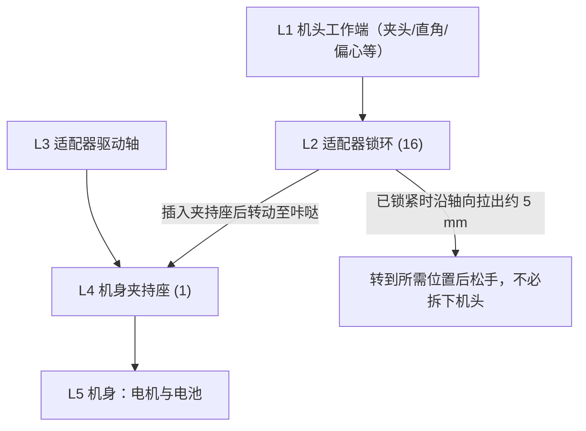

# 博世 FlexiClick 机头快换：插入夹持座后转动锁环至咔哒，轴向拉出约 5 mm 转到 16 个位置

> [!summary] 一句话概述
> 博世 FlexiClick 把电机与电池留在同一机身里，钻夹头、直角、偏心等机头作为独立适配器：先把适配器插入机身前端的夹持座，再转动适配器上的锁环，直到听到咔哒完成锁紧；要改方向时不必拆下机头，只需把已锁紧的适配器沿轴向拉出约 5 mm，转到所需位置后松手。解锁则按开锁方向转动锁环，再把适配器从夹持座上拉下。

## 配图

![[附件/bosch-flexiclick-adapter-family.jpg]]
*图源：[Bosch GSR 18V-60 FC Professional 原厂说明书 1 609 92A 53L（2019.12）](https://www.tooled-up.com/artwork/ProdPDF/Bosch-GSR-18V-60-FCC-User-Manual.pdf) 图示页；机身前端是夹持座 (1) 与批头锁套 (2)，各机头（GFA 18-M/B/W/E/WB）上都标出锁环 (16)*

![[附件/bosch-flexiclick-lock-ring-click.jpg]]
*图源：同上说明书图 B；先取出批头，将适配器插入夹持座 (1)，转动锁环 (16) 直至发出咔哒（图中 CLICK 与锁符号）*

![[附件/bosch-flexiclick-index-5mm-and-unlock.jpg]]
*图源：同上说明书图 E、图 F；已锁紧的直角/偏心机头可沿轴向拉出约 5 mm（图中标 max. 5 mm）后再转到所需位置并松手；拆下时按开锁方向转动锁环，再从夹持座 (1) 上拉出适配器*

> 图片版权归原作者所有，仅作个人学习收藏；出处见文末「来源与核实记录」。

## 结构原理

> 本节所有数字只写来源里给出的；来源没有就写「来源未给出」，不估算、不换算成看似精确的值。

### 堆叠方案

方向：**从机头工作端回到机身（含电机与电池）**

| 层级 | 零件 | 材料 | 厚度/尺寸 | 固定方式 | 依据 |
| --- | --- | --- | --- | --- | --- |
| L1（最外，工作端） | 钻夹头、批头锁套、直角或偏心输出等，视适配器型号而定 | GFA 18-M：13 mm 全金属夹头；其余来源未给出 | GFA 18-M 外形 71×48×52 mm，重量 0.4 公斤；GFA 18-W 外形 92×48×75 mm，重量 0.4 公斤；GFA 18-H 外形 146×58×58 mm，重量 0.8 公斤 | 夹头旋紧或锁套锁定批头 | 博世中国 GFA 18-M/W/H 产品页 |
| L2 | 适配器壳体与锁环 (16) | 来源未给出（Tools In Action 评测观察「机头部分看起来是金属」，不作为材料规格） | 来源未给出锁环行程与齿数 | 锁环转到发出咔哒后把适配器保持在机身夹持座上 | 原厂说明书图 B、零件 (16)；Tools In Action |
| L3 | 适配器驱动轴（12 V 锤钻附件说明书称为 hex shaft） | 来源未给出 | 来源未给出对边尺寸 | 插入机身夹持座 / 六角驱动孔，并须推到「离合环与锁环之间无间隙」后再锁紧（GFA12-H 说明书） | GFA12-H 说明书装配节 |
| L4 | 机身夹持座 (1) 与批头锁套 (2) | 来源未给出 | 来源未给出 | 无适配器时可直接插批头；有适配器时作为机头的机械与扭矩接口 | 原厂说明书 Product Features |
| L5 | 机身（电机、变速、扭矩预置环、电池接口） | 来源未给出 | GSR 18V-60 FC：额定电压 18 V；空载转速一挡 0–600 min⁻¹、二挡 0–1900 min⁻¹；最大扭矩（硬/）60/31 Nm | 电池包另行锁在机身尾部，不属于本篇机头接口 | 原厂说明书 Technical Data；对照见[[电动工具电池包：滑轨插入与按压锁舌（得伟拆解）]] |

剖面示意：

锁紧与防转、如何解锁（只写打开过的来源）：

- **装上**：先取出夹持座里的批头。把适配器插入夹持座 (1)，转动锁环 (16) 直到发出可听见的咔哒（原厂 18 V 说明书）。12 V 的 GFA12-H 写得更具体：先确认主六角驱动孔里没有批头，把附件的六角轴插入驱动孔并边推边正反轻转，直到离合环与锁环之间没有间隙，再把锁环转向锁定符号，直到咔哒。
- **防转 / 改角度**：博世中国产品页写，适配器能够锁定在 16 个不同的位置（360 度），而不必从起子机上拆下。原厂说明书把动作写为：把已锁紧的适配器拉离机身约 5 mm，转到所需位置后松手。图 E 在直角/偏心机头上标了 max. 5 mm。锁环锁死后，不先做这一轴向拉出，就不能自由转动机头（推断：轴向拉出是为了解除周向分度；锁环本身负责把适配器保持在机身上）。锁环内部是齿牙、销还是凸轮，来源未给出，本文不编造。
- **拆下**：先取出适配器里的批头，按开锁方向转动锁环，再把适配器从夹持座上拉下。GFA12-H 图 3：把锁环转向开锁符号直到咔哒，再把附件从工具上拉出。
- **电压等级**：博世 FlexiClick 系统页写，12 V 附件只与 12 V FlexiClick 起子机兼容，18 V 附件只与 18 V 兼容，不能跨电压混用。

### 零件清单

| 零件 | 数量 | 功能 | 材料 | 依据 |
| --- | --- | --- | --- | --- |
| 机身 / FlexiClick 电钻（如 GSR 18V-60 FC） | 1 | 提供电机、变速、电池接口和前端夹持座 | 来源未给出 | 原厂说明书 |
| 夹持座 (1) | 1 | 接收批头或适配器驱动轴 | 来源未给出 | 原厂说明书 Product Features |
| 批头锁套 (2) | 1 | 无适配器时锁定批头 | 来源未给出 | 原厂说明书：后推锁套、转动插入批头后松开锁定 |
| 锁环 (16) | 每只适配器 1 | 把适配器锁在夹持座上，开锁后可拆下 | 来源未给出 | 原厂说明书图 B、图 F |
| 机头适配器（GFA 18-M/B/W/E/WB，或 12 V 对应件、GFA 18-H 等） | 按系统选配 | 改变输出形式（夹头、直角、偏心、锤钻等） | GFA 18-M 夹头为 13 mm 全金属；其余来源未给出 | 博世中国产品页；原厂说明书附件列表 |
| 电池包 | 1 | 供电；锁在机身尾部，不是本篇快换对象 | 见对照案例 | 原厂说明书 Removing the Battery |

### 装配顺序

按原厂说明书「装配/更换工具」节（不是拆解反推）：

1. 先拆下电池，避免误启动（GFA12-H 与 18 V 说明书均要求在装配或换附件前断开电池）。
2. 若夹持座 (1) 里已有批头：后推锁套 (2)，把批头拉出。
3. 把所选适配器插入夹持座 (1)。12 V 锤钻附件还要求正反轻转、推到与锁环无间隙。
4. 转动锁环 (16) 直到发出咔哒，完成锁紧。
5. 再按该适配器的方式装入钻头或批头（直角/偏心用锁套；夹头类按图 D 旋紧）。
6. 若要改变直角或偏心机头的周向位置：把已锁紧的适配器拉出约 5 mm，转到所需位置后松手。博世中国页写共 16 个位置、覆盖 360 度。
7. 拆下时先取出工作端的批头/钻头，按开锁方向转锁环，再把适配器从夹持座上拉下。

### 受力与运动分析

- **受力路径**：钻孔或拧紧的反力矩从工作端进入适配器，经驱动轴传到机身夹持座，再由机身和操作者承担。锁环负责在轴向把适配器保持在夹持座上；来源未给出锁环的额定保持力或抗扭结构细节。
- **运动关系**：锁紧后，适配器相对机身在轴向上被保持；要改变周向角度时，先轴向拉出约 5 mm，再转动，松手后重新落入某一锁定位置。拆卸时锁环转到开锁方向，适配器可沿轴向抽出。无适配器时，夹持座本身仍可直接插批头。
- **失效风险**：未先取出批头就插拔适配器，说明书明确禁止（夹持座内不得留批头）。锁环未转到咔哒或 12 V 附件未推到无间隙就锁紧，存在松脱风险（推断，来源要求必须听到咔哒并确认贴合）。12 V 与 18 V 附件不能混用。内部锁紧元件的磨损与寿命，来源未给出。

## 设计要点与参数

| 要点 | 内容 | 依据 |
| --- | --- | --- |
| 锁紧动作 | 适配器插入夹持座后，转动锁环直至发出可听见的咔哒 | 原厂说明书 Fitting the adapter（图 B） |
| 解锁动作 | 按开锁方向转锁环，再从夹持座上拉下适配器 | 原厂说明书 Removing the adapter（图 F）；GFA12-H 图 3 |
| 周向分度 | 16 个位置、360 度，不必拆下机头；操作是把已锁紧适配器拉出约 5 mm 再转动后松手 | 博世中国产品页；原厂说明书 Turning the adapter，图 E 标 max. 5 mm |
| 驱动对中 | 12 V 锤钻附件：六角轴插入机身 hex drive，正反轻转并推到离合环与锁环无间隙后再锁 | GFA12-H 说明书 Mounting and Removing |
| 电压兼容 | 12 V 附件只配 12 V 机身，18 V 附件只配 18 V 机身 | 博世 Professional FlexiClick 系统页 |
| GFA 18-M 规格 | 13 mm 全金属夹头；重量 0.4 公斤；外形 71×48×52 mm | 博世中国 GFA 18-M 产品页 |
| GFA 18-W 规格 | 带钻头夹持的直角适配器；重量 0.4 公斤；外形 92×48×75 mm | 博世中国 GFA 18-W 产品页 |
| GFA 18-H 规格 | 把 FlexiClick 起子机变成 SDS plus 锤钻；重量 0.8 公斤；外形 146×58×58 mm；最大单次锤击力 1 J（产品页同时写 1.0 J） | 博世中国 GFA 18-H 产品页 |
| 机身示例参数 | GSR 18V-60 FC：18 V；空载转速 0–600 / 0–1900 min⁻¹；最大扭矩（硬/）60/31 Nm | 原厂说明书 Technical Data |
| 锁环内部结构 | 齿数、销径、材料、保持力：来源未给出 | — |

## 优缺点

**优点**
- 电机和电池留在机身，换的是机头模块，一套系统覆盖钻孔、拧紧、狭缝和（在配锤钻附件时）SDS plus 锤钻。
- 锁环转到咔哒即可保持，解锁动作明确；直角/偏心机头可用约 5 mm 的轴向拉出改 16 个方位，不必反复拆装。
- 机身前端在不装适配器时仍是可用的批头夹持座，缩短最基本拧紧时的工具长度。

**缺点 / 代价**
- 锁环内部防转结构未在公开说明书里画清，设计者无法直接按齿形或销径复用，只能复用「插入 + 转环咔哒 + 轴向微拉分度」这一动作链。
- 12 V 与 18 V 机头不能混用，附件库存要按电压等级分开。
- 每次装适配器前必须先清空夹持座里的批头，操作步骤比「只换批头」多一步。

## 可借鉴点

- 把「模块保持」和「周向分度」分成两个动作：锁环负责装上/取下，轴向拉出一小段（本例约 5 mm）再转动，用来改方向。不要用同一圈锁环既当快拆又当密分度，以免误开。
- 插入到位的判据要可检查：本例 12 V 说明书要求「无间隙」再锁环，18 V 说明书要求「听到咔哒」。设计时应同时给视觉（贴合、锁符号）和听觉（咔哒）反馈。
- 机身接口在不装模块时仍要能单独工作（这里是直接插批头），避免为了模块化牺牲最常用工况。
- 在说明书和图示里把锁环、批头锁套、扭矩环这三圈环分清，避免用户转错环。
- 若做跨系列快换，一开始就规定电压或扭矩等级不能混插，并在机械接口上做防呆（本篇来源只写了兼容性规则，防呆几何来源未给出）。

## 与库中相似案例对比

| 对比项 | 本案例（FlexiClick 机头快换） | [[电动工具电池包：滑轨插入与按压锁舌（得伟拆解）]] | [[Sony E 卡口：三爪、18 mm 法兰距与锁销磨损]] | [[Southco、DZUS 四分之一转快锁：90° 凸轮与按总材料厚度选钉长]] |
| --- | --- | --- | --- | --- |
| 换的是什么 | 机头/齿轮箱输出模块，电机和电池留在机身 | 电池包，工具头部不变 | 镜头，机身不变 | 面板与框架的可拆连接 |
| 锁紧动作 | 插入夹持座后转动锁环至咔哒 | 沿滑轨插入，按压锁舌落入 | 三爪旋入，锁销落入 | 约 90° 凸轮爬上搭扣并落入凹坑 |
| 防转 / 分度 | 已锁紧时不可自由转；拉出约 5 mm 后可转到 16 个位置 | 滑轨导向，锁舌防拔出，不是周向分度 | 三爪传扭，锁销防松 | 凸轮峰 + 凹坑 + 弹簧预紧 |
| 解锁 | 按开锁方向转锁环再拉出 | 按压锁舌后沿滑轨抽出 | 按锁销后反向旋转 | 反向转约 90° |
| 关键尺寸来源 | 5 mm 拉出、16 个位置/360°；夹头 13 mm 等见上表 | 该案例按得伟拆解，不套用到本篇 | 法兰距 18 mm 等，与本篇无关 | 按 TMT 选钉长，与本篇无关 |

## 相关案例

- [[电动工具电池包：滑轨插入与按压锁舌（得伟拆解）]]
- [[Sony E 卡口：三爪、18 mm 法兰距与锁销磨损]]
- [[Southco、DZUS 四分之一转快锁：90° 凸轮与按总材料厚度选钉长]]
- [[任天堂 Switch Joy-Con 滑轨连接]]
- 分类索引：[[04-机构与运动 索引]]

## 来源与核实记录

- 主来源：[博世专业中国：PRO GFA 18-M FlexiClick 适配器](https://www.bosch-pt.com.cn/cn/zh/products/gfa-18-m-1600A013P6)（2026-11-22 打开。中文要点：可锁定在 16 个不同位置（360 度）而不必拆下；13 mm 全金属夹头；重量 0.4 公斤；外形 71×48×52 mm）
- 补充来源 1：[博世专业中国：PRO GFA 18-W](https://www.bosch-pt.com.cn/cn/zh/products/gfa-18-w-1600A013P7)、[PRO GFA 18-H](https://www.bosch-pt.com.cn/cn/zh/products/gfa-18-h-1600A003NF)（同属博世，直角与锤钻附件的中文规格；不另计机构）
- 补充来源 2：[Bosch GSR 18V-60 FC Professional 原厂说明书 1 609 92A 53L（2019.12）](https://www.tooled-up.com/artwork/ProdPDF/Bosch-GSR-18V-60-FCC-User-Manual.pdf)（夹持座、锁环、装上/拉出约 5 mm 转向/拆下的步骤与图 B/E/F，以及 18 V、转速、扭矩。同属博世）
- 补充来源 3：[Bosch GFA12-H 说明书（2022-01）](https://ocsmedia.boschtools.com/binary/manualsmedia/o249710v2_2610056803_GFA12H_202201.pdf)（12 V 系统：六角轴插入、无间隙、锁环转向锁定/开锁符号至咔哒。同属博世）
- 补充来源 4：[Bosch Professional：FlexiClick System](https://www.bosch-professional.com/gb/en/flexiclick-system/)（12 V 与 18 V 附件不可跨电压混用、附件种类。同属博世）
- 补充来源 5：[Engineer Fix: How the Bosch FlexiClick System Works](https://engineerfix.com/how-the-bosch-flexiclick-system-works/)（2025-11-18；独立第二机构。互证「对齐驱动轴、压入并转锁环至咔哒、反向转锁环后拉下」以及 16 个位置；文中 22.5° 增量、7/16 inch 等数值未写入本篇博世参数表）
- 补充来源 6：[Tools In Action: Bosch Flexiclick Review](https://toolsinaction.com/bosch-flexiclick-review/)（2017-10-17；独立第三机构。互证转环到开锁位置即可取下机头，直角附件可在不同位置安装，并写到 16 个位置）
- 核实：2026-11-22 打开博世中国三个产品页、FlexiClick 系统页，并下载 GSR 18V-60 FC 与 GFA12-H 说明书核对照片与步骤。博世中国站提供的多语插页 1 609 92A 823 只确认了附件兼容的机型名单，没有更细的锁环结构。未把 SDS 钎杆快换写成与本篇同一结构。
