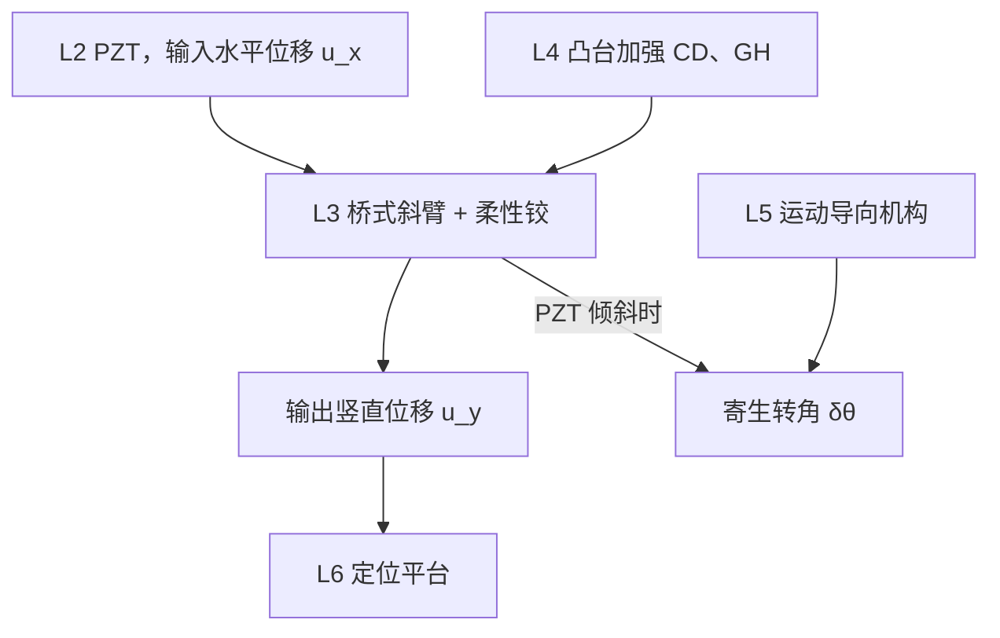

# 压电驱动桥式柔性铰链位移放大机构：理想放大比与铰链柔度造成的折减

> [!summary] 一句话概述
> 压电叠堆自己的行程很小，桥式柔性机构用两对斜臂把输入的水平小位移变成更大的竖直输出。按刚性杆几何可以得到一个理想放大比，但铰链并非理想转动副、斜臂会变形、压电安装若倾斜还会带出寄生转角，实际放大比总要打折。杜志元、闫鹏在桥式上增加运动导向和凸台加强，实验得到放大比 6.4、固有频率 345.0 Hz；Wei 等则给出覆盖并联、对齐、菱形三类桥的一般分析式，并说明把柔性铰当理想铰来算会不准。

## 配图

![[附件/bridge-cn-mechanism-fig1.jpg]]
*图源：[杜志元、闫鹏《基于桥式放大机构的柔顺微定位平台的研究》](https://robot.sia.cn/cn/article/pdf/preview/10.13973/j.cnki.robot.2016.0185.pdf) 第 186 页图 1；(a) 典型桥式：PZT 在 I、J 两点输入 uₓ，输出为 uᵧ，斜臂 AH 相对 x 轴倾角 α；(b) PZT 安装倾斜时出现寄生转角 δθ；(c) 改进平台：桥式放大机构加上运动导向机构，并加凸台提高 CD、GH 刚度*

![[附件/bridge-mdpi-3d-and-kinematic.jpg]]
*图源：[Wei 等, *Micromachines* 2017, 8, 238](https://mdpi-res.com/d_attachment/micromachines/micromachines-08-00238/article_deploy/micromachines-08-00238.pdf?version=1501761625) 第 2 页 Figure 1；(a) 桥式机构三维模型；(b) 理想运动学模型把柔性铰画成理想转动副。正文写：这种把铰链当理想转动副、忽略其弹性变形的模型已被证明不准*

![[附件/bridge-mdpi-three-types.jpg]]
*图源：同上第 2 页 Figure 2；三类桥式构型：(a) 并联型 parallel、(b) 对齐型 aligned、(c) 菱形 rhombic。几何不能简单互换，需要能覆盖各类的一般公式*

> 图片版权归原作者所有，仅作个人学习收藏；出处见文末「来源与核实记录」。

## 结构原理

> 本节所有数字只写来源里给出的；来源没有就写「来源未给出」。

### 堆叠方案

方向：**从压电叠堆的输入轴（水平）经过斜臂桥到输出平台（竖直），再经过导向机构到工作台**

| 层级 | 零件 | 材料 | 厚度/尺寸 | 固定方式 | 依据 |
| --- | --- | --- | --- | --- | --- |
| L1 | 固定基座 / 外框 | 来源未给出牌号 | 杜文图 1(c) 的外框，带安装孔 | 与桥式、导向一体或固接 | 杜志元、闫鹏图 1(c) |
| L2 | 压电叠堆（PZT） | 压电陶瓷 | 行程本身很小，该文未在打开的前页给出具体叠堆型号与额定行程 | 装在桥的输入点 I、J 之间 | 杜文图 1(a) |
| L3 | 桥式斜臂与柔性铰（点 A–J 等） | 弹性体，牌号未给出 | 连接杆 AH 长度 l_AH，相对 x 轴倾角 α；输入位移 uₓ，输出 uᵧ | 整体切出的柔性铰代替销轴 | 杜文图 1 与式 (1) |
| L4 | 加强凸台（改进型） | 与桥一体 | 来源未给出凸台尺寸 | 加在 CD、GH 处，提高这两杆刚度 | 杜文第 2 节与图 1(c) |
| L5 | 运动导向机构 | 与平台一体，四直梁型柔性铰链与基座相连 | 来源未给出梁长、厚的产品表 | 一端连基座，一端连桥的输出，用来消除寄生转角 | 杜文第 2 节与图 1(c) |
| L6 | 输出/定位平台 | 来源未给出 | 图 1(c) 中的中心台面 | 与导向和桥的输出端相连 | 杜文图 1(c) |

剖面示意：

和双平行四边形导轨的差别：本篇的目标是放大位移，导轨/导向是为了把放大后的运动走纯、抑制转角，不是这篇的主结构。

### 零件清单

| 零件 | 数量 | 功能 | 材料 | 依据 |
| --- | --- | --- | --- | --- |
| 压电叠堆 | 1 | 提供小行程、大力的输入 | 压电陶瓷 | 杜文图 1 |
| 桥式斜臂与柔性铰 | 一组对称桥（三类外形见 Wei 等 Fig. 2） | 把 uₓ 变成放大后的 uᵧ | 来源未给出牌号 | 杜文图 1；Wei 等 Fig. 1–2 |
| 加强凸台（改进型） | 2 处（CD、GH） | 减小杆件变形引起的放大比损失 | 与桥一体 | 杜文第 2 节 |
| 运动导向机构 | 杜文：4 条直梁型柔性铰 | 消除输出寄生转角 | 来源未给出 | 杜文第 2 节 |
| 输出平台与基座 | 各 1 | 定位输出与固定参考 | 来源未给出 | 杜文图 1(c) |

### 装配顺序

按杜文的结构设计（工艺细节来源未给出；实验系统是后来搭建的）：

1. 整体加工出带柔性铰的桥式机构和导向机构、凸台。
2. 把 PZT 装入输入端 I、J，尽量避免安装倾斜；杜文图 1(b) 说明倾斜会让桥左右受力不对称，输出端出现绕 z 的寄生转角 δθ，严重损害定位精度。
3. 导向机构与输出端相连，约束多余转动。
4. 再接入传感器和控制器做放大比、固有频率测试。

> 若只看到实验照片，安装顺序按结构关系反推，已在上面标明。

### 受力与运动分析

- **受力路径**：PZT 伸长，在 I、J 产生相向或背向的力 Fₓ，斜臂绕柔性铰转动并带动输出点沿 y 走。CD、GH 太软时会在 Fₓ 下先变形，把本该变成输出的位移吃掉，放大比下降（杜文第 2 节）。
- **运动关系**：理想放大比（杜文式 (1)，按几何方法、把杆当刚性看）

  R_amp = uᵧ / uₓ = (l_AH sin α − l_AH sin arccos((uₓ + l_AH cos α)/l_AH)) / uₓ

  其中 l_AH 为连接杆 AH 的长度，α 为 AH 相对 x 轴的倾角。杜文明确写：这个理想放大比在实际中很难达到。Wei 等进一步指出，把柔性铰当成理想转动副、忽略铰的弹性变形，分析结果不准。
- **失效风险**：PZT 装斜（δθ）、斜臂或 CD/GH 过柔、铰链取向不当（Wei 等写铰链取向对性能影响大）。只按理想式选 α 和杆长，实验放大比会对不上。

## 设计要点与参数

| 要点 | 内容 | 依据 |
| --- | --- | --- |
| 理想放大比 | 见上式 (1)，由 l_AH 与 α、输入 uₓ 决定 | 杜文第 2 节式 (1) |
| 实际达不到理想值的两条原因 | ① PZT 安装倾斜导致寄生转角 δθ；② CD、GH 刚度不足，在 Fₓ 下变形，放大比损失 | 杜文第 2 节与图 1(b) |
| 改进措施 | 加运动导向机构消除寄生转角；在桥中加两个凸台提高 CD、GH 刚度 | 杜文第 2 节与图 1(c) |
| 实验与模型对照 | 改进型平台实验放大比 6.4，固有频率 345.0 Hz。理论相对有限元：放大倍数误差 2.9%，固有频率误差 3.6%；相对实验：6.7% 与 6.8% | 杜文摘要 |
| 三类桥式外形 | 并联、对齐、菱形，几何不能互相换算，需要一般公式 | Wei 等 Fig. 2 与第 1 节 |
| 理想运动学模型的问题 | 把柔性铰当理想转动副会不准，因为忽略了铰的弹性变形 | Wei 等第 2 页 |
| 一般分析覆盖的量 | 输入/输出位移、位移放大、输入刚度、输出刚度与应力 | Wei 等摘要 |
| PZT 型号、额定行程、桥的详细壁厚 | 本篇打开的两份来源未在已核对段落给出可引用的统一产品表 | — |

## 优缺点

**优点**
- 不用杠杆销轴也能把压电的微米级位移放大到更好用的行程，结构紧凑、无间隙。
- 导向和加强凸台是针对「理想式达不到」的两条具体补救，不是空泛地再加刚度。
- 有实验放大比和频率，以及和理论、有限元的误差带。

**缺点 / 代价**
- 实际放大比低于几何理想值，设计必须把铰链柔度和安装倾斜算进去。
- 导向机构会占空间、也会改变刚度和频率，不是免费的。
- 三类外形不能套同一张尺寸表。

## 可借鉴点

- 先用理想式估一个放大比，再立刻问：铰链不是理想铰、斜臂会不会先弯、PZT 会不会装斜。这三项里任何一项都会把放大比打下来。
- 对输出转角敏感的定位台，不要只做桥，要加导向；对放大比掉得厉害的桥，先检查输入端附近的杆是不是太软。
- 选外形时先对上 Wei 等的三类（并联 / 对齐 / 菱形），不要把菱形桥的尺寸直接搬到并联桥上。
- 本篇是放大，不是双平行四边形导轨本身；导轨问题回到相应专篇。

## 与库中相似案例对比

| 对比项 | 本案例：桥式位移放大 | [[平行板簧直线导轨与双平行四边形：对称构型抵消寄生横向位移]] | [[直圆切口柔性铰链（Right circular flexure hinge）：最薄处厚度 t、切口半径 R 与公式适用范围]] | [[金属压电按钮：连续金属面微挠曲，无可见滑动键程的扩展案例]] |
| --- | --- | --- | --- | --- |
| 目的 | 放大压电小位移 | 做近似直线导轨 | 做近似转动副 | 金属面微挠曲按键，不是位移放大台 |
| 主参数 | 理想放大比、实际 6.4、频率 345.0 Hz | eᵧ 的消除、L/P/M | t、R、t/R | 按键力与行程 |
| 是否同一结构 | 否，放大是主结构 | 否，可作导向对照 | 桥里可以用这类铰，但不等于桥 | 否 |
| 是否重复 | 本篇新收 | 本轮另篇 | 本轮另篇 | 已有，不重复 |

## 相关案例

- [[平行板簧直线导轨与双平行四边形：对称构型抵消寄生横向位移]]
- [[直圆切口柔性铰链（Right circular flexure hinge）：最薄处厚度 t、切口半径 R 与公式适用范围]]
- [[圆角直梁柔性铰链（Corner-filleted flexure hinge）：等厚直梁加两端圆角 r，对照直圆切口铰]]
- [[金属压电按钮：连续金属面微挠曲，无可见滑动键程的扩展案例]]
- 分类索引：[[04-机构与运动 索引]]

## 来源与核实记录

- 主来源：[杜志元、闫鹏《基于桥式放大机构的柔顺微定位平台的研究》](https://robot.sia.cn/cn/article/pdf/preview/10.13973/j.cnki.robot.2016.0185.pdf)（《机器人》2016, 38(2): 185–192；DOI 10.13973/j.cnki.robot.2016.0185；山东大学。图 1、式 (1)、实验放大比 6.4 与固有频率 345.0 Hz）
- 补充来源：[Wei, Shirinzadeh, Li, Clark, Pinskier, Wang, Development of Piezo-Driven Compliant Bridge Mechanisms](https://mdpi-res.com/d_attachment/micromachines/micromachines-08-00238/article_deploy/micromachines-08-00238.pdf?version=1501761625)（*Micromachines* 2017, 8, 238；2017-08-03；中国矿业大学与莫纳什大学。BRIEF 中的 PMC6189966。Fig. 1–2、三类构型与理想铰模型的局限。NCBI 页面本次被验证码拦截，本文件为同一开放获取论文的出版社 PDF）
- 核实：2026-11-22 下载并打开上述两份 PDF。未把双平行四边形导轨或金属压电按钮写成同一结构。
