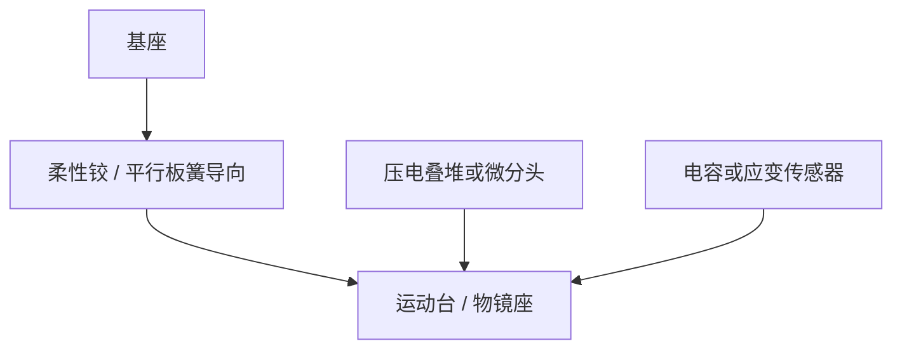

# 商品柔性导向微位移台：无摩擦柔顺结构导向，行程与分辨率来自弹性导轨而不是滚动导轨

> [!summary] 一句话概述
> 这类商品微位移台用柔性铰或平行板簧把运动台「挂」在基座上，位移来自弹性导轨的弯曲而不是滚珠或滑块：没有摩擦和游隙，分辨率可以到纳米级，但行程通常只有几十到几百微米（压电型）或数毫米（复合柔性手动型），不能把它和丝杠加滚珠导轨的位移台当成同一种结构。

## 配图

![[附件/zolix-ob200-flexure-stage.jpg]]
*图源：[卓立汉光「OB 系列物镜专用位移台」产品页](https://www.zolix.com.cn/Product_desc/1257_1775.html) 中的产品照片与尺寸图（图上型号为 Carrier.OB200.C）；给出外形 65 mm、高度方向 27.25 mm、物镜接口 M25×0.75、通光孔径 φ22 mm 等标注。同页文字写明：压电陶瓷堆叠驱动、无摩擦柔顺结构导向、内置电容传感器闭环*

![[附件/pi-p752-stage-photo.jpg]]
*图源：[PI P-752 High Precision Nanopositioning Stage 数据页第 1 页](https://www.pi-usa.us/fileadmin/user_upload/pi_us/files/product_datasheets/P752_Precision_Piezo_Nano-Positioning-Stage.pdf)；P-752.11C 实物。同页要点：0.1 nm 分辨率、行程至 35 μm、电容传感器、Flexure Guidance for Frictionless, Ultra-Straight Motion*

![[附件/pi-p752-datasheet-p1.jpg]]
*图源：同上数据页第 1 页全页；左侧说明柔性导向与直接驱动，右侧为 300 g 负载下的阶跃响应和双向重复性曲线。规格表在第 2 页：开环行程 20/35 μm，闭环行程 15/30 μm，运动方向刚度 30 或 20 N/μm*

> 图片版权归原作者所有，仅作个人学习收藏；出处见文末「来源与核实记录」。

## 结构原理

> 本节所有数字只写来源里给出的；来源没有就写「来源未给出」。

### 堆叠方案

方向：**从固定基座到运动台（中间是柔性导轨，不是滚动体）**

| 层级 | 零件 | 材料 | 厚度/尺寸 | 固定方式 | 依据 |
| --- | --- | --- | --- | --- | --- |
| L1（基座） | 与安装面连接的台体 | OB 标准版：铝合金、钢；无磁版：铝合金、钛合金 | OB100/200：65×50×27 mm；OB400：65×50×39 mm | 螺钉固定到显微镜或支架 | 卓立汉光 OB 参数表 |
| L2 | 无摩擦柔顺结构导向（柔性铰/板簧，与台体一体） | 与台体同一套材料 | 铰链厚度、梁长来源未给出 | 一体加工，无滚动体 | 卓立汉光：「无摩擦柔顺结构导向」；PI：「FEA-modeled, flexure guiding」 |
| L3 | 压电陶瓷叠堆（或 Thorlabs NanoFlex 的微分头+可选压电） | 压电陶瓷；具体牌号来源未给出 | PI 写 PICMA 压电执行器；行程见参数表 | 预紧在台体与运动台之间（PI 写 preloaded） | PI 数据页；卓立汉光「压电陶瓷堆叠驱动」 |
| L4（运动台） | 物镜座或工作面 | 同上 | 卓立汉光图：M25×0.75 物镜接口，φ22 mm 通光孔 | 与柔性导轨一体 | 卓立汉光尺寸图 |
| L5 | 电容位移传感器（闭环） | 来源未给出 | 卓立汉光：电容式；PI：电容，直接计量，不接触 | 内置 | 两家参数表 |

Thorlabs NanoFlex 是另一条商品路线：复合对称柔性导向（compound linear symmetrical flexure），手动微分头行程 5 mm，可选 20 μm 压电微调。它同样明确写：运动全部来自结构件的弹性弯曲，不用靠接触维持功能的零件，因而没有直线轴承那种误差。

打开产品页时必须先确认「柔性/柔顺/flexure」字样。若只有丝杠+滚珠导轨，就不能收进本篇。

### 零件清单

| 零件 | 数量 | 功能 | 材料 | 依据 |
| --- | --- | --- | --- | --- |
| 台体（含柔性导轨） | 1 | 提供无摩擦约束和回复力 | 见上表 | 卓立汉光、PI |
| 压电叠堆 | 1（或多轴时每轴 1） | 产生微位移 | 压电陶瓷 | 两家 |
| 位置传感器 | 1 套 | 闭环 | 电容（OB、P-752）；Thorlabs 闭环型为应变计 | 各产品页 |
| 物镜接口或安装面 | 1 | 携带负载 | 来源未另给 | 卓立汉光尺寸图 |

### 装配顺序

1. 把基座固定到显微镜或光学底板。OB 系列按物镜螺纹安装镜头；尺寸图给出 M25×0.75 等接口。
2. 连接控制器与电缆。OB 默认屏蔽电缆、D-Sub 7W2；UHV 版为 SMA。P-752 按型号分 LEMO 或 Sub-D。
3. 闭环标定后使用。PI 的 .CD 版本带 ID-chip，数字控制器可自动读取台子参数。来源未给出用户现场拆开柔性铰再组装的步骤，这类台子通常整台标定出厂，不作为可现场拆铰链的结构。

### 受力与运动分析

- **受力路径**：驱动力（压电或微分头）作用在运动台上，负载和惯性经柔性导轨的弯曲传到基座。导轨本身既是约束（限制不想要的自由度）又是弹簧（提供回复力和刚度）。PI 把运动方向刚度直接写进规格：15 μm 型 30 N/μm，30 μm 型 20 N/μm（±20%）。卓立汉光 OB100/200/400 的刚性为 0.5 / 0.35 / 0.25 N/μm，行程越大越软。
- **运动关系**：理想情况下只保留一个（或设计好的几个）弹性自由度，没有滚动摩擦和反向间隙，所以分辨率可以到 0.1 nm 量级（PI）或 1–5 nm 闭环（OB）。代价是行程短：OB 闭环行程 100/200/400 μm，P-752 闭环只有 15 或 30 μm。Thorlabs NanoFlex 用复合对称柔性机构做 5 mm 手动行程，并写明该构型在全行程上保持直线运动、零交叉耦合（zero cross talk）。
- **失效风险**：超过额定负载或横向力会让柔性铰过应力（推断；应遵守各表的最大负载：OB100/200 为 300 g，OB400 为 500 g；P-752 负载 30 N，推/拉 100/10 N）。带手动粗动的压电台，Thorlabs 用户评论区出现过在闭环时误拧粗动微分头导致异常的情况，说明粗、微两档不要同时硬拧（该评论不是规格，仅作使用提醒，不当作参数）。

## 设计要点与参数

| 要点 | 内容 | 依据 |
| --- | --- | --- |
| 导向类型 | 必须是无摩擦柔顺结构 / flexure guidance，不是滚珠导轨 | 卓立汉光要点；PI 要点 |
| OB 闭环行程 | OB100：100 μm；OB200：200 μm；OB400：400 μm | 卓立汉光表 1 |
| OB 闭环/开环分辨率 | 闭环 1 / 3 / 5 nm；开环 0.2 / 0.4 / 0.8 nm（对应 100/200/400） | 同上 |
| OB 刚度与空载谐振 | 0.5 / 0.35 / 0.25 N/μm；空载谐振 600 / 480 / 380 Hz（±20%） | 同上 |
| OB 最大负载 | 100/200 μm：300 g；400 μm：500 g | 同上 |
| OB 线性度与重复性 | 线性度误差 0.03%；重复定位精度 8 nm | 同上 |
| P-752 行程 | 开环 −20～+120 V：20 或 35 μm；闭环：15 或 30 μm | PI 规格表 |
| P-752 分辨率与重复性 | 15 μm 型：0.1 nm，±1 nm；30 μm 型：0.2 nm，±2 nm（典型值） | 同上 |
| P-752 刚度与谐振 | 15 μm 型：30 N/μm，空载 3200 Hz，300 g 时 980 Hz；30 μm 型：20 N/μm，空载 2100 Hz，300 g 时 600 Hz（±20%） | 同上 |
| P-752 负载 | 最大 30 N；推/拉 100 / 10 N | 同上 |
| NanoFlex 手动行程 | 5 mm；细调范围 300 μm，细调螺距 50 μm，粗调螺距 0.5 mm；台面 75×75 mm，高 30 mm；水平负载 1 kg，垂直 0.5 kg；可选压电 20 μm，理论分辨率 0.6 nm | Thorlabs Wayback 规格表 |

## 优缺点

**优点**
- 无摩擦、无游隙，闭环分辨率可以到纳米甚至亚纳米，适合显微扫描和计量。
- 导向和回复力做在同一组柔性铰里，零件少，也不必润滑，真空或洁净环境更好做（OB 提供 HV/UHV/无磁版）。
- 商品台把行程、刚度、谐振和负载写在同一张表里，便于按「行程越大越软、谐振越低」选型。

**缺点 / 代价**
- 行程比滚珠导轨台短几个数量级，不能拿它去走几十毫米。
- 刚度和谐振随负载明显下降（P-752 在 300 g 时谐振从 3200 Hz 降到 980 Hz），负载必须按表校核。
- 柔性铰过载几乎不可修，通常整台更换；来源也没有给出用户可拆铰链的维修步骤。

## 可借鉴点

- 先确认导轨类型：手册或产品页必须出现柔性铰、柔顺、flexure、frictionless flexure，才能当柔性台；只写「精密位移台」不够。
- 按「行程–刚度–谐振–负载」一组数选型，不要只看行程。同样是柔性导向，OB400 的 0.25 N/μm 和 P-752 的 30 N/μm 不是一个量级的应用。
- 需要毫米级行程时，看复合柔性（如 NanoFlex 的 5 mm），而不是把压电柔性台硬凑行程。
- 对照本轮平行板簧直线导轨原理：商品台是把那种导轨做成带传感器和驱动的封闭产品，设计时仍要交待是哪一种柔性构型，而不是用「纳米台」三个字代替结构。

## 与库中相似案例对比

| 对比项 | 本案例（商品柔性导向微位移台） | 本轮平行板簧 / 柔性铰原理篇（若入库） | [[应变式指点杆：十字薄片根部弯曲，将侧向按力变成二维输入]] | 丝杠+滚珠导轨位移台（不收录为本题） |
| --- | --- | --- | --- | --- |
| 运动来源 | 柔性导轨的弹性变形 | 同一类几何的原理与公式 | 薄片根部微弯，用于传感输入 | 滚动接触 |
| 目的 | 商品化的微定位，带行程和分辨率规格 | 讲构型与刚度公式 | 不是导轨 | 长行程定位 |
| 行程量级 | 15 μm～400 μm（压电）或 5 mm（复合柔性手动） | 原理分析 | 微应变 | 毫米到百毫米 |
| 是否误收滚动台 | 已排除：只收写明柔性导向的型号 | 对照 | 无关 | 若手册只写滚珠，立即放弃 |

## 相关案例

- [[应变式指点杆：十字薄片根部弯曲，将侧向按力变成二维输入]]
- [[恒扭力摩擦铰链：卡簧过盈产生扭力与「最低扭力 > 盖板力矩」选型]]
- 分类索引：[[04-机构与运动 索引]]

## 来源与核实记录

- 主来源：[北京卓立汉光仪器有限公司：OB 系列物镜专用位移台以及高分辨率显微系统的综合运动解决方案](https://www.zolix.com.cn/Product_desc/1257_1775.html)（打开日期 2026-11-22。中文产品页：无摩擦柔顺结构导向，OB100/200/400 与 OBHL、Carrier.OB200.XY 参数表及尺寸图。页面未另印手册版本号）
- 补充来源 1：[PI P-752 High Precision Nanopositioning Stage 数据页](https://www.pi-usa.us/fileadmin/user_upload/pi_us/files/product_datasheets/P752_Precision_Piezo_Nano-Positioning-Stage.pdf)（页脚 © 2008 Physik Instrumente，R1 09/08/20.0。Flexure guidance、行程、刚度、谐振与负载。独立第二机构）
- 补充来源 2：[Thorlabs NanoFlex 5 mm 单轴柔性平移台页面，Wayback 2024 年快照](https://web.archive.org/web/2024/https://www.thorlabs.com/newgrouppage9.cfm?objectgroup_id=720)（复合对称柔性导向、5 mm 手动行程与负载。Thorlabs 官网本次直接抓取只返回脚本壳，改用归档页。第三家商品例）
- 核实：2026-11-22 打开卓立汉光页，下载 PI 数据页，并用 Wayback 打开 Thorlabs 页。三家均明确柔性导向，故保留本题；未把滚珠导轨位移台写入。
