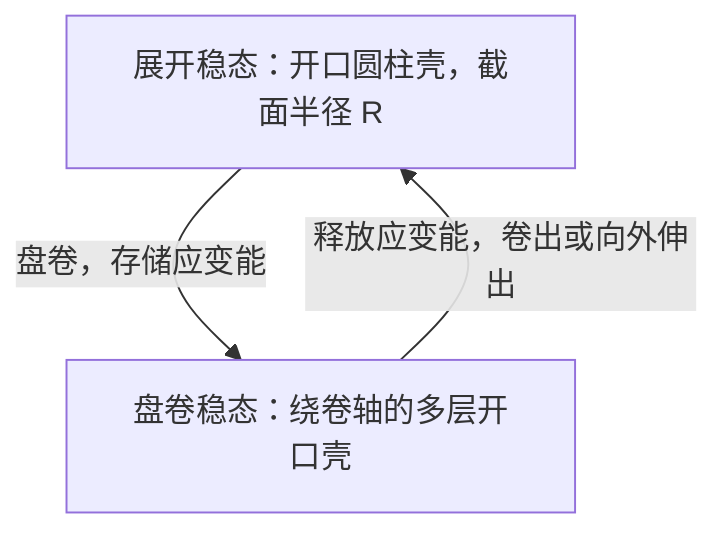

# 复合材料带簧双稳态：开口圆柱壳在伸直与盘卷构型间跳转

> [!summary] 一句话概述
> 开口圆柱壳形的复合材料带簧（tape spring / 双稳态可展伸杆）可以稳定在伸直和盘卷两种构型：伸直时截面保持开口圆曲率，盘卷时沿长度方向卷到卷轴上，由层合铺层存储和释放应变能。第二种稳态能把已卷区段保持住，因此还可以做「顶端固定、卷轴向外滚出」的卷出展开，不必再另加压辊把卷段压住。

## 配图

![[附件/tape-spring-deployment-modes.jpg]]
*图源：[Wang, Xu, Lu and Sun, Polymers 2023, 15, 2455](https://mdpi-res.com/d_attachment/polymers/polymers-15-02455/article_deploy/polymers-15-02455-v2.pdf?version=1685088071) 第 2 页 Figure 1；带簧展开的三种方式。(a) 普通展开：卷轴可转、带簧向外伸出，常用导辊和压辊；(b) 带辊的卷出展开（roll-out）：顶端固定，卷轴带着已卷段向外滚；(c) 无辊卷出展开：依靠第二稳态自己保持卷段，不必再加压辊*

![[附件/bidcb-fabrication-process.jpg]]
*图源：[Liu, Bai, Xi, Fantuzzi, Bu and Shi, arXiv:2305.05289](https://export.arxiv.org/pdf/2305.05289v1.pdf) Fig. 2；北航双稳态可展复合材料伸杆（Bi-DCB）试件制作：预浸料裁切、反对称铺层、在带半径 R 与圆心角 θ 的模具上真空袋固化。固化曲线：约 40 min 升到 150 ℃，保温至约 100 min，再降温；全程压力 100 kPa*

> 图片版权归原作者所有，仅作个人学习收藏；出处见文末「来源与核实记录」。

## 结构原理

> 本节所有数字只写来源里给出的；来源没有就写「来源未给出」。

### 堆叠方案

方向：**沿伸杆长度看，从开口圆柱壳的自由边到另一自由边（展开态截面）；盘卷态则沿螺旋/卷轴半径方向分层**

| 层级 | 零件 | 材料 | 厚度/尺寸 | 固定方式 | 依据 |
| --- | --- | --- | --- | --- | --- |
| L1（展开态壳体） | 开口圆柱壳带簧 / Bi-DCB | T700/环氧单向预浸料（北航） | 单层厚 0.03 mm；六种试件的半径 R、圆心角 θ、长度 L 见 Table 2 | 固化成一体层合壳 | 北航 Table 1、Table 2 |
| L2（盘卷态） | 同一根壳卷在卷轴上 | 同上 | 盘卷几何由折叠稳态的截面决定；北航对 1 号件截面用阿基米德螺线拟合 | 第二稳态保持，不必另加锁 | 北航 3.3 节；苏州大学 Figure 1c |
| L3（卷出展开时的卷轴/轮毂） | Hub | 苏州大学文讨论轮毂半径 rh 等符号；具体材料来源未给出 | 来源公式中有 rh、轮毂壁厚 th，实验件具体毫米数见该文参数表（两列文字有重叠，未在本篇引用看不清的格子） | 顶端固定时轮毂向外滚动 | 苏州大学第 2 节与 Figure 1 |

剖面示意：

这和本轮「屈曲梁/Young 型」双稳态不是同一件事：带簧的两个稳态来自壳的曲率方向（沿长度的弯曲 vs 截面的固有曲率），不是平面梁的跳跃屈曲。

### 零件清单

| 零件 | 数量 | 功能 | 材料 | 依据 |
| --- | --- | --- | --- | --- |
| 复合材料开口壳伸杆 | 1 | 在伸直与盘卷两稳态间转换，兼作结构杆 | 北航：T700/环氧；苏州大学：FRP 层合 | 两篇摘要 |
| 固化模具（半径 R、圆心角 θ） | 1（制备用） | 给出展开态截面 | 来源未给出模具材料 | 北航 Fig. 2 |
| 卷轴 / 轮毂 | 卷出展开时需要 | 盘卷中心，可向外滚动 | 来源未给出材料 | 苏州大学 Figure 1 |
| 导辊、压辊 | 普通展开时常用；无辊卷出展开时可不加 | 约束卷段 | 来源未给出 | 苏州大学 Figure 1a–c |

### 装配顺序

1. 按铺层表裁切预浸料并反对称铺叠（北航为避免折叠稳态出现扭转，选用反对称铺层）。
2. 放到半径为 R、圆心角为 θ 的模具上，真空袋封装。
3. 北航固化：以 3.75 ℃/min 升温，150 ℃ 保温 1 h，全程 100 kPa，然后随炉冷却。六种试件用同一固化周期。
4. 室温干燥状态下，把试件手动盘卷到折叠稳态；用听音、目视和敲击检查是否有损伤或分层。
5. 使用时：普通展开是转轮毂、把杆向外送出；卷出展开是把杆顶端固定，让轮毂带着卷段向外滚。若层合具有第二稳态，卷段可以不加压辊。

> 北航写的是试件制备与折叠实验，不是卫星上的飞行装配。飞行固定件来源未给出。

### 受力与运动分析

- **受力路径**：盘卷时，壳沿长度方向弯曲，截面曲率改变，应变能储存在层合里。展开或卷出时应变能释放，驱动伸杆伸直或推动轮毂。苏州大学指出：厚度远小于固有半径和盘卷半径，可按薄壁壳和经典层合理论（CLT）建立能量模型。
- **运动关系**：两个目标构型是展开稳态和折叠（盘卷）稳态。北航说明，反对称铺层可以同时得到这两种稳态，折叠态不必另加约束就能保持。苏州大学补充：正因为第二稳态能把卷段稳住，卷出展开的速度不受控制，末端速度过大可能对连接结构造成冲击，所以需要预测全程速度。
- **失效风险**：盘卷过程可能出现裂纹、边缘分层或内部脱粘（北航用三种检查方法排除损伤后再测截面）。对称铺层的伸杆在折叠态应变能高，放开会自己弹开，不能像反对称双稳态那样自己保持（北航引言段）。苏州大学还提到「开花」（blossoming）是异常展开失效模式，该文把它作为文献背景，本篇不引入未在该文实验段核验的极限载荷。储存时间引起的粘弹性会改变展开时间（苏州大学引用 Tilbert 的工作，本篇只记这一来源陈述，不另给未核对的小时数）。

## 设计要点与参数

| 要点 | 内容 | 依据 |
| --- | --- | --- |
| 双稳态来源 | 合理的反对称铺层使伸杆同时具备展开稳态和折叠稳态；折叠态无需外加约束即可保持 | 北航引言与 3.2 节 |
| T700/环氧单层性能（北航 Table 1） | E1=128.62 GPa，E2=7.52 GPa，G12=4.82 GPa，G13=4.50 GPa，G23=4.50 GPa，ν12=0.314；Xt=2103.44 MPa，Yt=75.97 MPa，Xc=1233.65 MPa，Yc=181.46 MPa，S12=216.36 MPa；密度 1.60×10^-3 g/mm³；单层厚 0.03 mm | Table 1 |
| 试件 1 | R=20 mm，θ=229°，L=620 mm，铺层 [45/-45/45/-45/45/90/-45/45/-45/45/-45] | Table 2 |
| 试件 2 | R=20 mm，θ=229°，L=400 mm，铺层 [45/-45/45/-45/0/45/-45/45/-45] | Table 2 |
| 试件 3 | R=20 mm，θ=229°，L=200 mm，铺层 [45/-45/45/-45/90/45/-45/45/-45] | Table 2 |
| 试件 4 | R=27.5 mm，θ=167°，L=650 mm，铺层 [45/-45/45/-45/0/90/45/-45/45/-45] | Table 2 |
| 试件 5 | R=27.5 mm，θ=167°，L=650 mm，铺层 [45/-45/45/-45/45/-45/45/-45/45/-45] | Table 2 |
| 试件 6 | R=30 mm，θ=191°，L=620 mm，铺层 [45/-45/45/-45/45/90/-45/45/-45/45/-45] | Table 2 |
| 固化 | 升温 3.75 ℃/min，150 ℃ / 1 h，压力 100 kPa | 北航 3.2 节与 Fig. 2b |
| 三种展开模式 | 普通展开（可转轮毂+导辊/压辊）；带辊卷出展开；无辊卷出展开（靠第二稳态保持卷段） | 苏州大学 Figure 1 |
| 等向/反向盘卷 | 轮毂与壳凹面在同一侧称为等向盘卷（equal-sense coiling）；反向盘卷（opposite-sense coiling）的能量处理不同 | 苏州大学第 2 节 |
| 卷出速度 | 第二稳态使卷段不必外控，但展开速度因此不受控，需要预测以免末端冲击 | 苏州大学摘要与引言 |
| 钢卷尺或 CuBe 金属带簧 | 苏州大学在综述中提到钢或 CuBe 也可做带簧，本两篇实验对象是复合材料层合，金属带簧的具体半径本篇来源未给出 | 苏州大学引言 |

## 优缺点

**优点**
- 一根开口壳就能在「伸直承力」和「卷起来收纳」之间切换，收纳比高、质量轻，适合空间可展杆。
- 反对称铺层做成双稳态后，卷段自己保持，卷出展开可以去掉压辊，机构更简单。
- 展开态截面半径、圆心角和铺层可以按刚度与可盘卷性一起选（北航给出六组可对照的试件）。

**缺点 / 代价**
- 铺层和固化工艺窗口窄：反对称层合在固化中容易残留热应力和翘曲，北航为此采用慢升温、延迟冷却。
- 盘卷过程有分层和边缘开裂风险，需要检查，不能把「能卷起来」当成无损。
- 无辊卷出展开的速度不易控制，末端冲击要单独评估。
- 复合材料带簧的双稳态对铺层方向敏感，不能把某一组 R、θ、L 和铺层拆开混用。

## 可借鉴点

- 若既要展开后够刚、又要收纳后自己稳住，优先考虑反对称铺层的双稳态壳，而不是靠外加压辊把卷段按住。
- 把「展开态截面半径 R、圆心角 θ、长度 L、铺层」写成一组设计变量，并用同一固化周期做对照件（北航六种试件的做法）。
- 卷出展开若去掉压辊，必须另做展开速度和末端冲击的估计，不能只验证「能够自己卷住」。
- 与平面屈曲梁双稳态分开选型：带簧用的是壳曲率方向，梁用的是平面内跳跃，二者的力-位移和失效模式都不能照搬。

## 与库中相似案例对比

| 对比项 | 本案例（复合材料带簧） | 本轮「双稳态柔顺机构」篇（屈曲梁 / Young 型） | [[活动铰链（Living Hinge）：一体成型的柔性铰链]] |
| --- | --- | --- | --- |
| 什么在「跳转」 | 开口壳的伸直曲率 ↔ 盘卷曲率 | 平面柔顺梁/连杆的两个平衡位置 | 薄膜弯曲带，不是双稳态壳 |
| 输出运动 | 伸杆伸长或卷轴滚出 | 滑块平移或杆件转动 | 翻盖式开合 |
| 是否已有活铰篇 | 不是薄膜活铰 | 不是活铰 | 库内已有，只对照 |
| 为何单独立篇 | 壳带几何曲率双稳态，与屈曲梁不是同一构型 | 本轮另篇，此处只对照 | — |

## 相关案例

- [[双稳态柔顺机构：完全柔性屈曲梁与Young型跳转的几何稳态]]
- 分类索引：[[04-机构与运动 索引]]
- [[活动铰链（Living Hinge）：一体成型的柔性铰链]]

## 来源与核实记录

- 主来源：[Tian-Wei Liu, Jiang-Bo Bai, Hao-Tian Xi, Nicholas Fantuzzi, Guang-Yu Bu, Yan Shi, Experimental and numerical investigation on folding stable state of bistable deployable composite boom, arXiv:2305.05289](https://export.arxiv.org/pdf/2305.05289v1.pdf)（2023-05-09 上传的预印本；第一单位为北京航空航天大学交通科学与工程学院。已下载 28 页 PDF，核对 Table 1–2、固化参数、反对称铺层与折叠实验方法）
- 补充来源：[Sicong Wang, Shuhong Xu, Lei Lu, Lining Sun, Roll-Out Deployment Process Analysis of a Fiber Reinforced Polymer (FRP) Composite Tape-Spring Boom, Polymers 2023, 15, 2455](https://mdpi-res.com/d_attachment/polymers/polymers-15-02455/article_deploy/polymers-15-02455-v2.pdf?version=1685088071)（2023-05-25；苏州大学机电工程学院。已下载 12 页 PDF，核对 Figure 1 三种展开模式、第二稳态对卷段的保持以及卷出速度问题。独立第二机构）
- 核实：2026-11-22 下载并打开上述两份 PDF。建议的 Caltech《Stability Analysis of Coiled Tape Springs》与 Seffen/Pellegrino 1997 报告本次打开失败（HTTP 403/500），不引用其中未核对的曲率半径。苏州大学参数表因双栏提取有重叠格子，未把看不清的 R、b、lb 数字写入本篇。
