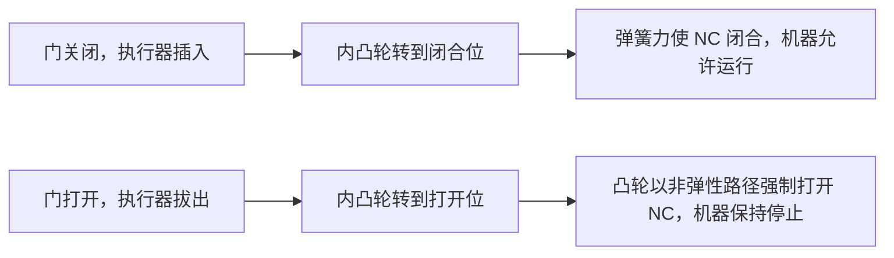

# 安全门舌片联锁：专用执行器转动内凸轮，以直接断开动作打开 NC 触点

> [!summary] 一句话概述
> 舌片式安全门联锁把开关本体装在机器上、把专用执行器装在门上：关门时执行器插入并转动内凸轮，NC 触点靠弹簧力闭合，控制系统判定门已关闭；开门时凸轮把 NC 触点强制推开，切断电路，即使启动按钮被按下机器也不能再开。IDEC 强调这种「直接断开动作」要求执行器到 NC 触点之间只有非弹性结构，即使触点已经熔焊，开门的力仍能把触点分开。它不是普通限位开关，也不是用螺丝刀就能拨动的门磁。

## 配图

![[附件/safety-omron-p2.png]]
*图源：[Omron，《Safety Door Switches》产品目录](https://omronfs.omron.com/en_US/ecb/products/pdf/su-safetydoorswitches.pdf) 舌片联锁产品系列页（T4016、D4BS、D4NS、D4GS-N 等）*

![[附件/safety-omron-p4.png]]
*图源：同上，D4BS 舌片联锁要点：1NC/1NO 与 2NC、镀金触点、金属壳体、−40～80 °C、IP67*

![[附件/safety-omron-p5.png]]
*图源：同上，D4NS 舌片联锁要点：2NC/1NO 与 3NC，另有 1NC/1NO、2NC 的 MBB 形式，可选金属头部和 M12 连接器*

> 图片版权归原作者所有，仅作个人学习收藏；出处见文末「来源与核实记录」。IDEC 中文页的结构图因防盗链未能保存为真实图片，故不使用。

## 结构原理

> 本节所有数字只写来源里给出的；来源没有就写「来源未给出」。

### 堆叠方案

方向：**从门上的专用执行器到开关体内的触点**

| 层级 | 零件 | 材料 | 厚度/尺寸 | 固定方式 | 依据 |
| --- | --- | --- | --- | --- | --- |
| L1 | 专用执行器（舌片） | 来源未给出 | 来源未给出厚度 | 安装在门上，只有配对形状才能插入 | IDEC |
| L2 | 开关本体入口与内凸轮 | 来源未给出 | 来源未给出 | 开关体安装在机器上；执行器插入后转动凸轮 | IDEC |
| L3 | NC 触点与复位弹簧 | 来源未给出；Omron D4BS / D4NS 为镀金触点 | 来源未给出开距 | 门关闭时靠弹簧力闭合；门打开时由凸轮强制推开 | IDEC；Omron 目录 |
| L4（锁定型才有） | 压缩弹簧 F、锁杆 B、凸轮凹槽和螺线管 | 来源未给出 | 来源未给出 | 弹簧锁：断电时锁杆卡在凸轮槽内；电磁锁：通电后才锁住 | IDEC |

剖面示意（无锁型，按 IDEC 图 3 文字）：

IDEC 把联锁开关分成无锁型和锁定型；锁定型再分成：

- **弹簧锁定（安全目的）**：用于危险运动不能立即停止、存在滑行的机器。断电时压缩弹簧把锁杆卡在凸轮凹槽里，门保持锁定；只有在确认滑行结束后给螺线通电才能开锁。意外断电或断线时无法开锁，避免有人在滑行尚未结束时开门。
- **电磁锁定（非安全目的的锁门）**：门关闭并插入执行器后给螺线通电才锁门，断电后门可以打开。只适用于接到停止信号后能立即停住的机器；若用在有滑行危险的设备上，停电时门会被打开，非常危险。

弹簧锁结构（IDEC 图 9）：左半部分与无锁型相同，凸轮随执行器旋转，触点 C 检测门的开闭（端子 1–2 回路）；右半部分在螺线断电时，锁杆受压缩弹簧 F 作用卡进凸轮槽。要把机器投入运行，必须门关闭且锁住，因此把触点 C 和触点 D 串联，两者都接通机器才能工作。门打开后，无论螺线是否通电，凸轮转动都会把杆保持在 D 段 NC 的打开位置，C 和 D 都断开。

防破坏：IDEC 写明不能被螺钉、针、金属板或钥匙、硬币、螺丝刀等常用工具禁用，必须使用配对执行器。设计和安装还要符合 ISO 14119（机械安全—与防护装置相关的联锁装置—设计和选择原则）。直接断开的 NC 触点用箭头符号标记。

### 零件清单

| 零件 | 数量 | 功能 | 材料 | 依据 |
| --- | --- | --- | --- | --- |
| 开关本体 | 1 | 容纳凸轮和触点，装在机架上 | Omron D4BS 为金属壳体，其他型号来源未给出 | IDEC；Omron |
| 专用执行器 | 1 | 插入后转动凸轮，并防止普通工具替代 | 来源未给出 | IDEC |
| 内凸轮 | 1 | 把门的插入/拔出变成触点运动和锁槽位置 | 来源未给出 | IDEC |
| NC / NO 触点 | 按型号 | 报告门状态；锁定型还有锁状态触点 | Omron：镀金触点，D4BS 为 1NC/1NO 或 2NC；D4NS 为 2NC/1NO、3NC，另有 MBB | IDEC；Omron |
| 压缩弹簧与锁杆 | 锁定型各 1 套 | 在凸轮槽内锁门 | 来源未给出 | IDEC |
| 螺线管 | 锁定型 1 | 弹簧锁：通电开锁；电磁锁：通电上锁 | 来源未给出 | IDEC |

### 装配顺序

来源没有给出工厂装配步骤。IDEC 的使用逻辑：

1. 开关体装在机器上，配对执行器装在门上，保证插入方向和深度与凸轮匹配。
2. 按危险是否立即停止，在无锁、弹簧锁、电磁锁三者中选择，不要把电磁锁用在有滑行的设备上。
3. 把检测门状态和检测锁状态的触点按安全回路要求串联到安全控制电路。
4. 重新启动必须在操作员确认周围安全后，于安全位置按另一个启动按钮，不能「关上门就自动再开」。
5. 安装还要考虑 ISO 14119 的防破坏要求，来源未在本页展开全部安装尺寸。

### 受力与运动分析

- **受力路径（直接断开）**：开门的力经执行器传到凸轮，再经非弹性零件传到 NC 触点。IDEC 明确即使触点因浪涌熔焊粘住，开门仍应能把触点分开。这与「只靠弹簧把触点拉开」不同。
- **运动关系**：执行器插入/拔出 → 凸轮旋转 → 触点通断；锁定型再叠加锁杆进出凸轮槽。弹簧锁在断电时保持锁定，电磁锁在断电时释放。
- **失效风险**：用普通工具旁路执行器；把电磁锁装到有滑行的机器上；触点熔焊但没有直接断开路径；安装位置使执行器插不到位，控制系统误判门已关闭。已打开资料没有给出锁合力牛顿数，故不编造。

## 设计要点与参数

IDEC 页以结构和安全逻辑为主，未给出电流、电压和锁合力。下列可核对数字来自 Omron 目录已读条目，只适用于对应型号。

| 要点 | 内容 | 依据 |
| --- | --- | --- |
| 结构 | 开关本体与专用执行器分离；插入后转内凸轮 | IDEC |
| 直接断开 | 执行器到 NC 之间为非弹性路径；熔焊时开门仍应打开触点 | IDEC |
| 防破坏 | 不能用螺丝刀、硬币等常用工具替代专用执行器；遵循 ISO 14119 | IDEC |
| 锁门类型 | 无锁 / 弹簧锁（安全） / 电磁锁（非安全目的） | IDEC |
| Omron D4BS | 1NC/1NO 或 2NC；镀金触点；导管 G1/2、M20、PG13.5；金属壳体；−40～80 °C；IP67 | Omron 目录 |
| Omron D4NS | 2NC/1NO、3NC，以及 1NC/1NO、2NC 的 MBB；可选金属头和 M12；镀金触点；可装到小至 20 mm² 的铝型材 | Omron 目录 |
| 锁合力、电气寿命 | 已打开的 IDEC 页和该份 Omron 目录未给出，来源未给出 | — |

## 优缺点

**优点**
- 用专用舌片和直接断开动作，开门就能切断安全回路，即使触点熔焊仍有机械分开的路径
- 弹簧锁和电磁锁的失电行为写得很清楚，便于按「有没有滑行」选锁型
- 与普通限位开关、门磁相比，更难用工具旁路

**缺点 / 代价**
- 执行器和开关必须成对使用，安装对位要求高
- 已打开资料没有给出锁合力和电气额定，做零件图还要再查对应规格书
- 锁型选错（把电磁锁用在有滑行的设备上）会造成比不装锁更危险的结果

## 可借鉴点

- 安全回路要用直接断开的 NC，并在图纸上保留箭头符号含义，不要只用普通微动的常闭触点充数。
- 先判断危险是否立即停止，再在无锁、弹簧锁、电磁锁里选，不要只看「能不能把门锁上」。
- 防破坏要从执行器形状和安装方式一起做，符合 ISO 14119，而不是只靠「装了一个开关」。
- 重启条件要单独设计启动按钮，避免关门即自动再运行。

## 与库中相似案例对比

| 对比项 | 本案例（舌片安全门联锁） | [[工业限位开关：在微动开关外面加防护壳和滚轮杠杆等致动器]] | [[微波炉门三联联锁：第一、第二联锁断开供电，监控开关在门开时短接熔断保护]] | [[三位置使能握持键：松手OFF、轻握ON、过握OFF且回程不再导通]] |
| --- | --- | --- | --- | --- |
| 目的 | 检测并（可选）锁定防护门，开门即停机 | 检测运动件到达位置 | 防止炉门打开时微波泄漏 | 双手设备上的使能保持 |
| 关键机构 | 专用舌片 + 凸轮 + 直接断开 NC | 滚轮杠杆 + 防护壳内微动 | 门钩按顺序驱动三只微动 | 三级按压力 |
| 何时用这篇 | 要为防护门做符合联锁原则的舌片开关 | 只要位置信号，不要安全联锁 | 要做微波炉门联锁，不是机床围栏 | 要使能开关而不是门联锁 |

## 相关案例

- [[工业限位开关：在微动开关外面加防护壳和滚轮杠杆等致动器]]
- [[微波炉门三联联锁：第一、第二联锁断开供电，监控开关在门开时短接熔断保护]]
- 分类索引：[[04-机构与运动 索引]]

## 来源与核实记录

- 主来源：[IDEC，《安全开关》中文技术页](https://cn.idec.com/zh/solution/safety/basic/safety-switch)（2026-11-27 打开。凸轮与 NC 动作、直接断开、ISO 14119、弹簧锁与电磁锁的结构和失电行为来自该页。该站配图保存结果为脚本，不采用。）
- 交叉来源：[Omron，《Safety Door Switches》产品目录](https://omronfs.omron.com/en_US/ecb/products/pdf/su-safetydoorswitches.pdf)（2026-11-27 下载。独立第二机构。D4BS / D4NS 触点形式、镀金触点、IP67、温度和铝型材安装来自已提取页。该目录是系列介绍，不是单型号完整规格书，锁合力未读到。）
- 核实：2026-11-27 打开上述来源。未编造锁合力或电气寿命。
