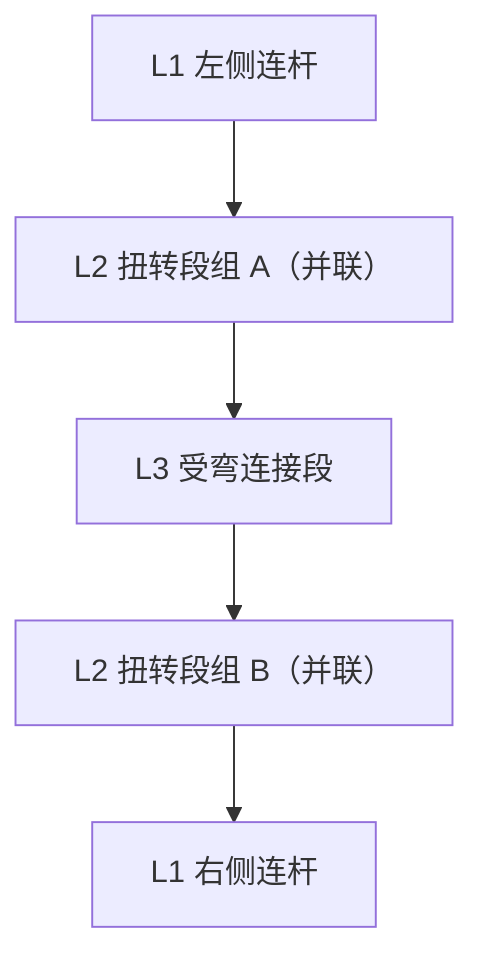

# 层合弹出扭转铰（LET Joint）：薄板窄梁扭转提供面外转动

> [!summary] 一句话概述
> LET（Lamina Emergent Torsional）铰从一块平面板里切出两组平行的窄扭转段，再用短连接段把它们串、并联起来：机构仍从这一层里「弹」到三维，但面外转动主要靠窄梁的扭转，而不是靠注塑薄膜活铰那种弯曲带，也不是靠打印时预留的间隙铰。对称布置让每根扭转梁只分担总转角的一部分，从而降低单根应力。

## 配图

![[附件/let-joint-outside-inside.jpg]]
*图源：[Jacobsen, Chen, Howell and Magleby, Lamina Emergent Torsion (LET) Joint，Mechanism and Machine Theory 44(11), 2098–2109, 2009；本图取自 Wayback 保存的 BYU ScholarsArchive PDF](https://web.archive.org/web/2020/https://scholarsarchive.byu.edu/cgi/viewcontent.cgi?article=2568&context=facpub) Fig. 1 与 Fig. 2。Fig. 1 为外侧 LET：扭转段伸出连杆宽度之外，A、B 两组扭转铰并联后再串联，短连接段在运动中受弯。Fig. 2 为内侧 LET：扭转段不超出连杆宽度，另增连接段在运动中受弯*

![[附件/let-steel-prototype-table.jpg]]
*图源：同上 Fig. 10 与 Table 1；AISI 1095 弹簧钢原型的尺寸定义：扭转段长 L_TL、宽 L_TW，弯曲连接段长 L_BL、宽 L_BW，中部宽度 L1，以及板厚。Table 1：L_TL=2.77 cm，L_TW=0.49 cm，L_BL=1.28 cm，L_BW=0.50 cm，L1=2.55 cm，厚度 0.081 cm*

![[附件/xhinges-printed-let-sensing.jpg]]
*图源：[Chang, Yan, Mueller and Li, X-Hinges, arXiv:2609.11077](https://arxiv.org/pdf/2609.11077.pdf) Figure 2；独立第二机构把 LET 构型做成多材料 FDM 关节：非导电 TPU 本体里同时打出高阻传感元和低阻导线，用于侧向、竖向和轴向变形的连续感知，而不是另装销轴或薄膜活铰*

> 图片版权归原作者所有，仅作个人学习收藏；出处见文末「来源与核实记录」。

## 结构原理

> 本节所有数字只写来源里给出的；来源没有就写「来源未给出」。

### 堆叠方案

方向：**从板的平面法向看「弹出」运动；铰链本身只有一层板厚**

| 层级 | 零件 | 材料 | 厚度/尺寸 | 固定方式 | 依据 |
| --- | --- | --- | --- | --- | --- |
| L1 | 左/右连杆（与铰一体的板） | 弹簧钢原型为 AISI 1095 | 厚度 0.081 cm；中部宽度 L1=2.55 cm | 与扭转段连续 | Table 1；Fig. 10 |
| L2 | 扭转窄梁（torsional hinge） | 同上 | L_TL=2.77 cm，L_TW=0.49 cm | 板内切出，两端连到连杆或连接段 | Fig. 1、Table 1 |
| L3 | 短连接段（connecting element，运动中受弯） | 同上 | L_BL=1.28 cm，L_BW=0.50 cm | 把左右扭转段连起来 | Fig. 1、Table 1 |

剖面示意（外侧对称 LET）：

X-Hinges 在同一类「桥式」柔顺结构里再叠入导电材料，属于同一平面构型的打印实现，尺寸见下文，不与弹簧钢 Table 1 混用。

### 零件清单

| 零件 | 数量 | 功能 | 材料 | 依据 |
| --- | --- | --- | --- | --- |
| 扭转窄梁 | 外侧对称 LET 通常左右、上下成组（Fig. 1 标 A、B） | 以扭转提供面外转角，并分担总转角 | AISI 1095（原型） | Fig. 1；第 3 节 |
| 短连接段 | 至少一组 | 连接两组扭转梁；运动中受弯 | 同上 | Fig. 1 |
| 两侧连杆 | 2 | 把铰接到负载结构上 | 同上 | Fig. 1、Fig. 10 |
| 导电传感迹线与传感元（仅 X-Hinges） | 按自由度配置 | 把扭转/拉伸应变变成电阻变化 | ABC3D ESD 导电 TPU；本体为非导电 TPU | X-Hinges Figure 2 与材料段 |

### 装配顺序

1. 在一块平板上按外侧或内侧构型切出（或腐蚀、微加工）扭转槽和连接段，连杆与铰是同一层，没有单独的销轴装配。
2. 把连杆连接到相邻构件，或如图 3 那样连接两根连杆；使用时机构从平面弹出，绕 LET 作面外转动。
3. 弹簧钢原型的试验：一端固定，在距铰中心 15.88 cm（6.25 in）处用测力传感器推动另一侧连杆，采集两组数据与模型对比（Fig. 11）。
4. X-Hinges：用多材料 FDM 一次打印本体、传感元和导线，不后装传感器。相邻传感结构之间至少留 z=0.6 mm，以免互相干扰。

> 来源没有给出冲裁间隙或蚀刻工艺规范。不要把本篇写成 FDM 活动件的 XY/Z 间隙规则。

### 受力与运动分析

- **受力路径**：外力矩 T 作用在一侧连杆上。对称外侧 LET 中，左右两侧各承担一半转矩。每侧的扭转段提供扭转刚度 k_T，连接段提供弯曲刚度 k_B。对称且扭转段相等、弯曲段相等时，等效刚度为 k_eq = 2 k_T² / (k_T + 2 k_B) 的形式（文中式 (3) 写为 2 k_T² k_B / (k_T² + 2 k_T k_B)）。输出关系为 T = k_eq θ（θ 用弧度）。
- **运动关系**：期望自由度是垂直于板面的转动。扭转段像扭杆，连接段同时受弯。若驱动力有沿连杆的分量，扭转段会被当成固定导向梁来拉压，铰会发生沿轴向的伸长或压缩（Fig. 8）；理想情况是扭转柔、拉压刚。
- **失效风险**：扭转段最大剪应力出现在矩形长边中点（Fig. 7）。弹簧钢原型在 20° 时，扭转段 τ_max=303 MPa，弯曲段 σ_max=547 MPa。该文未给出材料屈服限与这两项应力的比较，本篇不强行判断是否屈服。X-Hinges 指出导电 TPU 仍有迟滞和粘弹性蠕变，高精度场合需定期校准。

## 设计要点与参数

| 要点 | 内容 | 依据 |
| --- | --- | --- |
| 基本思想 | 从单层平面制作，却提供面外大转角；对称使每根扭转梁的转角小于关节总转角，从而降应力 | 摘要；第 2 节末 |
| 外侧 / 内侧 | 外侧：扭转段超出连杆宽度；内侧：扭转段不超出宽度，并增加受弯连接段。二者都可用来连接机架或连接两杆 | Fig. 1–2 与第 3 节 |
| 半 LET | 只用两根并联的扭转铰也可以 | 第 3 节 |
| 弹簧钢原型尺寸 | L_TL=2.77 cm，L_TW=0.49 cm，L_BL=1.28 cm，L_BW=0.50 cm，L1=2.55 cm，厚度 0.081 cm | Table 1 |
| 材料常数 | E=205 GPa（29,700 ksi），ν=0.29，G=79.37 GPa | 第 4 节 |
| 刚度 | k_T=2.26 N·m/rad，k_B=3.56 N·m/rad，k_eq=1.72 N·m/rad | 第 4 节 |
| 20°（0.34 rad）时的转矩与应力 | 输出转矩 0.60 N·m；τ_max=303 MPa；σ_max=547 MPa | 第 4 节 |
| 带轴向力时的伸长 | 若力臂 10 cm、转到 20°，轴向力 P=2.05 N，总伸长 d=2.11×10^-4 cm，该条件下伸长很小 | 第 4 节 |
| 试验力臂 | 15.88 cm（6.25 in）；两组实测与模型吻合（Fig. 11） | 4.1 节 |
| 其他材料 | 文中说明也可在聚丙烯和多晶硅上做；这两种的尺寸本篇未再列单独表格 | 摘要 |
| X-Hinges 试件 | 桥宽 w 从 0.8 mm 到 8.0 mm，其余固定：截面 L=20 mm，长 40 mm，厚 h=3 mm；相邻传感最小间距 z=0.6 mm | X-Hinges 附录/实验段 |
| 与薄膜活铰的区别 | 转动靠窄梁扭转，不是薄弯曲带；与注塑 PP 活铰不是同一几何 | 对照库内活铰篇 |
| 与打印间隙铰的区别 | LET 是弹性扭转设计，不是预留 XY/Z 间隙的活动关节 | 对照库内 FDM 间隙规则篇 |

## 优缺点

**优点**
- 一层板就能做出面外转动铰，适合冲压、激光切割、层合和某些微加工，也适合把整套机构先做在平面再弹出。
- 没有销轴间隙和摩擦面，对称扭转可以降低单根应力、加大转角。
- 同一构型可以从弹簧钢做到聚合物打印（X-Hinges），并在打印时直接埋入传感。

**缺点 / 代价**
- 拉压刚度并不是无限大，驱动力若有轴向分量，铰会伸长或压缩，需要按固定导向梁校核。
- 扭转应力公式要求截面宽度大于厚度（w≥t），很薄很宽的带才能按该文矩形扭转公式来用。
- 聚合物打印版会有蠕变和电阻漂移，不能把钢原型的 k_eq 直接用到 TPU 上。

## 可借鉴点

- 需要「从薄板里做出面外转铰」时，优先考虑成对的扭转窄梁，而不是把板减薄成弯曲活铰；活铰适合翻盖，LET 适合要更大转角、又希望应力分担的场合。
- 先选外侧还是内侧：外侧扭转段更长、更容易做得柔；内侧更省宽度、不伸出连杆轮廓。
- 把扭转刚度 k_T 和连接段弯曲刚度 k_B 分开算，再按串并联合成 k_eq，不要把整个切缝当成一根梁。
- 加载应尽量是纯力矩或切向力；有轴向分量时要估算伸长（本例 20°、10 cm 力臂下伸长只有 2.11×10^-4 cm，但换几何后要重算）。
- 若用 3D 打印做 LET，传感层与结构层一次打出可以，但要单独处理聚合物蠕变，不能沿用钢的刚度数字。

## 与库中相似案例对比

| 对比项 | 本案例（LET 扭转铰） | [[活动铰链（Living Hinge）：一体成型的柔性铰链]] | [[FDM 一体打印活动件（Print-in-Place）：XY 每边 0.3 mm、Z 两整层的间隙规则]] | [[恒扭力摩擦铰链：卡簧过盈产生扭力与「最低扭力 > 盖板力矩」选型]] |
| --- | --- | --- | --- | --- |
| 转动靠什么 | 窄梁扭转（可加短梁弯曲） | 薄膜的弯曲 | 预留间隙的刚性活动关节 | 摩擦副过盈 |
| 是否一层板切出 | 是，层合弹出 | 是，但几何是弯曲带 | 不是弹性铰设计 | 不是 |
| 本轮是否重复 | 不重复；强调扭转几何与刚度公式 | 库内已有，只对照 | 库内已有，不写间隙规则 | 库内已有 |

## 相关案例

- [[活动铰链（Living Hinge）：一体成型的柔性铰链]]
- [[FDM 一体打印活动件（Print-in-Place）：XY 每边 0.3 mm、Z 两整层的间隙规则]]
- [[恒扭力摩擦铰链：卡簧过盈产生扭力与「最低扭力 > 盖板力矩」选型]]
- [[接触辅助十字簧片柔性铰（CAFP）：接触缩短簧片自由长度以改变单向刚度]]
- 分类索引：[[04-机构与运动 索引]]

## 来源与核实记录

- 主来源：[Joseph O. Jacobsen, Guimin Chen, Larry L. Howell, Spencer P. Magleby, Lamina Emergent Torsion (LET) Joint, Mechanism and Machine Theory, 44(11), 2098–2109, 2009](https://web.archive.org/web/2020/https://scholarsarchive.byu.edu/cgi/viewcontent.cgi?article=2568&context=facpub)（仓储 PDF 标注原刊 2009；预印本首页署 Brigham Young University 与西安电子科技大学。本次 scholarsarchive 原站返回 403，改从 Internet Archive 下载同一 PDF 并打开：Fig. 1–2、Fig. 10、Table 1 与第 4 节计算）
- 补充来源：[Xiang Chang, Haiyang Yan, Stefanie Mueller, Jiaji Li, X-Hinges: 3D Printing Self-Sensing Compliant Mechanisms for Continuous and Multi-DOF Motion Sensing, arXiv:2609.11077](https://arxiv.org/pdf/2609.11077.pdf)（2026-09-10 的作者接受稿，拟刊于 UIST ’26；MIT CSAIL、天津大学、浙江大学。已下载 15 页 PDF，核对以 LET 为结构基础、TPU 材料与试件尺寸。独立第二机构）
- 核实：2026-11-22 打开上述两份 PDF。BYU 技术转让 1 页简介已下载，与主来源同属 BYU 体系，不另计机构。《机械工程学报》2015 综述仅简要提到 LET / 平面折展，未作为本篇参数来源。未写入薄膜活铰厚度经验或打印间隙规则。
