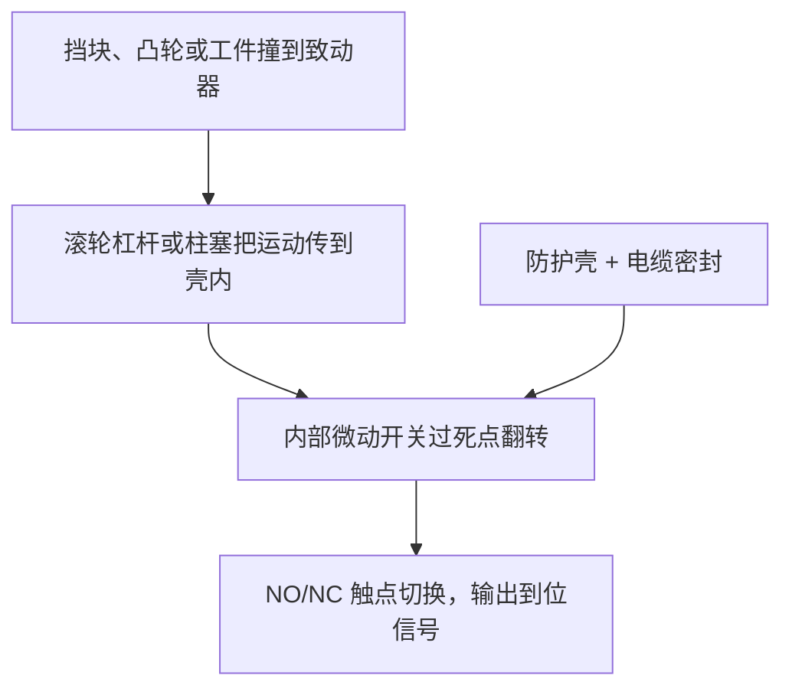

# 工业限位开关：在微动开关外面加防护壳和滚轮杠杆等致动器

> [!summary] 一句话概述
> 工业限位开关（行程开关、极限开关）不是再发明一种触点，而是把一颗快动微动开关装进金属或强化树脂外壳，再配上柱塞、滚轮或杠杆等致动器，用来在机台外侧承受撞击、油水和粉尘。庆丰把它概括成「同一颗心脏，差在有没有穿盔甲」。天得 TZ 系列限位开关在庆丰文中的口径是防护 IP65–IP67，机械寿命 1000 万次、电气寿命 50 万次；同文列出的裸微动例如 Omron V-15 可到 250 VAC / 15 A，与库内已收录的鼠标用 D2FC（6 VDC / 1 mA）不是同一使用场合。

## 配图

![[附件/limit-cf-01.jpg]]
*图源：[庆丰自动控制《微動開關與極限開關差在哪？》](https://www.cf-electric.com.tw/guides/micro-vs-limit-switch/)；文中用于对照的限位/微动实物照片之一*

![[附件/limit-cf-02.jpg]]
*图源：同上；实物照片之二*

![[附件/limit-cf-03.jpg]]
*图源：同上；实物照片之三*

![[附件/limit-tend-tz5-p1.png]]
*图源：[天得 TZ-5 系列限位开关说明书（100Y 镜像）](https://www.100y.com.tw/pdf_file/TEND_TZ-5.pdf) 第 1 页；TZ-5 外形与尺寸页*

![[附件/limit-tend-tz5-p2.png]]
*图源：同上，后续外形/接线图页*

> 图片版权归原作者所有，仅作个人学习收藏；出处见文末「来源与核实记录」。

## 结构原理

> 本节所有数字只写来源里给出的；来源没有就写「来源未给出」。

### 堆叠方案

方向：**从撞块或凸轮接触点到电缆引出**

| 层级 | 零件 | 材料 | 厚度/尺寸 | 固定方式 | 依据 |
| --- | --- | --- | --- | --- | --- |
| L1（最外） | 致动器：针型/柱塞、滚轮柱塞、铰链杠杆、铰链滚轮杆、弹性杆等 | 来源未给出牌号 | 来源未给出统一尺寸；柱塞型行程短、位置准，杠杆型把行程放大、操作力更小 | 锁在外壳上，把外部运动变成对内部按钮的按压 | 庆丰致动器表 |
| L2 | 防护外壳 | 金属或强化树脂 | 来源未给出壁厚。庆丰：天得 TZ 整颗做到 IP65–IP67；对比天得 TM 微动汎用型 IP00、密封防水型 IP62 | 固定在机台外侧；电缆从壳底固定孔进入并密封 | 庆丰 |
| L3 | 内部微动开关（内藏开关） | 快动簧片机构，具体牌号来源未给出 | 来源未给出封装尺寸 | 被致动器按压，过临界点后自行翻转 | 庆丰；unionwell |
| L4 | 触点与电缆 | 来源未给出材料。庆丰举例多为 1C（SPDT：公共、常开、常闭） | 见下方额定表 | 从密封孔引出 | 庆丰 |

剖面示意：

本文不展开微动开关内部簧片缺口，那部分见已收录的 D2FC 专篇。这里只把「外壳 + 致动器」当作与裸微动的差别。

### 零件清单

| 零件 | 数量 | 功能 | 材料 | 依据 |
| --- | --- | --- | --- | --- |
| 致动器 | 1 | 匹配撞块的运动方式 | 来源未给出 | 庆丰 |
| 防护壳 | 1 | 抗撞击、挡油水粉尘 | 金属或强化树脂 | 庆丰 |
| 内部微动开关 | 1 | 快动切换触点 | 来源未给出 | 庆丰；unionwell |
| 电缆密封件 | 来源未给出 | 进线处密封 | 来源未给出 | 庆丰 |

### 装配顺序

来源给出的是选型和安装逻辑，不是某型号的工厂工单：

1. 按安装位置决定要不要外壳：盘内、有遮蔽处用裸微动；机台外、有油水或碰撞处用限位开关（庆丰）。
2. 按撞块运动选致动器：正面直压用柱塞；侧面滑过用滚轮柱塞或铰链滚轮杆；来向不固定用弹性杆（庆丰）。
3. 把开关锁在机台，调整撞块使内部开关动作后仍有余程，又不会把柱塞顶死。庆丰提醒：柱塞型位置准但撞过头会打坏开关，要靠机构挡点保护。
4. 电缆从密封孔引入并压紧。接线按负载是交流还是直流、电流大小来选，不能把交流额定套到直流（庆丰：同一颗 TM-1300，250 VAC 为 15 A，30 VDC 只有 6 A）。
5. 安全门、急停回路通常要求强制开离的安全开关，一般限位开关不一定符合（庆丰安全提醒）。

### 受力与运动分析

- **受力路径**：撞块力 → 致动器（可能经杠杆放大行程、减小所需操作力）→ 壳内微动按钮 → 内部快动簧片翻转到触点切换。触点切换速度由内部快动决定，与撞块有多快无直接对应（庆丰）。
- **运动关系**：滚轮型允许挡块侧向滑过；纯柱塞适合直线推压。弹性杆则可多方向触发。
- **失效风险**：超行程打坏柱塞或内部开关；密封失效后油污进盒；直流电弧不能自然过零，用交流额定去切直流会缩短寿命或烧触点（庆丰）。电气寿命远低于机械寿命：庆丰所引天得 TZ 为机械 1000 万次、电气 50 万次，贴着额定上限用时应按电气寿命估。

## 设计要点与参数

| 要点 | 内容 | 依据 |
| --- | --- | --- |
| 结构定义 | 限位开关＝微动开关＋防护壳＋致动器 | 庆丰；unionwell 亦作防水微动与防水限位的对照 |
| 天得 TZ 防护 | IP65–IP67（庆丰转述官方口径） | 庆丰 |
| 天得 TZ 寿命 | 机械 1000 万次、电气 50 万次 | 庆丰 |
| 致动器类型 | 针型/柱塞、滚轮柱塞、铰链杆、铰链滚轮杆、弹性杆 | 庆丰 |
| 微动举例额定（阻性） | Omron SS-5GL：125 VAC 5 A；V-15-1A5：250 VAC 15 A；Z-15G-B：125/250 VAC 15 A；天得 TM-1300：125/250 VAC 15 A；TM-1300-2：20 A。TM-1300 的 30 VDC 只有 6 A | 庆丰 |
| 触点形式 | 多为 1C（SPDT）；两路独立触点要用两颗或多接点型 | 庆丰 |
| 安全回路 | 一般限位不一定具备强制开离，安全门/急停需另选安全型 | 庆丰 |

## 优缺点

**优点**
- 把已经成熟的快动微动放到能上机台的外壳里，不必为油污环境重做触点
- 致动器可以按撞块运动方式更换，柱塞求准，滚轮求耐刮
- 防护和寿命分档清楚，便于按安装位置付钱

**缺点 / 代价**
- 体积和成本高于裸微动，盘内不必浪费一层壳
- 电气寿命只有机械寿命的几十分之一，不能拿「一千万次」去切额定电流
- 一般限位不能直接当安全门开关用

## 可借鉴点

- 选型先问三件事：装在哪（要不要壳）、东西怎么碰它（选哪一种头）、切什么负载（交直流和电流）。
- 侧面滑过的挡铁优先滚轮，不要用纯柱塞去「刮」。
- 机构上必须给超行程留挡点，尤其是柱塞型。
- 直流回路单独查直流额定。安全回路改选强制开离型，见安全门联锁专篇。

## 与库中相似案例对比

| 对比项 | 本案例（工业限位开关） | [[鼠标微动开关（Omron D2FC）：杠杆、簧片翻转与触点]] | [[安全门舌片联锁：专用执行器转动内凸轮，以直接断开动作打开 NC 触点]] | [[急停蘑菇头：机械保持、刻意复位与触点脱落向安全侧断开]] |
| --- | --- | --- | --- | --- |
| 讨论重点 | 外壳、防护和致动器如何把撞击变成对内部微动的按压 | 超小型微动内部的簧片、缺口和 1 mA 级额定 | 专用安全联锁，开门力直接强制打开 NC | 按下保持、需刻意复位的安全元件 |
| 使用场所 | 机台外、油水粉尘、行程末端 | 鼠标、轻载按键 | 防护门与安全回路 | 急停回路 |
| 何时用这篇 | 要为行程检测选壳和滚轮/柱塞 | 要设计或维修鼠标微动内部 | 要做安全门，不能用普通限位代替 | 要做急停 |

## 相关案例

- [[鼠标微动开关（Omron D2FC）：杠杆、簧片翻转与触点]]
- [[安全门舌片联锁：专用执行器转动内凸轮，以直接断开动作打开 NC 触点]]
- [[急停蘑菇头：机械保持、刻意复位与触点脱落向安全侧断开]]
- 分类索引：[[04-机构与运动 索引]]

## 来源与核实记录

- 主来源：[庆丰自动控制器材，《微動開關與極限開關差在哪？關係、致動器選法一次講清楚》](https://www.cf-electric.com.tw/guides/micro-vs-limit-switch/)（2026-11-27 打开并下载文中实物照片。定义、致动器表、天得 TZ 的 IP 与寿命口径、直流额定不可套用交流，以及安全回路提醒来自该文。庆丰是通路商，文中数字按其所引厂商口径记录。）
- 交叉来源：[天得 TZ-5 Series Limit Switch 说明书（100Y 提供的 PDF）](https://www.100y.com.tw/pdf_file/TEND_TZ-5.pdf)（2026-11-27 下载并渲染外形页。用于对照 TZ-5 系列外观与尺寸图。该 PDF 带密集水印，正文参数以庆丰转述的官方口径为准，不从水印页猜测未读清的数字。）
- 交叉来源：[unionwell，《工业设备防水微动开关与防水限位开关》](https://www.unionwellswitch.com/zh/waterproof-micro-switch-vs-waterproof-limit-switch/)（2026-11-27 打开。独立制造机构。用于核对「微动与限位的差别在外壳和致动器」这一分层，不把该页未摘录的型号额定写入本表。）
- 核实：2026-11-27 打开上述来源。未把本篇写成 D2FC 内部簧片的重复，也未把一般限位写成安全门开关。
