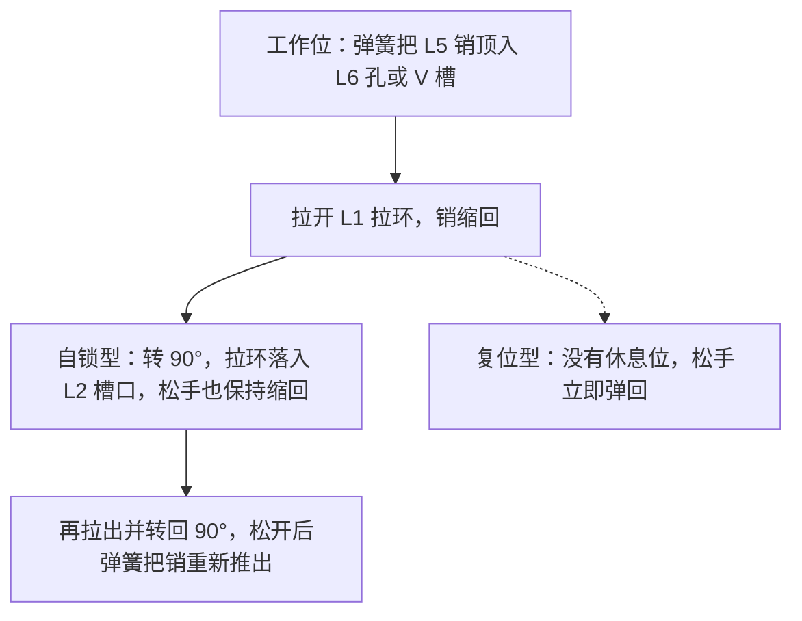

# 带拉环弹簧分度销：弹簧保持插入，拉出后转 90° 停在槽上

> [!summary] 一句话概述
> 带休息位的弹簧分度销（index plunger / 旋钮柱塞自锁型）靠内置弹簧把销顶进定位孔或 V 槽；要让开时，拉开环或旋钮使销缩回，再转 90°，让拉环落在槽口上，销就会保持缩回，松手也不弹回去。再拉一下转回 90°，弹簧又把销推出来。它不是球头快卸销：快卸销是按压按钮收起杆上的钢珠，以便从通孔里抽出整根销，本篇是带螺纹套的弹簧柱塞。

## 配图

![[附件/winco-gn413-indexing-plunger.jpg]]
*图源：[JW Winco GN 413 样本页](https://live-catalog.jwwinco.com/pdf/winco/us/413.pdf?dispositiontype=attachment)；A / AK 为无休息位（松手即弹回），C / CK 为带休息位。C 型剖视标出 Notch，CK 型画了「Pull ring rotated 90°」，销保持在缩回位置。表中给出销径 5 / 6 / 8 / 10 mm 与弹簧初载、末载*

![[附件/winco-gn413-product-photo.jpg]]
*图源：[JW Winco GN 413 产品页](https://www.jwwinco.com/en-us/products/3.1-Indexing-locking-blocking-with-pins-and-ball-shaped-elements/Indexing-plungers/GN-413-Stainless-Steel-Indexing-plungers)；带拉环的不锈钢实物。拉环既用于装配时拧入，也用于把销拉回并在 C / CK 型上转到休息位*

> 图片版权归原作者所有，仅作个人学习收藏；出处见文末「来源与核实记录」。

## 结构原理

> 本节所有数字只写来源里给出的；来源没有就写「来源未给出」。

### 和球头快卸销的区别

球头快卸销（ball-lock pin）是一根穿过通孔的销，中部有钢珠，按压端头按钮后钢珠缩回，整根销可以抽出；松开按钮钢珠弹出，防止销自己滑出。本篇的分度销是拧在支架上的弹簧柱塞：销只做轴向伸缩，并不把整件从孔里取走。休息位靠拉环转 90° 卡在槽口上实现，没有按压收珠的动作。两套零件不要互相替代。

### 堆叠方案

方向：**从操作侧的拉环，到螺纹套里的弹簧与销，再到被定位件上的孔或 V 槽**

| 层级 | 零件 | 材料 | 厚度/尺寸 | 固定方式 | 依据 |
| --- | --- | --- | --- | --- | --- |
| L1（最外） | 拉环或旋钮 | GN 413：拉环为 AISI 301 不锈钢。米思米还有蘑菇头旋钮、手柄等形状 | GN 413 给出环相关尺寸 d3、l4、m，例如销径 5 mm 时 d3 = 1.5 mm、l4 = 23 mm、m = 18 mm（以样本表为准） | 用手拉出；C / CK 型再旋转 90° 落入槽口 | Winco 样本「Information」；米思米「根据形状等选型」 |
| L2 | 槽口（notch） | 做在螺纹套或导向面上 | 来源未给出槽深数值 | C / CK 型在销缩回后，转 90° 由槽口托住拉环，保持缩回 | Winco：A notch keeps the plunger in the retracted position |
| L3 | 螺纹套（阀体） | GN 413：钢发黑（ST）或 AISI 303（NI） | 螺纹 d2 为 M10、M12、M16，或细牙 M10×1、M12×1.5、M16×1.5。可选锁紧螺母（AK / CK） | 拧入安装板；有螺母的型号用 DIN 439 B / ISO 4035 / ISO 8675 锁紧 | 样本 Specification 与表 |
| L4 | 弹簧 | AISI 301 不锈钢（GN 413） | 初载 / 末载：5 mm 销为 5 N / 15 N，6 mm 为 6 N / 21 N，8 mm 与 10 mm 为 7 N / 27 N（约值） | 装在套内，把销向外推 | 样本 Metric table「Spring load ≈」 |
| L5 | 柱塞销 | AISI 303，化学镀镍 | 销径 d1 = 5 / 6 / 8 / 10 mm，公差 −0.02 / −0.10 mm，配合孔按 H7。最小伸出 l1 min. 分别为 5、6、9、9 mm | 在套内滑动，前端进入定位孔或 V 槽 | 样本表；米思米销尖形状 |
| L6 | 定位孔或 V 槽（在被定位件上） | 应用自定 | 米思米：锥面销配孔，孔口建议倒角；若间隙小于 0.05 mm，孔口做成 0.5–1 mm 倒角更易插入。球面销配 V 槽，靠弹簧把销尖压在 V 面上 | 销插入后限制平台移动 | 米思米选型要点 |

剖面示意：

米思米把两种操作写成：

- 复位型：前端通常突出；拉出旋钮则缩回；松开后靠弹簧恢复突出。要保持缩回就必须一直拉着。
- 凸销锁定型 / 自锁型：拉出后保持拉出并旋转 90°，即可锁定在缩回位置；解锁时再保持拉出并转 90°，松开后弹簧把销推回。

这与 GN 413 的 A/AK（non lock-out）和 C/CK（lock-out）一一对应。

### 零件清单

| 零件 | 数量 | 功能 | 材料 | 依据 |
| --- | --- | --- | --- | --- |
| 拉环或旋钮 | 1 | 拉出销，并在自锁型上转到休息位；GN 413 的拉环还可当拧入工具 | AISI 301（GN 413 拉环） | Winco |
| 螺纹套 | 1 | 提供安装螺纹和销的导向，自锁型带槽口 | 钢发黑或 AISI 303 | Winco |
| 锁紧螺母 | 0 或 1 | AK / CK 型用来锁紧安装位置 | 钢发黑或 A2，DIN 439 B / ISO 4035 / ISO 8675 | Winco |
| 弹簧 | 1 | 保持销插入，并在解锁后推回 | AISI 301 | Winco |
| 柱塞销 | 1 | 插入孔或 V 槽完成定位 | AISI 303 化学镀镍 | Winco |
| 定位衬套（可选附件） | 可选 | Winco 列出 GN 412.4 / 412.5 等定位衬套 | 来源未在本页展开材料 | Winco Accessory |

### 装配顺序

按样本和米思米选型逻辑：

1. 按定位方式选销尖：孔定位用锥面销，V 槽定位用球面销。米思米写，锥面+孔的定位精度取决于间隙，间隙会造成松动；球面+V 槽则由弹簧把销尖压在 V 面上，减少松动。
2. 按是否需要「销保持缩回」在复位型（A/AK）和自锁型（C/CK）之间选择。需要空出孔、腾出手去搬工件时，用自锁型。
3. 按销径、螺纹和板厚选型号。GN 413 的销径与螺纹组合见参数表；有锁紧螺母的型号便于微调伸出后锁住。
4. 把螺纹套拧入安装板（可用拉环当扳手），需要时拧紧锁紧螺母。销对准预先做好的 H7 孔或 V 槽。
5. 使用：插入定位时松开拉环，让弹簧把销推入；要移动平台时拉出。自锁型再转 90° 卡住，移动完成后再转回，让销弹入下一个位置。

### 受力与运动分析

- **受力路径**：弹簧力沿销轴把销压进孔或 V 槽。米思米明确：旋钮柱塞只用于定位，「不能承受作用在移动平台上的诸如加工力（过大的力）等外力」。若要用它去挡垂直于销的载荷，必须保证该剪切载荷小于销能承受的值；GN 413 本页没有给出抗剪额定值，只给出弹簧初载和末载，抗剪需另查其 Load Rating 页或做计算，不能把 15 N、27 N 当成侧向承载。
- **运动关系**：销相对螺纹套只有轴向移动；自锁型增加拉环绕轴转 90° 这一操作，用来把销停在缩回位置。复位型没有这个停留自由度。
- **失效风险**：把分度销当挡块去扛切削力，销或孔会损坏（米思米已警告）。孔口没有倒角、间隙又小于 0.05 mm 时，对不准就插不进。休息位的槽口磨损或没有转到位，松手后销会突然弹出。误把球头快卸销装进螺纹座，或把分度销当快卸销去穿通孔，都会失去各自的锁定方式。

## 设计要点与参数

| 要点 | 内容 | 依据 |
| --- | --- | --- |
| 自锁动作 | 拉出后旋转 90°，槽口保持缩回；再拉出转 90° 解锁，弹簧推回 | 米思米选型要点、产品特点文、FAQ；Winco C/CK |
| GN 413 销径与螺纹 | d1 = 5 mm 配 M10 或 M10×1；6 mm 配 M12 或 M12×1.5；8 mm 与 10 mm 配 M16 或 M16×1.5 | Winco 样本表 |
| 销公差与孔 | 销 −0.02 / −0.10 mm，孔 H7 | 同上 |
| 最小伸出 l1 | 5、6、9、9 mm（对应 5 / 6 / 8 / 10 mm 销） | 同上 |
| 弹簧载荷（约值） | 5 N / 15 N；6 N / 21 N；7 N / 27 N；7 N / 27 N（初载 / 末载） | 同上 |
| 材料 | 套：钢发黑或 AISI 303；销：AISI 303 化学镀镍；簧和环：AISI 301 | 样本 Specification |
| 孔口倒角 | 间隙小于 0.05 mm 时，孔口 0.5–1 mm 倒角更易插入 | 米思米选型要点 |
| 承载边界 | 只用于定位，不能当作承受加工力的支承 | 米思米 |

## 优缺点

**优点**
- 单手拉转即可在「插入定位」和「保持缩回」之间切换，不必一直捏着
- 螺纹安装，位置可调（带锁紧螺母的型号更方便）
- 销径、弹簧力和复位/自锁分成明确规格，便于按定位孔选
- 和快卸销相比，销不会整根掉出来，适合装在机架上反复使用

**缺点 / 代价**
- 不能当受力挡销去扛加工载荷
- 必须为销准备对得准的孔或 V 槽，对不准就卡死或定位不准
- 休息位是靠槽口托住，槽口磨损或没转到位会失效
- 名称多（分度销、旋钮柱塞、弹簧柱塞、index plunger），要看有没有 90° 休息位，不要和球头快卸销、球头柱塞混订

## 可借鉴点

- **需要「缩回后腾出手」就选带 90° 休息位的 C/CK 或自锁型**；只是点一下定位、马上还要弹回，用复位型更简单。
- **先定配合面再定销尖**：孔用锥面，V 槽用球面；孔口倒角按间隙来，不要指望硬塞。
- **弹簧力只保证插入，不保证抗剪**。侧向力要另做挡块或加大销的专门校核。
- **拉环可以当装配扳手**，但不要把它设计成必须伸进很深凹槽才能抓住的位置。
- 需要把整根销抽出带走时，改用球头快卸销，不要把本结构掰成那种用法。

## 与库中相似案例对比

| 对比项 | 本案例 | [[过中心拉伸搭扣（Southco 97）：杠杆过死点自锁，把箱盖拉向箱体]] | [[GoPro 快拆卡扣与指旋螺母：两爪弹性卡入和螺钉夹紧是两套锁]] |
| --- | --- | --- | --- |
| 保持方式 | 弹簧把销顶入；休息位靠转 90° 卡槽 | 杠杆过死点，张力压向止挡 | 弹性卡爪 + 指旋螺钉，两套锁 |
| 操作 | 拉出，可选转 90° 停留 | 翻杠杆 | 卡入后再拧紧 |
| 用途 | 平台、转盘的重复定位 | 箱盖拉紧 | 相机配件快拆 |
| 不是什么 | 不是按压收珠的球头快卸销 | 不是 90° 凸轮钉 | 不是弹簧分度销 |

## 相关案例

- [[过中心拉伸搭扣（Southco 97）：杠杆过死点自锁，把箱盖拉向箱体]]
- [[Southco、DZUS 四分之一转快锁：90° 凸轮与按总材料厚度选钉长]]
- 分类索引：[[04-机构与运动 索引]]

## 来源与核实记录

- 主来源：[米思米：旋钮柱塞选型要点](https://techinfo.misumi.com.cn/exportarticle/article/2664/)（2022-08-29；中文：结构、复位型与凸销锁定型的 90° 操作、销尖与孔/V 槽、倒角建议、不能承受加工力）
- 补充来源 1：[米思米：旋钮柱塞的产品特点和使用注意事项](https://techinfo.misumi.com.cn/exportarticle/article/2978/)（2022-12-06；自锁型五步操作，与选型文一致）
- 补充来源 2：[米思米 FAQ：复位型和自锁型有什么区别？](https://techinfo.misumi.com.cn/faq/detail/8602/)（2024-01-24；拉出后转 90° 即可固定）
- 补充来源 3：[JW Winco GN 413 产品页](https://www.jwwinco.com/en-us/products/3.1-Indexing-locking-blocking-with-pins-and-ball-shaped-elements/Indexing-plungers/GN-413-Stainless-Steel-Indexing-plungers) 与 [样本 PDF](https://live-catalog.jwwinco.com/pdf/winco/us/413.pdf?dispositiontype=attachment)（独立机构：C/CK 转 90° 靠槽口保持缩回，销径、螺纹、l1、弹簧初末载、材料）
- 核实：2026-11-22 打开米思米三页与 Winco 产品页，并下载 GN 413 样本。未把球头快卸销或球头柱塞的参数写入本篇。
