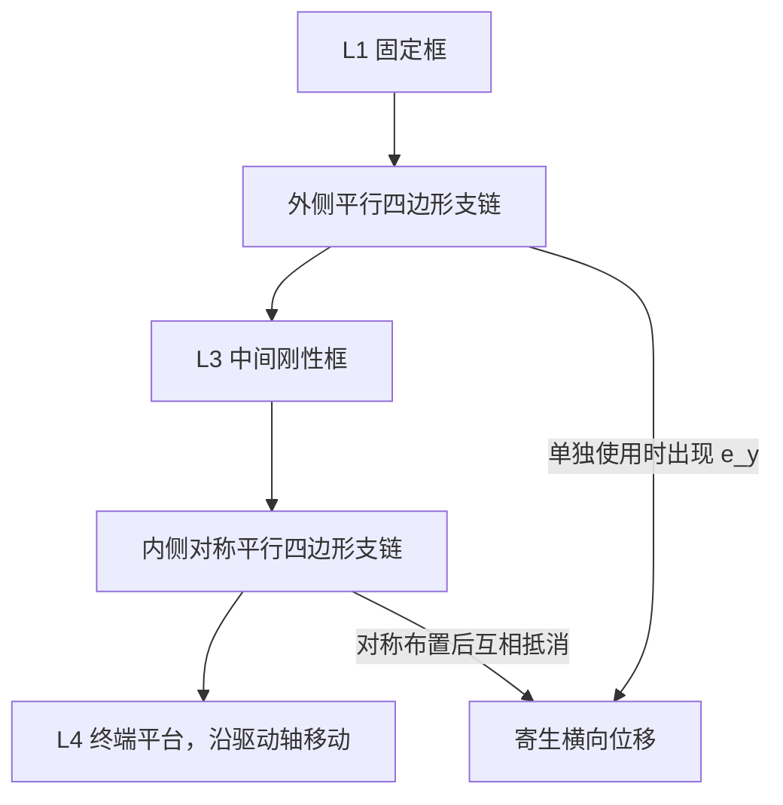

# 平行板簧直线导轨与双平行四边形：对称构型抵消寄生横向位移

> [!summary] 一句话概述
> 一对平行板簧（或平行四边形柔性铰链机构）可以当作近似直线导轨，但终端在沿驱动方向移动时，还会带出垂直方向的耦合误差；把两个相同的平行四边形沿驱动轴线对称布置，组成双平行四边形，就可以抵消这条寄生横向位移，得到更接近理想移动副的输出。清华杜云松等给出了构型说明和一组铰链/机构尺寸；上海工程技术大学的二维微动台用复合双平行四杆加结构对称来消除轴间耦合和寄生位移。这不是短切口转动副，也不是指点杆那种微应变传感。

## 配图

![[附件/thu-parallelogram-vs-double.jpg]]
*图源：[杜云松、李铁民、姜峣、张京雷《平面柔性铰链机构的柔度计算方法》](https://jst.tsinghuajournals.com/CN/rhhtml/20160612.htm) 图 6； (a) 单个平行四边形：终端在 Fₓ 下沿 x 运动时不转，但出现耦合误差 eᵧ；(b) 双平行四边形：两个相同平行四边形沿驱动轴线对称布置，文中写可完全消除耦合运动误差，相当于两个理想移动副*

![[附件/thu-double-parallelogram-params.jpg]]
*图源：同上文图 8；双平行四边形并联机构，四条串联支链左右对称，A、B、C、D 端固定，尺寸参数包括 L、P、M，铰链为圆弧切口并编号 1–8*

![[附件/sues-xy-flexure-photo.jpg]]
*图源：[刘浩、赖磊捷《二维微动平台柔性机构动力学建模与分析》](https://xuebao.sues.edu.cn/article/doi/10.12299/jsues.22-0274) 图 5；二维柔性机构微定位平台实验照片，四周为复合双平行四杆模块、中心为工作台。同页图 2 为该构型示意图，本篇配图不超过 3 张，不另嵌入*

> 图片版权归原作者所有，仅作个人学习收藏；出处见文末「来源与核实记录」。

## 结构原理

> 本节所有数字只写来源里给出的；来源没有就写「来源未给出」。

### 堆叠方案

方向：**从固定基座经过平行柔段到终端平台（单轴）；二维台再在正交方向重复一套对称模块**

| 层级 | 零件 | 材料 | 厚度/尺寸 | 固定方式 | 依据 |
| --- | --- | --- | --- | --- | --- |
| L1 | 固定基座 / 固定端 A、B、C、D | 来源未给出牌号 | 清华双平行四边形算例：铰链 R = 5 mm，D = 10 mm，w = 1 mm；机构参数讨论了 M = 30 mm、P = 10 mm 或 L = 10 mm 等组合 | 固定约束 | 杜云松等 4.2 节与图 8 |
| L2 | 平行板簧或带圆弧铰的平行支链 | 同上 | 清华单个平行四边形算例：B = 35 mm，L = 54 mm，铰链 R = 5 mm，D = 10 mm，厚度 w 取 1、3、5 mm 做误差比较 | 与基座和终端一体或固接 | 杜云松等图 7 与表 3 |
| L3 | 中间刚性块（双平行四边形的内侧框） | 同上 | 由参数 P、M、L 确定内外间距，详见该文图 8 | 与两侧支链一体 | 杜云松等图 8 |
| L4 | 终端平台 / 位移输出点 n | 同上 | 二维台为中心工作台，四周再布置复合双平行四杆模块 | 与内侧支链相连 | 杜云松等图 6(b)、图 8；刘浩等图 2、图 5 |

剖面示意：

和转动铰、指点杆的差别：

- 本篇做的是近似移动副，不是把切口当转动副来用。
- [[应变式指点杆：十字薄片根部弯曲，将侧向按力变成二维输入]] 用的是微应变传感，不是导轨。

夹心/三明治双平行四边形（沿厚度方向再叠一层以提高面外刚度）的 ASPE / Deep Blue 文本次下载失败，本篇不引用其未打开的参数。

### 零件清单

| 零件 | 数量 | 功能 | 材料 | 依据 |
| --- | --- | --- | --- | --- |
| 固定框 | 1 | 提供不动参考 | 来源未给出 | 杜云松等图 6–8 |
| 平行柔段 / 圆弧铰支链 | 单平行四边形为两条串联支链；双平行四边形为四条 | 导向并提供沿驱动方向的柔度 | 来源未给出 | 杜云松等 4.2 节 |
| 中间刚性框（双平行四边形） | 1 组 | 把两个平行四边形串在驱动轴上并对称 | 来源未给出 | 杜云松等图 6(b)、图 8 |
| 终端平台 | 1 | 输出近似直线运动；二维台再在 X、Y 各做一套 | 来源未给出 | 刘浩等图 2、图 5 |

### 装配顺序

来源按整体柔性机构分析，不是多件装配。按构型写出设计顺序（工艺来源未给出）：

1. 先做一对平行板簧或平行四边形支链，确认终端在驱动方向能走，同时会有横向耦合 eᵧ（杜云松等图 6a）。
2. 再做一套相同的平行四边形，与第一套沿驱动轴线对称布置，把终端夹在中间或按图 6b、图 8 连接，使两侧寄生位移相反、互相抵消。
3. 需要 X、Y 两轴时，用结构对称的复合双平行四杆模块绕中心平台布置（刘浩等），不要只用单边模块。
4. 用柔度/刚度矩阵或有限元核对驱动方向柔度、耦合项和固有频率。

### 受力与运动分析

- **受力路径**：驱动力 Fₓ 作用在终端（或与输出点重合的载荷点），经平行支链传到固定框。单平行四边形在沿 x 走的同时，支链走的是圆弧，于是终端出现 y 向误差 eᵧ，但文中写不会发生转动。
- **运动关系**：双平行四边形利用对称把 eᵧ 抵消，输出近似纯平动。刘浩等进一步用结构对称约束消除轴间耦合和寄生位移，实现 X、Y 平动。
- **失效风险**：只做单边平行四边形却按理想移动副去控制，会把耦合误差当成外部扰动（推断，图 6a 已画出 eᵧ）。面外刚度不足时平台会低头或侧倾；夹心方案本轮未能打开，来源未给出可引用的面外刚度公式。厚度 w 增大时，清华方法与有限元的柔度误差也会增大（表 3：w = 5 mm 时轴向柔度误差 6.3%）。

## 设计要点与参数

| 要点 | 内容 | 依据 |
| --- | --- | --- |
| 单平行四边形的寄生运动 | 终端沿 x 运动时不转，但有耦合误差 eᵧ | 杜云松等 4.2 节与图 6a |
| 双平行四边形的作用 | 两个相同平行四边形沿驱动轴线对称分布，「可以完全消除机构的耦合运动误差，实现机构的输出解耦，并且可以看作是两个理想的移动副」 | 杜云松等 4.2 节与图 6b |
| 单平行四边形算例尺寸 | B = 35 mm，L = 54 mm，铰链 R = 5 mm，D = 10 mm；w = 1、3、5 mm 时，文中方法与有限元最大误差 6.3%（出现在轴向柔度、w = 5 mm） | 杜云松等图 7 与表 3 |
| 双平行四边形算例 | 铰链 R = 5 mm，D = 10 mm，w = 1 mm；讨论 P/R、(L−2R)/R、(M−2R)/R 与轴向/剪切柔度的关系。文中写：P/R 增大则轴向柔度减小、剪切柔度基本不变；(L−2R)/R 增大则轴向柔度线性增加，剪切柔度增加幅度较大 | 杜云松等图 8–11 及相关段落 |
| 二维复合双平行四杆台的频率 | 刚度矩阵模型：X 向 55.402 Hz，Y 向 55.402 Hz，扭转 215.54 Hz；有限元：54.619、54.636、208.97 Hz；误差 1.434%、1.402%、3.144% | 刘浩等表 1（页面给出的对比表） |
| 夹心双平行四边形的面外刚度公式 | 本轮未能打开相应 PDF，来源未给出 | — |
| 材料牌号、行程、驱动力 | 两篇打开的来源未给出统一产品级数值 | — |

## 优缺点

**优点**
- 用对称几何抵消寄生横向位移，不必靠控制去补一条已知的耦合轨迹。
- 可以整体切出，没有导轨间隙和润滑问题。
- 二维台可以把同一模块绕中心重复，做成解耦平动。

**缺点 / 代价**
- 双平行四边形比单边导轨多占一套支链和中间框，体积和惯性都更大。
- 面外刚度和载荷能力仍受薄板限制；本轮没有打开夹心方案的参数，不能在本篇里给出现成的加厚办法。
- 驱动方向刚度随 L、P、M 和铰链尺寸变化，需要按来源的柔度关系逐项校核，不能只画一个对称符号就结束。

## 可借鉴点

- 只要看到一对平行板簧在做「直线」导轨，先问有没有 eᵧ；若精度不允许，就改成沿驱动轴对称的双平行四边形。
- 尺寸上优先核对 (L−2R)/R 这类会同时拉动轴向和剪切柔度的参数，以及主要改变轴向柔度的 P/R。
- 做 XY 台时，对称约束要同时管轴间耦合和单轴寄生，不要只在一个方向做双平行四边形。
- 不要和短切口转动铰或指点杆写成同一篇。

## 与库中相似案例对比

| 对比项 | 本案例：平行板簧 / 双平行四边形 | [[直圆切口柔性铰链（Right circular flexure hinge）：最薄处厚度 t、切口半径 R 与公式适用范围]] | [[应变式指点杆：十字薄片根部弯曲，将侧向按力变成二维输入]] | [[压电驱动桥式柔性铰链位移放大机构：理想放大比与铰链柔度造成的折减]] |
| --- | --- | --- | --- | --- |
| 要解决的问题 | 近似直线移动，抵消横向寄生 | 近似转动 | 把侧向力变成电信号 | 把压电小位移放大 |
| 关键构型 | 对称的两套平行四边形 | 短圆弧切口 | 十字薄片根部 | 桥式斜臂 + 柔性铰 |
| 已有案例是否覆盖 | 库内没有这条导轨，本篇新收 | 本轮另篇 | 已有，不是导轨 | 本轮另篇，是放大不是导轨本身 |
| 是否重复活铰/打印间隙 | 不是 | 不是 | 不是 | 不是 |

## 相关案例

- [[直圆切口柔性铰链（Right circular flexure hinge）：最薄处厚度 t、切口半径 R 与公式适用范围]]
- [[压电驱动桥式柔性铰链位移放大机构：理想放大比与铰链柔度造成的折减]]
- [[应变式指点杆：十字薄片根部弯曲，将侧向按力变成二维输入]]
- [[FDM 一体打印活动件（Print-in-Place）：XY 每边 0.3 mm、Z 两整层的间隙规则]]（打印间隙，不是柔顺导轨）
- 分类索引：[[04-机构与运动 索引]]

## 来源与核实记录

- 主来源：[杜云松、李铁民、姜峣、张京雷《平面柔性铰链机构的柔度计算方法》](https://jst.tsinghuajournals.com/CN/rhhtml/20160612.htm)（《清华大学学报（自然科学版）》2016, 56(6): 633–639；收稿日期 2015-07-02。中文全文 HTML 与图 6–8、表 3 及双平行四边形尺寸讨论）
- 补充来源：[刘浩、赖磊捷《二维微动平台柔性机构动力学建模与分析》](https://xuebao.sues.edu.cn/article/doi/10.12299/jsues.22-0274)（《上海工程技术大学学报》2023 年；收稿日期 2022-09-13，刊出 2023-06-20。独立第二机构。摘要、图 2、图 5 与表 1 已打开；全文 PDF 本次未能下载，不引用未出现在页面上的公式）
- 核实：2026-11-22 打开并保存上述页面与配图。密歇根大学三明治双平行四边形 PDF 多次下载失败，不写入参数。未与指点杆或短切口转动铰混篇。
