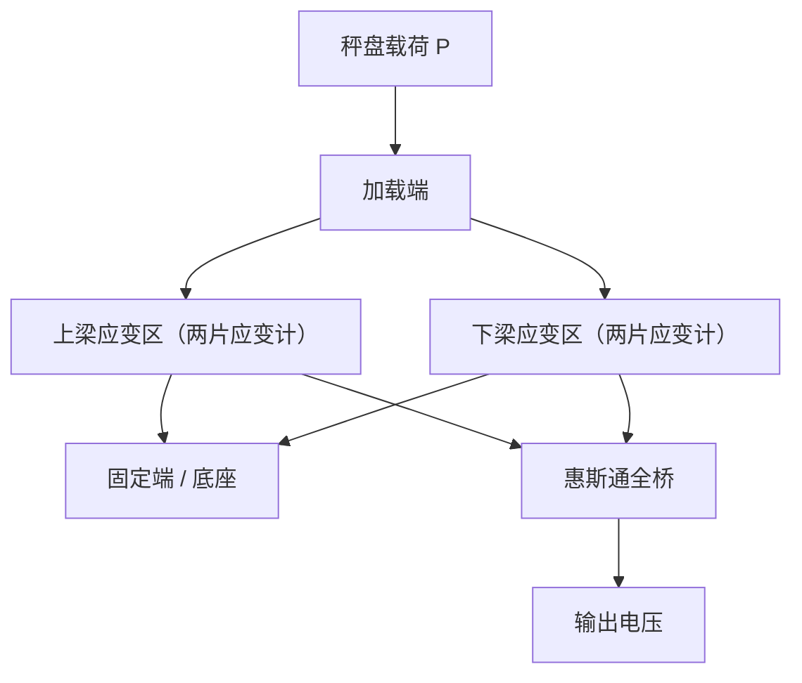

# 平行梁式称重传感器弹性体：双孔平行梁把载荷变成孔壁最薄处的弯曲应变，并用修锉调整四角误差

> [!summary] 一句话概述
> 平行梁式称重传感器把弹性体做成双孔（或上下平行梁）结构：载荷使梁弯曲，电阻应变计贴在圆孔壁厚最小的四个位置，组成差动全桥把重量变成电压；几何上它和平行板簧微动导轨同源，但目的是把指定截面的应变做稳定、可补偿，而不是提供无摩擦直线导轨。

## 配图

![[附件/cstam-parallel-beam-fig1.jpg]]
*图源：[查明华、陈晓勤、张如一《电子秤中平行梁弹性元件的性能分析》，《力学与实践》1997 年第 19 卷第 3 期第 28 页](https://pubs.cstam.org.cn/data/article/mie/preview/pdf/1997-065.pdf) 图 1；上为双孔平行梁弹性体，标出孔半径、壁厚最薄处 h、孔距 a、梁宽等，应变计贴在四个圆孔壁厚最小处；下为简化成的平行四边形刚架（三次超静定）*

![[附件/weighment-parallel-beam-fig1.jpg]]
*图源：[林志伟《平行梁型称重传感器四角误差的产生与调整》，《衡器》2025 年第 7 期第 3 页](https://web.archive.org/web/2025/http://weighment.com/discourse/paper2025/250710.pdf) 图 1；双孔（腰圆/相连双孔）弹性体的外形与 A–A 剖面，标出宽度 b、梁厚 h、总高 H、孔距等结构尺寸。原文写这些尺寸中，弹性体厚度 b 与孔距等会影响灵敏度，半成品阶段主要靠微量改变贴片区截面来调四角*

![[附件/weighment-parallel-beam-fig2.jpg]]
*图源：同上第 3 页图 2；四角误差测量示意（带网格的弹性体与加载托盘）。正文把偏载误差最终归结为各应变计处截面尺寸 b、h 不一致，用微量平锉或斜锉来修正*

> 图片版权归原作者所有，仅作个人学习收藏；出处见文末「来源与核实记录」。

## 结构原理

> 本节所有数字只写来源里给出的；来源没有就写「来源未给出」。

### 堆叠方案

方向：**从秤盘加载端到固定端（沿梁的长度）**

| 层级 | 零件 | 材料 | 厚度/尺寸 | 固定方式 | 依据 |
| --- | --- | --- | --- | --- | --- |
| L1（加载端） | 弹性体自由端，常经托盘或钢球引入垂直载荷 | 铝合金（林志伟）；测试例 LY12-S | 清华测试例：C3H1-15，量程 15 kg | 加载端与托盘/垫块接触；清华文讨论偏心载荷作用位置 | 林志伟第 1–2 节；清华第 28–29 页 |
| L2 | 双孔平行梁工作段，上下梁在孔壁最薄处形成应变区 | 与弹性体一体 | 清华图 1：孔距 a，最薄壁厚 h，梁宽 b；林志伟图 1：b、h、H 及孔距 | 一体加工，无单独铰链 | 两文附图 |
| L3 | 四片电阻应变计，贴在四个最薄截面，组成惠斯通电桥 | 电阻应变计（牌号来源未给出） | 来源未给出栅长 | 胶贴；位置偏离会直接变成四角误差 | 清华：贴在圆孔壁厚最小处 4 点；林志伟第 2 节 |
| L4（固定端） | 弹性体根部，需要足够的固支刚度 | 与弹性体一体 | 来源未给出固定螺钉规格 | 螺钉或底座固定 | 刘九卿文强调支承边界；林志伟按固定模块安装后再测四角 |

它和平行板簧直线导轨的相似处是：上下两根梁加两端刚架，载荷下梁弯曲、两端近似平行移动。不同处是：导轨要的是工作台运动；这里要的是四个指定截面上大小相等、符号正确的弯曲应变，并且用桥路把偏心引起的附加应变对消。

### 零件清单

| 零件 | 数量 | 功能 | 材料 | 依据 |
| --- | --- | --- | --- | --- |
| 双孔平行梁弹性体 | 1 | 把垂直载荷变成指定截面的弯曲应变 | 铝合金；测试例 LY12-S | 林志伟；清华 |
| 电阻应变计 | 4 | 感受上下梁最薄处的拉/压应变 | 来源未给出牌号 | 两文 |
| 补偿电路与封胶（生产中） | 来源未给出件数 | 减小温度、湿度影响 | 来源未给出 | 林志伟第 3 节 |
| 加载托盘 / 固定模块（测试工装） | 各 1（测试时） | 按实际使用方式引入载荷并固定根部 | 来源未给出 | 林志伟第 4 节 |

### 装配顺序

1. 加工弹性体，保证双孔和梁厚。清华把结构简化为平行四边形刚架，属三次超静定；上下梁相对很薄，左右两竖段相对粗，可视为刚架立柱。
2. 在四个圆孔壁厚最小处粘贴应变计，组成全桥。林志伟指出：贴偏、不对称会直接造成四角误差；有的厂靠人工微调，有的用机器视觉与机械手定位，但贴完后仍必须做四角调整。
3. 半成品安装到与设计一致的工装上（模拟秤盘的受力托盘 + 固定模块），在四个角位置加载，读输出，再按规则微量修锉贴片区截面，直到四角一致（林志伟第 4 节）。
4. 封胶、温度补偿和后续标定。具体工艺参数来源未给出。

### 受力与运动分析

- **受力路径**：重量由秤盘传到加载端，经上下平行梁弯到固定端。清华给出贴片处总应变 ε = 6Pa / (E b h²)，其中 P 为重力，a 为两圆孔中心距，b 为梁宽，h 为水平梁厚度，E 为弹性模量。林志伟给出应变区最大应变 εmax = 3PL / (2 b h² E)，L 为文中对应的力臂长度。两式形式不同，本篇不加换算，分别按原文引用。
- **运动关系**：加载端相对固定端做以弯曲为主的微小位移，上下梁应变近乎对称（清华从图 6 得出「上下梁的应力应变几乎完全对称」）。理想情况下，偏心弯矩或偏心扭矩在四臂上的附加应变大小相等、在桥路里对消，总输出不受影响——这是平行梁抗偏载的几何理由（清华 2.1、2.2）。
- **失效风险 / 误差来源**：现实里四个贴片截面的 b、h 不可能完全一致，或贴片偏离中心，桥路就不能完全对消，表现为四角误差。林志伟把原因归为：铝合金材质不均或加工瑕疵、贴片位置与对称性、温湿度。清华还提到，若贴片处圆弧壁厚加工不等，也会有影响，可用工具对元件加以修正；并对 C3H1-15（材料 LY12-S，15 kg）做了测试：P = 98 N，偏心距 e = 75 mm 时，附加弯矩引起的轴力应变大约为 30 μ（10⁻⁶），但对总应变输出的影响按原文结论很小。

## 设计要点与参数

| 要点 | 内容 | 依据 |
| --- | --- | --- |
| 基本构型 | 双孔平行梁，简化为平行四边形刚架，三次超静定；贴片在圆孔壁厚最小的 4 个位置 | 清华图 1 与第 1 节 |
| 中心载荷下的应变（清华） | ε = 6Pa / (E b h²) | 清华第 28 页 |
| 应变区最大应变（林志伟） | εmax = 3PL / (2 b h² E) | 林志伟第 4 节 |
| 抗偏心的几何条件 | 四个贴片部位抗弯系数相同时，偏心弯矩对总输出应变没有影响；偏心扭矩的附加总应变也为 0 | 清华 2.1、2.2 |
| 测试例 | C3H1-15，材料 LY12-S，量程 15 kg；P = 98 N，e = 75 mm，附加轴力应变约 30 μ | 清华第 28–29 页 |
| 四角调整方法 | 把偏载误差归结为各贴片处 b、h 不一致，微量调整截面尺寸（平锉或斜锉）以移动弯曲中性面 | 林志伟第 4 节 |
| 半成品上可调与不可调 | 弹性体厚度 b 无法再调；可对孔距等做较大区间调整以改灵敏度，对孔径微调则会影响灵敏度，需与四角调整一起权衡 | 林志伟第 4 节 |
| 梁高、孔距的通用推荐值 | 除测试例和公式符号外，来源未给出可照抄的通用系列尺寸 | — |

## 优缺点

**优点**
- 结构简单、体积小，适合单传感器电子秤；清华写其线性好、抗侧向和横向偏载能力强、四角误差小、重复性好。
- 抗偏载主要靠几何和桥路对消，而不是靠操作者把物体放到正中。
- 四角误差可以在半成品阶段用修锉收敛，不必把整批弹性体报废。

**缺点 / 代价**
- 输出对贴片位置和四个截面尺寸非常敏感，再精密的粘贴也还要做四角调整。
- 根部边界和加载方式会改变灵敏度；支承如果不是足够的固支，理论对消就会被破坏（边界问题在刘九卿文中有专门讨论）。
- 修锉是不可逆的微量材料去除，方向锉错会把四角越调越差，必须按测量组合选择修锉点。

## 可借鉴点

- 把「要测量的弯曲应变」设计在孔壁最薄、位置对称的四个点上，并让桥路把偏心附加应变对消；这是平行梁相对单梁或柱式弹性体的核心。
- 图纸上除了外形，还要标贴片中心相对孔最薄处的允许偏差，以及四个截面的 b、h 公差——它们直接决定四角。
- 把「结构尺寸决定灵敏度」和「微量修锉决定四角」分成两个阶段：灵敏度靠孔距、梁厚一次做对；四角留在贴片后的半成品工序调。
- 不要把它当成无摩擦微动导轨来用：这里允许并利用弯曲应变，导轨则希望工作区应变只服务于运动而不输出信号。若两者几何相近，也要按目的分别校核行程、应力和贴片位置。

## 与库中相似案例对比

| 对比项 | 本案例（平行梁称重弹性体） | [[应变式指点杆：十字薄片根部弯曲，将侧向按力变成二维输入]] | 本轮同期的平行板簧直线导轨（原理，若入库） | [[金属锅仔片阵列：直径、力值、行程与寿命互换]] |
| --- | --- | --- | --- | --- |
| 目的 | 把垂直载荷变成稳定的桥路输出 | 把侧向按力变成二维指点输入 | 提供近似直线运动的柔性导轨 | 按键手感，不是测力 |
| 弹性几何 | 双孔平行梁，四贴片全桥 | 十字薄片根部弯曲 | 平行板簧或双平行四边形，几何同源但服务运动 | 失稳鼓包 |
| 关键公差 | 四贴片位置与截面 b、h，加上四角修锉 | 薄片根部对称 | 簧片等长等厚、寄生运动抵消 | 直径与力值 |
| 是否重复收录 | 否，本篇写测力与四角调整 | 已有，指点杆不是称重梁 | 必须区分「导轨」与「天平梁」 | 不是同一结构 |

## 相关案例

- [[应变式指点杆：十字薄片根部弯曲，将侧向按力变成二维输入]]
- [[金属压电按钮：连续金属面微挠曲，无可见滑动键程的扩展案例]]
- [[键盘内胆Gasket悬置：把按键触底载荷从刚性螺柱改经弹性垫传到壳体]]
- 分类索引：[[04-机构与运动 索引]]

## 来源与核实记录

- 主来源：[查明华、陈晓勤、张如一《电子秤中平行梁弹性元件的性能分析》](https://pubs.cstam.org.cn/data/article/mie/preview/pdf/1997-065.pdf)（《力学与实践》第 19 卷 1997 年第 3 期，清华大学工程力学系。双孔平行梁模型、贴片位置、抗偏心分析与 C3H1-15 测试例。该 PDF 预览件前页含其他论文残留，本篇只引用「电子秤中平行梁弹性元件的性能分析」正文与图 1）
- 补充来源 1：[林志伟《平行梁型称重传感器四角误差的产生与调整》](https://web.archive.org/web/2025/http://weighment.com/discourse/paper2025/250710.pdf)（《衡器》2025 年第 7 期第 9–13 页，文章编号 1003-1870（2025）07-0009-05；作者单位：福建省计量科学研究院等。基金：2024R1050。独立第二机构。原站 weighment.com 本次直接访问返回 HTTP 500，改用 Wayback 归档打开同一 PDF）
- 补充来源 2：[刘九卿《应变式称重传感器结构与边界设计的若干问题》](https://web.archive.org/web/2020/http://weighment.com/discourse/paper2013/130421.pdf)（中国运载火箭技术研究院第 702 研究所。已打开，仅作边界条件补充，不把与平行梁无关的其他弹性体构型写入本篇）
- 核实：2026-11-22 下载 CSTAM PDF，并通过 Wayback 打开两篇 weighment 论文。未把平行板簧导轨或指点杆写成同一篇。
