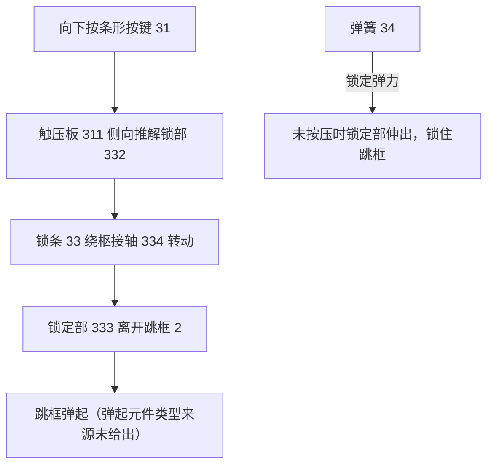

# 弹出式地面插座：按压锁条解锁后面板弹起（对照 TIP-ON 与心形槽）

> [!summary] 一句话概述
> 弹起式地插要解决的是：不用时面板锁在地面齐平，用时按一下把锁打开，跳框带着插座弹起来。飞利富的锁定机构用一条长按键带动两根锁条转动，锁舌从跳框上收回；罗格朗则在产品层写清「关闭时锁住，先按按钮再后推，面盖才抬起，开到位后又锁在打开位置」。它和 [[Blum TIP-ON 按压弹开抽屉：柜体轨弹簧单元与抽屉锁止模块]]、[[Nifco 经典心形槽 Push-Push：U 形销与片簧（对照 ITW 防变形版）]] 都是「按一下再弹出」，但地插锁的是面板/跳框，不是心形槽里的撞销，也不是抽屉轨上的关闭模块。

## 配图

![[附件/popup-socket-lockbar-patent.jpg]]
*图源：[习技网转载实用新型「一种弹起式插座的锁定机构及弹起式插座」](https://www.xjishu.com/zhuanli/59/202422209392.html) 附图；条形按键 31 压在条形支架 32 上，两端锁条 33 的锁定部 333 向外伸出，用来卡住跳框*

![[附件/legrand-popup-open-method.jpg]]
*图源：[罗格朗《地插系列产品手册》X1435-2（201508）](https://doc01.homedo.com/Files/Documents/PreparationAttachment/%E7%BD%97%E6%A0%BC%E6%9C%97/100111309/x1435-fb.pdf) 第 9 页；阻尼型：先按按钮再向后推，面盖缓启；无阻尼型：按键后面盖会较快弹起，需扶住面盖；预埋盒口低于地面 10–15 mm，面板 120×120 mm，安装孔距 84 mm*

![[附件/legrand-popup-button-slide.jpg]]
*图源：[罗格朗 Pop-Up sol 说明书 F01367FR-06](https://assets.legrand.com/pim/NP-FT-GT/F01367FR-06.pdf) 第 2 页「2.2 Ouverture」；关闭时锁住 → 按按钮解锁 → 向后推按钮 → 盖板抬起 → 开到位后按钮自动复位并把盖板锁在打开位置；关闭前也要先按按钮解锁*

> 图片版权归原作者所有，仅作个人学习收藏；出处见文末「来源与核实记录」。

## 结构原理

> 本节所有数字只写来源里给出的；来源没有就写「来源未给出」。专利描述的是飞利富的锁定机构，罗格朗手册描述的是该公司地插的操作和安装，两者不要拼成同一套零件图。

### 堆叠方案

**A. 飞利富锁定机构（从按键外侧到面框）**

| 层级 | 零件 | 材料 | 厚度/尺寸 | 固定方式 | 依据 |
| --- | --- | --- | --- | --- | --- |
| L1（最外） | 条形按键（31） | 来源未给出 | 长条状，尺寸来源未给出具体毫米 | 用连接插轴（35）可上下活动地装在支架上 | 专利权利要求 1、3 |
| L2 | 触压板（311） | 与按键一体 | 从按键向下凸伸，对准锁条 | 下压按键时侧面推动锁条 | 权利要求 1、2 |
| L3 | 条形支架（32） | 来源未给出 | 底部间隔两个安装槽位（321）；上部有沿长度方向的凸条（322） | 底部螺纹孔，紧固螺丝（36）穿过面框螺栓穿孔与支架螺接；枢接轴下端插入面框定位插孔 | 权利要求 1、5、6 |
| L4 | 锁条（33）×2 | 来源未给出 | 带枢接孔（331）、解锁部（332）、锁定部（333） | 枢接孔套在槽位里的枢接轴（334）上，可转动 | 权利要求 2 |
| L5 | 弹簧（34）×2 | 来源未给出类型（未写压簧或扭簧） | 来源未给出弹力值 | 给锁条提供锁定弹力，使解锁部与触压板侧面相抵 | 权利要求 1、2 |
| L6 | 插座面框（1）+ 跳框机构（2） | 来源未给出 | 来源未给出 | 锁定部伸出槽位后锁定跳框；解锁后锁定部离开跳框 | 权利要求 2、7 |

**B. 罗格朗弹起地插（产品层，不是上面那套锁条的零件表）**

| 层级 | 零件 | 材料 | 厚度/尺寸 | 固定方式 | 依据 |
| --- | --- | --- | --- | --- | --- |
| L1 | 面盖 | 中文手册：黄铜或锌合金电镀镍（不锈钢面）；法文：Inox brillant = Zamak nickel，Laiton brossé = 黄铜，Alu mat = 铝 | 中文超薄地脚插面板 120×120 mm；法文 3 模块盖板 A=120 mm、B=120 mm，4 模块 B=142.5 mm，6 模块 B=230 mm，8 模块 B=275 mm | 关闭时锁住，打开后锁在高位 | 中文手册第 7、9 页；F01367FR-06 第 2 页 |
| L2 | 开启按钮 | 来源未给出 | 来源未给出 | 先按解锁，再向后推（中文阻尼型；法文同样先按后滑） | 中文第 9 页；法文 2.2 |
| L3 | 插座功能件 / 跳起部分 | 来源未给出 | 法文空盒：3 模块 A=79.8 mm、B=92 mm，C=57 mm，D=77.5 mm（4/6/8 模块见该页表） | 解锁后抬起 | 法文 2.1.2 |
| L4 | 金属底盒 | 中文：钢板+黑色电泳（预埋盒注意事项） | 中文无阻尼型底盒 640530：100×100×55 mm；阻尼型底盒 650630：100×100×60 mm；安装孔距示意 84 mm | 预埋，口部低于地面 10–15 mm | 中文第 7、9 页 |
| L5 | 地面 / 架空地板 | 混凝土或活动地板 | 中文：满足 60 mm 和 80 mm 深度水泥地面；法文混凝土最小厚度 60 mm，饰面调整 3 mm mini 至 32 mm maxi | 底盒预埋或架空地板套件 | 中文第 3、8、9 页；法文第 3–4 页 |

剖面示意（专利锁定动作）：

和心形槽、TIP-ON 的差别：

- [[Nifco 经典心形槽 Push-Push：U 形销与片簧（对照 ITW 防变形版）]]：同一条按压路径既走「锁止」也走「解锁」，靠心形槽轨迹换相，锁的是一根撞销。
- [[Blum TIP-ON 按压弹开抽屉：柜体轨弹簧单元与抽屉锁止模块]]：锁止模块在抽屉底板下，弹簧单元在柜体轨上，按的是整屉内移。
- 本案例：用户按的是面板上的按钮/锁条机构，锁的是面盖或跳框；打开后再弹起的是插座本体。罗格朗还要求打开过程分「先解锁、再推/弹」，关闭时也要先解锁，避免行人用脚误开（中文手册对阻尼型的说明）。

### 零件清单

飞利富锁定机构（专利）：

| 零件 | 数量 | 功能 | 材料 | 依据 |
| --- | --- | --- | --- | --- |
| 条形按键 31 | 1 | 向下按压，提供大尺寸操作面 | 来源未给出 | 权利要求 1；说明书积极效果 |
| 触压板 311 | 与锁条对应，专利为两处 | 把下压变成对锁条的侧向推力 | 与按键一体 | 权利要求 1、2 |
| 条形支架 32 | 1 | 给按键、锁条、弹簧定位，并固定到面框 | 来源未给出；枢接轴与支架一体成型 | 权利要求 1、5 |
| 锁条 33 | 2 | 转动后用锁定部锁住或放开跳框 | 来源未给出 | 权利要求 1、2 |
| 弹簧 34 | 2 | 给锁条锁定弹力 | 来源未给出 | 权利要求 1、2 |
| 连接插轴 35 | 来源未给出数量 | 让按键相对支架上下活动；与一个插孔过盈、与另一个间隙配合 | 来源未给出 | 权利要求 3、4 |
| 紧固螺丝 36 | 来源未给出数量 | 把支架锁到面框 | 来源未给出 | 权利要求 6 |
| 跳框机构 2 | 1 | 被锁条锁定，解锁后弹出 | 来源未给出；弹起元件类型未写 | 权利要求 7 |

罗格朗产品层零件以手册货号为准，不往专利表里填。

### 装配顺序

**专利中的锁定机构（原文装配逻辑）：**

1. 用连接插轴把条形按键装到条形支架上（凸条上的插孔一与按键连接块上的插孔二对穿；一处过盈、一处间隙）。
2. 从支架底部把锁条和弹簧装进两个安装槽位，制成完整锁定机构。
3. 把锁定机构固定到插座面框：枢接轴下端插入面框定位插孔，螺丝穿过面框孔拧进支架螺纹孔。
4. 使用时只需向下按条形按键：触压板侧向推动锁条，锁定部离开跳框，完成解锁。

**罗格朗地插安装（中文手册以无阻尼型为例；法文补充混凝土预埋）：**

1. 预埋金属底盒，口部低于最终地面 10–15 mm（中文）。法文：混凝土最小厚度 60 mm；浇筑前先盖上保护盖，防止混凝土进入；铺饰面前把水平调到至少 3 mm，最大 32 mm。
2. 按手册做接线。中文无阻尼型示意：剥线 9 mm，最大线径 Ø4 mm，区分 N、L 和接地。法文该系列额定 16 A、250 V~，230 V 时最大 3680 W。
3. 把地插装入底盒。中文安装示意面板 120×120 mm，孔距 84 mm。法文 3 模块混凝土预埋盒金属尺寸 X 向 100 mm，固定孔距 A=84 mm（与中文 84 mm 一致），4/6/8 模块见该表。
4. 开启：阻尼型先按按钮再向后推，面盖缓启，完全打开后松开按钮。无阻尼型按键后面盖会较快弹起，手册要求按键时扶住面盖，避免伤及手指。法文还写：开到高位后按钮自动复位，盖板锁在打开位置；要关闭必须再按按钮解锁后再关上。

### 受力与运动分析

- **受力路径（专利）**：手指下压力经条形按键传到触压板，触压板给锁条解锁部一个侧向力，锁条绕枢接轴转动，锁定部收回。未按压时，弹簧把锁条推向锁定方向，锁定部伸出并挡住跳框。地面踩踏、面板上的垂直载荷由面框和底盒承担的具体数值，该专利未给出。
- **受力路径（罗格朗）**：中文小型地插盒关闭状态垂直负载 3000 N，打开 IP30、关闭 IP40，IK08；法文 Pop-Up sol 关闭 3000 N、打开 1500 N，IP30 开 / IP40 关，IK07。两份文件的 IK 等级不同，属于不同产品线，不要混用。
- **运动关系**：这是「按压解锁 + 面板/跳框弹起」，不是心形槽那种「再按一次才换相」。专利里按键只有上下活动，锁条是转动。罗格朗阻尼型和法文说明书都是「先按后滑」，无阻尼型是按键后迅速弹起。弹起的储能元件（扭簧、压簧或液压杆）在已打开的专利文本和罗格朗手册里都没有写成统一零件名称：中文阻尼型只写「新增液压装置，打开速度比常规产品慢 20 倍」；无阻尼型只写会快速弹起。故弹起元件类型写「来源未给出」，不把「扭簧」写死。
- **失效风险**：专利背景批评更早的拉板方案（先下压再后拉，CN202384566U）在手指湿滑、摩擦力不足时难以打开；新方案改成下压即可侧向推锁条。推断（标注推断）：若弹簧失效或锁条转动卡滞，可能出现锁不住（跳框自行弹起）或按不解锁。罗格朗则强调无阻尼型要扶住面盖，否则有夹手风险；阻尼型用「先按再推」避免被脚误开。

## 设计要点与参数

| 要点 | 内容 | 依据 |
| --- | --- | --- |
| 锁定原理（飞利富） | 弹簧使锁条锁定部伸出锁住跳框；下压按键经触压板侧向推锁条转动解锁 | 专利权利要求 1、2 |
| 锁条数量 | 两个安装槽位，各一套锁条和弹簧 | 权利要求 1 |
| 按键安装 | 连接插轴一处过盈、一处间隙，按键可上下活动 | 权利要求 4 |
| 弹起元件类型 | 来源未给出（专利只写跳框机构；罗格朗阻尼型写液压装置，无阻尼型写快速弹起） | 专利；中文手册第 5、9 页 |
| 面板尺寸（罗格朗中文超薄地脚插） | 120×120 mm | 中文手册第 7 页 |
| 底盒（罗格朗中文） | 无阻尼 640530：100×100×55 mm；阻尼 650630：100×100×60 mm；口部低于地面 10–15 mm；安装孔距示意 84 mm | 中文第 7、9 页 |
| 盖板尺寸（罗格朗法文 3 模块） | A=120 mm，B=120 mm；4 模块 B=142.5 mm；6 模块 B=230 mm；8 模块 B=275 mm | F01367FR-06 第 2 页 |
| 开盖动作（罗格朗） | 关闭时锁住；按按钮解锁；向后推/滑开；开到位后锁在打开位置；关闭也要先解锁 | 中文第 9 页；法文 2.2 |
| 阻尼（罗格朗中文阻尼型） | 液压装置，开启缓慢匀速，打开速度比常规产品慢 20 倍 | 中文第 5 页 |
| 防护与载荷（罗格朗，勿跨产品线混用） | 中文小型地插盒：IP30 开 / IP40 关，IK08，关闭 3000 N，250 V~；法文 Pop-Up sol：IP30 开 / IP40 关，IK07，开 1500 N / 关 3000 N | 中文第 8 页；法文第 9 页 |
| 混凝土最小厚度 | 法文 60 mm | 法文 3.1 |

## 优缺点

**优点**
- 把「解锁」和「弹起」分开：先解除锁条/按钮锁，再让跳框或面盖升起，不必靠心形槽一次走完两个相位
- 专利用长条按键和两根锁条，按压面积大，不依赖手指与拉板之间的摩擦力
- 锁定机构可以先做成组件再螺丝上到面框，装配路径清楚
- 罗格朗在打开、关闭两个位置都可以再锁住，并可用液压把弹起速度降下来，减少夹手和被脚误开

**缺点 / 代价**
- 比心形槽多一个独立的锁条组件，零件数和配合面更多
- 弹起储能元件在已核对来源里写得不统一（跳框、液压、快速弹起），选型时必须对着具体型号的说明书，不能默认都是扭簧
- 无阻尼型弹起快，手册明确要求扶住面盖
- 预埋深度和口部高差（低于地面 10–15 mm、混凝土至少 60 mm）一旦做错，面板无法与地面齐平

## 可借鉴点

- **地面或桌面上的弹起面板，不要做成「再按一下就换相」的心形槽**：它要抵抗踩踏和误踏，更适合「专用锁条/按钮解锁 + 单独的弹起元件」，锁止和弹起不要抢同一条轨迹。
- **先解锁、后运动**：罗格朗在打开和关闭都要求先按按钮，等于给垂直载荷和水平滑动加了一道互锁，减少被脚踢开。
- **弹起速度要单独设计**：需要快开就必须处理夹手（扶住面盖或加缓冲）；需要慢开就加液压，并给出相对速度（罗格朗写慢 20 倍），不要指望锁条自己减速。
- **锁条用弹簧保持锁定、用按键的斜向/侧向力解锁**，和「靠摩擦力拉出拉板」相比，湿手、戴手套时更稳。
- 预埋盒口部低于完成地面的那一截尺寸（10–15 mm）要写进安装图，它决定面板能不能落平，不是装饰问题。

## 与库中相似案例对比

| 对比项 | 本案例（弹起地插） | [[Blum TIP-ON 按压弹开抽屉：柜体轨弹簧单元与抽屉锁止模块]] | [[Nifco 经典心形槽 Push-Push：U 形销与片簧（对照 ITW 防变形版）]] |
| --- | --- | --- | --- |
| 按什么 | 面板上的按钮/条形按键 | 按整屉面板，抽屉内移一小段 | 按撞销或面板，走心形槽 |
| 锁什么 | 面盖或跳框（专利是锁条锁跳框） | 抽屉底板下的关闭模块咬住轨上驱动件 | 心形槽里的撞销 |
| 弹起/推出 | 解锁后跳框或面盖弹起；储能件类型来源未统一给出 | 柜体轨上的弹簧单元把抽屉推出一段 | 片簧把撞销推出 |
| 再关 | 罗格朗要先按按钮解锁再关上，开到位也会锁住 | 推回后关闭模块重新咬合 | 再按一次沿心形槽换到锁止相 |
| 误开防护 | 罗格朗阻尼型强调先按后推，避免用脚误开 | 不是地面踩踏场景 | 一般不按抗踩踏设计 |

## 相关案例

- [[Blum TIP-ON 按压弹开抽屉：柜体轨弹簧单元与抽屉锁止模块]]
- [[Nifco 经典心形槽 Push-Push：U 形销与片簧（对照 ITW 防变形版）]]
- [[防变形静音 Push-Push 按压弹跳锁（ITW 专利 EP1596030）]]
- [[按动圆珠笔：旋转凸轮的按压伸缩机构]]
- 分类索引：[[04-机构与运动 索引]]

## 来源与核实记录

- 主来源：[一种弹起式插座的锁定机构及弹起式插座（习技网转载）](https://www.xjishu.com/zhuanli/59/202422209392.html)（申请号 202422209392，申请日 2024-09-09，公布日 2025-08-10；专利权人：飞利富科技股份有限公司；研发人员：骆德元、周贻培、徐国强、吴锦耀、王瑶辉。条形按键、支架、两根锁条、弹簧、触压板侧向推动、跳框锁定与组装顺序均来自该页。Google Patents 未能打开对应公开号页面，附图仅核对该站所载一张装配轴测图）
- 补充来源 1：[罗格朗《地插系列产品手册》X1435-2，2015-08](https://doc01.homedo.com/Files/Documents/PreparationAttachment/%E7%BD%97%E6%A0%BC%E6%9C%97/100111309/x1435-fb.pdf)（TCL-罗格朗国际电工（惠州）有限公司。阻尼/无阻尼开启方式、120×120 mm 面板、100×100×55/60 mm 底盒、预埋低 10–15 mm、液压慢 20 倍、防护与载荷）
- 补充来源 2：[Legrand Pop-Up sol 技术说明书 F01367FR-06](https://assets.legrand.com/pim/NP-FT-GT/F01367FR-06.pdf)（创建 2012-01-10，更新 2026-04-22。与中文手册同属罗格朗，不另计机构。关闭/打开双位置锁止、先按后滑、模块尺寸、混凝土 60 mm、IP/IK/载荷）
- 核实：2026-11-22 打开专利页并下载中、法两份罗格朗 PDF。未把罗格朗内部改写成飞利富锁条，也未把未写明的弹起弹簧类型记成扭簧。
