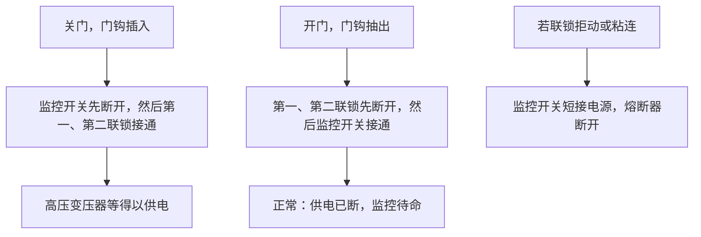

# 微波炉门三联联锁：第一、第二联锁断开供电，监控开关在门开时短接熔断保护

> [!summary] 一句话概述
> 微波炉用门钩去按一组微动开关，而不是只靠一只门磁：关门后第一、第二联锁开关接通，给高压变压器等供电，同时门监控开关断开；开门后两只联锁先断开切断供电，监控开关再接通，一旦联锁拒动或粘连，监控开关就把电源短接，让熔断器断开，避免炉门打开时仍在发射微波。导文对格兰仕 WP700（P7021TP-6）的拆解写明，这一先断后通的时间差由下门钩的曲线长度决定；Merrychef 402s 则用教科书式的 Primary、Secondary 和 Monitor 布置，并另加第四只开关给逻辑板发门状态。它不是普通门控微动的简单并联，也不是机床舌片安全门联锁。

## 配图

![[附件/mw-merrychef-p25.png]]
*图源：Merrychef 402s 服务手册（Pt. No. 32Z3522 Issue 6）第 25 页，门关闭时的 Primary、Secondary、Monitor 接线以及 SW1–SW4 位置*

![[附件/mw-merrychef-p26.png]]
*图源：同上，第 26 页，门联锁微动开关的调整与试验说明首页*

![[附件/mw-merrychef-p18.png]]
*图源：同上，相关结构/部件页，仅作该商用炉门区域的对照，不把未标注尺寸写成参数*

> 图片版权归原作者所有，仅作个人学习收藏；出处见文末「来源与核实记录」。

## 结构原理

> 本节所有数字只写来源里给出的；来源没有就写「来源未给出」。两台样机机构相同、零件编号不同。

### 堆叠方案

方向：**从炉门钩到开关，再到供电和保护回路**

| 层级 | 零件 | 材料 | 厚度/尺寸 | 固定方式 | 依据 |
| --- | --- | --- | --- | --- | --- |
| L1 | 上门钩、下门钩 | 来源未给出 | 钩长必须合适，曲线长度决定时间差（导文） | 随炉门插入联锁骨架 | 导文，格兰仕 WP700 |
| L2 | 联锁开关总成骨架与摇臂 | 来源未给出 | 安装位置必须准确 | 下门钩通过两只摇臂分别作用到第二联锁和监控开关 | 导文 |
| L3a | 第一联锁开关 | 导文：W-15-302C | 来源未给出行程 | 上门钩顶尖直接按压轻触键 | 导文 |
| L3b | 第二联锁开关 | 导文：W-15-302C | 来源未给出 | 下门钩经摇臂按压 | 导文 |
| L3c | 门监控开关 | 导文：W-15-202C | 来源未给出 | 同一下门钩经另一摇臂；门开时导通 | 导文 |
| L4 | 电源熔断器 | 导文：8 A / 250 V（该机第一联锁回路） | — | 监控开关动作时短接以熔断 | 导文 |
| — | Merrychef 的四只微动 | 来源未给出型号 | 来源未给出行程 | SW1 Monitor、SW2 Primary（右侧）；SW3 Secondary、SW4 逻辑板（左侧） | Merrychef 第 25 页 |

导文给出的动作逻辑（格兰仕 WP700，P7021TP-6）：

- 关门：门钩顶尖插到位，第一、第二联锁接通，监控开关断开。
- 开门：第一、第二联锁断开，监控开关接通。
- 顺序：插入门钩时，监控开关先于第二联锁动作（第二联锁尚未接通，监控已经断开）；抽出门钩时，第二联锁先于监控开关动作（监控尚未接通，第二联锁已经断开）。时间差很短，由门钩圆滑曲线的长度决定。
- 监控开关在门打开时，把第一联锁的输出端与第二联锁的输入端短接。若此时联锁漏电或未彻底断开，短路电流切断高压电路，防止微波泄漏。
- 第一联锁回路还带棕色导线和 8 A / 250 V 熔断器；关闭炉门后输出端才有 220 V。第二联锁在关门后经白线为高压变压器供电，经蓝线为定时电动机供电，并分出照明和转盘电机。检修时输入端可能已经带电，导文提醒注意安全。

另一台格兰仕 WP700TL23-K1：没有面板下方开门按键，靠直接拉门；下门钩斜边越长，监控与第二联锁的间隔越大，文中认为安全系数越低；间隔过短则监控还没断开时第二联锁已经导通，会熔断保险丝。这一对矛盾说明钩形必须按试验调整，不能随意加长或削短。

Merrychef 402s（独立机构，商用炉）：

- 四只微动开关。三只按传统 Primary、Secondary、Monitor 布置，第四只向逻辑板发信号。
- 手册图为门关闭状态：Primary 切断变压器供电以停止微波；Secondary 在 Primary 失效时同样切断微波；Monitor 在门打开且 Primary 失效时，把市电短路，熔断微波保险丝并使炉子无法再工作。
- 若 Monitor 已经把保险丝熔断，Primary 和 Monitor 都必须更换，因为短路电流可能已经损坏这两只微动。
- 微动分列炉门两侧，位置必须调整正确后才能试验。

剖面示意：

### 零件清单

| 零件 | 数量 | 功能 | 材料 / 型号 | 依据 |
| --- | --- | --- | --- | --- |
| 上门钩、下门钩 | 各 1 | 插入并按预定顺序驱动开关 | 来源未给出 | 导文 |
| 摇臂 | 2（下门钩侧） | 把下钩运动分给第二联锁和监控开关 | 来源未给出 | 导文 |
| 第一、第二联锁开关 | 各 1 | 关门接通供电，开门切断 | 导文样机为 W-15-302C | 导文 |
| 监控开关 | 1 | 门开时准备短接保护 | 导文样机为 W-15-202C | 导文 |
| 熔断器 | 1 | 保护动作时断开电源 | 导文样机 8 A / 250 V | 导文 |
| 逻辑板门开关（商用炉） | 1 | 只向控制板报告门状态 | Merrychef SW4 | Merrychef |

### 装配顺序

来源没有给出工厂装配步骤。调整要点：

1. 门钩长度和骨架位置必须使钩尖到达设定位置，否则联锁按不实或监控断不开（导文）。
2. 用钩形曲线保证「关门：监控先断、联锁后通；开门：联锁先断、监控后通」。
3. 不要把斜边随意加长或削短，过长降低安全余量，过短可能在关门过程中先造成短路（导文对 WP700TL23-K1）。
4. Merrychef 要求按手册把两侧微动调到正确位置再做联锁试验；若保险丝已被 Monitor 熔断，同时更换 Primary 和 Monitor。

### 受力与运动分析

- **受力路径**：手关门 → 门钩插入骨架 → 直接按压或经摇臂按压微动键 → 内部触头闭合或打开。力来自门的关闭，不是电磁铁。
- **运动关系**：三只开关必须错开动作，而不是同时动作。错开量由钩的几何决定，已打开资料没有给出毫米数。
- **失效风险**：钩短或骨架装偏；开关粘连而监控回路失效；Monitor 已经短路过但仍继续使用旧微动；把机床舌片联锁或普通门磁套用到微波防护。检修第一联锁输入端可能一直有 220 V，存在触电风险（导文）。

## 设计要点与参数

| 要点 | 内容 | 依据 |
| --- | --- | --- |
| 门关状态 | 第一、第二联锁通，监控断 | 导文；Merrychef 图注为门关位置 |
| 门开状态 | 两只联锁断，监控通 | 导文；Merrychef 文字 |
| 保护方式 | 监控把联锁两侧短接，熔断器断开 | 导文；Merrychef（短路市电以熔断微波保险丝） |
| 导文样机开关 | W-15-302C、W-15-202C | 导文 |
| 导文样机熔断器 | 8 A / 250 V | 导文 |
| 导文样机电源 | 关门后联锁输出 220 V | 导文 |
| Merrychef 开关布置 | SW1 Monitor、SW2 Primary 在右侧；SW3 Secondary、SW4 逻辑板在左侧 | Merrychef 第 25 页 |
| 微动行程、钩长尺寸 | 来源未给出毫米数 | — |

## 优缺点

**优点**
- 用两路切断加一路短路保护，不怕单一联锁粘连
- 动作顺序由门钩几何保证，不依赖软件
- 商用炉再加第四只开关给逻辑板，把「切断高压」和「通知控制」分开

**缺点 / 代价**
- 钩长和骨架位置非常敏感，装偏就会出现关不上或一关门就熔断
- 监控动作是破坏性保护，动作后相关微动可能已经损坏，必须成对更换
- 回路里有市电，维修风险高

## 可借鉴点

- 把「切断供电」和「失效时短接熔断」分成不同开关，不要只用一只门开关。
- 用机械曲线保证先断后通，并把这个顺序写进试验方法。
- 保护动作后要规定更换哪些零件，不能只换保险丝。
- 给控制板的门信号不要承担切断高压的任务。

## 与库中相似案例对比

| 对比项 | 本案例（微波炉门三联联锁） | [[安全门舌片联锁：专用执行器转动内凸轮，以直接断开动作打开 NC 触点]] | [[工业限位开关：在微动开关外面加防护壳和滚轮杠杆等致动器]] | [[翻盖式按键防误触：铰链、自动回盖弹簧与独立按钮]] |
| --- | --- | --- | --- | --- |
| 目的 | 开门时切断微波并在拒动时熔断保护 | 防护门安全联锁，可选锁门 | 位置检测 | 盖体防误触 |
| 关键 | 三只（或四只）微动的先断后通 + 短接 | 专用舌片 + 直接断开 NC | 滚轮杠杆 | 盖体连动 |
| 何时用这篇 | 要做微波炉或类似辐射防护门 | 要做机床围栏安全门 | 只要位置信号 | 要做消费电子翻盖 |

## 相关案例

- [[安全门舌片联锁：专用执行器转动内凸轮，以直接断开动作打开 NC 触点]]
- [[工业限位开关：在微动开关外面加防护壳和滚轮杠杆等致动器]]
- 分类索引：[[04-机构与运动 索引]]

## 来源与核实记录

- 主来源：[导文，《门控联锁开关的作用及必要性》](https://www.daowen.com)（2026-11-27 打开。格兰仕 WP700 / P7021TP-6 与 WP700TL23-K1 的门钩、摇臂、开关型号、8 A 熔断器和动作顺序来自该文。配图下载为脚本，不采用。完整栏目地址以已保存 html 为准。）
- 交叉来源：Merrychef 402s 服务手册，Pt. No. 32Z3522 Issue 6（2026-11-27 下载并提取第 25–26 页。独立第二机构。Primary / Secondary / Monitor / SW4 和保险丝更换要求来自该手册。）
- 核实：2026-11-27 打开上述来源。未编造钩长和微动行程，未把格兰仕开关型号写到 Merrychef 上。
