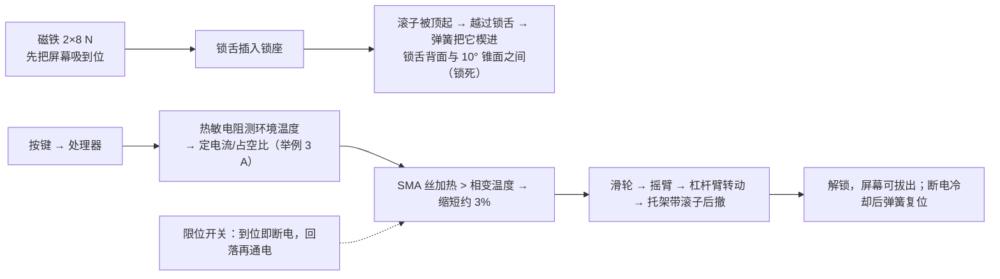

# 微软 Surface Book 形状记忆合金（肌肉线）电控分离锁

> [!summary] 一句话概述
> Surface Book 的屏幕和键盘底座之间靠「锁舌插进锁座、弹簧把滚子楔住」锁死；按键后给一根镍钛形状记忆合金丝通电加热，丝收缩约 3%，通过滑轮和摇臂把滚子拉开，屏幕就能取下。滚子同时充当「公差吸收器」，让锁座可以做到间隙 < 0.1 mm、几乎零旷量。

## 配图

![[附件/surface-book-muscle-wire-lock.jpg]]
*图源：[iFixit Surface Book 拆解](https://www.ifixit.com/Teardown/Microsoft+Surface+Book+Teardown/51972) 第 21 步；锁模组：左侧电路板（SW1 为限位开关位置）、右侧弹簧、滑轮和连杆，金属锁座在最右*

![[附件/surface-book-muscle-wire-lock2.jpg]]
*图源：同上；拆散的零件：带金色端子的肌肉线、黑色滑轮/摇臂、拉簧、连杆、金属锁座支架*

> 图片版权归原作者所有，仅作个人学习收藏；出处见文末「来源与核实记录」。

## 结构原理

> 本节数字只写来源里给出的；来源没有就写「来源未给出」。专利里的数值是「实施例可达到的范围」，不等于量产件的实测值。

### 堆叠方案

方向：**沿锁舌插入方向，从底座（锁舌）到屏幕内部（执行器）**

| 层级 | 零件 | 材料 | 厚度/尺寸 | 固定方式 | 依据 |
| --- | --- | --- | --- | --- | --- |
| L1 | 锁舌（locking protrusion，底座上的金属片） | 金属（iFixit 称「metal tab」） | 来源未给出；边角倒圆，防止斜拔时卡死 | 固定在底座 | iFixit 第 21 步；专利 FIG.5-3 说明 |
| L2 | 锁座（locking receptacle）+ 开口 | 金属 | 锥面角度 < 11.4°（按 2·arctan μ，μ=0.1 钢），图示 10° | 固定在屏幕端 | 专利 FIG.3 说明 |
| L3 | 滚子锁（rotating lock，小圆柱/球）+ 托架（carrier） | 来源未给出 | 滚子可上下移动 ±0.5 mm，吸收厚度方向约 ±0.16 mm 公差 | 托架被弹簧压向锁座锥面 | 专利；iFixit 称「very tiny rod」 |
| L4 | 杠杆臂 + 摇臂 + 滑轮（connector） | 塑料/金属，来源未给出 | 摇臂与杠杆止挡间隙 < 0.2 mm（或 < 0.5 mm） | 销轴铰接 | 专利 FIG.5 |
| L5 | 单根拉簧（同时张紧 SMA 丝并把滚子压回锁位） | 弹簧钢 | 张紧丝的力 7.5–15 N；压锁的力 1.3–2.6 N；弹簧与丝夹角约 10° | 挂在摇臂上 | 专利 FIG.5 |
| L6 | SMA 丝（镍钛，绕过滑轮成回环）+ 两端夹子 + 热敏电阻 + 限位开关 | Nitinol | 收缩约 3%；单根直拉行程 4.5 mm，绕滑轮回环 2.25 mm；相变温度举例 > 90 °C | 两端夹在电路板上供电 | 专利；iFixit 第 21 步 |
| L7 | 磁铁（锁附近） | 磁铁 | 举例每颗 8 N、两颗 16 N | 屏幕/底座端 | 专利 |

剖面示意：

### 零件清单

| 零件 | 数量 | 功能 | 材料 | 依据 |
| --- | --- | --- | --- | --- |
| 锁舌 / 锁座 | 专利图示每台 2 套 | 机械锁合、承受拉力 | 金属 | 专利 FIG.2；iFixit |
| 滚子锁 | 每套 1 个（另有双滚子、楔块、凸轮等实施例） | 楔紧锁舌、吸收公差 | 来源未给出 | 专利 FIG.3、6–10 |
| 托架 + 杠杆臂 + 摇臂 + 滑轮 | 各 1 | 把丝的收缩传到滚子 | 来源未给出 | 专利 FIG.5 |
| 拉簧 | 1（单弹簧同时完成两种偏置） | 张紧丝、复位锁 | 弹簧钢 | 专利；iFixit 第 21 步 |
| SMA 丝 | 1 根（回环） | 电控执行器 | 镍钛 | 专利；Hackaday「single loop」 |
| 热敏电阻、限位开关、隔热罩 | 各 1 | 防过热、到位控制、保护周边零件 | — | 专利 |
| 手动解锁口 | 1 | 卡死时用回形针顶摇臂 | — | 专利（manual override 579） |

### 装配顺序

> 来源只给了拆解顺序与专利结构，以下按结构推断（推断）。

1. 把锁座支架装进屏幕下缘，放入托架与滚子。
2. 装杠杆臂、摇臂（销轴），挂上拉簧。
3. SMA 丝两端夹到电路板端子，中段绕过滑轮，靠拉簧预张紧。
4. 装热敏电阻、限位开关和隔热罩，电路板固定。
5. 底座端装锁舌与磁铁；整机对插测试锁止/解锁。

### 受力与运动分析

- **受力路径**：拔屏幕的拉力 → 锁舌背面 → 滚子（线接触）→ 锁座 10° 锥面。锥角小于摩擦自锁角（2·arctan μ），所以拉力越大滚子楔得越紧，不会被拉开；弹簧只需要很小的力（1.3–2.6 N）保持滚子到位。
- **运动关系**：插入时锁舌顶起滚子（托架上移）→ 越过后弹簧推回；解锁时 SMA 丝收缩 → 杠杆转动 → 托架后撤。滚子在锥面上的位置随零件公差浮动，相当于把厚度方向的公差「转换成滚子位置的不确定性」。
- **失效风险**：用户强拉（专利举例 100 N）时锁可能被楔死、丝拉不开，所以设有回形针手动解锁；环境温度高时按常温电流加热会烧坏丝，所以先测温再定占空比；SMA 动作无声，用户没有反馈（MSPoweruser 报道「咔哒声」是软件播放的音效）。

## 设计要点与参数

| 要点 | 内容 | 依据 |
| --- | --- | --- |
| 拼缝间隙 | 实施例：< 0.1 mm，同时绕 x 轴旷量 < 1.5° | 专利 |
| 旷量 | 200 N·mm 扭矩下 < 0.1°（最优实施例）；1 N 拉力下 y 向旷量 < 18 μm | 专利 |
| 抗拉 | 单套锁：4 N 拉力位移 < 75 μm；28 N 位移 ≤ 0.5 mm；200 N 不脱开（实施例） | 专利 |
| 插入力 | < 5 N；磁铁 16 N 时可实现「零插入力」（磁铁直接吸进） | 专利 |
| 锥面角 | < 2·arctan μ；钢 μ=0.1 时 < 11.4°，图示 10° | 专利 |
| 公差吸收 | 滚子 ±0.5 mm 行程 ≈ 吸收 ±0.16 mm 厚度公差；z 向容量 ±300 μm | 专利 |
| SMA 行程 | 收缩约 3%；单根 4.5 mm，回环 2.25 mm | 专利 |
| 弹簧 | 张丝 7.5–15 N，压锁 1.3–2.6 N，夹角约 10° | 专利 |
| 驱动 | 举例可用电流 3 A，按温度换算占空比；相变温度举例 > 90 °C | 专利 |
| 量产件丝径、寿命次数 | 来源未给出 | — |

## 优缺点

**优点**
- 执行器只是一根丝，几乎不占体积，比电磁铁、电机更薄（Microsoft 博客与 WIRED 说是为了做薄做轻）
- 锁止不靠电：断电即锁，安全
- 滚子 + 锥面自锁 + 公差吸收，能做到极小间隙和旷量，保证底座和屏幕之间的电连接器不断开

**缺点 / 代价**
- 需要温度补偿、限位开关和软件控制，系统复杂
- 没有机械手感/声音，需要软件补反馈（MSPoweruser：微软先试过杠杆、电磁铁、液压，最后才选镍钛丝）
- 结构细小、零件多，iFixit 整机可维修性 1/10

## 可借鉴点

- **自锁锥角公式**：楔紧类锁（滚子、楔块）的锥面角取 < 2·arctan μ，按配对材料摩擦系数算，钢对钢可先取 10°
- **用滚子吸收公差**：要求「零间隙 + 低插入力」的对插连接，可以让一个浮动滚子/楔块被弹簧压进锥面，零件公差变成滚子位置变化，不再需要把每个零件都做到微米级
- **小行程电控锁**可以考虑 SMA 丝；要放大行程就把丝绕滑轮成回环（行程减半、力加倍）或配杠杆；一定要配温度检测和限位断电
- **保留手动应急解锁孔**（回形针口），并在软件里给用户声音/图标反馈
- 用磁铁先把两部分吸到位，再让机械锁锁死：磁力负责导向和插入，机械锁负责抗拉

## 与库中相似案例对比

| 对比项 | 本案例 | [[Mac Pro 2019 旋转把手外壳锁与免工具模块锁]] | [[任天堂 Switch 2 Joy-Con 2 磁吸连接]] |
| --- | --- | --- | --- |
| 驱动 | 电控（SMA 丝） | 手动旋转把手 | 手动按键 + 磁吸 |
| 锁止原理 | 滚子楔入自锁锥面 | 凸轮/锁钩 | 磁铁吸附 + 机械锁片 |
| 共同点 | 都是「磁或导向先定位，再机械锁死」 | — | 同样用磁铁负责对位 |
| 区别 | 断电自锁、靠软件解锁；公差靠滚子吸收 | 无电控 | 无自锁锥面 |

## 相关案例

- [[微软 Surface Book 动态支点铰链（分段铝铰链）]]（同一产品的铰链）
- [[Mac Pro 2019 旋转把手外壳锁与免工具模块锁]]
- [[任天堂 Switch 2 Joy-Con 2 磁吸连接]]
- [[防变形静音 Push-Push 按压弹跳锁（ITW 专利 EP1596030）]]
- 分类索引：[[04-机构与运动 索引]]

## 来源与核实记录

- 主来源：[Microsoft Surface Book Teardown](https://www.ifixit.com/Teardown/Microsoft+Surface+Book+Teardown/51972)（iFixit，2015-11-03，Andrew Optimus Goldheart），第 21 步「Muscle Wire Lock」、第 33 步可维修性评分
- 补充来源 1：[US9740245B2 Locking mechanism](https://patents.google.com/patent/US9740245B2/en)（Microsoft，申请 2015-12-01，授权 2017-08-22）——滚子锁、锥角公式、SMA 行程、弹簧力、热敏电阻、手动解锁、全部数值
- 补充来源 2：[Hackaday：Surface Book Teardown Reveals Muscle Wire Mechanism](https://hackaday.com/2015/11/04/microsoft-surface-book-teardown-reveals-muscle-wire-mechanism/)（2015-11-04）——「single loop」、弹簧保持锁止
- 补充来源 3：[WIRED：The Story Behind the Surface Book's Crazy New Hinge](https://www.wired.com/2015/10/story-behind-surface-books-crazy-new-hinge/)（2015-10-07）——锁位于铰链外侧、与铰链独立
- 补充来源 4：[MSPoweruser：Surface Book's Detaching Mechanism](https://mspoweruser.com/surface-books-detaching-mechanism-involves-a-little-software-audio-theater/)——微软试过杠杆、电磁铁甚至液压方案后选了镍钛丝；解锁「咔哒」为软件音效
- 核实：2026-11-13 打开 iFixit API 拆解全文、Google Patents 专利全文、Hackaday、WIRED、MSPoweruser 原文核对。专利未说明哪一个实施例用于量产，量产细节以 iFixit 照片为准。
