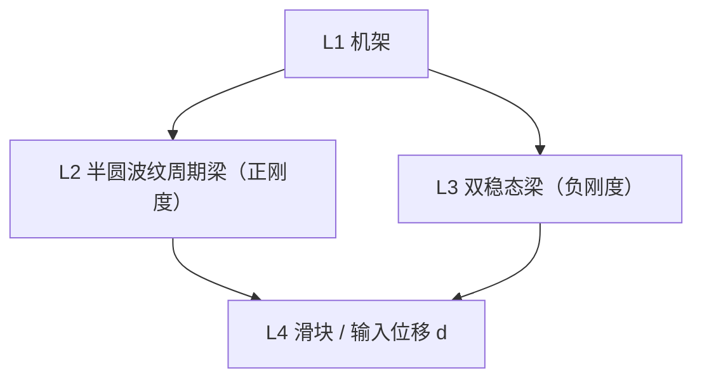

# 恒力柔顺机构：半圆波纹正刚度梁与双稳态负刚度梁并联抵消

> [!summary] 一句话概述
> 恒力柔顺机构把一段近似正刚度的柔顺梁和一段带负刚度的双稳态梁并联（或按同样原则组合）：在一段行程里正、负刚度大致抵消，输出力几乎不随位移变化。它靠梁的几何，而不是发条盒或配重。刘敏等用半圆波纹周期梁做正刚度、双稳态梁做负刚度，3D 打印 PLA 样机在 1.1–6.2 mm 行程内得到约 18.8 N 的恒力。

## 配图

![[附件/cfm-corrugated-bistable-config.jpg]]
*图源：[刘敏、袁奇、张佳、占金青、吴剑，《基于半圆型波纹周期梁的柔顺恒力机构优化设计》，《农业机械学报》2023, 54(12): 449–458](https://www.aeeisp.com/nyjxxb/cn/article/pdf/preview/d16dd580-f893-4fa8-94a5-db657dce4b39.pdf) 第 450 页图 1；上侧为带倾角 θ 的双稳态梁（参数 t1、b1、L1），下侧为半圆波纹周期梁（参数 R、t2、b2、L2），两者并联在输入/输出滑块与机架之间*

![[附件/cfm-aeeisp-test-setup.jpg]]
*图源：同上第 457 页图 13、图 14；图 13 为实验台：1 力显示器，2 数显螺旋测微器，3 力传感器（量程 0–100 N，分辨力 0.1 N），4 PLA 样机。图 14 为力-位移曲线：第 1 次实验在 1.1–6.2 mm 内恒力在 17.8–19.8 N 之间波动，平均值约 18.8 N；后续几次实验恒力逐渐下降*

![[附件/cfm-ding-parametric-curves.jpg]]
*图源：[Ding, Li and Li, Robotica 40, 3463–3475, 2022](https://www.cambridge.org/core/services/aop-cambridge-core/content/view/D3C077964FB61CE73E8772D980B2AE55/S0263574722000340a.pdf/configuration-design-and-experimental-verification-of-a-variable-constant-force-compliant-mechanism.pdf) 第 3469 页 Figure 9；另一独立机构的正负刚度组合恒力机构：改变 L1、t1、θ2、t2 对力-位移曲线的影响。实验段另给出无预载时 2–4 mm 行程内约 11.15 N 的恒力*

> 图片版权归原作者所有，仅作个人学习收藏；出处见文末「来源与核实记录」。

## 结构原理

> 本节所有数字只写来源里给出的；来源没有就写「来源未给出」。

### 堆叠方案

方向：**从机架一侧到输入/输出滑块（刘敏等图 1，并联布置）**

| 层级 | 零件 | 材料 | 厚度/尺寸 | 固定方式 | 依据 |
| --- | --- | --- | --- | --- | --- |
| L1（外框/机架） | 矩形框架 | 样机为 PLA | 来源未给出框壁厚 | 与梁端一体（图 1） | 图 1；材料见正文与表 1 段 |
| L2 | 半圆波纹周期梁（正刚度模块） | PLA，E = 3 GPa，ν = 0.3 | 表 1：R = 3.5 mm，t2 = 1 mm，b2 = 8 mm，L2 = 3.5 mm；每个单元由 4 段直梁和 2 段半圆曲梁组成 | 下端连机架、上端连滑块（图 1） | 表 1；第 450 页 |
| L3 | 双稳态梁（负刚度模块） | 同上 | 表 1：L1 = 38 mm，t1 = 1.1 mm，b1 = 8 mm，θ = 8° | 两端分别连机架与滑块，与波纹梁并联 | 表 1；图 1 |
| L4 | 输入/输出滑块 | 样机为 PLA | 来源未给出滑块外形尺寸 | 沿框架导向（图 1 画为水平移动件） | 图 1 |

剖面示意：

丁丙晓等的机构同样用「正刚度结构 + 负刚度（双稳态梁）」组合，并用作用在正刚度结构上的预载位移来调节恒力大小。那是另一套几何，参数不与表 1 混用。

### 零件清单

| 零件 | 数量 | 功能 | 材料 | 依据 |
| --- | --- | --- | --- | --- |
| 半圆波纹周期梁 | 图 1 为 1 组（多单元串联呈波纹） | 提供近似线性的正刚度，减小大变形几何非线性 | PLA（刘敏等样机） | 图 1；第 450 页 |
| 双稳态梁 | 图 1 为 1 根带倾角的梁 | 屈曲后出现负刚度段，用来抵消正刚度 | 同上 | 图 1；图 6 力-位移 |
| 机架与滑块 | 各 1（图 1） | 约束与输入位移 | 同上 | 图 1 |
| 实验台：螺旋测微器、力传感器、力显示器 | 各 1 | 以 0.1 mm 间隔记录力 | 来源未给出仪器品牌之外的材料 | 图 13 及第 457 页 |

### 装配顺序

1. 按表 1 尺寸做出一体的机架、波纹梁、双稳态梁和滑块（刘敏等用 3D 打印 PLA）。
2. 把样机输入端对着力传感器；用数显螺旋测微器顶住传感器，推动机构变形。
3. 每隔 0.1 mm 读一次力显示器。力传感器量程 0–100 N、分辨力 0.1 N；测微器量程 0–25 mm、分辨力 0.01 mm。
4. 丁丙晓等另用测微头改变正刚度结构的预载位移（文中实验用 0、2.5、5、7.5 mm），以得到不同的恒力水平。那是另一套样件的步骤，不能直接搬到刘敏等的台上。

> 来源没有给出打印层高、喷嘴或热处理参数。

### 受力与运动分析

- **受力路径**：输入位移 d 加在滑块上。一部分力走半圆波纹梁（变形与载荷成正比，正刚度），一部分力走双稳态梁（过屈曲点后出现负刚度）。两路在滑块处合成。当两段刚度接近抵消时，合力在一段行程内几乎不变，即近似零刚度的恒力输出（刘敏等第 450 页）。
- **运动关系**：滑块相对机架作直线移动。刘敏等理论验证把输入位移取在 0–8 mm；实验观察的恒力区间是 1.1–6.2 mm。没有传统转动副。
- **失效风险**：同文在 PLA 样机上做了多次实验：第 1 次平均约 18.8 N，随后恒力逐渐减小，最终稳定在 14 N 左右；出现约 0.2 mm 的回弹残移。作者认为可能与 3D 打印 PLA 的致密性和弹性不足有关，并建议恒力特性要求高时改用弹性更好的金属。理论与仿真的相对误差在 10% 以内；实验相对理论的误差为 3.41%–13.17%，作者归因于测量误差和加工尺寸误差。

## 设计要点与参数

| 要点 | 内容 | 依据 |
| --- | --- | --- |
| 组合原理 | 正刚度模块与负刚度模块并联，使一段行程内 K≈0，输出力近似恒定 | 刘敏等第 450 页；丁丙晓等摘要（positive and negative stiffness combination） |
| 正刚度模块（刘敏等） | 半圆波纹周期梁，每单元 4 段直梁 + 2 段半圆曲梁；表 1：R=3.5 mm，t2=1 mm，b2=8 mm，L2=3.5 mm | 图 1、表 1 |
| 负刚度模块（刘敏等） | 双稳态梁；表 1：L1=38 mm，t1=1.1 mm，b1=8 mm，θ=8° | 表 1 |
| 材料（刘敏等） | PLA，E=3 GPa，ν=0.3 | 第 454 页表 1 段 |
| 理论/仿真恒力 | 输入位移约 0.9–6.2 mm 内维持近似恒力，理论恒力约 20.5 N；相对误差在 10% 以内 | 第 454 页图 8 段 |
| 第 1 次实验结果 | 1.1–6.2 mm 内恒力 17.8–19.8 N，平均值约 18.8 N | 图 14 及第 457 页 |
| 重复加载 | 共进行 5 次实验（图 14 另有第 6 条曲线）；恒力逐渐下降，最终约 14 N；回弹残移 0.2 mm | 第 457 页 |
| 优化效果（刘敏等） | 响应面法优化后，恒力区间由 5 mm 扩大到 7.5 mm（正文结论段） | 第 457 页结束语 |
| 丁丙晓等无预载实验 | PLA-ST，ρ=1250 kg/m³，E=1.477 GPa；在 [2, 4] mm 内输出力 10.75–11.26 N，平均约 11.15 N；相对平均值的波动为 +0.9% 与 −3.5% | Robotica 实验段 |
| 预载调力（丁丙晓等） | 用测微头把预载位移设为 0、2.5、5、7.5 mm，得到不同恒力水平 | 同文实验段 |
| 与卷簧恒力的区别 | 本结构用梁的正、负刚度抵消，不是发条盒里的卷簧 | 对照库内 Ergotron 案例；两篇来源均未采用卷簧 |

## 优缺点

**优点**
- 在指定行程里把力几乎“摊平”，适合怕过载的微操作或需要近似恒定接触力的场合，不必再加力闭环。
- 正、负刚度分成两个几何模块，可以分别建模（刘敏等对正刚度用莫尔积分和柔度矩阵，对负刚度用椭圆积分），再并联验证。
- 丁丙晓等说明：只调节正刚度侧的预载，就可以改恒力大小，而不必重做负刚度梁。

**缺点 / 代价**
- PLA 打印件在多次实验中恒力会掉下来，并留下残移；作者自己建议重要场合改金属。
- 恒力只在一段行程内成立（刘敏等实验是 1.1–6.2 mm），超出这段后力会再升上去，不能当成无限程恒力源。
- 两套来源的材料模量、力值和行程都不一样（18.8 N / 数毫米 vs 11.15 N / 2–4 mm），不能把一组尺寸抄到另一套构型上。

## 可借鉴点

- 先分别设计「近似线性的正刚度梁」和「过屈曲后有一段负刚度的梁」，再并联看合成曲线，而不是直接优化一根形状复杂的梁。
- 正刚度尽量做成几何非线性小的形式（本例用半圆波纹周期梁，就是为了减轻直梁大变形的非线性）。
- 验收时不要只看第一次加载：PLA 一类塑料要重复走几次曲线，看恒力有没有下降、有没有残移。
- 若需要可调恒力，优先在正刚度侧加可调预载（丁丙晓等），不要同时改两边导致曲线形状失控。
- 图纸上把恒力行程和力的波动范围一起写出来（例如 1.1–6.2 mm、17.8–19.8 N），不要只写一个「约 18.8 N」。

## 与库中相似案例对比

| 对比项 | 本案例（柔顺梁恒力） | [[Ergotron CF 恒力螺旋弹簧支架（对比气弹簧）]] | [[显示器气弹簧支架：张力螺丝与悬停平衡]] | [[气弹簧内部结构：活塞阻尼孔与氮气预压]] |
| --- | --- | --- | --- | --- |
| 产生恒力的元件 | 正刚度梁与负刚度（双稳态）梁并联抵消 | 发条盒里的螺旋卷簧 | 气弹簧 + 张力调节 | 缸内氮气预压与阻尼孔 |
| 是不是柔顺梁几何 | 是 | 不是 | 不是 | 不是 |
| 本轮是否再写一篇卷簧 | 不写；只对照 | 库内已有 | 不是柔顺恒力 | 不是柔顺恒力 |
| 典型行程/力（本篇来源） | 刘敏等：1.1–6.2 mm，约 18.8 N | 见该篇，不在此引用未核对数 | — | — |

## 相关案例

- [[Ergotron CF 恒力螺旋弹簧支架（对比气弹簧）]]
- [[显示器气弹簧支架：张力螺丝与悬停平衡]]
- [[气弹簧内部结构：活塞阻尼孔与氮气预压]]
- [[双稳态柔顺机构：完全柔性屈曲梁与Young型跳转的几何稳态]]
- 分类索引：[[04-机构与运动 索引]]

## 来源与核实记录

- 主来源：[刘敏、袁奇、张佳、占金青、吴剑，基于半圆型波纹周期梁的柔顺恒力机构优化设计，《农业机械学报》2023, 54(12): 449–458](https://www.aeeisp.com/nyjxxb/cn/article/pdf/preview/d16dd580-f893-4fa8-94a5-db657dce4b39.pdf)（2023-12-25；doi:10.6041/j.issn.1000-1298.2023.12.043。华东交通大学机电与车辆工程学院；刘敏同时署中国科学院合肥物质科学研究院智能机械研究所。已下载 10 页全文，核对图 1、表 1、图 13–14 与实验数据）
- 补充来源：[Bingxiao Ding, Xuan Li, Yangmin Li, Configuration design and experimental verification of a variable constant-force compliant mechanism, Robotica 40, 3463–3475, 2022](https://www.cambridge.org/core/services/aop-cambridge-core/content/view/D3C077964FB61CE73E8772D980B2AE55/S0263574722000340a.pdf/configuration-design-and-experimental-verification-of-a-variable-constant-force-compliant-mechanism.pdf)（2022-05-16 在线发表；香港理工大学工业及系统工程学系、吉首大学。已下载 13 页 PDF，核对正负刚度组合、PLA-ST 参数、无预载 11.15 N / 2–4 mm 以及预载调节。独立第二机构）
- 核实：2026-11-22 下载并打开上述两份 PDF。同一团队的 Sensors and Actuators 预印本（ira.lib.polyu.edu.hk）已打开，但与 Robotica 文属同一作者组，不另计机构。未把 Ergotron 卷簧恒力写成同一结构。
