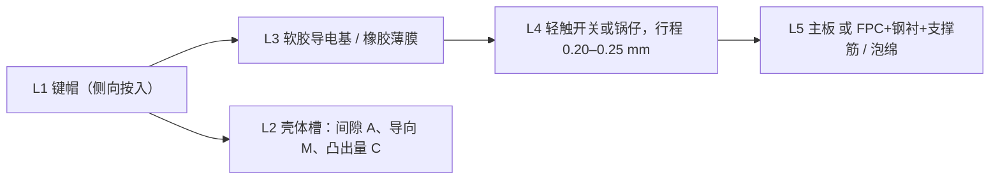

# 手机侧键传力结构：键帽、软胶导电基与壳体间隙链

> [!summary] 一句话概述
> 手机侧键的关键不是再设计一套硅胶鼓或锅仔的力值曲线，而是**键帽如何把侧向按压传到壳内的轻触开关或锅仔**，以及壳体开孔、软胶裙边、FPC 支撑筋这一串间隙。艾邦转载的设计规范把行程定为推动开关或 FPC 侧键约 0.20–0.25 mm，并给出键帽–壳体、导电基–开关、裙边避让等一串经验间隙；工作熊拆解的 Sony Ericsson W550i 则展示了一种真实做法：塑胶帽套在橡胶薄膜上，靠壳体卡槽定位，FPC 折弯后把开关贴在侧壁，下面垫泡绵做缓冲。文中毫米数一律视为该规范/拆解的经验值，不要写成某款量产机的官方规格。

## 配图

![[附件/side-key-metal-gaps.jpg]]
*图源：[艾邦笔电论坛《手机侧按键与壳体配合设计规范》](https://www.abnotebook.com/a/14931)（作者 lhl，2024-10-25；原文始发于公众号「手机结构设计联盟」）；金属侧键与壳体配合的间隙标注示意（文中的 A/B/C/D/E/F 等）。数字见下文表格，均属该设计规范给出的经验值。*

![[附件/side-key-fpc-stack.jpg]]
*图源：同上；FPC 侧键方案（SIDE_KEY_FPC）的装配关系：主板上留 FPC 接口，FPC 折向侧面，锅仔朝外，壳体上的支撑筋托住 FPC 钢衬。*

![[附件/w550i-side-key-rubber.jpg]]
*图源：[工作熊《拆解 Sony Ericsson W550i 手机－侧边按钮的设计》](https://www.researchmfg.com/2011/12/sony-ericsson-w550i-side-key/)（2011-12-05，2019-11-16 更新）；橡胶薄膜上套硬质塑胶帽，靠塑胶壳体卡槽定位。同一条橡胶上有两个键时，中间多出一根 bump 做隔离，减少误按。*

> 图片版权归原作者所有，仅作个人学习收藏；出处见文末「来源与核实记录」。规范给出间隙标注图和 FPC 方案装配图；拆解实物图来自 W550i。

## 结构原理

> 艾邦文中的数字是设计规范/经验值。W550i 拆解几乎没有给出间隙毫米数，只提供结构和材料线索（包括留言中作者回复的橡胶硬度与胶水）。

### 堆叠方案

方向：**从外侧键帽到壳内开关，沿按压方向。** 规范把侧键分成两类：主板侧贴轻触开关，或 FPC 侧键板 + 锅仔。

| 层级 | 零件/区域 | 材料 | 厚度/尺寸（规范经验值） | 固定方式 | 依据 |
| --- | --- | --- | --- | --- | --- |
| L1 | 键帽 SIDE_KEY | 塑胶：常双色 PC+TPU（80–85 SHA）；或五金键帽 | 音量/电源键宽度 1.3–1.8 mm；电源键长度设计 10 mm；音量键长度按当时机型尺寸分 20–22 mm 或 22–25 mm。电源键凸出壳体大面 0.4 mm，非电源键 0.5 mm | 先装到壳体再总装；五金键帽与软胶用 UV/瞬干胶等粘接，胶厚预留 0.05 mm | 艾邦规范 |
| L2 | 壳体开孔与导向面 | 塑胶或金属壳体 | 周边间隙 A：塑胶键+模具孔 0.10 mm（喷涂）/0.12 mm（真空镀），成品目标单边约 0.06 mm；塑胶键+CNC 孔 0.08 mm；金属键+CNC 孔 0.04 mm。导向面 M ≥ 0.6 mm。拔模：按键 1°、壳体 1° | 键帽在槽内导向，避免卡键或晃动 | 艾邦规范 |
| L3 | 软胶（SIDE_KEY_RUBBER）裙边与导电基 | 五金方案要求 ≥60 SHA；W550i 作者后来回复硅胶硬度 60±10，并用 UV 胶粘接 | 导电基与开关或锅仔的间隙 D＝0.05 mm；裙边与壳体间隙 F ≥ 0.3 mm；软胶与壳体避让 E ≥ 0.5 mm；导电基软胶厚度 < 0.3 mm，导电基高度 > 0.3 mm；裙边倒 C 角 0.2×0.2 | 把侧向位移传到开关/锅仔，并吸收一部分公差 | 艾邦规范；W550i 留言 |
| L4 | 开关或锅仔 | 轻触开关，或 FPC 上的金属锅仔 | 行程一般 0.20–0.25 mm。导电基直径随锅仔：锅仔 D＝4 mm 时 Φ＝1.6–2.0 mm；D＝5 mm 时 Φ＝2.0–2.5 mm | 被导电基压到行程后导通。锅仔力值见库中已有专篇，本篇不重复曲线 | 艾邦规范 |
| L5 | 开关的支承 | 主板（带定位柱贴片），或 FPC + 钢衬 + 壳体支撑筋 | FPC 与壳体间隙约 0.1 mm；上下壳定位筋间隙 G＝0.3 mm；后壳支撑筋厚 H：五金 ≥ 0.3 mm，塑胶 ≥ 0.6 mm；前壳支撑筋高度约 1/3 的 FPC 高度。W550i：FPC 折到侧壁，下面垫泡绵 | 把反力接住，否则手感发飘或按不到底 | 艾邦规范；W550i 拆解 |

剖面示意：

### 零件清单

| 零件 | 数量 | 功能 | 材料 | 依据 |
| --- | --- | --- | --- | --- |
| 键帽 | 每键 1，音量键可共用一条 | 外观与传力 | 塑胶或五金 | 艾邦；W550i |
| 软胶 / 橡胶薄膜 | 1 | 导电基传力、裙边密封与防转、隔离 | 规范：≥60 SHA（五金方案）；W550i 留言：60±10 | 两源 |
| 壳体与卡槽 | 1 | 定位、导向、外观缝 | 塑胶或金属 | 两源 |
| 轻触开关或锅仔 | 每键 1 | 导通 | 开关在主板或 FPC 上 | 两源 |
| FPC 或主板、钢衬、支撑筋或泡绵 | 1 套 | 电气连接与反力支承 | W550i 为软板+泡绵 | 两源 |

### 装配顺序

规范建议：为便于装配，一般先把 SIDE_KEY 组件装到壳体上，再组装整机。

W550i（按拆解顺序反推）：

1. 开关 SMT 在 FPC 上，FPC 折弯贴到内部底座侧壁，必要时垫泡绵。
2. 橡胶薄膜套上塑胶帽，卡进壳体侧槽；双键时靠中间 bump 分隔。
3. 合壳，使外部橡胶对准内部开关。工作熊提到：若卡槽只做了一边（旁边是螺丝孔），安装时按键容易掉出来。

规范还提醒：侧键附近的锁壳螺丝柱与 PCB 或壳体在 Z 向干涉 0.05 mm，减轻锁螺丝对侧键位置的影响；按键偏心不大于外形尺寸的 1/6。

### 受力与运动分析

- **受力路径**：手指侧向按键帽 → 软胶导电基压缩间隙 D → 压到开关或锅仔走完 0.20–0.25 mm 行程 → 反力由主板或 FPC 钢衬+支撑筋承担。若 E、F 间隙不够，软胶会先碰到壳体，行程被“吃掉”，表现为按不动或手感差。若支承太软（筋太薄、FPC 悬空、泡绵过软），则按下去发飘、开关未走满行程。
- **运动关系**：键帽在壳体槽内沿按压方向移动，靠导向面约束上下窜动。不是本篇要展开的硅胶斜壁或锅仔自身的力–位移曲线，那些见已有专篇。
- **失效风险**（规范与拆解）：缝隙大、手感弱、可靠性失效；开关方案累积公差大、一致性差；CNC 孔掉漆；间隙 D 过大则按键下陷，过小则难装；W550i 那种一板到底、左右侧键打在同一块硬板板边的做法，会因板边到壳的距离控制不住而大量不良，工作熊认为更好的是独立小片板、用壳体直接定位。
- **两种方案取舍**（规范）：微动开关成本低，但公差链长、手感一致性较差；FPC + 锅仔可以调整中心位置，寿命和手感更好（该文观点）。

## 设计要点与参数

下列均为艾邦文给出的**设计规范/经验值**，不是某一款量产机的官方规格。

| 要点 | 内容 | 依据 |
| --- | --- | --- |
| 目标行程 | 推动轻触开关或 FPC 侧键约 0.20–0.25 mm | 艾邦 |
| 间隙 A（键与孔周边） | 塑胶+模具孔：0.10 mm（喷涂）/0.12 mm（真空镀），成品单边约 0.06 mm；塑胶+CNC：0.08 mm；金属+CNC：0.04 mm（外形公差 ±0.03 mm，需检具） | 艾邦 |
| 装配间隙 B（金属键） | 0.05 mm | 艾邦 |
| 凸出量 C | 电源键 0.4 mm，非电源键 0.5 mm | 艾邦 |
| 导电基到开关/锅仔 D | 0.05 mm | 艾邦 |
| 软胶与壳体避让 E | ≥ 0.5 mm（行程 0.2–0.25 mm，且软胶会再变形） | 艾邦 |
| 裙边与壳体 F | ≥ 0.3 mm；FPC 方案里 FPC 与壳体约 0.1 mm | 艾邦 |
| 导向 M、拔模、胶厚 | M ≥ 0.6 mm；按键/壳体拔模各 1°；五金与软胶胶厚预留 0.05 mm | 艾邦 |
| 导电基与软胶厚度 | 软胶厚度 < 0.3 mm（太厚手感软，太薄怕跌坏）；导电基高度 > 0.3 mm | 艾邦 |
| FPC 支承 | G＝0.3 mm；H 五金 ≥ 0.3 mm、塑胶 ≥ 0.6 mm；前壳筋高约 1/3 FPC 高度 | 艾邦 |
| 公差管控（摘录） | 裙边厚、导电基高 ±0.03 mm；壳体直边 ±0.05；PCB 孔位 ±0.05、孔径 ±0.03；开关焊孔 ±0.03 | 艾邦 |
| W550i 结构线索 | FPC 折弯侧贴 + 泡绵；橡胶+塑胶帽+壳体卡槽；双键中间 bump；单边卡槽易掉件。硬度与胶水见作者 2014 年留言：硅胶 60±10，UV 胶 | 工作熊 |

## 优缺点

**优点**
- 把侧向操作转换成壳内现成的轻触开关或锅仔，无需在侧壁再做一套完整按键芯
- 规范把外观缝、行程和支承拆成可检查的间隙链，便于在 2D 图上设重点尺寸
- FPC 方案可以把开关键位从主板板边解放出来，避免“一板到底”的公差死结（W550i 文的教训）

**缺点 / 代价**
- 间隙链长，膜厚、喷涂、CNC 掉漆都会把 A 做成卡键或大缝
- 开关方案便宜但一致性差；FPC 方案要处理折弯、钢衬、支撑筋和泡绵老化
- 规范数值是经验带，换材料硬度或开关行程后必须重新试手感，不能当国家标准

## 可借鉴点

- 出图先画按压方向的间隙链：A/D/E/F + 开关行程 0.20–0.25 mm，再决定键帽凸出量和软胶厚度
- 支承必须画出来：要么是主板和定位柱，要么是 FPC 钢衬+壳体筋（或泡绵），不要让 FPC 悬空挨打
- 侧键组件先装到壳体，再合机；卡槽尽量两边都有，避免 W550i 那种单边槽掉件
- 左右各有侧键时，不要把开关打在同一块硬板的两对边再指望板边到壳的距离左右都准
- 硅胶/软胶硬度和粘接工艺要写进 BOM（规范 ≥60 SHA，W550i 实践 60±10 + UV 胶）
- 锅仔和硅胶鼓的力值、排气槽等不要在本篇重复设计，直接引用已有案例，本篇只负责传到它们之前的结构

## 与库中相似案例对比

| 对比项 | 本案例（侧键传力与间隙链） | [[硅胶导电按键：斜壁荷重、碳粒与排气槽]] | [[金属锅仔片阵列：直径、力值、行程与寿命互换]] | [[鼠标微动开关（Omron D2FC）：杠杆、簧片翻转与触点]] |
| --- | --- | --- | --- | --- |
| 本篇焦点 | 键帽、壳体槽、软胶、FPC 支承如何把侧向按压传进去 | 硅胶鼓本身的力值与排气 | 锅仔本身的力值、行程、寿命 | 微动开关内部机构 |
| 运动方向 | 侧向按压，再传到朝向侧面的开关/锅仔 | 正向按压 | 正向按压 | 正向按压杠杆 |
| 参数来源 | 设计规范经验值 + 拆解结构 | 该篇的荷重曲线 | 该篇的直径/力值表 | 该篇的规格 |
| 关系 | 本结构的“负载”常常就是那两篇文章里的锅仔或开关 | 被引用，不再重复曲线 | 被引用，不再重复曲线 | 可作为 SIDE_KEY_SWITCH 的内部参考 |

## 相关案例

- [[硅胶导电按键：斜壁荷重、碳粒与排气槽]]
- [[金属锅仔片阵列：直径、力值、行程与寿命互换]]
- [[鼠标微动开关（Omron D2FC）：杠杆、簧片翻转与触点]]
- [[薄膜开关叠层：面板、间隔层、电路层与开窗排气]]
- 分类索引：[[04-机构与运动 索引]]

## 来源与核实记录

- 中文主来源：[艾邦笔电论坛《手机侧按键与壳体配合设计规范》](https://www.abnotebook.com/a/14931)（lhl，2024-10-25；2026-11-21 GET，HTTP 200。文末注明始发于微信公众号「手机结构设计联盟」。行程、间隙、材料硬度与公差均为该规范经验值，不是某款量产机官方规格。）
- 独立第二来源：[工作熊 / ResearchMFG《拆解 Sony Ericsson W550i 手机－侧边按钮的设计》](https://www.researchmfg.com/2011/12/sony-ericsson-w550i-side-key/)（2011-12-05 发表，2019-11-16 更新；2026-11-21 GET 打开。FPC 折弯侧贴、泡绵、橡胶+塑胶帽、壳体卡槽、双键 bump、单边卡槽掉件，以及 2014-12-15 作者回复的硅胶硬度 60±10 与 UV 胶。）
- 核实：2026-11-21 打开两页。搜到的 sohu 等转载未当作新的独立来源。未把硅胶按键或锅仔专篇的力值抄进本篇。打开的规范文没有详细展开“摇臂短臂/长臂截面”的另一套悬臂键参数，故标题用“传力结构”准确概括已核实内容，不以未打开的摇臂尺寸冒充本页数据。
