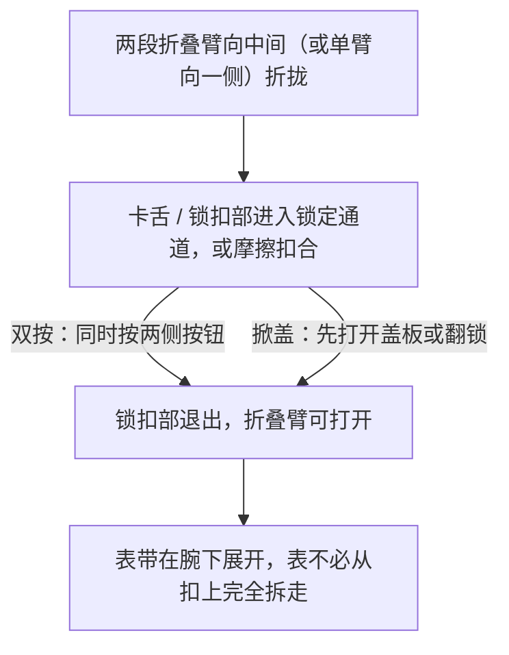

# 手表折叠扣与蝴蝶扣：双按或掀盖释放，表带折叠后由卡舌锁住

> [!summary] 一句话概述
> 手表折叠扣（deployant / 折叠扣）用一段或多段铰接金属片把表带在腕下折起来，合上后由卡舌、摩擦扣或额外的安全盖锁住；常见的蝴蝶扣是两端向中间对折的双折形式，很多带左右双按，必须同时按下两侧按钮，锁舌才让开，扣体才能打开。它要防的是「单手误触或刮蹭导致整表从手腕掉下」，和只靠针扣穿孔的皮带式表扣不是同一套锁。

## 配图

![[附件/cn-patent-dual-push-butterfly-clasp.jpg]]
*图源：中国实用新型「一种分体双按蝴蝶扣结构」（惠州市恒德信精密科技有限公司，林炜焘；技术公布日 2025-10-09；说明书转载页 https://www.xjishu.com/zhuanli/04/202422696604.html ）附图。可见对称外框、中间对折的内档，以及两侧向外伸出的按钮（图中件 5）。这是该专利的一种分体双按实施方式，用来看清「双侧按钮 + 中间折叠片」的外形，不代表所有商品蝴蝶扣都带自动弹出扭簧*

![[附件/rolex-oysterclasp-cover.jpg]]
*图源：[劳力士官网 Oysterclasp 介绍页](https://www.rolex.com/watchmaking/features/bracelets/oysterclasp) 分享图；折叠扣由一片可掀开的盖板保护，盖上可见王冠标识。官网写：盖板一次动作打开，合上时先有轻微阻力，再发出干脆的咔嗒声。这是掀盖式，不是双按，用来对照「同一折叠原理、不同释放方式」*

> 图片版权归原作者所有，仅作个人学习收藏；出处见文末「来源与核实记录」。本篇没有采用电商尺寸表。专利图只说明该申请的结构，不把它写成某款量产表的实测。

## 结构原理

> 本节所有数字只写来源里给出的；来源没有就写「来源未给出」。各品牌微调节孔数、伸展片行程等只在来源明确写到时才出现，不从商品页补数。

### 堆叠方案

方向：**从手腕内侧（贴近皮肤的底片）向外到最外层的锁盖或表带搭接面**

| 层级 | 零件 | 材料 | 厚度/尺寸 | 固定方式 | 依据 |
| --- | --- | --- | --- | --- | --- |
| L1（贴腕） | 靠近手腕的底片 / 长弧形底座 | 金属，具体牌号来源未给出 | 来源未给出 | 两端用铰链分别接两段折叠臂（双折/蝴蝶）或只接一段折叠臂（单折） | Watch Wiki：double or butterfly deployant has two hinged sections, one at either end of the base component；Fratello：两片折向中间；太空人：两个铰链分别向左右打开，像蝴蝶翅膀 |
| L2 | 折叠臂（单折一片，蝴蝶扣两片；三折则另加外盖板） | 同上 | 来源未给出 | 折到合拢位置后，末端进入锁合 | Watch Wiki 的 Single / Double / Tri-Fold 分类；太空人把只向一侧打开的称为滚筒式折叠扣 |
| L3 锁合 | 卡舌、锁扣部，或靠摩擦力扣合 | 专利示例：内档端部的第一卡扣部（凸块、锁定通道、进入通道和斜面）与按钮带动的锁扣部配合 | 斜面角度、通道宽度来源未给出（该专利也未给出毫米数） | 合拢时锁扣部进入锁定通道；开启时按钮使锁扣部退出 | 专利说明书；Fratello：很多折叠扣带推按钮，必须同时按两侧才能打开；Watch Wiki：many have one or more button to release the catch but others are purely friction attached |
| L4 释放件 | 双侧推按按钮，或掀盖 / 翻锁 | 专利示例：按钮穿过外框，经挫牙针连到锁扣部，两侧锁扣部之间用生耳针一类第二弹性件相连 | 按压力、行程来源未给出 | 双按：两侧同时向内推，锁扣让开。掀盖：先掀开外盖再打开折叠臂（劳力士 Oysterclasp；Fratello 也写 dive/sport 上常见 flip-lock） | 专利；Fratello Pushbuttons / Flip-locks 节；劳力士官网 |
| L5 表带连接 | 与金属链节或皮带的接口 | 常见弹簧棒（生耳）或螺丝，Fratello 还提到双头螺丝等 | 太空人写常见弹簧棒长度有 18 mm、20 mm、22 mm（该文是在讲针扣选配，不是折叠扣锁合力） | 链节可拆则长度靠拆节和扣上微孔调节；皮带类常把长端穿过带针的扣再折回 | Fratello；Watch Wiki；太空人 |
| L6 可选安全层 | 第二道翻锁、安全盖、隐藏式开关 | 来源按型号 | 来源未给出 | 三折扣可在外板之外再加一道 safety catch（Watch Wiki）；潜水面盘常见双锁（太空人）；有的同时有双按和翻锁（Fratello 举 Grand Seiko 例，仅作类型说明） | Watch Wiki；太空人；Fratello |

剖面示意：

独立来源对同一动作的表述：

- Watch Wiki：Cartier 在 1909 年取得第一件「折叠扣」专利，法文 boucle déployant，1911 年起用于 Santos。Deployant 用两片或更多铰接金属件互相折叠来闭合表带或表链；许多带一颗或多颗释放按钮，也有纯摩擦扣合。Double 或 butterfly 是底座两端各有一段铰接臂，在手腕中部会合。
- Fratello（Brandon Baines，2021-08-30）：单折和双折（dual-deployant / butterfly）都可以带推按钮；带按钮时必须同时按下两侧才能打开，因而比纯摩擦更不容易在手腕上意外弹开，摘表时也更容易主动打开。掀盖式 flip-lock 须先掀开安全盖。双折在金属表链上往往轮廓更低，有的几乎融入链节。
- 太空人腕時計（2021-06-11）：蝴蝶折叠加宽表带而不必把扣完全解开，戴脱更快，也比传统针扣更不容易从手腕上松开。蝴蝶扣由左右两个铰链组成；可以用针固定，也可以用按钮开关；还有把开关藏在表带内侧的隐藏式。只向一侧打开的是滚筒式。潜水扣常在折叠之外再加一道翻盖。
- 专利 202422696604：针对「必须同时按两侧按钮后，还要再手动拨开表带才能完全分开」的传统一体式，增加第一弹性件（转轴上的扭簧）和第二锁扣部——按下按钮解除锁合后，内档可在扭簧作用下自动弹出。合拢时，内档端部斜面挤开两侧锁扣部，锁扣部进入通道后再被第二弹性件推入锁定通道。这是该申请的改进点，不能写成所有双按蝴蝶扣都会自动弹出。
- 劳力士 Oysterclasp：用盖板保护折叠扣，一次动作打开；合上有轻微阻力并伴有干脆的咔嗒声。官网没有写双按，也不给出力值。

### 零件清单

| 零件 | 数量 | 功能 | 材料 | 依据 |
| --- | --- | --- | --- | --- |
| 底座 / 底片 | 1 | 贴腕，提供折叠臂的铰链基准 | 来源未给出牌号 | Watch Wiki；Fratello；专利中的外框+配装空间 |
| 折叠臂 / 内档 | 单折 1，蝴蝶 2 | 把表带长度折起来或展开 | 同上 | 同上 |
| 铰链（转轴） | 至少 1–2 处 | 规定折叠轨迹 | 专利示例含第一转轴 | 各来源铰链描述；专利 |
| 锁扣部 + 卡舌 / 锁定通道 | 1 套 | 合拢后保持折叠状态 | 专利给出斜面和通道几何，无尺寸 | 专利；Fratello / Watch Wiki 的 catch |
| 双侧按钮或掀盖 | 双按为 2；掀盖为 1 | 释放锁合 | 来源未给出 | Fratello；专利；劳力士 |
| 弹性件 | 按设计 | 专利示例：扭簧使内档弹出；生耳针把两侧锁扣部连在一起并提供回位 | 专利写第一弹性件为转轴扭簧，第二弹性件为生耳针 | 仅该专利实施方式 |
| 与表带的弹簧棒或螺丝 | 两端各 1（常见） | 把扣连接到链节或皮带 | 太空人提到弹簧棒常见长度 18/20/22 mm（针扣语境） | 太空人；Fratello |

### 装配顺序

按各文对开合逻辑的说明（不是某表厂的装配工艺卡）：

1. 把底座和折叠臂用铰链连成单折、双折或三折骨架（分类见 Watch Wiki / 太空人）。
2. 装入锁扣部和释放件：双按则把按钮从外框两侧穿入并与锁扣部连接；掀盖则装可翻转的外盖。专利实施方式里，两侧锁扣部还要用第二弹性件连起来，内档转轴上套扭簧。
3. 用弹簧棒或螺丝把扣的两端接到表链或皮带。皮带类单折常见一端是带针的扣、一端是开框，长端从上方穿过（Fratello）；金属链则两端都在链节上，多余长度靠拆节而不是穿过扣环（Fratello）。
4. 戴表：把表放在手腕上，将折叠臂按向底座直至锁合到位。专利实施方式下，斜面会先挤开锁扣部，再让锁扣部进入锁定通道。劳力士掀盖式合上时有阻力和咔嗒声。
5. 摘表：双按须同时按下两侧按钮（Fratello、太空人、专利对传统双按的描述）；若是该专利带扭簧的结构，锁一解除内档可自行弹出，不必再拨。掀盖式先打开盖板或翻锁，再展开折叠臂。展开后表仍可挂在扣上，不必像某些针扣那样完全抽出皮带。

> 出厂如何调铰链间隙、如何铆轴，来源未给出，不编造。

### 受力与运动分析

- **受力路径**：手表自重和摆臂惯性通过表链传到折叠扣。合拢后，拉开表带的力试图把折叠臂绕铰链展开，这个趋势由卡舌/锁扣部（或摩擦扣、外盖）挡住。双按时，单一侧的按压不应让锁扣完全让开（Fratello 的要点是必须两颗按钮都按；专利传统问题也以「同时按两侧」为前提）。来源没有给出开合力的牛顿数，本文不引用未打开原文的行业标准力值。
- **运动关系**：折叠臂相对底座是有限转角的铰链运动，合拢后被锁扣限制。按钮多沿宽度方向按入。掀盖是另一条转动自由度，作为第一道锁。Watch Wiki 写三折还可能在外板之外再加一道 safety catch。
- **失效风险**：只有摩擦、没有按钮或翻锁的扣，更容易被刮开（Fratello 把按钮和 flip-lock 都写成额外安全）。只按到一侧按钮就打开，则双按形同虚设（推断：这是双按要同时动作的原因）。铰链松旷、锁舌磨损会导致合上不到位或虚锁。专利指出传统一体式损坏后往往要整扣更换。自动弹出扭簧若失效，只会回到「按完还要手拨」的传统操作，不一定等于失锁（推断，仅针对该专利结构）。

## 设计要点与参数

| 要点 | 内容 | 依据 |
| --- | --- | --- |
| 发明与术语 | Cartier 1909 年专利，1911 年用于 Santos；法文 boucle déployant。单折、双折（蝴蝶）、三折是不同折叠拓扑 | Watch Wiki；Fratello；太空人也写 1910 年代路易·卡地亚 |
| 蝴蝶 vs 单折 | 蝴蝶：两端向中间对折，锁合多在腕下中部，轮廓可以更低；单折：一片臂折到另一侧，锁合位置常偏一端 | Watch Wiki；Fratello；太空人 |
| 双按释放 | 须同时按两侧按钮，锁舌才让开，降低误开风险，又便于主动打开 | Fratello Pushbuttons 节；太空人「按钮开关」；专利背景 |
| 掀盖 / 翻锁 | 先打开盖板或安全翻锁，再展开折叠臂。可与双按叠用 | 劳力士 Oysterclasp；Fratello Flip-locks；太空人潜水双锁；Watch Wiki tri-fold safety catch |
| 摩擦扣合 | 有的折叠扣没有按钮，只靠摩擦保持，便利性与防误开的平衡不同 | Watch Wiki；Fratello 写早期/部分设计 |
| 一种自动弹出的双按实现 | 扭簧预载内档，按钮解除锁合后内档自行离开配装空间；合拢靠斜面挤开锁扣再进入锁定通道 | 仅专利 202422696604，不是行业通例 |
| 与针扣的差别 | 折叠扣打开时表仍连在扣上，不必完全抽出皮带；针扣靠针插入孔位调节长度 | 太空人；Fratello Tang/pin 与 deployant 两节 |
| 开合力、锁舌尺寸、铰链间隙 | 来源未给出 | 已打开的表厂页、科普文和专利均无牛顿数或毫米锁量。未打开的 QB/T 数值不引用 |

## 优缺点

**优点**
- 戴脱时表不必完全离开手腕，也不必像针扣那样抽出一截皮带
- 双按或掀盖把「打开」做成必须的主动动作，降低刮蹭误开后整表掉落的风险
- 双折可以把锁合放在腕下并做低，外观更连续
- 释放方式可以按场景叠加：正装表常见隐藏或低外形双按，潜水和运动表再加翻锁

**缺点 / 代价**
- 零件和铰链远多于针扣，厚、重、贵，也多了松旷和虚锁的失效点
- 没有微调节的金属链，仍要靠拆节，季节性胀腕不方便（Fratello 评论区大量讨论这一点，本文不把评论当参数）
- 皮带用折叠扣有时要特制表带，不能直接套到普通针扣皮带上（Watch Wiki 对 double deployant 的说明）
- 不同释放方式不能从外观一眼当成同一种锁，维修时要按具体结构拆

## 可借鉴点

- **防掉落要靠「必须两步或两指才能打开」**：双按是「两指同时」；掀盖是「先开盖再展臂」。和 FIDLOCK、侧向插扣一样，单一刮蹭不应完成解锁。
- **折叠本身不是锁，锁在卡舌上**。先把长度折起来，再用独立的锁舌或盖板保持过中/合拢位置。不要指望铰链的摩擦力单独承担整表重量。
- **按使用场景叠加安全层**，而不是做成最复杂的一种给所有表：日常折叠 + 双按已经能解决大部分误开；潜水或高活动再加翻锁。
- 写案例和做维修说明时，把「Cartier 式折叠原理」和「某一款双按自动弹出专利」分开，避免把改进点写成所有蝴蝶扣的必有零件。
- 力值和锁量没有可靠来源就写「来源未给出」，不要抄电商或未打开的标准摘要。

## 与库中相似案例对比

| 对比项 | 本案例 | [[FIDLOCK V-BUCKLE：磁吸引导到位后再由机械扣锁死]] | [[侧向释放插扣（ITW SR 1）：双弹性卡臂、母座侧窗与中间翼]] |
| --- | --- | --- | --- |
| 锁定 | 折叠合拢后由卡舌、摩擦或掀盖保持 | 磁吸只负责引导，机械扣锁死 | 双弹性卡臂进入母座侧窗 |
| 防误开 | 双须同时按，或先掀盖；单侧刮蹭不应打开 | 要按设计的释放动作才能开机械锁 | 须按下或内挤卡臂才能退出 |
| 打开后 | 表仍连在扣上，折叠臂展开 | 两半完全分开 | 插头从母座抽出 |
| 参数情况 | 已打开源几乎无牛顿数 | 按该篇已核实的磁体与机械锁说明 | 按该篇已核实的卡臂几何 |

## 相关案例

- [[FIDLOCK V-BUCKLE：磁吸引导到位后再由机械扣锁死]]
- [[侧向释放插扣（ITW SR 1）：双弹性卡臂、母座侧窗与中间翼]]
- [[GoPro 快拆卡扣与指旋螺母：两爪弹性卡入和螺钉夹紧是两套锁]]
- 分类索引：[[04-机构与运动 索引]]

## 来源与核实记录

- 主来源：[Fratello Watches: How Watches Work: A Guide To Watch Buckles And Clasps](https://www.fratellowatches.com/watch-buckles-clasps-guide/)（Brandon Baines，2021-08-30。单折/双折/蝴蝶术语、双按须同时按两侧、翻锁、与针扣的差别。配图多为各品牌产品照片，本文未把未保存版权说明的照片转存为结构图）
- 补充来源 1：[Watch Wiki: Deployant](https://www.watch-wiki.net/doku.php?id=deployant)（Cartier 1909 / Santos 1911、single / double-butterfly / tri-fold、按钮或纯摩擦）
- 补充来源 2：[太空人腕時計：錶帶扣和潛水錶扣的快速指南教學](https://www.taikonaut.com.tw/blogs/all-about-watch-bands/a-quick-guide-to-watch-buckles-and-watch-clasps)（2021-06-11；中文独立科普：蝴蝶左右开合、按钮或隐藏开关、滚筒式、潜水双锁。弹簧棒 18/20/22 mm 出现在针扣选配段落，不移作折叠锁合力）
- 补充来源 3：[一种分体双按蝴蝶扣结构的制作方法（实用新型转载）](https://www.xjishu.com/zhuanli/04/202422696604.html)（公布 2025-10-09；申请日 2024-11-05。零件级双按、斜面入锁、扭簧弹出。只代表该实施方式，已下载附图作结构示意）
- 补充来源 4：[Rolex: Oysterclasp](https://www.rolex.com/watchmaking/features/bracelets/oysterclasp)（官网；掀盖保护的折叠扣，合上有阻力与咔嗒声。用作释放方式对照，不是双按蝴蝶的参数源）
- 核实：2026-11-22 实际打开上述页面并保存专利图与官网图。未打开 QB/T 4523 原文，不引用网络转述的开合力范围。未采用电商「表带扣尺寸」作为结构参数。
