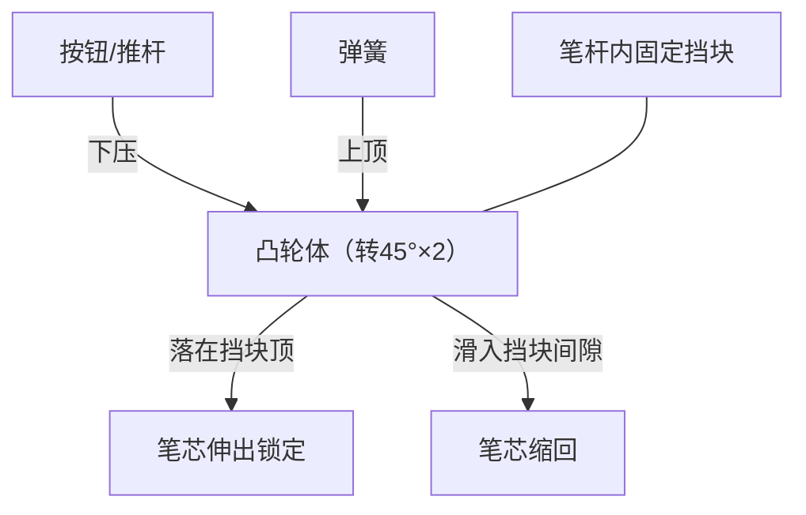

# 按动圆珠笔：旋转凸轮的按压伸缩机构

> [!summary] 一句话概述
> 按动笔用「按钮/推杆（plunger）+ 可旋转凸轮体（cam body）+ 笔杆内固定挡块（stop members）+ 弹簧」组成旋转分度机构：每按一次凸轮体转一格，交替落在挡块顶上（笔芯伸出锁定）或滑进挡块间隙（笔芯缩回）。

> [!note] 与已收录/同轮案例的区别
> [[防变形静音 Push-Push 按压弹跳锁（ITW 专利 EP1596030）]] 也是「按两次切换」，但靠随动销走**平面心形轨道**；按动笔靠**绕轴旋转的分度凸轮**，零件全部同轴，适合细长圆柱空间。

## 配图

![[附件/click-pen-cam.jpg]]
*图源：Pen Vibe《Engineers Explain How Click Pens Work》配图「How Do Clicky Pens Work?」：左为缩回状态、右为伸出状态的推杆/凸轮/挡块剖切示意*

> 图片版权归原作者所有，仅作个人学习收藏；出处见文末「来源与核实记录」。

## 结构原理

> 本节数字只写来源里给出的；来源没有就写「来源未给出」。

### 堆叠方案

方向：**沿笔杆轴线从按钮端到笔尖端**

| 层级 | 零件 | 材料 | 厚度/尺寸 | 固定方式 | 依据 |
| --- | --- | --- | --- | --- | --- |
| L1 | 按钮 + 推杆（plunger） | 来源未给出 | 来源未给出 | 轴向滑动，上端有弹簧把它推回 | Pen Vibe「How Click Pens Work」 |
| L2 | 凸轮体（cam body），与笔芯端部相连 | 来源未给出 | 每次转动 45°（两次共 90°） | 可绕轴旋转并轴向滑动 | 同上 |
| L3 | 固定挡块（stop members） | 来源未给出 | 来源未给出 | 固定在笔杆内 | 同上 |
| L4 | 笔芯 + 笔芯弹簧 | — | 来源未给出 | 弹簧把凸轮体向上顶 | 同上 |

剖面示意：

### 零件清单

| 零件 | 数量 | 功能 | 材料 | 依据 |
| --- | --- | --- | --- | --- |
| 推杆（含按钮） | 1 | 传递按压，推动凸轮体 | 来源未给出 | Pen Vibe |
| 凸轮体 | 1 | 分度旋转，决定锁定/缩回 | 来源未给出 | Pen Vibe |
| 固定挡块 | 若干（来源未给出） | 承托凸轮体实现锁定 | 来源未给出 | Pen Vibe |
| 弹簧 | 来源未给出 | 复位推杆、上顶凸轮体 | 金属（推断） | Pen Vibe |

### 装配顺序

来源未给出装配顺序。

### 受力与运动分析

- **运动关系**（Pen Vibe 描述的一个伸出循环）：
  1. 按下按钮，推杆把凸轮体压到固定挡块下方；
  2. 弹簧把凸轮体顶向推杆，凸轮体转 45°，发出第一声「咔」；
  3. 松开按钮，推杆被弹簧推回，凸轮体再转 45° 并撞上挡块，发出第二声「咔」，笔芯完全伸出并锁定；
  4. 再按一次重复上述过程，松手后笔芯缩回。
- **受力路径**：书写时笔尖反力 → 笔芯 → 凸轮体 → 固定挡块 → 笔杆（推断：来源只说「锁定」）。
- **失效风险**：来源未给出。

## 设计要点与参数

| 要点 | 内容 | 依据 |
| --- | --- | --- |
| 三个核心零件 | 凸轮体、推杆、固定挡块 | Pen Vibe |
| 分度角 | 每次动作两段各 45° | Pen Vibe |
| 两声点击 | 一声来自按下后的转动，一声来自松手后撞挡块 | Pen Vibe |
| 凸轮型面、行程、弹簧力 | 来源未给出 | — |

## 优缺点

**优点**
- 同轴布置，适合细长圆柱形产品
- 两声点击提供明确的状态反馈

**缺点 / 代价**
- 小尺寸凸轮型面精度要求高（推断）
- 来源未给出寿命与失效数据

## 可借鉴点

- 圆柱形产品的按压切换（伸缩、开关、锁定）可直接套用「推杆 + 旋转分度凸轮 + 固定挡块」
- 用两段转动设计两次点击音，给用户明确反馈
- 与心形轨道式 push-push 对比选型：空间细长选旋转凸轮，空间扁平选心形槽

## 相关案例

- [[防变形静音 Push-Push 按压弹跳锁（ITW 专利 EP1596030）]]
- [[DualSense 自适应扳机：电机+蜗杆的力反馈机构]]
- 分类索引：[[04-机构与运动 索引]]

## 来源与核实记录

- 主来源：[Engineers Explain How Click Pens Work](https://penvibe.com/how-pens-work/)（Pen Vibe，2015-11-04 发布、2024-10-14 更新，Tony Bridges）
- 补充来源：[How a Retractable Ballpoint Pen Works](https://www.youtube.com/watch?v=MhVw-MHGv4s)（YouTube，engineerguy / Bill Hammack，以 Parker Jotter 讲解；文章称视频长 4:43）
- 核实：2026-11-13 打开 Pen Vibe 全文核对机构动作；视频仅通过 oEmbed 核对标题与频道，未看完整视频。文章另称第一支商用按动圆珠笔由 John F. Sullivan 为 Frawley Pen 公司申请专利（1950 年代）。
