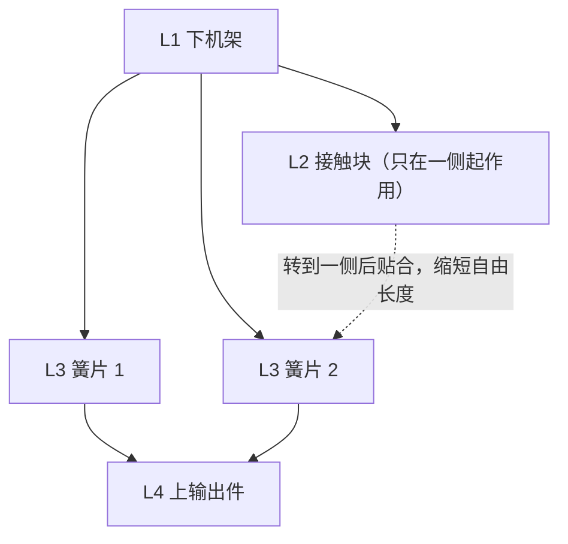

# 接触辅助十字簧片柔性铰（CAFP）：接触缩短簧片自由长度以改变单向刚度

> [!summary] 一句话概述
> 接触辅助十字簧片柔性铰（contact-aided CAFP）在普通十字交叉簧片旁边，加一块固定在机架上的接触块：朝某一侧转动时，其中一根簧片贴上接触面，自由长度被缩短，整铰刚度明显提高；朝另一侧转动时不接触，刚度仍接近原来的十字簧片。这样，同一个柔性转动副在顺时针和逆时针可以表现得不一样，而不必改成两套铰链。

## 配图

![[附件/cafp-contact-member-geometry.jpg]]
*图源：[Bilancia, Berselli, Magleby and Howell, On the modeling of a contact-aided cross-axis flexural pivot, Mechanism and Machine Theory 143 (2020) 103618](https://unige.iris.cineca.it/retrieve/e268c4cb-3721-a6b7-e053-3a05fe0adea1/1-s2.0-S0094114X19316921-main.pdf) 第 2 页 Fig. 1。左图为交叉角 β 保持不变的构型，右图为簧片长度 L 保持不变的构型。两根簧片（Beam 1、Beam 2）交叉连接下机架（宽 W1）和上刚性输出件（宽 W2），高度为 h，矩形截面为 b×t。阴影三角块为接触件，特征长度为 Lc。接触发生后，靠近接触块的那根簧片自由长度缩短*

> 图片版权归原作者所有，仅作个人学习收藏；出处见文末「来源与核实记录」。

## 结构原理

> 本节所有数字只写来源里给出的；来源没有就写「来源未给出」。

### 堆叠方案

方向：**从下机架到上输出件（平面十字簧片，侧视）**

| 层级 | 零件 | 材料 | 厚度/尺寸 | 固定方式 | 依据 |
| --- | --- | --- | --- | --- | --- |
| L1（下） | 机架 / 下刚性件 | 来源未给出 | 宽度 W1；高度方向的跨距为 h | 固定 | Fig. 1 |
| L2 | 接触块（contact member） | 来源未给出 | 特征长度 Lc；固定在机架上 | 与机架固结 | Fig. 1、第 2 节 |
| L3 | 两根交叉簧片 Beam 1、Beam 2 | 来源未给出 | 长度 L，交叉角 β，矩形截面 b×t | 两端分别连下机架和上输出件 | Fig. 1 |
| L4（上） | 输出刚性件 | 来源未给出 | 宽度 W2 | 随转角 θ 运动 | Fig. 1 |

剖面示意：

于靖军等的中文综述把这类机构称为「辅助接触式柔性机构（contact-aided compliant mechanisms）」：利用柔性高副接触得到非线性刚度、非光滑路径或大转角等普通纯柔性件不容易得到的特性。本篇以十字簧片加接触块这一具体构型为准。

### 零件清单

| 零件 | 数量 | 功能 | 材料 | 依据 |
| --- | --- | --- | --- | --- |
| 下机架 | 1 | 提供固定边界，并安装接触块 | 来源未给出 | Fig. 1 |
| 接触块 | 1 | 在指定转向与一根簧片贴合，缩短其自由长度 | 来源未给出 | Fig. 1；第 2 节 |
| 交叉簧片 | 2 | 提供柔性转动，并在接触后改变刚度 | 来源未给出 | Fig. 1 |
| 上输出件 | 1 | 输出转角 θ，承受力矩或力 | 来源未给出 | Fig. 1 |

### 装配顺序

1. 先把两根簧片按选定的 β 或 L 交叉装到下机架和上输出件之间，形成普通 CAFP。文中讨论两种参数化方式：保持交叉角 β 不变，或保持簧片长 L 不变；后者的几何变化范围较小。
2. 在机架一侧装上形状设定好的接触块，使输出件转到某一侧时，指定簧片能贴上接触面。接触长度由 Lc 描述。
3. 来源是建模与有限元研究，没有给出工厂装配工步或紧固件。接触用罚函数/简化库仑摩擦来建模，式中出现接触刚度 k 和静摩擦系数 μ，具体数值按分析工况选取，本文不编造一组「标准 μ」。

> 来源只给了拆分后的几何定义和仿真流程，没有实物装配照片清单。

### 受力与运动分析

- **受力路径**：力矩或平面力作用在上输出件上，经两根簧片传到下机架。未接触时，两根簧片都按各自的自由长度弯曲，表现接近普通十字簧片铰。一旦转到接触侧，Beam 2（图中靠近接触块的那根）与接触块贴合，自由长度缩短，这一侧的抗弯能力上升，整铰的转动刚度随之提高。反向转动不走这条接触路径，刚度不升高。于是顺、逆时针的力-转角曲线不对称。
- **运动关系**：期望运动是平面内转动。十字簧片铰还会有寄生移动（parasitic shift）。接触会改变转角与寄生位移的关系。文中对纯转动加载，在 θ < 0.883 rad 的范围内用 CBCM 与 ANSYS 对比转动刚度、寄生位移和最大应力。
- **失效风险**：接触区簧片仍有不可忽略的曲率，应力集中需要单独看，不能按「贴上就变成短梁」的简单梁公式了事（文中强调接触区曲率）。接触建模依赖网格和节点区间，Lc 的微小变化也要用较细的网格。来源没有给出某一材料的许用应力或疲劳寿命。纯柔性十字簧片在受压时还有失稳风险（文中作为普通 CAFP 的背景指出），接触块主要改变弯曲自由长度，不是专门的防屈曲挡块（推断：来源把接触块的功能写成改变刚度）。

## 设计要点与参数

| 要点 | 内容 | 依据 |
| --- | --- | --- |
| 接触要解决的问题 | 让柔性转动副在两个转向表现不同：接触侧因自由长度缩短而显著增刚 | 摘要；第 2 节 |
| 两种几何参数化 | β = const（交叉角不变）或 L = const（簧片长不变）；后者变化范围更小 | Fig. 1；第 2 节 |
| 主要尺寸符号 | 下宽 W1、上宽 W2、高度 h、簧片长 L、交叉角 β、截面 b×t、接触特征长度 Lc | Fig. 1 |
| 性能指标 | 转动刚度、寄生位移、最大应力；对多种长宽比 AR 和 Lc 做参数扫描 | 摘要与第 3 节之后 |
| 纯转动算例范围 | θ < 0.883 rad 时，刚度在 Fx=Fy=0 条件下取均值 | 性能指标段 |
| 建模方法 | 链式梁约束模型（CBCM）处理大变形接触；与 ANSYS 的接触算法对照，并强调计算效率 | 摘要 |
| 接触模型 | 接触法向与切向力用刚度 k 和静摩擦系数 μ 的简化形式；文中说明这是罚函数类算法的简化 | 接触建模段 |
| 实物材料、板厚的毫米值 | 来源未给出某一件加工图纸的材料牌号和毫米数；本篇不从图上估读 | — |
| 中文综述的定位 | 辅助接触式柔性机构利用接触（柔性高副）获得非线性刚度、非光滑路径、大转角等特性，是一类有前景的新型柔性机构 | 于靖军等 2015，第 4.2 节 |
| 与无接触双稳态梁的区别 | 本结构的「变刚度」来自接触改变力路径，不是屈曲跳跃形成的两个稳态 | 对照本轮双稳态篇 |

## 优缺点

**优点**
- 用一块固定接触块，就能让同一柔性铰在两个转向给出不同刚度，不必做两套铰或另加主动变刚度驱动。
- 仍然保持十字簧片铰零件少、可平面加工的优点。
- 参数扫描（AR、Lc、β 或 L）可以先用地图看刚度、寄生位移和应力的走势，再决定接不接触、接触段做多长。

**缺点 / 代价**
- 接触带来非光滑和局部曲率，模型和网格都比无接触十字簧片复杂；简化摩擦模型不能代替后期的详细接触分析。
- 已打开的主来源以仿真和建模为主，没有给出可直接照抄的材料、板厚和公差，工程上还要另做样件。
- 寄生位移仍然存在，接触会改变它，并不能自动把十字簧片做成「纯转动、无移动」的理想铰。

## 可借鉴点

- 若只需要「朝一边硬、朝另一边软」，先考虑在现有柔性铰旁加接触限位，而不是立刻上主动变刚度。
- 接触块要固定在机架上，并明确它缩短的是哪一根簧片的自由长度；方向装反，软硬两侧会对调。
- 设计指标不要只看刚度，同时看寄生位移和接触区应力。
- 把接触行程 Lc 当作独立变量，做一组有/无接触的对比曲线，避免把接触后的短梁刚度当成全行程刚度。
- 本结构不是双稳态：去掉外力后，它不会自己跳到另一个几何稳态（除非另加屈曲构型）。需要保持位置时，还要另做锁或双稳态模块。

## 与库中相似案例对比

| 对比项 | 本案例（接触辅助 CAFP） | 本轮「双稳态柔顺机构」篇 | [[恒扭力摩擦铰链：卡簧过盈产生扭力与「最低扭力 > 盖板力矩」选型]] | [[活动铰链（Living Hinge）：一体成型的柔性铰链]] |
| --- | --- | --- | --- | --- |
| 刚度为什么会变 | 接触缩短一根簧片的自由长度 | 屈曲/跳转形成两个稳态和负刚度段 | 摩擦副过盈，不是接触改梁长 | 薄膜弯曲，无接触变刚度 |
| 有没有两个自己保持的位置 | 没有（来源未把它写成双稳态） | 有 | 靠摩擦保持姿态 | 没有 |
| 是不是摩擦铰 | 接触可以有摩擦，但目的是改弹性力路径 | 不是 | 是摩擦铰，库内已有 | 不是 |
| 是否重复收录 | 本篇写接触辅助柔性铰 | 另篇，只对照 | 只对照 | 只对照 |

## 相关案例

- [[恒扭力摩擦铰链：卡簧过盈产生扭力与「最低扭力 > 盖板力矩」选型]]
- [[活动铰链（Living Hinge）：一体成型的柔性铰链]]
- [[双稳态柔顺机构：完全柔性屈曲梁与Young型跳转的几何稳态]]
- [[层合弹出扭转铰（LET Joint）：薄板窄梁扭转提供面外转动]]
- 分类索引：[[04-机构与运动 索引]]

## 来源与核实记录

- 主来源：[Pietro Bilancia, Giovanni Berselli, Spencer Magleby, Larry Howell, On the modeling of a contact-aided cross-axis flexural pivot, Mechanism and Machine Theory 143 (2020) 103618](https://unige.iris.cineca.it/retrieve/e268c4cb-3721-a6b7-e053-3a05fe0adea1/1-s2.0-S0094114X19316921-main.pdf)（2019-09-12 接受，2020 年卷。通讯单位为 University of Genova；合作单位 Brigham Young University。已从热那亚大学机构库下载 14 页 PDF，核对 Fig. 1–2、接触缩短自由长度、CBCM/ANSYS 与性能指标）
- 补充来源：[于靖军、郝广波、陈贵敏、毕树生，柔性机构及其应用研究进展，《机械工程学报》2015, 51(13)](https://qikan.cmes.org/jxgcxb/EN/PDF/10.3901/JME.2015.13.053)（北京航空航天大学、科克大学、西安电子科技大学。已下载全文，核对第 4.2 节对辅助接触式柔性机构的中文界定。独立中文综述机构；该综述没有给出本篇 CAFP 的毫米尺寸，故不写入参数表）
- 核实：2026-11-22 下载并打开上述两份 PDF。IIT Hyderabad 等关于接触辅助机构拓扑优化的 arXiv:2410.23714 已下载，讨论的是描迹多折路径的拓扑构型，与本十字簧片接触块不是同一结构，不写入本篇参数。未把无接触双稳态梁或摩擦铰写成同一篇。
