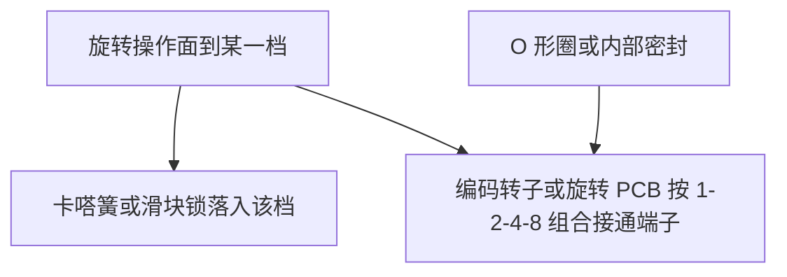

# 旋转BCD编码开关：编码转子把档位编成4位代码（对照 Nidec SC 与 Omron A6A）

> [!summary] 一句话概述
> 旋转 BCD 编码开关用一圈档位代替一排滑动拨码：转到某一格时，编码转子（或旋转电路板）按 1-2-4-8 的组合接通若干端子，输出十进制或十六进制代码。Nidec SC-1000 为 16 档、步进角 22.5°，SC-2000 为 10 档、步进角 36°，调节力矩 4–20 mN·m，外壳里有不锈钢卡嗒簧和硅橡胶 O 形圈，切换额定 DC 5 V / 100 mA。Omron A6A 同样提供 10 位十进制和 16 位十六进制（及反码），但把稳定接触写成「滑块锁 + 旋转 PCB」，内部密封等效 IP64，电气寿命至少 2000 步，额定 0.1 A / 28 VDC，操作力矩 1.18–2.45×10⁻² N·m。它不是 EC11 那种连续旋转出脉冲的增量编码器。

## 配图

![[附件/rotary-nidec-structure.png]]
*图源：[Nidec Components SC-1000/2000 目录](https://www.nidec-components.com/e/catalog/switch/sc-1000&sc-2000.pdf)；内部结构：壳体、金属卡嗒簧、硅橡胶 O 形圈、带镀金图案的插入转子、基座、镀金触点和端子*

![[附件/rotary-nidec-spec.png]]
*图源：同上；标准规格与电气特性，含 BCD/BCH、接触额定、接触电阻和工作温度*

![[附件/rotary-nidec-code.png]]
*图源：同上；16 位与 10 位真码/反码的档位–端子导通表*

![[附件/rotary-omron-a6a-p1.png]]
*图源：[Omron A6A Rotary DIP Switch 数据表](https://omronfs.omron.com/en_US/ecb/products/pdf/en-a6a.pdf) 第 1 页；10/16 位型号、IP64、电气寿命和操作力矩*

> 图片版权归原作者所有，仅作个人学习收藏；出处见文末「来源与核实记录」。

## 结构原理

> 本节所有数字只写来源里给出的；来源没有就写「来源未给出」。

### 堆叠方案

方向：**从操作面到 PCB（以 Nidec 顶设型为主，A6A 对照）**

| 层级 | 零件 | 材料 | 厚度/尺寸 | 固定方式 | 依据 |
| --- | --- | --- | --- | --- | --- |
| L1（最上） | 操作面：无旋钮的一字槽，或带旋钮；A6A 还有圆锥、扁平、加长轮和侧视轮 | Nidec 转子为聚酰胺；A6A 致动器颜色按型号分（圆锥黑、扁平白等） | Nidec 低矮高度 3.9 mm。A6A 质量约 0.7–1.0 g | 旋转，按步进角停档 | Nidec；A6A 型号表 |
| L2 | 定位卡嗒：Nidec 为不锈钢金属簧；A6A 写滑块锁（slider lock） | Nidec：SUS 301 | 来源未给出厚度 | 提供档位手感和停留 | Nidec 结构表；A6A 特性说明 |
| L3 | 密封：Nidec 为硅橡胶 O 形圈；A6A 为内部密封，等效 IP64，并可清洗 | Nidec：硅橡胶 | 来源未给出截面尺寸 | 阻止助焊剂和灰尘进入触点 | Nidec；A6A |
| L4 | 编码件：Nidec 为带镀金图案的插入转子；A6A 为旋转 PCB 机构 | Nidec：铜合金镀金图案 | 来源未给出直径 | 转到某一档时，按码表接通对应端子 | Nidec；A6A |
| L5 | 触点与端子 | Nidec：铜合金镀金。A6A：来源未给出牌号。Nidec 端子排列为 4-1 | 来源未给出脚距数字（外形见目录尺寸页） | 直插或海鸥翼（Nidec 顶设型可选） | Nidec；A6A |
| L6 | 壳体与基座 | Nidec：PPS，UL 94V-0 | 见目录外形图 | 嵌合 | Nidec |

剖面示意：

Nidec 电路类型为 BCD 或 BCH（真码与反码）。SC-1000 有 16 个位置，SC-2000 有 10 个位置。Omron A6A 同样分 BCD Decimal、Decimal complement、Hexadecimal、Hexadecimal complement。不要把两家的码表混着抄。

### 零件清单

| 零件 | 数量 | 功能 | 材料 | 依据 |
| --- | --- | --- | --- | --- |
| 壳体 | 1 | 容纳转子并提供密封面 | Nidec：PPS | Nidec |
| 金属卡嗒簧 | 1（Nidec） | 步进手感与停留 | SUS 301 | Nidec |
| O 形圈 | 1（Nidec） | 密封 | 硅橡胶 | Nidec |
| 插入转子 | 1（Nidec） | 编码图案 | 聚酰胺 + 铜合金镀金 | Nidec |
| 基座、触点、端子 | 1 套 | 引出 4 位代码和公共端 | 基座 PPS，触点铜合金镀金（Nidec） | Nidec |
| A6A 的滑块锁与旋转 PCB | 来源未给出数量分解 | 稳定接触 | 来源未给出 | A6A 文字说明 |

### 装配顺序

两份数据表都没有给出工厂装配步骤，只有安装和清洗注意。按结构关系理解（不是作业指导书）：

1. 基座与端子、触点先成型或装配到位。
2. 放入编码转子（或旋转 PCB）并与触点对准。
3. Nidec：装入金属卡嗒簧和硅橡胶 O 形圈后再盖壳体。A6A：按内部密封结构装配，使防护达到等效 IP64。
4. 装操作面（一字槽、十字槽、旋钮、圆锥或轮）。Nidec 带旋钮型给出端子强度试验：10 N、10 s（仅带旋钮）。
5. 焊到 PCB。Nidec 可焊性条件为 245±3 °C、2–3 s；A6A 写可清洗。具体回流曲线以各数据表其余页为准，未在本篇已摘页逐条展开的项目写来源未给出。

### 受力与运动分析

- **受力路径**：螺丝刀或手指的力矩克服卡嗒簧（或滑块锁）的定位力，转到下一档；编码图案改换与触点的接通组合。Nidec 调节力矩 4–20 mN·m；A6A 操作力矩 1.18–2.45×10⁻² N·m（即 11.8–24.5 mN·m）。两家力矩区间不同，不能互换套用。
- **运动关系**：断续旋转，不是连续出脉冲。Nidec SC-1000 每档 22.5°，SC-2000 每档 36°。转到某档后由卡嗒保持，直到再施力。
- **失效风险**：密封失效后助焊剂或粉尘进入，接触电阻升高。A6A 把 IP64 和可清洗写成针对助焊剂和粉尘的对策。Nidec 给出接触电阻最大 100 mΩ，A6A 初值最大 200 mΩ，测试条件不同，不可直接比大小后当成同一指标。电气寿命方面，A6A 明确至少 2000 步；Nidec 目录在已摘页出现 Load life 栏目并与 DC 5 V / 100 mA 写在一起，但该页没有在已识别文本中给出完整的次数，本文不编造 Nidec 的寿命次数。

## 设计要点与参数

分两家列出，不混用。

**Nidec SC-1000 / 2000**

| 要点 | 内容 | 依据 |
| --- | --- | --- |
| 档位与步进角 | 16 位 22.5°（SC-1000）；10 位 36°（SC-2000） | Nidec |
| 高度 / 质量 | 低矮 3.9 mm；顶设无旋钮约 0.63 g，有旋钮约 0.73 g | Nidec |
| 调节力矩 | 4–20 mN·m | Nidec |
| 接触额定 | 非切换 DC 50 V / 100 mA；切换 DC 5 V / 100 mA；最小 DC 20 mV / 1 μA | Nidec |
| 接触电阻 / 绝缘 / 耐压 | 最大 100 mΩ；至少 1000 MΩ（DC 100 V）；AC 250 V、60 s | Nidec |
| 温度 | 工作 −40～85 °C | Nidec |
| 密封 | 硅橡胶 O 形圈；可清洗（详见目录第 149、150 页，本轮未把这两页全文展开，清洗步骤以原目录为准） | Nidec |

**Omron A6A**

| 要点 | 内容 | 依据 |
| --- | --- | --- |
| 档位 | 10 位十进制或 16 位十六进制，各有反码型号 | A6A |
| 额定 | 0.1 A / 28 VDC（阻性）；最小 1 mA / 5 VDC | A6A |
| 电气寿命 | 至少 2000 步 | A6A |
| 防护 | 内部密封，等效 IEC IP64；可清洗 | A6A |
| 操作力矩 | 1.18–2.45×10⁻² N·m | A6A |
| 接触电阻 / 绝缘 / 耐压 | 初值最大 200 mΩ；至少 10 MΩ（250 VDC）；端子间 250 VAC、1 min | A6A |
| 温度 / 湿度 | 工作 −10～+70 °C，60%RH 最大（无结冰凝露）；工作时湿度 45%–85%RH（+5～+35 °C） | A6A |
| 接触稳定措施 | 滑块锁 + 旋转 PCB | A6A |

## 优缺点

**优点**
- 用 4 根编码线覆盖 10 或 16 档，比一排 16 位滑动 DIP 更省板面积
- 有明确步进和停留，适合现场用螺丝刀改地址或模式
- 两家都考虑了清洗或密封，比敞开拨码更适合过波峰

**缺点 / 代价**
- 电气寿命以步计，A6A 至少 2000 步，不能当频繁调节的旋钮编码器
- 电流仍是信号或小负载级别，不能当电源波段开关
- 真码和反码订货号容易订错，必须和软件译码约定一致

## 可借鉴点

- 先确定要 10 档还是 16 档，再选步进角和码制，不要用增量编码器去「模拟」BCD 设定。
- 需要洗板或粉尘环境，优先看密封：Nidec 的 O 形圈或 A6A 的 IP64，并按各自数据表的清洗条件做，不要把两家的清洗页混用。
- 在丝印上标明 0 位和旋转方向，并在软件里写明是真码还是反码。
- 力矩只有十几到几十 mN·m，面板如果加了过紧的装饰盖，可能会转不动或把槽拧滑。

## 与库中相似案例对比

| 对比项 | 本案例（旋转 BCD 拨码） | [[DIP 滑动拨码开关：挡块推动 V 形滑块，使一对镀金固定触点接通或断开]] | [[ALPS EC11 旋转编码器：11 mm 金属轴增量脉冲与可选按压开关]] | [[钮子拨杆开关：手柄过中后压缩弹簧把动触点快速切换到另一侧静触点]] |
| --- | --- | --- | --- | --- |
| 输出 | 4 位编码，一档一个代码 | 每位独立 ON/OFF | 连续旋转的 A/B 脉冲，可选按压缩码 | 2 或 3 个保持档，直接通断电路 |
| 密封 | Nidec 有 O 形圈；A6A 等效 IP64 | 可选胶带或盒型灌封 | EC11 常规型不按本篇密封等级来选 | 通常不按 IP64 拨码来设计 |
| 寿命口径 | A6A 至少 2000 步 | 来源未给出次数 | 按编码器圈数/脉冲寿命另查 | 来源未给出 |
| 何时用这篇 | 要在很小占地设定地址或模式 | 要每位单独拨 | 要连续调节参数 | 要拨电源或功能保持档 |

## 相关案例

- [[DIP 滑动拨码开关：挡块推动 V 形滑块，使一对镀金固定触点接通或断开]]
- [[ALPS EC11 旋转编码器：11 mm 金属轴增量脉冲与可选按压开关]]
- [[轻触开关壳体封装金属弹片：盖板、推杆与锅仔片反转导通（以 Omron B3F 为例）]]
- 分类索引：[[04-机构与运动 索引]]

## 来源与核实记录

- 主来源：[Nidec Components，SC-1000/2000 Rotary Coded Switches 目录](https://www.nidec-components.com/e/catalog/switch/sc-1000&sc-2000.pdf)（2026-11-27 下载。内部七件套材料、3.9 mm 高度、步进角、力矩 4–20 mN·m、接触额定和 O 形圈来自该 PDF。Load life 栏目未在已识别文本中读到完整次数，不编造。）
- 交叉来源：[Omron A6A Rotary DIP Switch 数据表](https://omronfs.omron.com/en_US/ecb/products/pdf/en-a6a.pdf)（2026-11-27 从 omronfs.omron.com 下载。独立第二机构。IP64、滑块锁与旋转 PCB、0.1 A / 28 VDC、电气寿命至少 2000 步和操作力矩来自该份数据表。）
- 核实：2026-11-27 打开上述两份 PDF。世强硬创转载的斯茂「旋转编码开关」文描述的是带轴和硅胶按压子的编码器结构，与本篇 BCD 拨码不是同一机构，未作为本篇来源。未把本篇写成 EC11 增量编码器。
