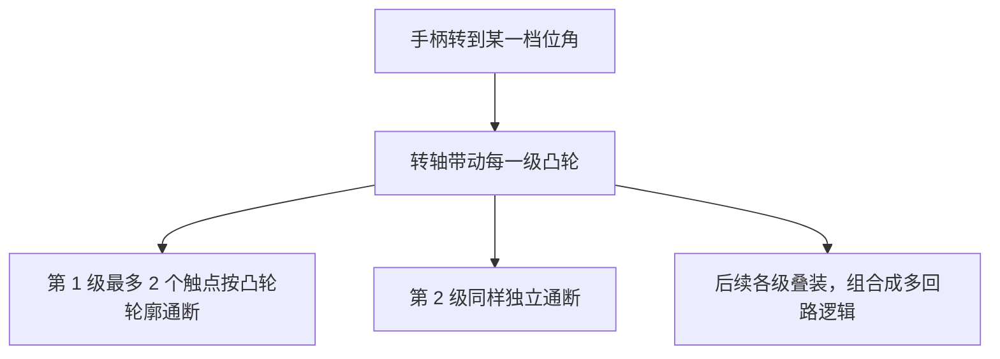

# 旋转凸轮开关：每一级最多两个触点，由凸轮按档位独立通断

> [!summary] 一句话概述
> 旋转凸轮开关用一根操作轴带着多级凸轮，每一级最多布置两个触点，手柄转到某个角度时，该级凸轮决定这两个触点是接通还是断开，从而组合成多回路、多档位的控制逻辑。Kraus & Naimer Catalog 120 把 CG、CH、CHR 系列写到 25 A，档位角为 30°、45°、60° 或 90°，并给出三种接触系统：刚性双断银合金桥、多点交叉触点，以及用于低电压的镀金十字线 H 桥。它不是编码拨盘，也不是只有一对触点的钮子开关。

## 配图

![[附件/cam-kn-p1.png]]
*图源：Kraus & Naimer《Catalog 120》（01/2026）封面，CG、CH、CHR 型，至 25 A*

![[附件/cam-kn-p10.png]]
*图源：同上，开关功能与接线图页之一（双掷等功能示例）*

![[附件/cam-salzer-01.jpg]]
*图源：[德国 Salzer 开关网，P220-61028-A01 产品页](https://www.salzer-cn.com/product/salzer-p220-61028-a01.html) 外观照片，仅作另一家凸轮开关的外形对照*

> 图片版权归原作者所有，仅作个人学习收藏；出处见文末「来源与核实记录」。

## 结构原理

> 本节所有数字只写来源里给出的；来源没有就写「来源未给出」。两家产品不可混用参数。

### 堆叠方案

方向：**从面板手柄到最里一级触点**

| 层级 | 零件 | 材料 | 厚度/尺寸 | 固定方式 | 依据 |
| --- | --- | --- | --- | --- | --- |
| L1 | 手柄与面板安装件 | 来源未给出 | 来源未给出；Salzer 经销页宣传面板开孔 Ø22.5 mm | 面板或底座安装（Catalog 120 分列两种） | Kraus & Naimer；Salzer 经销页 |
| L2 | 转轴 | 来源未给出 | 来源未给出 | 把档位角传到各级凸轮 | 由「凸轮操作的旋转开关」这一产品定义推断为转轴传力，轴径来源未给出 |
| L3 | 级（stage）与凸轮 | 来源未给出 | 每级最多 2 个触点；CG4 最多 8 级，CG6 最多 5/4 级，CG8 / CH 等最多 12 级 | 级是所有开关的基础单元，可叠装 | Kraus & Naimer Construction Data |
| L4 | 触点系统 | 见下表三种 | 来源未给出开距 | 按凸轮轮廓在对应角度接通或断开 | Kraus & Naimer |
| L5 | 端子 | 开口端子，带防触指；CH / CHR 为防松十字槽螺钉；CHR 可接环形端子 | 来源未给出线径范围 | 安装后仍可接线 | Kraus & Naimer |

Kraus & Naimer 三种接触系统（Construction Data）：

| 系列示例 | 接触系统 | 用途说明（原文要点） |
| --- | --- | --- |
| CG6 至 CHR16B | 刚性双断桥，银合金触点 | 常规控制，通断能力较高 |
| CG4 和 CG4-1 | 多点交叉触点 | 提高接触可靠性 |
| CGD4-1、CH11/CHR11、CH12/CHR12 | H 桥「十字线」触点；CH12/CHR12 以外为镀金，CH12/CHR12 为银触点 | 适合低电压、电子电路 |

档位角：CG4–CGD4-1、CG6–CHR6、CG8–CHR16、CG8B、CH10B–CHR16B 均为 30°、45°、60°、90°；CG8S 为 60°。

Salzer 经销页对 P220 系列的宣传（只作对照，不并入上表）：额定电流 ≤20 A（AC-23A）、额定电压 ≤690 V AC、触点最多 24 个、档位最多 12、防护 IP66、机械寿命 ≥100 万次、凸轮片可按 30°、45°、60° 或 90° 设定、强制断开、压铸铝合金壳加硅胶密封圈、触点材质写为银氧化锡（AgSnO₂）。这些数字未在 Kraus & Naimer 手册同一页出现，不能写成 CG 系列的参数。

剖面示意：

### 零件清单

| 零件 | 数量 | 功能 | 材料 | 依据 |
| --- | --- | --- | --- | --- |
| 手柄 / 面板件 | 1 套 | 操作和指示档位 | 来源未给出 | Kraus & Naimer |
| 转轴 | 1 | 传递角度 | 来源未给出 | 结构需要，轴径未给出 |
| 级与凸轮 | 按型号，见表 | 按角度驱动触点 | 来源未给出 | Kraus & Naimer |
| 触点 | 每级最多 2 | 通断各回路 | 银合金、交叉触点或镀金/银 H 桥 | Kraus & Naimer |
| 端子与螺钉 | 与触点对应 | 接线，防触指 | 来源未给出 | Kraus & Naimer，符合 EN 50274 |

### 装配顺序

来源没有给出工厂装配步骤。手册能确认的使用要点：

1. 按回路数选择级数（每级最多 2 个触点）和档位角。
2. 按负载性质选择三种接触系统之一，低电压或电子电路不要只用普通银合金桥想当然。
3. 在面板安装和底座安装中选择，并按手册预留接线空间；端子在安装后仍可接近，且出厂为开口。
4. 功能组态（通断、双掷、多步、电压表/电流表切换、电机开关等）按手册接线图选，不要自行假设凸轮排列。

### 受力与运动分析

- **受力路径**：手指扭矩经手柄到转轴，再传到各级凸轮；凸轮轮廓推动或释放触点桥。Catalog 120 未给出操作扭矩数值，来源未给出。
- **运动关系**：手柄在离散档位角停留，每一级独立编码该档位的通断，所以同一角度下有的回路通、有的回路断，可做星三角、正反转等逻辑。
- **失效风险**：级数不够导致强行用一对触点兼多路；接触系统与电压/负载不匹配（把普通银合金用在干电路上）；接线时破坏防触指结构。Salzer 页提到强制断开和互锁附件，但未给出具体机构尺寸，本文不补充。

## 设计要点与参数

| 要点 | 内容 | 依据 |
| --- | --- | --- |
| 系列范围 | CG、CH、CHR，至 25 A | Catalog 120 封面 |
| 每级触点数 | 最多 2 | Construction Data |
| 最多级数 | CG4–CGD4-1：8；CG6–CHR6：5/4；CG8 及多种 CH：12 | Construction Data |
| 档位角 | 30°、45°、60°、90°（CG8S 仅 60°） | Construction Data |
| 端子 | 开口、防触指（EN 50274、VDE 0660 part 514、DGUV V3） | Construction Data |
| 标准 | IEC 60947-3、EN 60947-3、VDE 0660 part 107、UL 和 cUL（cUR） | Construction Data |
| 额定电流分档 | 手册给出 AC-21A 等 Ie 表，因栏目需对照具体型号，本文不擅自合并列值；上限以封面 25 A 为准 | Catalog 120 |
| 操作扭矩与机械寿命 | Kraus & Naimer 已打开页未读到寿命次数，来源未给出 | — |

## 优缺点

**优点**
- 用叠级和可选档位角组合复杂回路，不必为每种逻辑单独开模具做专用开关
- 三种接触系统分开，能同时覆盖常规电力和低电压电子回路
- 端子防触指、安装后可接线，适合密集盘面

**缺点 / 代价**
- 级数和凸轮组态要按手册选定，设计前期就要把回路表做出来
- 已打开页没有给出操作扭矩和寿命次数，振动场合还要再查技术数据章
- 不同品牌的「最多触点数」算法不同（按级叠加 vs 宣传最多 24 触点），不能直接对拍

## 可借鉴点

- 先画各档位各回路的通断表，再决定级数和档位角，不要先定一个「万能旋钮」。
- 低电压信号回路单独选镀金或十字线接触系统。
- 盘面开孔和底座安装要按所选系列的尺寸章，不要拿另一品牌的 Ø22.5 mm 去套 CG 系列。
- 需要隔离和负载切断时，核对该系列在 IEC 60947-3 下的具体使用类别，不要只看「能转几档」。

## 与库中相似案例对比

| 对比项 | 本案例（旋转凸轮开关） | [[旋转BCD编码开关：编码转子把档位编成4位代码（对照 Nidec SC 与 Omron A6A）]] | [[钮子拨杆开关：手柄过中后压缩弹簧把动触点快速切换到另一侧静触点]] | [[灶具旋钮轴向解锁：先推或拉解除转动约束，阀芯压紧与解锁分工]] |
| --- | --- | --- | --- | --- |
| 输出 | 多级、多回路按档位独立通断 | 4 位编码触点，表示档位号 | 通常一对或几对触点左右切换 | 解锁后再旋转调节 |
| 机构 | 叠级凸轮 + 触点桥 | 编码转子 / 旋转电路板 | 过中弹簧 + 动触点 | 轴向按压解锁 |
| 何时用这篇 | 要在工业盘面上用一个旋钮切多路逻辑 | 要拨一个 BCD 地址或量程 | 只要左右两档的电源切换 | 要防误转的灶具旋钮 |

## 相关案例

- [[旋转BCD编码开关：编码转子把档位编成4位代码（对照 Nidec SC 与 Omron A6A）]]
- [[钮子拨杆开关：手柄过中后压缩弹簧把动触点快速切换到另一侧静触点]]
- 分类索引：[[04-机构与运动 索引]]

## 来源与核实记录

- 主来源：Kraus & Naimer《Catalog 120》，01/2026，Control Switches CG、CH and CHR type up to 25 A（2026-11-27 下载并提取 Construction Data：级、触点系统、档位角、端子和标准。封面与功能页配图来自该 PDF。）
- 交叉来源：[Salzer 旋转凸轮开关 P220-61028-A01 产品页](https://www.salzer-cn.com/product/salzer-p220-61028-a01.html)（2026-11-27 打开。独立第二机构。宣传参数和外观照片仅作对照。页中的电话、微信和地址不写入本篇。）
- 核实：2026-11-27 打开上述来源。未把 AC-21A 分栏数字按错型号引用，未编造 Kraus & Naimer 的机械寿命。
