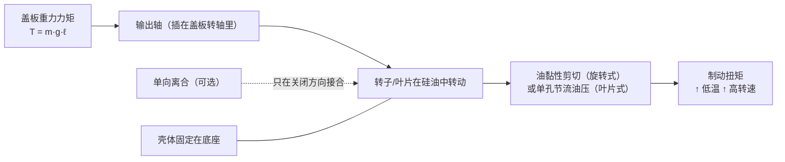

# 旋转阻尼器（缓降盖板）：硅油黏性、水平型与垂直型的扭矩曲线

> [!summary] 一句话概述
> 马桶盖「松手慢慢落下」靠的是一个装在转轴上的小油缸：转子在灌满硅油的壳体里转，油的黏性阻力产生制动扭矩。Bansbach 的结构说明讲清了它的三个特性：**温度越低扭矩越大、转速越快扭矩越大、原则上双向都有扭矩（要单向就加单向离合器）**，目录额定扭矩在 20 rpm 下测得。TOK 的目录给出选型方法：T = m × g × ℓ（例：0.408 kg、重心 0.25 m → 1.0 N·m），并且把限位角阻尼器分成「水平型」（越接近水平扭矩越大，用于马桶盖、垃圾桶盖）和「垂直型」（水平时最大，下垂时变小，用于面包柜、抽油烟机翻板）。

## 配图

![[附件/bansbach-rotary-vs-vane-damper.jpg]]
*图源：[Bansbach《Basic Structure of Rotary Dampers》](https://www.globalspec.com/BansbachEasylift/ref/BasicStructure_RotaryDamper.pdf)；上：旋转阻尼器（O 形圈、盖、硅油、转子、壳体）及温度/转速特性曲线；下：叶片式阻尼器（转轴、盖、叶片、壳体、硅油）*

![[附件/tok-rotary-damper-types.png]]
*图源：[TOK 旋转阻尼器目录](https://rotarydamper-tok-inc.com/wp-content/uploads/2025/07/Catalog_RotaryDampers.pdf) Outline 页；三种类型：水平型（扭矩由低到高）、垂直型（由高到低）、连续旋转型（配齿条做恒速缓降）*

> 图片版权归原作者所有，仅作个人学习收藏；出处见文末「来源与核实记录」。

## 结构原理

> 本节数字只写来源里给出的；来源没有就写「来源未给出」。

### 堆叠方案

方向：**沿阻尼器轴线，从安装底座到输出轴**（以 Bansbach 旋转阻尼器结构图和 TOK TD73 为例）

| 层级 | 零件/区域 | 材料 | 厚度/尺寸 | 固定方式 | 依据 |
| --- | --- | --- | --- | --- | --- |
| L1 | 壳体 Main body（带安装耳或外形卡位） | TD73：POM | TD73 外径 Ø11（-0.2），长 22 ± 0.2 | 螺钉或卡入安装孔 | Bansbach；TOK |
| L2 | 硅油腔 | 硅油 | 转子与壳体间隙、油接触面积决定扭矩；具体间隙来源未给出 | 灌封 | Bansbach |
| L3 | 转子 Rotor（叶片式为 Vane） | TD73：POM | 来源未给出 | 在油中转动 | Bansbach |
| L4 | 盖 Cap + O 形圈 | TD73 盖：POM | 来源未给出 | 封油 | Bansbach |
| L5 | 输出轴（双 D 或扁位） | TD73：POM | 轴扁位 Ø7（-0.2）/ 5（-0.2）；安装孔 Ø7 +0.01~+0.10、5 +0.01~+0.06 | 插入盖板转轴 | TOK |

剖面示意：

### 零件清单

| 零件 | 数量 | 功能 | 材料 | 依据 |
| --- | --- | --- | --- | --- |
| 壳体 | 1 | 储油、固定 | POM（TD73）；其他型号有 PBT、锌合金等 | TOK；Bansbach |
| 转子或叶片 | 1 | 在油中运动产生阻力 | POM（TD73） | Bansbach；TOK |
| 硅油 | — | 黏性阻尼介质 | 硅油 | Bansbach |
| 盖 + O 形圈 | 各 1 | 封油 | POM + 橡胶 | Bansbach |
| 单向离合器 | 0/1 | 只在一个方向产生扭矩 | 来源未给出 | Bansbach |
| 齿轮（连续旋转型） | 0/1 | 与齿条配合做直线缓降；扭矩不够时用齿轮放大 | — | TOK |

### 装配顺序

1. 先算扭矩：T = m × g × ℓ（ℓ 为支点到重心的距离），或 T = F × ℓ（F 为盖板末端的抬升力，ℓ 为支点到末端）。TOK 计算器按水平位置计算，因为那是需要最大扭矩的位置（TOK）。
2. 按运动方式选类型：最终位置水平 → 水平型；最终位置下垂 → 垂直型；不限角度或直线运动 → 连续旋转型 + 齿条（TOK）。
3. 按扭矩、外径、材料、阻尼方向（CW/CCW）选型号；TD73 有 A（CW）/B（CCW）两种，外形对称可双向插入（TOK）。
4. 按目录的安装尺寸开孔和轴孔，装入盖板转轴；TD73 出厂时轴在关闭位置（0°）（TOK）。

### 受力与运动分析

- **旋转式**：靠油的黏性阻力制动；扭矩取决于油黏度、转子与壳体间隙、油接触面积（Bansbach）。
- **叶片式**：利用油压，相当于单孔节流的阻尼缸，转速越高内压越高、扭矩越大（Bansbach）。
- **温度**：油黏度随温度变化，扭矩随环境温度升高而下降（Bansbach 曲线）。B 站软文提到的「冬天缓降失灵、夏天漏油」，指的是转轴阻尼脂低温变硬、高温变稀渗漏（cv53553976）。
- **速度**：转速越快扭矩越大，所以盖板下落是「自调速」的（推断：重力力矩一定时，盖板会落到扭矩与力矩平衡的速度）。
- **角度**：限位角阻尼器的扭矩随角度变化，所以 TOK 不按扭矩值验收，而是用关闭时间治具测试（TD73 测 70° → 0° 的关闭时间）。

## 设计要点与参数

| 要点 | 内容 | 依据 |
| --- | --- | --- |
| 扭矩公式 | T = m × g × ℓ，g = 9.8 m/s²；例：m 0.408 kg、ℓ 0.25 m → 1.0 N·m | TOK |
| 抬升力公式 | T = F × ℓ；例：F 2.0 N、ℓ 0.5 m → 1.0 N·m | TOK |
| 额定测试条件 | Bansbach：20 rpm；TOK TD73：23 ± 2 ℃ | Bansbach；TOK |
| TD73 扭矩档 | A 系列 0.05/0.10/0.20/0.29 N·m（CW）；B 系列 0.08/0.10/0.20/0.29 N·m（CCW） | TOK |
| TD73 其他 | 开启角 110°；重约 3 g；允许径向载荷 29.4 N；寿命 10 万次；一般公差 ±0.3；TOK 称其为最小的水平型（Ø11 mm） | TOK |
| 寿命差异 | 同目录 TD60 为 5 万次，TD27/28 为 10 万次 | TOK |
| 扭矩范围 | TOK 选型按 0.002 N·m 到 5 N·m 以上分档；外径 6 mm 到 40 mm 以上 | TOK 选型页 |
| 软文提到的温度窗口 | 阻尼脂工作温度 -15 ~ +200 ℃，卫浴实际 -10 ~ 80 ℃（厂商宣传值） | cv53553976 |

## 优缺点

**优点**
- 零件小（TD73 约 3 g），直接插在转轴里，不占外部空间
- 速度自适应：越快阻力越大
- 免维护、寿命 5–10 万次（TOK 型号）

**缺点 / 代价**
- 扭矩随温度变化，低温偏硬、高温偏软
- 限位角型扭矩不恒定，只能按关闭时间验收
- 单个阻尼器扭矩有限，重盖要多个并联或用齿轮放大（TOK）

## 可借鉴点

- **先判断最终位置是水平还是下垂**，再选水平型或垂直型，避免全程扭矩错配
- **按最不利位置（水平）算扭矩**
- **验收按关闭时间写**：例如「70° → 0° 关闭时间 X 秒 @23 ℃」
- **低温环境（北方卫浴、车内）单独做低温关闭时间测试**
- 与 [[恒扭力摩擦铰链：卡簧过盈产生扭力与「最低扭力 > 盖板力矩」选型]] 区别：摩擦铰链让盖子停住，阻尼器让盖子慢慢落下

## 与库中相似案例对比

| 对比项 | 本案例 | [[恒扭力摩擦铰链：卡簧过盈产生扭力与「最低扭力 > 盖板力矩」选型]] | [[防变形静音 Push-Push 按压弹跳锁（ITW 专利 EP1596030）]] |
| --- | --- | --- | --- |
| 阻力来源 | 硅油黏性（与速度相关） | 卡簧干摩擦（与速度基本无关） | 弹簧 + 凸轮轨迹 |
| 能否停在任意角度 | 不能（会慢慢落下） | 能 | 只有两个位置 |
| 温度敏感 | 高 | 中（-20 ~ 80 ℃ 指定） | 低 |
| 扭矩公式 | T = m·g·ℓ | T = W·d，比公差下限 | — |

## 相关案例

- [[恒扭力摩擦铰链：卡簧过盈产生扭力与「最低扭力 > 盖板力矩」选型]]
- [[防变形静音 Push-Push 按压弹跳锁（ITW 专利 EP1596030）]]
- [[DualSense 自适应扳机：电机+蜗杆的力反馈机构]]
- 分类索引：[[04-机构与运动 索引]]

## 来源与核实记录

- 主来源：[TOK Rotary Dampers Catalog](https://rotarydamper-tok-inc.com/wp-content/uploads/2025/07/Catalog_RotaryDampers.pdf)（TOK, Inc.，2025-07 PDF，39 页；引用 Outline、扭矩估算、TD73/TD60/TD27/28 规格页）
- 补充来源 1：[Basic Structure of Rotary Dampers](https://www.globalspec.com/BansbachEasylift/ref/BasicStructure_RotaryDamper.pdf)（Bansbach easylift，GlobalSpec 托管 PDF）
- 补充来源 2：[What is a Rotary Damper?](https://rotarydamper-tok-inc.com/mechanism/)（TOK 原理页：限位角型与连续旋转型分类、应用场景）
- 补充来源 3：[马桶盖缓降油脂低温失效、高温漏油？](https://www.bilibili.com/read/cv53553976)（B 站专栏，广东新宝星润滑科技，2026-10-22；润滑脂软文，只引用故障现象和其宣传温度窗口）
- 核实：2026-11-13 下载两个 PDF 并打开网页核对。TD73 的安装孔公差从目录尺寸图文本中读出，具体以 TOK 原图为准。
