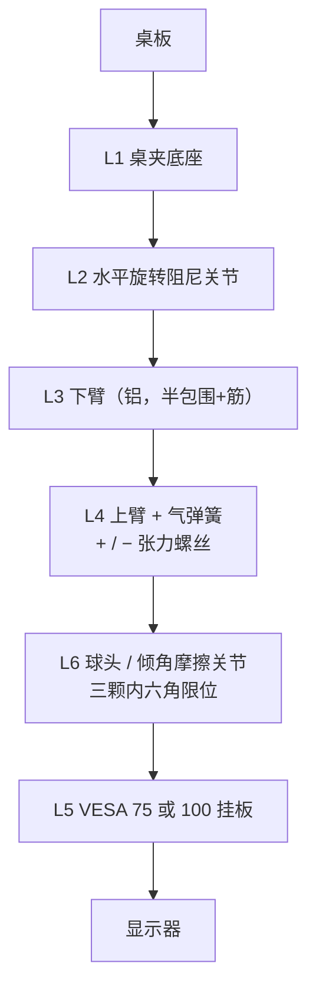

# 显示器气弹簧支架：张力螺丝与悬停平衡

> [!summary] 一句话概述
> 桌面显示器气弹簧支架用上臂里的气弹簧去抵消屏幕重量：拧臂上的「+ / −」张力螺丝，把气弹簧的推力调到和屏幕重力平衡，屏幕就能在行程里随手悬停。本篇只写整臂的堆叠——桌夹或穿孔底座、下臂、上臂气弹簧、VESA 头和倾角摩擦关节——不剖开气缸。气弹簧手感更线性、更顺，但密封件会慢慢漏力；和机械/恒力弹簧的取舍见 [[Ergotron CF 恒力螺旋弹簧支架（对比气弹簧）]]。

## 配图

![[附件/monitor-arm-nb-f00a-gas-spring.jpg]]
*图源：[中关村在线《必买：这四款显示器支架，可以闭眼买》](https://news.zol.com.cn/780/7809517.html) 配图，NB F00A 气弹簧支架；可见桌夹底座、下臂、上臂（气弹簧藏在上臂里）和 VESA 头部。ZOL 写该型号承重 2–12 kg，自称带 G*S Hover 悬停。*

![[附件/loctek-d6-mechanical-spring-arm.jpg]]
*图源：同上，乐歌 D6（机械弹簧，作对照）；外形同样是「底座—下臂—上臂—VESA 头」，但上臂用机械弹簧而不是气弹簧。ZOL 写承重 2–9 kg、自重 3.67 kg。*

![[附件/brateck-ldt23-vesa-arm.jpg]]
*图源：同上，北弧 LDT23 气弹簧支架，展示桌夹夹住桌板、上臂气弹簧段和头部挂屏。ZOL 写承重 1–15 kg；图中「15KG」为该文配图标注。*

> 图片版权归原作者所有，仅作个人学习收藏；出处见文末「来源与核实记录」。

## 结构原理

> 本节所有数字只写来源里给出的；来源没有就写「来源未给出」。气弹簧缸内的活塞、密封圈和充气压力，本篇不展开（另一篇写元件内部）。

### 堆叠方案

方向：**从桌面安装点到显示器背面（以极果对乐歌 D7A 的拆装/体验为准）**

| 层级 | 零件 | 材料 | 厚度/尺寸 | 固定方式 | 依据 |
| --- | --- | --- | --- | --- | --- |
| L1（桌面） | 夹钳式底座（也可换成穿孔，来源未展开穿孔件细节） | 来源未给出；底座前有 Audio / MIC / USB 开孔（D7A） | 外露底座「仅仅比扑克牌的盒子略宽一些」（极果，非精确尺寸） | 夹钳夹紧桌板 | 极果 D7A 评测「支架固定」 |
| L2 | 立柱 / 下臂旋转关节 | 来源未给出 | 来源未给出 | 「两块不同尺寸阻尼结构的组合」做横向旋转 | 极果「横向旋转系统」 |
| L3 | 下臂（铝臂） | 航空级铝材；截面三面半包围、内有加强筋 | 来源未给出截面尺寸 | 与上臂铰接 | 极果「铝臂结构细节」 |
| L4 | 上臂 + 内置气弹簧 + 张力调节螺丝 | 铝臂 + 气弹簧组件 | 来源未给出气缸直径或行程 | 用随附大号六角扳手按臂上「+ / −」指示拧张力螺丝 | 极果「气弹簧悬停」 |
| L5 | VESA 挂板（X 型，上方两孔为 U 型槽） | 来源未给出 | 适配显示器 75×75 或 100×100 mm 孔距（ZOL 提醒要先确认） | 四颗螺丝把挂板拧到屏幕背面，再挂到头部 | 极果「显示器固定」；ZOL；Ergotron VESA 说明 |
| L6（最外） | 头部万向关节（倾角 / 旋转） | 来源未给出 | 来源未给出 | 「关节球的仿生设计，配合三颗内六角螺丝进行限位」；拧紧或放松六角螺丝可调屏幕松紧 | 极果「自由角度」 |

剖面示意：

### 零件清单

| 零件 | 数量 | 功能 | 材料 | 依据 |
| --- | --- | --- | --- | --- |
| 桌夹底座 | 1 | 把整臂固定到桌边，不打孔 | 来源未给出 | 极果 |
| 下臂、上臂 | 各 1 | 形成「之字形」伸展，上臂藏气弹簧 | 铝；走线槽用黑色塑料盖 | 极果 |
| 气弹簧组件 | 1（在上臂内） | 提供与屏幕重力平衡的推力 | 来源未给出内部介质 | 极果 |
| 张力调节螺丝 | 1 | 加大或减小气弹簧张力，匹配不同重量的屏幕 | 来源未给出 | 极果：随附大号六角扳手 |
| VESA X 型挂板 | 1 | 连接 75 或 100 孔距屏幕；上方两孔做成 U 槽，方便对孔 | 来源未给出 | 极果 |
| 头部三颗内六角螺丝 | 3 | 限制并调节屏幕倾角/旋转的松紧 | 来源未给出 | 极果 |
| 走线塑料盖 | 若干 | 卡扣扣进铝臂，把电源线和视频线藏进臂内 | 黑色塑料 | 极果 |
| 随附螺丝与垫片 | 三套不同规格螺丝、八个垫片、两个八角扳手（D7A） | 适配不同 VESA 孔和桌夹 | 来源未给出规格型号 | 极果「工具」 |

### 装配顺序

> 按极果 D7A 体验文的安装叙述整理，不是工厂装配工艺。

1. 用夹钳把底座夹到桌边（极果称这是最简单的固定方式：结实、不伤桌面、可换位置）。
2. 确认屏幕背面有 VESA 四孔，把 X 型挂板先拧到屏幕上。上方两个 U 形槽用来微调孔距、方便挂入。
3. 把屏幕挂到支架头部。
4. 用大号六角扳手拧上臂的张力螺丝：按臂上的「+ / −」指示，把气弹簧张力调到与显示器重力相对平衡，屏幕即可自由悬停。
5. 再调头部三颗内六角螺丝，找到「能转动、又能停住」的松紧。
6. 电源线和视频线卡进铝臂里的黑色塑料盖。若使用底座上的 USB / 音频口，需先把支架自带线插到电脑对应接口（音频和 USB 线长 1.5 米，极果写出）。

### 受力与运动分析

- **受力路径**：屏幕重力经 VESA 挂板到头部关节，再传到上臂；上臂内气弹簧的推力（方向沿臂、随张力螺丝改变）用来平衡这段重力矩。平衡后，人手只要克服关节摩擦和少许不平衡力，就能把屏幕停在行程中的任意高度。极果原话：当显示器重力与气弹簧的力达到相对平衡时，即可实现自由悬停。
- **运动关系**：底座水平旋转（阻尼结构）；下臂/上臂在竖直平面内收展；头部可倾转和旋转到竖屏（极果写 360° 屏幕旋转，万向节可在横向和纵向之间切换）。悬臂可调高度，极果写 D7A 为 520 mm，方便站立办公。
- **失效风险**：ZOL 写气弹簧「使用寿命有限」；Work While Walking 等对比文把原因说成缸体泄漏、年年掉力（详见对照篇）。张力没调对时：太松则自动下垂，太紧则自动上升（调节逻辑见极果的 +/− 说明）。夹钳对桌板厚度和桌沿强度有要求，来源未给出桌板厚度范围。

## 设计要点与参数

| 要点 | 内容 | 依据 |
| --- | --- | --- |
| D7A 适配尺寸 / 承重 | 17–27 英寸；2–9 kg；支架自重 2.8 kg | 极果 D7A 评测正文（文中另有「详细参数如下图」，图内数字未能在本批文本抓取中完整转出，不补写） |
| D7A 高度调节 | 悬臂可调高度 520 mm | 极果 |
| 张力调节 | 大号六角扳手，按臂上 +/− 指示拧张力螺丝，使气弹簧张力与屏幕重力平衡 | 极果 |
| 头部限位 | 三颗内六角螺丝限位；拧紧或放松可调屏幕转动松紧 | 极果 |
| VESA | 先确认屏幕是 75×75 或 100×100 国际标准孔；MIS-D 常用 M4×10 mm，重量上限 14 kg（VESA 给制造商的指南，个别机型可能偏离） | ZOL；Ergotron *VESA Mounting Guide* |
| ZOL 对气弹簧的概括 | 「伸缩力度近乎线性的弹性曲线，推拉起来轻松且准确，但相应地使用寿命有限」 | ZOL 2021-11-17 |
| 横评其它气弹簧例子 | NB F00A：22–35 英寸、2–12 kg、自重 5 kg；北弧 LDT23：17–40 英寸、1–15 kg、自重 5.35 kg | ZOL |
| 气缸内压、活塞直径、泄漏率 | 来源未给出 | — |

## 优缺点

**优点**
- 调好张力后可以单手移动、随停，适合频繁改坐姿或站立办公
- 桌夹几乎不占桌面（极果：比传统底座至少少占三分之二面积，原话为观感比较，不是精确测量）
- 头部关节可竖屏，VESA 上沿做成 U 槽，对孔省事

**缺点 / 代价**
- 气弹簧寿命有限，力会随时间下降（ZOL；对照篇有更细的泄漏讨论）
- 每换一台不同重量的屏幕都要重新拧张力螺丝
- 单屏支架站立使用时，键盘鼠标仍在桌面，高低差要另想办法（极果自己写的不足）

## 可借鉴点

- **悬停的本质是「弹簧力 = 屏幕重力矩 / 力臂」，用一颗可调螺丝覆盖一个重量区间**，而不是为每个重量单独做一种臂。出厂预紧只覆盖典型重量，说明书必须写清：自动上漂拧 −（放松）、自动下垂拧 +（加紧）——极果写的是按臂上 +/− 指示调节。
- **把「承重平衡」和「关节松紧」分成两颗（组）螺丝**：上臂张力螺丝管升降悬停，头部三颗内六角管倾角/旋转阻尼。不要用同一颗螺丝同时当平衡和当摩擦。
- **VESA 挂板上沿做 U 形槽**：先挂后拧，安装时不必把屏幕举着对四个盲孔。
- **铝臂截面用半包围 + 内筋**：极果认为这样能在承重足够时减轻重量，并顺带把走线藏进槽里。
- 选孔距和螺丝规格时查 [[VESA MIS-D 75-100 接口与倾角摩擦关节]]，不要只看屏幕英寸数。

## 与库中相似案例对比

| 对比项 | 本案例（气弹簧整臂） | [[Ergotron CF 恒力螺旋弹簧支架（对比气弹簧）]] | [[恒扭力摩擦铰链：卡簧过盈产生扭力与「最低扭力 > 盖板力矩」选型]] |
| --- | --- | --- | --- |
| 用来平衡重力的元件 | 上臂内气弹簧 + 张力螺丝 | 恒力卷簧，拧螺丝改容量 | 不负责「举起」，只负责「停住」 |
| 手感 | ZOL：近乎线性、轻松准确 | 厂商称全程均匀力；可能有机械噪声 | 摩擦随停，无升降 |
| 寿命 | 密封件会漏，力逐年下降 | 厂商称比气弹簧更耐久、可再调 | 按扭转寿命（如 3 万次）计 |
| 本篇范围 | 整臂堆叠与调节，不剖气缸 | 与气弹簧的取舍 | 元件级铰链 |

## 相关案例

- [[Ergotron CF 恒力螺旋弹簧支架（对比气弹簧）]]
- [[VESA MIS-D 75-100 接口与倾角摩擦关节]]
- [[恒扭力摩擦铰链：卡簧过盈产生扭力与「最低扭力 > 盖板力矩」选型]]
- [[旋转阻尼器（缓降盖板）：硅油黏性、水平型与垂直型的扭矩曲线]]
- 分类索引：[[04-机构与运动 索引]]

## 来源与核实记录

- 主来源：[乐歌（Loctek）D7A显示器支架｜伸缩自如电脑支架……](http://www.jiguo.com/article/article/38193.html)（极果，作者「度天年」，2017-04-10）——D7A 2–9 kg、自重 2.8 kg、17–27 英寸、张力螺丝、520 mm 高度、头部三颗内六角、X 型 U 槽挂板、桌夹、铝臂截面
- 补充来源 1：[必买：这四款显示器支架，可以闭眼买](https://news.zol.com.cn/780/7809517.html)（中关村在线，肖瘦人，2021-11-17）——气弹簧 vs 机械弹簧的概括，以及 NB F00A / 乐歌 D6 / 北弧 LDT23 / 爱格升 45-241-026 的参数
- 补充来源 2：[VESA Mounting Guide for Monitors](https://www.ergotron.com/en-us/support/vesa-standard)（Ergotron）——MIS-D 75×75 或 100×100 mm、M4×10 mm、≤14 kg
- 核实：2026-11-15 用 WebFetch 打开极果与 ZOL 原文、Ergotron VESA 页。乐歌官网 `51loctek.com/news/297` 与产品页本批请求失败（500 / 无法连接），不引用未打开页面上的扳手尺寸等数字。气弹簧内部结构留给另一篇元件文，本篇不剖缸。
