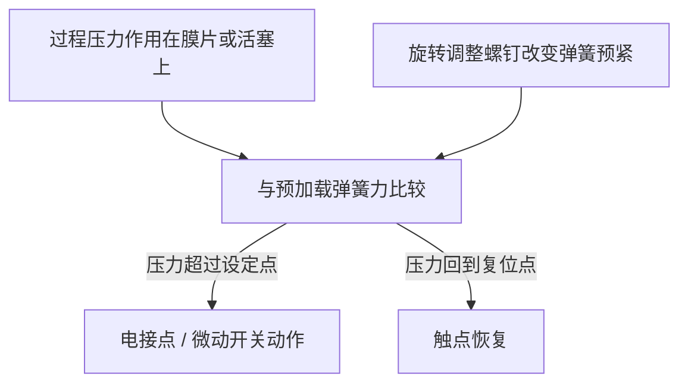

# 机械式膜片与活塞压力开关：预紧弹簧设定动作点并触发微动开关

> [!summary] 一句话概述
> 机械式压力开关不靠电子采样，而是让过程压力作用在膜片或活塞上，去克服一颗预紧弹簧；弹簧力由调整螺钉设定，测量元件的位移再触发电接点（常见为微动开关）。WIKA 介绍的紧凑型 PSM01 / PSM02（可调迟滞）带快插端子时高度为 50 mm，扳手宽度 24 和 27；膜片式版本最大可开关至 1.6 MPa，活塞式开关范围高达 32 MPa，过载安全限值可到膜片式 6 MPa、活塞式 35 MPa。它不是电子压力传感器加比较器，也不是把压力直接接到大电流主触头上。

## 配图

![[附件/pressure-wika-diagram.jpg]]
*图源：[WIKA 博客，Dave，《机械式压力开关如何工作？》](https://blog.wika.com.cn/know-how-zh-cn/how-does-a-mechanical-pressure-switch-work-2/) 结构示意图：电气连接、调整螺钉、预加载弹簧、电接点、测量元件和过程连接*

![[附件/pressure-wika-hero.jpg]]
*图源：同上，紧凑型机械式压力开关外观照片*

![[附件/pressure-dungs-p5.png]]
*图源：[Dungs，《Pressure switches for gas and air》手册，Edition 2026.11，No. 306783_EN](https://en.dungs.com/media/download/pdf?file=306783) 功能说明页：调节弹簧、微动开关、膜片和压力接口；示例设定范围 250–5,000 Pa。该页迟滞示意为图，本文不从插图估读具体迟滞数值*

> 图片版权归原作者所有，仅作个人学习收藏；出处见文末「来源与核实记录」。

## 结构原理

> 本节所有数字只写来源里给出的；来源没有就写「来源未给出」。WIKA 与 Dungs 是两家独立制造商，量程和接口不可混用。

### 堆叠方案

方向：**从过程接口到电气接线**

| 层级 | 零件 | 材料 | 厚度/尺寸 | 固定方式 | 依据 |
| --- | --- | --- | --- | --- | --- |
| L1 | 过程连接 | 来源未给出材质 | 来源未给出螺纹规格 | 接到被测管路 | WIKA 博客（零件 6） |
| L2 | 测量元件 | 低压用膜片（面积较大），高压用活塞（面积较小） | 来源未给出直径和料厚 | 感受过程压力并产生位移 | WIKA 博客 |
| L3 | 预加载弹簧 | 来源未给出牌号 | 弹簧几何按所需开关范围设计（WIKA） | 一端由调整螺钉压缩 | WIKA 博客；Dungs 亦列出 Adjusting spring |
| L4 | 电接点 / 微动开关 | 来源未给出触点材料 | 来源未给出行程 | 测量元件克服弹簧后触发 | WIKA 博客称电接点；Dungs 明确为 Microswitch |
| L5 | 电气连接 | 快插端子版本见 WIKA | 紧凑型带快插端子时高度 50 mm；扳手宽度 24 和 27 | 引出控制回路 | WIKA 博客 |

剖面示意：

WIKA 写明：螺钉旋入越深，测量元件必须克服的弹簧力越大，开关点相应提高；开关点对应压力升高时的动作值，压力降低时对应复位值。PSM02 可调迟滞，具体迟滞范围该博客未给出数字。开关点设置范围必须小于过载安全限值，以便吸收压力峰值，例如泵的空载运行保护。

Dungs 手册补充：该类压力开关无需辅助能源（works without auxiliary energy），结构上同样是调节弹簧 + 微动开关 + 膜片 + 压力接口 P+。功能说明页以「压力升高时调整、设定范围 250–5,000 Pa」作为迟滞示意图的示例，本文只引用这个示例范围，不把该页插图里未读出的迟滞宽度写成参数。

WIKA 使用说明书 NI-221E（MW / MA 系列膜片压力开关，与 PSM 不是同一产品）写到：作用在敏感元件（膜片）上的压力决定弹性变形，用于致动一只或两只按设定值调节的电动微动开关；微动开关为快速释放型，具有自动重启功能；死区可以是固定或可调。带传感元件 H 或 G 的型号是活塞式隔膜仪表，压力作用在活塞上再传到膜片。该手册只用来印证「膜片变形 → 微动开关」这一原理，不把 MW 系列的 1.8 kg / 3.2 kg 和质量尺寸写进 PSM 的参数表。

### 零件清单

| 零件 | 数量 | 功能 | 材料 | 依据 |
| --- | --- | --- | --- | --- |
| 过程连接 | 1 | 接入被测介质 | 来源未给出 | WIKA 博客 |
| 膜片或活塞 | 1 | 把压力变成位移 | 来源未给出牌号 | WIKA 博客；Dungs：Membrane |
| 预加载弹簧 | 1 | 设定动作点 | 来源未给出 | WIKA；Dungs |
| 调整螺钉 | 1 | 改变弹簧预紧 | 来源未给出 | WIKA 博客 |
| 电接点或微动开关 | 1（WIKA 示意图）；Dungs 为 Microswitch | 输出通断 | 来源未给出 | WIKA；Dungs |
| 电气连接 | 1 组 | 引出信号 | 快插端子为可选结构 | WIKA 博客 |

### 装配顺序

来源没有给出工厂装配步骤。使用与设定要点（WIKA 博客）：

1. 先确认系统可能出现的最大压力，再选膜片式或活塞式，以及对应的过载限值。
2. 用调整螺钉设定开关点；需要可调迟滞时选 PSM02 这一类，不要在不可调迟滞的产品上强行改弹簧。
3. 开关点必须落在设置范围内，并低于过载安全限值，以便吸收压力峰值。
4. 膜片式量程较小是为了用较灵敏的测量元件保证重复性；若把开关值和超压范围做得更大，就要用更强的膜片，重复性会下降（WIKA 原文，未给出量化指标）。

### 受力与运动分析

- **受力路径**：过程压力 × 测量面积 → 与弹簧力平衡 → 超过设定点后推动电接点。低压用大面积膜片，高压用小面积活塞，避免高压把薄膜顶坏，也避免低压时活塞力太小推不动弹簧。
- **运动关系**：压力升高到开关点动作，降到复位值返回；两者之差即死区/迟滞。Dungs 用图表示迟滞，WIKA 把可调迟滞做成 PSM02，具体毫米或帕斯卡差来源未在已打开的文字中给出，故不编造。
- **失效风险**：选错量程或忽视过载限值，压力峰值会损坏测量元件。膜片做得过「硬」会牺牲重复性。调整螺钉松动则开关点漂移。管路安装密封失败不属于开关内部机构，但会使测量元件受不到真实压力。

## 设计要点与参数

以下数字只来自已打开的 WIKA 博客，适用于文中的紧凑型 PSM01 / PSM02，不适用于 Dungs 或其他系列。

| 要点 | 内容 | 依据 |
| --- | --- | --- |
| 工作原理 | 预加载弹簧 + 膜片或活塞测量元件 | WIKA 博客 |
| 外形 | 带快插端子版本高度 50 mm；扳手宽度 24 和 27 | WIKA 博客 |
| 迟滞 | PSM01 未写可调；PSM02 可调迟滞，数值来源未给出 | WIKA 博客 |
| 膜片式最大开关压力 | 1.6 MPa | WIKA 博客 |
| 活塞式开关范围 | 高达 32 MPa | WIKA 博客 |
| 过载安全限值（可选） | 膜片式 6 MPa，活塞式 35 MPa | WIKA 博客 |
| 电气额定与寿命 | 该博客未给出，来源未给出 | WIKA 博客 |
| Dungs 示例设定范围 | 250–5,000 Pa（压力升高时调整的示例，不是 PSM 的量程） | Dungs 手册 |

## 优缺点

**优点**
- 不需要辅助电源就能监视压力并输出开关量，结构直观，适合泵和压缩机的压力保护
- 用螺钉设定开关点，膜片和活塞按压力高低分档，过载限值高于设定范围，能吸收峰值
- 紧凑型高度只有 50 mm（快插版本），方便装进移动机械

**缺点 / 代价**
- 膜片式量程小，做大了要牺牲重复性；活塞式适合高压，不适合做很低的压力
- 已打开的紧凑型介绍没有给出电气寿命、防护等级和接口螺纹，选型还要再查对应规格书
- 两家制造商的量程体系完全不同，不能拿 Dungs 的帕斯卡示例去套 WIKA 的兆帕产品

## 可借鉴点

- 先按最大系统压力选测量元件类型和过载限值，再设定开关点，不要只看动作压力。
- 把「开关范围」和「过载安全限值」分成两个数写在零件图上。
- 需要可调迟滞时选对应型号，不要在固定迟滞产品上靠拧螺钉同时改动作点和回差。
- 对标或替代时只对比同一类测量元件，不要用膜片式的 1.6 MPa 去比较活塞式的 32 MPa。

## 与库中相似案例对比

| 对比项 | 本案例（膜片/活塞压力开关） | [[KSD301 突跳式温控器：蝶形双金属片到位后瞬间切换触点]] | [[磁浮子液位开关：浮子内磁铁与管内簧管磁耦合]] | [[工业限位开关：在微动开关外面加防护壳和滚轮杠杆等致动器]] |
| --- | --- | --- | --- | --- |
| 触发量 | 过程压力克服设定弹簧 | 温度使蝶形双金属片翻转 | 液位带动磁铁接近干簧管 | 外部机械位移经杠杆传到微动 |
| 执行件 | 膜片或活塞 + 电接点/微动 | 碟片直接带动触点 | 簧管触点 | 微动开关在防护壳内 |
| 何时用这篇 | 要为管路或泵做机械式压力设定 | 要做定温保护 | 要做液位开关 | 要做位置限位而不是压力 |

## 相关案例

- [[KSD301 突跳式温控器：蝶形双金属片到位后瞬间切换触点]]
- [[工业限位开关：在微动开关外面加防护壳和滚轮杠杆等致动器]]
- 分类索引：[[04-机构与运动 索引]]

## 来源与核实记录

- 主来源：[WIKA 博客，Dave，《机械式压力开关如何工作？》](https://blog.wika.com.cn/know-how-zh-cn/how-does-a-mechanical-pressure-switch-work-2/)（2026-11-27 打开。结构六件套、50 mm 高度、扳手宽度、膜片/活塞分档、1.6 / 32 / 6 / 35 MPa 均来自该中文页。）
- 交叉来源：[Dungs，《Pressure switches for gas and air》，Edition 2026.11，No. 306783_EN](https://en.dungs.com/media/download/pdf?file=306783)（2026-11-27 下载并提取。独立第二机构。零件名称、无辅助能源、示例设定范围 250–5,000 Pa 来自功能说明页。不从带图的迟滞示意中估读数值。）
- 同机构补充：WIKA 使用说明书 NI-221E（MW / MA 系列）确认膜片变形致动快速释放微动开关、死区可固定或可调，以及 H / G 为活塞式隔膜。不作为第二机构，也不把该系列重量写入 PSM 参数表。
- 核实：2026-11-27 打开上述来源。未编造接口螺纹、电气寿命和迟滞宽度。
