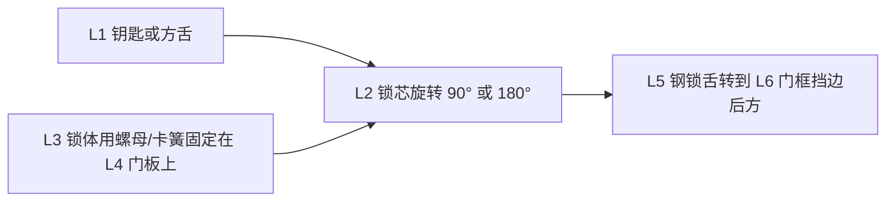

# 柜用凸轮转舌锁：钥匙带动锁舌转过门框挡边（不是板式偏心轮）

> [!summary] 一句话概述
> 柜用凸轮转舌锁（cam lock）的锁芯穿过门板，钥匙或方舌带动背面那一片金属锁舌，旋转约 90° 或 180° 后转到门框或锁扣板后面，形成挡边；反转则离开挡边，门就可以开。它不是家具里把两块板拉紧的偏心轮连接件（预埋螺杆 + 偏心轮），也不是带轴向压缩行程的压缩式门锁：本篇的锁舌主要是转过去挡住，目录若没有写出轴向压缩量，就不能当成压缩锁用。

## 配图

![[附件/omr-cam-lock-components.jpg]]
*图源：[OMR Serrature 凸轮锁技术指南](https://www.omrserrature.it/en/cam-locks-technical-guide-for-those-who-integrate-them-into-their-products/)；从左到右分解了钥匙、锁芯（转子）、锁体（定子）、卡簧、金属锁舌和固定螺钉。配图还示意了 90° 旋转。图上的螺纹和外形标注属于该示意图，不把它们抄成所有转舌锁的通用规格*

![[附件/emka-cam-lock-series-overview.jpg]]
*图源：[EMKA 2025 中文总目录](https://www.emka.com/fileadmin/catalog/catalog_downloads/pdf/zh/___________________CN_06-_2025_Web.pdf) 页码 1-100 转舌锁总览；按 1022 / 1012 / 1000 / 1500 分出小型到卡式系列，并列出开孔形式、IP 等级、锁头直径与锁体长度 GH 等选项。注意同一总览里也列入了「压紧锁」，那是另有轴向压缩的品种，见压缩式门锁篇*

![[附件/fornd-cam-lock-behind-frame.jpg]]
*图源：[弗朗德：凸轮锁详解](https://fornd.com/zh_CN/blog/article/cam-locks-explained-uses-applications-and-how-they-work)（2025-09-03）；示意锁舌已经转到门框挡边后方。该文标题译成「凸轮压缩锁」，但正文讲的是旋转凸轮挡住门框，并没有给出可量化的轴向压缩行程，本篇按普通转舌锁采用，不把它当作压缩锁参数来源*

> 图片版权归原作者所有，仅作个人学习收藏；出处见文末「来源与核实记录」。

## 结构原理

> 本节所有数字只写来源里给出的；来源没有就写「来源未给出」。

### 先和家具偏心轮连接件分开

家具板式柜常用的偏心轮连接件（如预埋螺杆 + 偏心轮），是把偏心轮转过一定角度来拉紧另一块板里的螺杆，目的是把两块木板或零件拉到一起，锁在板内，不是门锁。本篇的凸轮转舌锁装在门或抽屉面板上，锁舌在门背面旋转，挡住的是门框或锁扣板，打开后门扇仍是完整的一扇门。两者都有一个叫「凸轮/偏心」的零件，但一个是板式连接件，一个是门锁转舌。

也要和压缩式门锁区分：EMKA 把「压紧锁」列在转舌锁大类旁边，但压紧锁会在转舌进框后再轴向移动（1022 为 6 mm）。本篇只写没有这段压缩行程的普通转舌锁。

### 堆叠方案

方向：**从面板外侧的钥匙孔，穿过门板，到内侧的锁舌和门框挡边**

| 层级 | 零件 | 材料 | 厚度/尺寸 | 固定方式 | 依据 |
| --- | --- | --- | --- | --- | --- |
| L1（最外） | 钥匙、工具方舌或旋钮 | OMR：标准钥匙为镀镍黄铜 | 来源未给出通用钥匙牙型尺寸 | 插入锁芯后转动 90° 或 180° | OMR「Barrel」与「operating principle」；弗朗德 |
| L2 | 锁芯（转子 / barrel） | OMR 标准为 Zamak，中档可用不锈钢护套并加防尘盖 | 内含叶片或弹子，只有正确钥匙才能转 | 在锁体内转动，并带动锁舌 | OMR 三要素之 1 |
| L3 | 锁体（定子 / stator） | OMR 标准为 Zamak（锌铝镁铜）。EMKA 1022 可选 PA、锌合金或不锈钢 | EMKA 1022 小型：锁头直径 20 / 22 mm，锁头高度 3 mm，锁体长度 GH = 13.5 mm。1012 中型：直径 22 mm，头高 4 mm，GH = 20 mm。1000 大型：直径 28 / 30 / 32 等，GH = 18–60 mm | 穿过门板，用螺母、卡簧（弹簧固定）、快装卡式、螺钉或焊接固定 | OMR「Types of fasteners」；EMKA 1-100 总览 |
| L4 | 门板 | 应用自定（金属柜、木柜、薄板箱盖等） | 必须落在所选 GH 允许的面板厚度范围内（具体上限以来源对应型号页为准，总览页未给出每一型号的最大板厚） | 被锁体夹紧 | 弗朗德安装步骤；EMKA GH 列 |
| L5 | 锁舌（凸轮 / cam） | OMR 明确写成钢，因为要承受弯曲和冲击，不宜长期用锌合金 | 直臂、弯臂或钩形等，由所选锁舌决定。旋转 90° 或 180° 后转到框后 | 用螺钉或方孔套在锁芯尾部，随锁芯一起转 | OMR「Cam」；弗朗德「金属臂或凸轮」 |
| L6 | 门框或锁扣板 | 应用自定 | 来源未给出通用挡边高度 | 锁舌转到其后方形成机械挡 | 弗朗德；OMR |

剖面示意：

### 零件清单

| 零件 | 数量 | 功能 | 材料 | 依据 |
| --- | --- | --- | --- | --- |
| 钥匙或操作工具 | 1 把或按钥匙系统 | 对齐全内部件，允许锁芯转动 | 镀镍黄铜（OMR 标准） | OMR |
| 锁芯 | 1 | 带动锁舌，并提供钥匙区别 | Zamak，或带不锈钢护套 | OMR |
| 锁体 | 1 | 穿门固定 | Zamak / PA / 锌合金 / 不锈钢 | OMR；EMKA |
| 固定件 | 1 | 螺母、卡簧、马蹄卡或螺钉 | 按安装方式 | OMR |
| 锁舌 | 1 | 转到框后挡住门 | 钢（OMR）；EMKA 可选钢、不锈钢或 PA | OMR；EMKA 总览 |
| 防尘盖等 | 可选 | 挡住钥匙孔灰尘或水溅 | 来源未给出 | OMR 中档配置；EMKA 总览有防尘盖 |

### 装配顺序

按弗朗德列出的四步，并用 OMR、EMKA 的固定方式补充（不是某一型号的工艺卡）：

1. 在门板上按所选系列开孔。EMKA 总览按系列给出不同的异形孔（1022 小型、1012 中型、1000 大型、1500 卡式），不能拿一种双 D 孔打遍所有系列。
2. 把锁体从面板前部穿过（弗朗德第 1 步），在背面用安装螺母或其他固定件锁紧（第 2 步）。OMR 补充：薄板常用卡簧，较厚板用螺母或马蹄卡，也可用螺钉。
3. 按开门方向把锁舌装到正确方位（第 3 步）。锁舌的直、弯、钩以及长度，要让转到关闭位置时确实落到框后，转到打开位置时完全让开。
4. 试转 90° 或 180°，确认钥匙能抽出的位置、锁舌不会刮框，门能关能开（第 4 步）。

### 受力与运动分析

- **受力路径**：试图拉开门时，门框挡边压在锁舌上，力经锁舌传到锁芯尾部和锁体。OMR 因此把锁舌规定为钢。锁体本身主要承受安装夹紧和扭转，不靠偏心把两块板拉死。
- **运动关系**：工作自由度就是锁芯带动锁舌旋转，常见 90° 或 180°（OMR、弗朗德）。转到挡边后，没有目录给出的轴向压缩量，门缝密封要另靠柜门密封条或改用压缩锁。
- **失效风险**：锁舌长度或折弯方向装反，转不到框后等于没锁。GH 与门厚不配，锁体会松动或装不进去。把本结构当成压缩锁去压厚密封条，通常压不紧——那是压缩式门锁的工作。把家具偏心轮的拧紧力矩和转角拿来当门锁参数，会完全选错件。薄板只用普通螺母、又处于振动环境时，OMR 认为不如带弹簧的 1/4 转预算锁或更合适的固定方式（该节是针对车载箱盖一类应用的讨论，不是所有转舌锁的通用结论）。

## 设计要点与参数

| 要点 | 内容 | 依据 |
| --- | --- | --- |
| 动作 | 锁芯带动锁舌旋转 90° 或 180°，转到门框或锁扣板后方 | OMR；弗朗德 |
| 三件套 | 锁芯（barrel）、锁体（stator）、锁舌（cam） | OMR 技术定义 |
| 锁舌材料 | 钢（OMR 强调这是结构需要，不是外观） | OMR |
| EMKA 1022 小型 | IP65；锁头直径 20 / 22 mm；头高 3 mm；GH = 13.5 mm；可选螺钉、卡式、弹簧固定 | 总览 1-100 |
| EMKA 1012 中型 | IP65；直径 22 mm；头高 4 mm；GH = 20 mm | 同上 |
| EMKA 1000 大型 | IP65 / IP66 / IP69K（按配置）；直径 28 / 30 / 32 等；GH = 18–60 mm | 同上 |
| 安装 | 穿过面板 → 拧紧背面螺母或其他固定件 → 按方向装锁舌 → 试转 | 弗朗德 |
| 不是压缩锁 | 本篇不引用轴向压缩行程；EMKA 的压紧锁是另一品种（6 mm） | EMKA 1A-220，见压缩锁篇 |

## 优缺点

**优点**
- 零件少，开孔标准，安装快，适合作为小门和抽屉的默认锁
- 锁舌形状和长度可以按框口改，不必换整套锁体
- 钥匙、方舌、旋钮和不同钥匙系统（如统一钥匙）都可以换，不改变基本运动

**缺点 / 代价**
- 单点锁定，高门或厚密封条时压不均，需要改压缩锁或多点连杆锁
- 没有过死点自锁，锁紧位置靠锁芯的限位和锁舌挡住框；振动应用要单独评估固定方式和锁芯保持
- 名称很乱，「凸轮锁」「转舌锁」「压缩锁」在销售文案里经常混用，必须看有没有轴向行程

## 可借鉴点

- **先问它挡住的是门框，还是在拉紧一块预埋螺杆**。后者是板式偏心轮连接件，不要进门锁清单。
- **先问有没有可量化的轴向压缩**。没有，就按转舌锁选锁舌长度和旋转 90°/180°；有，才走压缩锁。
- **锁舌用钢，锁体可以用锌合金**——OMR 把这个材料分工写得很清楚，不要整锁都改成同一软合金。
- **开孔和 GH 跟系列走**，1022 的 13.5 mm 锁体不能拿 1000 系列的孔去装。
- 门高起来之后，优先考虑 [[电柜三点连杆锁：一点把手驱动上下连杆把柜门多点锁在框上]] 或 [[电柜压缩式门锁（Southco E3 与 EMKA 1022）：先转舌再轴向压缩密封条]]，而不是把一片更长的锁舌硬转到框后。

## 与库中相似案例对比

| 对比项 | 本案例 | [[电柜压缩式门锁（Southco E3 与 EMKA 1022）：先转舌再轴向压缩密封条]] | [[Southco、DZUS 四分之一转快锁：90° 凸轮与按总材料厚度选钉长]] |
| --- | --- | --- | --- |
| 动作 | 锁舌转 90°/180° 挡住门框 | 先转舌，再轴向压缩 6.4 或 6 mm | 钉上的凸轮转约 90°，按 TMT 选钉长 |
| 目的 | 限制开门，结构简单 | 压紧密封条并锁门 | 频繁开合的面板快锁 |
| 不是什么 | 不是家具偏心轮连接件 | 不是普通转舌锁 | 不是门锁转舌 |
| 锁点数 | 单点 | 通常单点 | 每钉一点 |

## 相关案例

- [[电柜压缩式门锁（Southco E3 与 EMKA 1022）：先转舌再轴向压缩密封条]]
- [[电柜三点连杆锁：一点把手驱动上下连杆把柜门多点锁在框上]]
- [[Southco、DZUS 四分之一转快锁：90° 凸轮与按总材料厚度选钉长]]
- 分类索引：[[04-机构与运动 索引]]

## 来源与核实记录

- 主来源：[弗朗德：凸轮锁详解：用途、应用及工作原理](https://fornd.com/zh_CN/blog/article/cam-locks-explained-uses-applications-and-how-they-work)（2025-09-03；中文：钥匙转动锁舌到框后，90° 或 180°，四步安装。标题虽带「压缩」，正文无轴向行程，本篇按普通转舌锁引用）
- 补充来源 1：[OMR Serrature: Cam locks technical guide](https://www.omrserrature.it/en/cam-locks-technical-guide-for-those-who-integrate-them-into-their-products/)（独立锁厂指南：三要素、Zamak/钢/黄铜分工、90°/180°、固定方式）
- 补充来源 2：[EMKA 2025 中文总目录转舌锁总览 1-100](https://www.emka.com/fileadmin/catalog/catalog_downloads/pdf/zh/___________________CN_06-_2025_Web.pdf)（独立机构：系列开孔、IP、锁头直径、GH；并单独列出压紧锁以免混淆）
- 核实：2026-11-22 打开上述页面与 PDF，并下载分解图。未把任何家具偏心轮连接件手册写入本篇。
