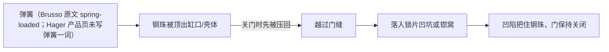

# 橱柜弹簧碰珠（Hager、Brusso）：弹簧把钢珠顶入锁片凹坑

> [!summary] 一句话概述
> 橱柜弹簧碰珠是一种很小的机械门扣：弹簧把钢珠向外顶，门关上时钢珠先被压回去，再落入锁片上的凹坑（或锪窝），靠凹陷把住门。Hager 1446 是开槽暗装的面盖式，Brusso 是黄铜缸体压入门边。它和磁吸门吸都是「把门留在关闭位置」，但碰珠靠的是钢珠与凹坑的机械卡入，不是磁力。

## 配图

![[附件/hager-1446-ball-catch-install.jpg]]
*图源：[Hager 1446 安装说明 I-TA00012 Rev.04](https://www.hagerco.com/Files/Images/Images/Instructions/I-TA00012-Rev04.pdf)；左侧把门边的碰珠中心与锁片中心对齐，并在框上锪出锁片凹杯（CUP OF STRIKE，深 1/8"[3]）；右侧给出 1446 碰珠与 1448 锁片的开槽尺寸*

![[附件/brusso-bc263-ball-catch.jpg]]
*图源：[Brusso BC-263 图纸](https://brusso.com/cdn/shop/files/Brusso_Hardware_LLC_Tear_Sheet_BC-263_Ball_Catch.pdf?v=3798670436380518937)；黄铜缸体外径 Ø0.250"，钢珠从缸口露出；安装说明要求孔深以缸体顶面（不是珠顶）与木面齐平为准，锁片侧用锪孔做凹坑*

> 图片版权归原作者所有，仅作个人学习收藏；出处见文末「来源与核实记录」。

## 结构原理

> 本节所有数字只写来源里给出的；来源没有就写「来源未给出」。Hager 与 Brusso 是同一类机构的两种安装形态，参数分表列出，不混用。

### 堆叠方案

方向：**从门边（装碰珠）到门框（装锁片）**。也可以按现场反过来装，但两家已打开的说明书都按「碰珠在门、锁片在框」写。

**A. Hager 1446（面盖开槽式）**

| 层级 | 零件 | 材料 | 厚度/尺寸 | 固定方式 | 依据 |
| --- | --- | --- | --- | --- | --- |
| L1（门边） | 碰珠面盖 | 钢壳体（产品页） | 面盖 1"×2-1/4"（25 mm×57 mm）；安装图另标 1-11/16"[43] 等相关开槽 | 两颗 #6 沉头木螺丝；面盖开槽至与门边齐平，深 1/16"[1.5] 或直到齐平 | 产品页 Faceplate；安装图步骤 5、7 |
| L2 | 钢珠 | 镀层钢珠（plated steel ball） | 来源未给出珠径 | 装在壳体里，可进出调节以适应门缝 | 产品页 Material；Notes: Ball adjusts in and out for various door and frame clearances |
| L3 | 壳体 / 弹簧腔 | 钢壳体 | 安装图：在门边钻 Ø7/8"[23]、深 1-1/4"[32] 的孔。产品页另写 Hole diameter: 1"（25 mm），Hole depth: 1-1/4"（32 mm），与安装图孔径不一致，两处都照录，不以其中一处改写另一处 | 插入已钻孔后再上螺丝 | 安装图步骤 2；产品页 |
| L4 | 门缝 | — | 安装图：门与框的间隙应不大于 1/8"[3] | — | 安装图 NOTE 2 |
| L5 | 锁片（strike，图中 1448） | 黄铜锁片 | 1-3/8"×2-1/4"（35 mm×57 mm）；框上开槽 1/16"[3] 深至齐平（原文英寸与括号毫米不一致，照录）；并为锁片凹杯再凿 1/8"[3] 深；锁片弯边朝外，中心与碰珠中心对齐 | 两颗 #6 螺丝；框上两处 Ø3/8"[9.5]、深 1/8"[3] 的沉头让位 | 产品页 Strike Size；安装图步骤 8–12 与附图 |

产品页未写「弹簧」一词，但写钢珠可进出调节。弹簧出现在独立第二来源 Brusso 的结构描述里，见下表，不把 Brusso 的弹簧零件画进 Hager 爆炸图。

**B. Brusso BC-263 / 265 / 275（压入圆柱式）**

| 层级 | 零件 | 材料 | 厚度/尺寸 | 固定方式 | 依据 |
| --- | --- | --- | --- | --- | --- |
| L1 | 黄铜缸体 | 黄铜（图纸 Material: Brass；产品页 Solid brass） | BC-263 外径 1/4"（6 mm）/ 图纸 Ø0.250"；BC-265 为 11/32"（9 mm）；BC-275 为 7/16"（11 mm）。BC-263 图纸高度方向尺寸 0.445 / 0.488 等，按该页英寸值 | 过盈压入，或略扩孔后用环氧胶；缸体有凹槽，产品页写 grooved sides grip the glue | 产品页；安装说明直径表；BC-263 图纸 |
| L2 | 钢珠 | 钢珠（产品页 A steel ball） | 来源未给出与缸径不同的珠径 | 在机加工黄铜缸里，被弹簧顶向锁片 | 产品页：A spring-loaded brass ball catch… A steel ball rides in a machined brass cylinder against a matching keeper |
| L3 | 弹簧 | 来源未给出弹簧材料 | 来源未给出丝径和力值 | 装在缸内，把钢珠向外顶 | 产品页 spring-loaded |
| L4 | 锁片 / keeper | 与套件成对，材质未在已打开页单独列出（包装：one catch and keeper） | 用锪钻做凹坑；可用复写纸靠关闭门来转移中心 | 同样压入或胶固，一旦装到位很难无损取出 | 安装说明 |

剖面示意：

这类碰珠不要和双珠夹持锁片（两边滚珠夹住一片锁舌）混成同一零件：本篇写的是「单珠顶入凹坑」。海福乐「双珠碰珠门碰」等夹持式只作为形态区别，不写入本篇参数表。

### 零件清单

| 零件 | 数量 | 功能 | 材料 | 依据 |
| --- | --- | --- | --- | --- |
| 碰珠本体（壳体+钢珠，Hager；缸体+钢珠+弹簧，Brusso） | 每处 1 | 提供可伸缩的钢珠 | 见上表 | Hager 产品页；Brusso 产品页 |
| 锁片 / keeper | 每处 1 | 提供钢珠落入的凹坑 | Hager：黄铜 | Hager Material；Brusso 套件含 keeper |
| 固定螺丝 | Hager：共四颗 #6 FPHWS（产品页）；安装图分写碰珠、锁片各两颗 #6 | 把面盖和锁片固定齐平 | 来源未给出螺丝材质牌号 | Hager 产品页 Fasteners；安装图 |
| 胶 / 钢丝（Brusso 可选） | 按需 | 辅助固定或便于以后取出 | 安装说明写 epoxy or resin、fishing tackle or thin high tensile wire | Brusso 安装说明 |

### 装配顺序

**Hager 1446（按安装图步骤，不是反推）：**

1. 在门边厚度中心画十字，确定高度。
2. 钻 Ø7/8"[23]、深 1-1/4"[32] 的孔（按安装图；与产品页 1" 孔径的差异见上表）。
3. 把碰珠插入孔中，描下面盖轮廓和螺丝孔，把门边开槽 1/16"[1.5] 深至面盖齐平。
4. 钻 1/16"[1.5]、深 1"[25.4] 的预孔，用两颗 #6 螺丝固定碰珠。
5. 在门框上把锁片中心与碰珠中心对齐，弯边朝外。安装图给出 Y = 1/2（门厚）+ 1/8"，用来定位锁片。门缝不大于 1/8"[3]。若装在门上沿和框横头，把碰珠中心放在距锁边 2-1/2"[63.5] 处。
6. 描形并开槽至锁片齐平；为锁片凹杯再凿 1/8"[3]；钻沉头让位和预孔，用两颗 #6 螺丝固定锁片。

**Brusso（按安装说明）：**

1. 按门厚选型号：BC-263 用于 3/4" 及以上板厚（直径 1/4" / 6 mm），BC-265 用于 7/8" 及以上（11/32" / 9 mm），BC-275 用于 1" 及以上（7/16" / 11 mm）。产品页要求门边两侧至少各留 1/4″ 木材。
2. 用与缸径相同的铲钻、福斯纳或普通钻头先浅后深，直到缸体顶面（不是珠顶或穹顶）与木面齐平。可用细木棒标记深度；钻深了就在孔底垫垫片补偿。
3. 关门前在锁片一侧垫复写纸，轻轻关门，用印痕一端作为锪窝中心。先浅锪检查位置，再加深；必要时可把中心稍微挪过去。
4. 过盈压入。孔太紧可略砂孔壁或缸壁，以免裂木；也可略大于直径后用环氧胶固定。缸体凹槽可绕细钢丝，便于以后拉出重调。说明写：两件一旦到位，几乎不可能不伤木头就取出来。

### 受力与运动分析

- **受力路径**：开门时，手把钢珠从凹坑的斜面/球面里拉出，钢珠克服弹簧（Brusso）或调节后的伸出阻力缩回壳体，越过门缝。关门时反向：珠被锁片边缘压回，对准凹坑后再被顶入，把门留在关闭位置。Hager 产品页把用途限定在 cabinets and lightweight doors，并写 Not intended for heavy weight applications。Brusso 用 click when it seats 描述手感，没有给出以牛顿计的保持力。
- **运动关系**：唯一的活动件是钢珠沿缸/壳体轴线伸缩，没有旋转锁或心形槽换相。Hager 允许把钢珠进出位置调到适应不同门缝；Brusso 靠孔深和锪窝深度来保证珠与凹坑的相对位置。
- **失效风险**：门缝大于 Hager 给出的 1/8"[3]，珠可能进不到凹坑或保持力变弱（安装图把该间隙写成不应超过的值）。碰珠与锁片中心不齐，珠会打在平面上发出响声或关门不到位。Brusso 孔钻深了，缸体沉下去，珠够不着锁片；孔偏了几乎不能无损返工。Hager 产品页与安装图孔径不一致，现场必须按所采用的那一份图纸施工，不要两份尺寸各取一半。

## 设计要点与参数

| 要点 | 内容 | 依据 |
| --- | --- | --- |
| 基本动作 | 弹簧（Brusso 原文）把钢珠顶向锁片凹坑/锪窝 | Brusso 产品页；Hager 安装图 CUP OF STRIKE |
| Hager 面盖 / 锁片 | 面盖 1"×2-1/4"（25×57 mm）；锁片 1-3/8"×2-1/4"（35×57 mm） | Hager 产品页 |
| Hager 材料 | 钢壳体、黄铜锁片、镀层钢珠 | Hager 产品页 |
| Hager 钻孔 | 安装图：Ø7/8"[23]×深 1-1/4"[32]；产品页：孔径 1"（25 mm）、孔深 1-1/4"（32 mm） | 两处原文并列 |
| Hager 门缝 | 不大于 1/8"[3] | 安装图 NOTE 2 |
| Hager 锁片定位 | Y = 1/2×门厚 + 1/8"；弯边朝外 | 安装图 |
| Hager 用途限制 | 柜门和轻型门，不用于重型 | 产品页 |
| Brusso 直径分档 | 1/4"、11/32"、7/16"（6 / 9 / 11 mm）对应 3/4"、7/8"、1" 及以上板厚 | 产品页；安装说明 |
| Brusso 孔深基准 | 缸体顶面与木面齐平，不是珠顶 | 安装说明 |
| Brusso 凹坑 | 锪钻做 indent，用复写纸转移中心 | 安装说明 |
| 保持力数值 | 两家已打开来源均未给出牛顿或 kgf | — |

## 优缺点

**优点**
- 结构件很少，动作直观：一颗珠、一个凹坑
- 不依赖磁性，油漆门、薄金属门框也可以用（具体材料以型号为准）
- 面盖式（Hager）可以调珠的进出，适应门缝；压入式（Brusso）装好后面上几乎只看见一颗珠，外观干净
- 关门有明确的「落入」手感（Brusso 所称 click）

**缺点 / 代价**
- 对中和深度很敏感，尤其是不可拆的压入式，装错就伤木头
- 已打开来源没有给出保持力，不能按「多重的门」直接选型；Hager 已明确不用于重型门
- 钢珠和锁片是金属接触，可能有响声或留下压痕
- 同一厂家的产品页和安装图也可能对不上孔径，必须选定一份施工

## 可借鉴点

- **要用机械方式把门留在关上，又希望零件藏进门边时，优先考虑「弹性体 + 凹坑」**：珠被压回再落入，比靠摩擦力贴住更有到位感。
- **把「可调」做在珠的伸出量或锁片凹坑深度上**，不要指望门缝自己保持不变。Hager 把门缝上限写成 1/8"，同时允许调珠。
- **压入式把孔深基准写在缸体顶面，而不是珠顶**，避免珠还在伸出状态时就把孔钻深了。
- **不可逆的过盈装配要先用转移痕迹（复写纸、浅锪）对中**，再做最终深度。
- 需要更大保持力或希望完全无机械卡入时，改看磁吸门吸；两者不要写成同一种门扣。

## 与库中相似案例对比

| 对比项 | 本案例（弹簧碰珠） | [[橱柜磁吸门吸：只有磁力保持、没有机械锁死（对照 FIDLOCK）]] | [[侧向释放插扣（ITW SR 1）：双弹性卡臂、母座侧窗与中间翼]] |
| --- | --- | --- | --- |
| 保持方式 | 钢珠落入锁片凹坑 | 磁铁吸住吸片，无机械锁死 | 弹性卡臂进入母座侧窗 |
| 开门 | 把珠从凹坑里拉出 | 拉开磁力 | 按压或侧向释放卡臂 |
| 对中要求 | 珠与凹坑必须对准，深度敏感 | 吸片与磁面要对准、贴平 | 插入导向后由卡臂对中 |
| 力值 | 已打开来源未给保持力；Hager 限轻型门 | 海福乐等以 kg 标吸力 | 按插扣系列载荷 |

（磁吸门吸为本批次同批案例，收录后互链。）

## 相关案例

- [[橱柜磁吸门吸：只有磁力保持、没有机械锁死（对照 FIDLOCK）]]
- [[FIDLOCK V-BUCKLE：磁吸引导到位后再由机械扣锁死]]
- [[侧向释放插扣（ITW SR 1）：双弹性卡臂、母座侧窗与中间翼]]
- 分类索引：[[04-机构与运动 索引]]

## 来源与核实记录

- 主来源：[Hager 1446 Light Weight Ball Catch 产品页](https://www.hagerco.com/trim-auxiliary/residential/1446)（面盖和锁片尺寸、钢壳体/黄铜锁片/镀层钢珠、可进出调节、仅用于柜门和轻型门；产品页孔径写 1"）
- 补充来源 1：[Hager 1446 安装说明 I-TA00012 Rev.04](https://www.hagerco.com/Files/Images/Images/Instructions/I-TA00012-Rev04.pdf)（与产品页同属 Hager。Ø7/8" 钻孔、开槽、锁片凹杯、Y 公式、门缝不大于 1/8"）
- 补充来源 2：[Brusso Precision Ball Catches 产品页](https://brusso.com/products/precision-ball-catches)（独立第二机构。spring-loaded、钢珠在机加工黄铜缸中对着 keeper、分档直径与适用板厚、门边两侧各留 1/4″）
- 补充来源 3：[Brusso 安装说明](https://brusso.com/cdn/shop/files/Brusso_Hardware_LLC_Installation_Instructions_BC-263_Ball_Catch.pdf?v=4779230657442695036) 与 [BC-263 图纸](https://brusso.com/cdn/shop/files/Brusso_Hardware_LLC_Tear_Sheet_BC-263_Ball_Catch.pdf?v=3798670436380518937)（孔深以缸顶齐平、锪窝、Ø0.250" 等尺寸。同属 Brusso）
- 核实：2026-11-22 打开上述页面并下载 PDF。未把双珠夹持式碰珠的力值写入本篇；Hager 产品页未出现 spring 一词，弹簧的明文出自 Brusso，已在正文区分。
