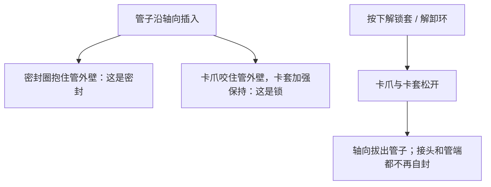

# 气动快插接头（SMC KQ2 一类）：卡爪咬管、密封圈密封，按解锁套后拔出

> [!summary] 一句话概述
> SMC KQ2 这类气动快插接头在管子推到位后，不锈钢卡爪（chuck）咬住管外壁，由密封圈对管外壁密封；拔管时按下解锁套（release bush），卡住管壁的卡爪和卡套被松开，管子才能轴向拔出。它锁的是「管子」，断开后管路是敞开的。后面一篇液压平面阀快换则是公母各带截止阀，锁的是「接头的两半」。

## 配图

![[附件/smc-kq2-cutaway.jpg]]
*图源：[SMC Series KQ2 Uni One-touch Fittings（KQ2_3132.pdf）](https://content2.smcetech.com/pdf/KQ2_3132.pdf) 首页剖视；标注 Seal（真空至 1.0 MPa）、Chuck（卡爪，保持力由 collet 加强）、Collet、Guide、Release bush（Gray，拔管时松开 chuck 与 collet，减轻对管壁的过度咬伤）、Body、O-ring、Stud、Gasket、Uni thread。目录原文释放说明写 “the check and collet are released”，结合同页零件名 Chuck，应指卡爪*

![[附件/festo-qs-claw-seal-release.jpg]]
*图源：[Festo《快插/螺纹接头 QS》中文样本](https://ftp.festo.com/public/pneumatic/SOFTWARE_SERVICE/Documentation/2013/ZH/QS_CN.PDF) 第 2 页（样本页脚 2008/10）。独立厂商对同一类机构的拆解：不锈钢夹爪固定气管、按下蓝色解卸环、丁腈橡胶密封圈密封标准外径气管。该页中文有一处「固定住气缸」的表述，从上下文和配图看是在讲夹管，引用时以「夹爪固定气管、不伤管壁」整段为准*

![[附件/festo-qs-section-materials.jpg]]
*图源：同上第 4 页；标准型 QS 剖面零件编号 1 解卸圈、2 密封件、3 主体、4 气管固定夹、5 螺纹接口，并给出不同外径的气管插入深度。材料与插入深度只适用于 Festo 对应型号，不写入 SMC KQ2 参数表*

> 图片版权归原作者所有，仅作个人学习收藏；出处见文末「来源与核实记录」。

## 结构原理

> 本节所有数字只写来源里给出的；来源没有就写「来源未给出」。SMC 与 Festo 的压力、温度、材料分系列列出，不混抄。

### 堆叠方案

方向：**沿管子轴线，从已插入的管端向外（接头内部 → 管口）**

| 层级 | 零件 | 材料 | 厚度/尺寸 | 固定方式 | 依据 |
| --- | --- | --- | --- | --- | --- |
| L1 管外壁密封 | Seal（密封圈） | SMC KQ2：NBR（与 O-ring 同行） | 来源未给出截面尺寸；工作压力范围见参数表 | 管子插入后压在管外壁上；KQ2 写 special profile，既保证密封又减小插管阻力 | KQ2_3132 首页 Seal；零件材料表 Seal, O-ring = NBR |
| L2 夹持 | Chuck（卡爪）+ Collet（卡套） | 卡爪 SUS304；卡套 POM | 来源未给出爪齿高度 | 卡爪咬住管外壁提供保持力，卡套加大保持力。解锁时二者被松开，以免过度咬伤管壁 | 同上 Chuck / Collet / Release bush 说明 |
| L3 导向 | Guide | SUS304、C3604BD 或 POM | 来源未给出 | 引导管子和卡爪/卡套的轴向运动 | 零件材料表 |
| L4 解锁 | Release bush（灰色） | POM（表中与 Collet, Release button 同行） | 来源未给出行程 | 向内按压后松开卡爪和卡套，管子可拔出 | Release bush 说明；颜色：KQ2 本体白、解锁浅灰（相对旧系列 KQ 的黑/蓝） |
| L5 本体与螺纹端 | Body、Stud、O-ring、Gasket、Uni thread | 本体 C3604BD、PBT；螺柱螺纹段 C3604BD；垫圈 SUS304 + NBR | Uni thread 用于 Rc / G / NPT / NPTF 阴螺纹；垫圈为不锈钢薄片两面贴合 NBR，坐在阴螺纹倒角上 | 螺纹端旋入气源或阀体；在有限空间里，本体与螺纹段可相对转过定位所需的角度 | 首页 Stud / Gasket / Uni thread |

Festo QS（独立对照，不写入上表尺寸）沿管子同样是：气管固定夹（高合金不锈钢）咬管、丁腈密封圈密封、按下解卸圈后拔管。标准型 QS 还给出插入深度，例如外径 4 / 6 / 8 / 10 / 12 / 16 mm 对应 15（QSW: 12）/ 17（QSW: 12）/ 18 / 20.5 / 23.5 / 24.5 mm。

剖面示意：

### 零件清单

| 零件 | 数量 | 功能 | 材料 | 依据 |
| --- | --- | --- | --- | --- |
| Body | 1 | 形成内腔，容纳密封与夹持元件 | C3604BD、PBT | KQ2_3132 材料表 |
| Stud（螺纹段，部分型号可相对本体转动） | 按型号 | 接到阴螺纹接口 | 螺纹段 C3604BD | 同上；Stud 说明 |
| Chuck | 1 组 | 咬住管外壁，提供保持力 | SUS304 | 同上 |
| Collet | 1 | 加大保持力；解锁时与卡爪一同松开 | POM | 同上 |
| Guide | 1 | 导向 | SUS304 / C3604BD / POM | 同上 |
| Release bush / Release button | 1 | 按压解锁 | POM；KQ2 为浅灰 | 同上 |
| Seal、O-ring | 各 1（按结构） | 管外壁密封；螺纹端/分体面密封 | NBR | 同上 |
| Gasket（Uni thread 用） | 按螺纹端 | 坐在阴螺纹倒角上密封 | SUS304 + NBR | 同上 |
| 气管 | 配套 | 被夹持和密封的对象 | KQ2 适用：Nylon、Soft nylon、Polyurethane；外径 ø4、ø6、ø8、ø10、ø12、ø16 | Applicable Tubing 表 |

Festo 标准型 QS 对应零件名是解卸圈、密封件、主体、气管固定夹、螺纹接口，材料见配图第 4 页，不与 KQ2 混用一张清单。

### 装配顺序

按 KQ2 目录的使用逻辑（现场接管，不是接头出厂装配工艺卡；出厂如何把卡爪、卡套、密封圈装进本体，来源未给出逐步工艺）：

1. 把接头螺纹端旋入对应阴螺纹。Uni thread 用带 NBR 的不锈钢垫圈坐在倒角上，目录称可兼容 Rc、G、NPT、NPTF 及倒角和公差差异。有 Stud 可转的型号，先转到便于布管的角度。
2. 确认管子外径、材料在适用表内，端口切平、无毛刺（具体切口要求该页未写，来源未给出）。
3. 把管子沿轴向推入，直到越过密封圈并被卡爪咬住。密封靠圈，保持靠卡爪和卡套。
4. 轻拉管子，确认已经被咬住（此步为使用常识推断，目录首页未写「确认拉力」数值）。
5. 拆管：按住灰色解锁套，使卡爪和卡套松开，再沿轴向拔出。目录强调这样可避免过度咬伤管壁。
6. Festo 对照：按下蓝色解卸环；解卸环上标有对应气管外径，便于选型核对。

### 受力与运动分析

- **受力路径**：管内气压（或真空）作用于管壁和密封圈；要把管子拉脱的力由卡爪齿作用在管外壁上，再经卡套、导向进入本体，最后由螺纹端传到安装座。密封圈不承担主要拉脱力（推断：目录把 Seal 和 Chuck 分成两项功能）。Festo 写夹爪可吸收振动和气压涌动。
- **运动关系**：插管是单向轴向推入，到位后卡爪保持。解锁套相对本体轴向按入，把卡爪撑开或撤出咬合位置（具体楔面几何，两份目录都没有给出尺寸，来源未给出）。拔管仍是轴向，不应靠旋转硬拧（旋转是否伤管，SMC 该页未写；不补充未给出的操作禁令）。
- **失效风险**：管子外径或硬度不在适用表内，可能插不到密封位置或被卡爪伤管。工作压力超过该系列最大值，或水击超过最大工作压力（KQ2 注：surge pressure must be under the maximum operating pressure）。解锁套被误按会导致意外拔管——这与液压快换母头上带「防意外断开锁」不是同一安全等级（对照液压篇）。断开后两侧都不截止，系统若仍有压，管口会排气或喷液。

## 设计要点与参数

| 要点 | 内容 | 依据 |
| --- | --- | --- |
| 密封与夹持分工 | 密封圈封管外壁；卡爪+卡套负责保持；解锁套松开夹持后才能拔管 | KQ2_3132 首页；Festo 第 2 页同一分工 |
| KQ2 流体 | Air / Water（注：一般工业用水，其他流体需咨询；水击须低于最大工作压力） | Specifications |
| KQ2 最大工作压力 | 1.0 MPa | 同上；Seal 项也写低真空至 1.0 MPa |
| KQ2 工作真空 | –100 kPa | 同上 |
| KQ2 耐压（proof） | 3.0 MPa | 同上 |
| KQ2 温度 | 环境与流体 –5 to 60°C；水 0 to 40°C，不可结冰 | 同上 |
| KQ2 适用管 | Nylon、Soft nylon、Polyurethane；外径 ø4、ø6、ø8、ø10、ø12、ø16 | Applicable Tubing |
| KQ2 颜色 | 本体白，解锁浅灰（旧系列 KQ：本体黑，解锁蓝） | Product’s Color |
| Festo 标准型 QS / QS-B 随温工作压力 | –0.95 … +10 bar（Mini QSM 为 –0.95 … +14 bar；金属型 QS-F 可达 +16 bar。只适用于 Festo 对应系列） | Festo 第 5 页工作和环境条件 |
| Festo 标准型 QS 插入深度 | 管外径 4–16 mm 对应 15–24.5 mm，见上文堆叠表 | Festo 第 4 页 |
| 卡爪齿深、解锁行程、保持力牛顿数 | 来源未给出 | 两份已打开目录均无 |

## 优缺点

**优点**
- 接管是「即插」，拆管是「按套再拔」，不用对螺纹，现场改管快
- 密封和夹持分开，卡爪可以做成金属齿，密封圈可以做成低插入力的截面
- 解锁时主动松开卡爪，减轻反复插拔对管壁的咬伤（KQ2 原文）
- 同一原理下各厂有完整的压力、温度、管材表，便于按系列选型

**缺点 / 代价**
- 断开后不截止，不能当液压快换或自封接头用
- 保持力建立在管外壁被齿咬住，管材、外径、切口和老化都会改变保持和密封
- 解锁套是外露按压件，没有附加的「防意外拨套」时，存在误拔风险
- 不同品牌的压力、插入深度、解锁圈颜色不能互抄

## 可借鉴点

- **夹持和密封不要做在同一个零件上**：齿负责不让管子被拉出，弹性圈负责圆周转密封。把齿做进密封圈，或指望密封圈去抗拉脱，都会把两种失效搅在一起。
- **解锁要同时「放开齿」和「避免过咬」**。KQ2 把这一点写进释放套说明：拔管时松开 chuck 和 collet，防止过度咬管。
- **断开是否需要自封，是选型的第一问**。气动快插通常不自封；要避免漏油、进气，应走带双向截止阀的液压平面阀快换，而不是把气管接头放大。
- 在解锁件上标出适用外径（Festo 解卸环），比只印在样本上更不容易插错管。
- 水击、介质、温度按该系列的注走，不要用「都能快插」把水管、油管、气管混用。

## 与库中相似案例对比

| 对比项 | 本案例 | [[电缆防水格兰头：PG 螺纹、夹紧爪与密封圈]] | [[液压平面阀快速接头（ISO 16028）：双向截止阀与套筒钢球锁，区别于气管快插]] |
| --- | --- | --- | --- |
| 锁住的对象 | 插入的软管外壁 | 电缆外护套 | 公头（插头）与母头（插座）两半 |
| 密封 | 密封圈抱管外壁 | 密封圈抱电缆 | 平面阀与端面，断开时各自封闭 |
| 解锁 | 按解锁套，张开卡爪后拔管 | 拧紧/松开压紧螺母，不是快拆按套 | 拨开或后拉母头套筒，钢球退出槽后分开两半 |
| 断开后 | 管口与接头都敞开 | 通常不作为反复快拆 | 两侧阀芯关闭，减少喷油和进污 |

## 相关案例

- [[液压平面阀快速接头（ISO 16028）：双向截止阀与套筒钢球锁，区别于气管快插]]
- [[电缆防水格兰头：PG 螺纹、夹紧爪与密封圈]]
- [[Southco、DZUS 四分之一转快锁：90° 凸轮与按总材料厚度选钉长]]
- 分类索引：[[04-机构与运动 索引]]

## 来源与核实记录

- 主来源：[SMC Series KQ2 Uni One-touch Fittings，文件 KQ2_3132.pdf](https://content2.smcetech.com/pdf/KQ2_3132.pdf)（6 页样本，已下载；剖视零件、1.0 MPa / –100 kPa / 3.0 MPa、温度、管材与外径、材料表。创建信息显示 2006 年 PDF）
- 补充来源 1：[SMC kq2_2.pdf](https://content2.smcetech.com/pdf/kq2_2.pdf)（80 页，2012 年版本信息；与上一份同属 SMC，不另计机构，仅作同系列手册备份）
- 补充来源 2：[Festo《快插/螺纹接头和快插接头》中文样本 QS_CN.PDF](https://ftp.festo.com/public/pneumatic/SOFTWARE_SERVICE/Documentation/2013/ZH/QS_CN.PDF)（已下载，114 页，页脚 2008/10，文件修改日期 2010-07。不锈钢夹爪、蓝色解卸环、丁腈密封、插入深度和分系列压力/温度。独立第二机构）
- 核实：2026-11-22 下载并 pdftotext / pdftoppm 上述 PDF。SMC 中国站 6-P2-P11.pdf 已下载但该文件加密限制抽取，且同属 SMC，不作为第二机构。未另开亚德客品牌变体篇。
