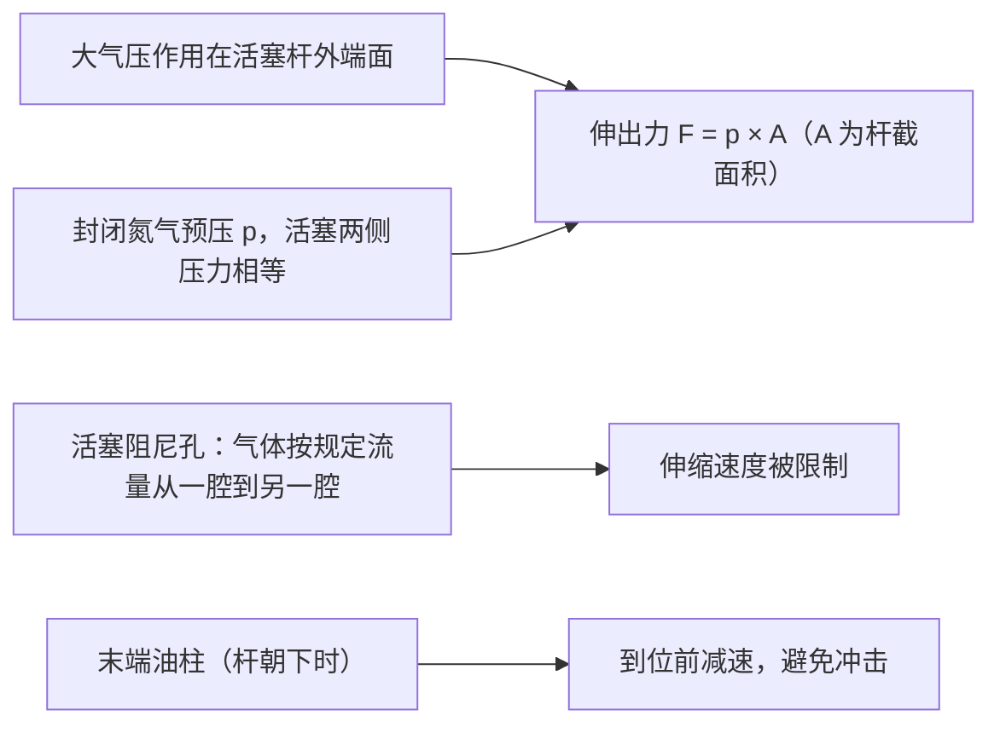

# 气弹簧内部结构：活塞阻尼孔与氮气预压

> [!summary] 一句话概述
> 气弹簧是封闭缸筒里预充高压氮气的蓄能元件：活塞两侧气压其实相等，伸出力来自「气压作用在活塞杆内端面、外侧只有大气压」的面积差；活塞上的阻尼孔让气体（和油）按规定流量穿过活塞，从而限制伸缩速度，末端再靠油柱加大阻尼。

## 配图

![[附件/gas-spring-piston-pressure-cutaway.jpg]]
*图源：[Camloc《Understanding The Basics: How do gas struts work?》](https://web.archive.org/web/2024/https://camloc.com/wp-content/uploads/Understanding-the-Basics-How-do-gas-struts-work.pdf) 及同主题网页配图；剖开缸筒：内部气压（红箭头）作用在活塞两侧，活塞杆外端承受大气压（蓝箭头），面积差产生伸出力*

![[附件/gas-spring-oil-damping-curve.jpg]]
*图源：[Camloc Technical Guide Edition 1.2](https://web.archive.org/web/2024/https://camloc.com/wp-content/uploads/Technical-Guide-Edition-1.2-Gas-Spring-Overview.pdf) Figure One；杆朝下安装时，活塞进入末端油柱后速度明显下降，形成油阻尼区，避免到位冲击*

> 图片版权归原作者所有，仅作个人学习收藏；出处见文末「来源与核实记录」。

## 结构原理

> 本节所有数字只写来源里给出的；来源没有就写「来源未给出」。

### 堆叠方案

方向：**沿活塞杆轴线，从杆外端到缸筒封闭端**

| 层级 | 零件 | 材料 | 厚度/尺寸 | 固定方式 | 依据 |
| --- | --- | --- | --- | --- | --- |
| L1 | 活塞杆及外接头 | Camloc 未在入门文给出具体牌号；Tallsen 写活塞杆常用镀铬钢或不锈钢 | 杆径决定出力：Camloc 举例 6 mm 杆截面积 28.3 mm²，10 mm 杆 78.5 mm²（增大 177%） | 与活塞固定连接 | Camloc 1.1；Tallsen |
| L2 | 杆侧密封与 beadroll | 密封件；beadroll 为缸筒上的滚槽 | 来源未给出密封断面尺寸。beadroll 既留住密封组件，又在最大伸出时作机械止挡，保护密封 | 装配后滚槽限位 | Camloc Basics 2.0 术语 |
| L3 | 活塞（带阻尼孔/节流通道） | 来源未给出具体材料 | 孔或节流通道的具体直径来源未给出；其作用是让气体（及油）穿过活塞并控制速度 | 固定在杆上 | Camloc Basics 1.02；苏世博 FAQ 10；Tallsen |
| L4 | 氮气预压 + 少量油 | 氮气（惰性、不燃）；油用于润滑密封并在末端阻尼 | Camloc：充氮压力 15–200 bar（1.5–20 MPa）。苏世博：充气压力和弹伸力随几何在 10–230 bar。油量影响末端阻尼强弱 | 封闭充装 | Camloc 1.1 / 1.2；苏世博 FAQ 3、4、11 |
| L5 | 缸筒与端塞 | 钢或苏世博所称压力管；Tallsen 写缸筒常用钢或不锈钢 | 缸筒直径不进入 P1 计算公式（Camloc：「管径对 P1 无关」） | 端塞密封；Camloc 的 Vari-Lift 阀可做在端塞上 | Camloc Basics 3.05–3.06；1.1 |

剖面示意：

### 零件清单

| 零件 | 数量 | 功能 | 材料 | 依据 |
| --- | --- | --- | --- | --- |
| 缸筒 / 压力管 | 1 | 封闭高压气体与油 | 钢等 | 各来源 |
| 活塞杆 | 1 | 把面积差变成外部出力 | 常镀铬 | Camloc；Tallsen |
| 活塞 | 1 | 分出两腔，并开设阻尼孔/通道 | 来源未给出 | 各来源 |
| 氮气充量 | 1 次充装 | 储能；压力越高、杆越粗，出力越大 | 氮气 | Camloc；苏世博 |
| 油 | 按设计油量 | 润滑密封；末端（或按设计方向）阻尼 | 非易燃油（苏世博表述） | Camloc 1.2；苏世博 |
| 密封组件 | 一套 | 在运动的活塞杆处保持气密，因此必然有摩擦 | 如 O 形圈等（Tallsen 举例） | 苏世博 FAQ 8–9；Tallsen |
| 端塞 / 可选放气阀 | 1 | 封闭缸端；Camloc Vari-Lift 可用 2 mm 内六角逐步放气调力 | — | Camloc Basics 5.0 |
| 接头 | 两端 | 连接到机构上（本篇不展开支架布置） | 球头、鱼眼等（Tallsen 举例） | Tallsen |

### 装配顺序

来源以原理和充气为主，完整工厂装配节拍未给出。按元件逻辑：

1. 将活塞、密封、导向和油按设计装入缸筒，活塞杆从密封端伸出。
2. 端塞封闭；充入氮气到规定压力。Camloc：刚充完后约 24 小时内压力会因 settleback 大约下降 5%。
3. 检测静态 P1 力（见参数表）。
4. 若为 Vari-Lift 型，出厂充到该规格最大力，装机后再逐步放气微调（只能放、不能补，须逐步进行）。
5. 连接到应用的铰点。优选安装方向：Camloc 1.2 写杆朝下时，活塞在接近全伸出时进入油柱，末端阻尼最大。

本篇到元件为止。显示器气弹簧支架的四连杆布置、行程与倾角由另一执行者写应用篇，这里不展开。

### 受力与运动分析

- **受力路径**：Camloc：活塞两侧氮气压力始终相等，并不是靠活塞两边压差推动（那是气缸）。伸出的原因是氮气作用在活塞杆内侧端面，外侧只有大气压，力 F = p × A。把杆推入后，可用容积减小，压力按波义耳定律升高，因而出现弹簧一样的递增出力（P2 > P1）。苏世博公式一致：F = p × A，并给出 p2 = (V1/V2) × p1。
- **运动关系**：单自由度直线伸缩。速度由活塞上的节流孔（及油）限制。苏世博把「减振」定义为：杆运动时气体经活塞上的连接通道从一腔流到另一腔，通道阻力大则运动慢；静止时这段节流不提供保持力。保持力来自预压产生的伸出力。
- **失效风险**：无末端油阻尼时，快速到位可能冲击、损坏或伤人（Camloc 1.2）。密封必须有足够面压，因此不可能做成无摩擦（苏世博）。温度升高时，阻尼和出力都会变（Camloc 1.2 提到工作温度影响阻尼；1.1 专章讨论温度对力的影响，本篇不额外引用未摘录的图表数值）。擅自钻孔放气或破坏压力管是禁止的（苏世博警告标识）。

与 [[旋转阻尼器（缓降盖板）：硅油黏性、水平型与垂直型的扭矩曲线]] 的差异：旋转阻尼器是消耗动能的硅油黏性元件，主要提供旋转阻力、不蓄能；气弹簧是氮气蓄能元件，主功能是提供伸出力/支撑，阻尼孔和油只用来管速度和到位冲击。苏世博 FAQ 12 也区分：气弹簧是蓄能装置，减振器是吸能装置；需要既支撑又减速时，才选带不同阻尼特性的气弹簧。

## 设计要点与参数

| 要点 | 内容 | 依据 |
| --- | --- | --- |
| 出力公式 | F = p × A，A 为活塞杆截面积，与缸筒直径无关 | Camloc 1.1；苏世博 FAQ 5 |
| 充气压力 | Camloc：15–200 bar（1.5–20 MPa）。苏世博：10–230 bar（随几何与弹伸力而变） | 两家各自产品范围，不是同一系列的互换规格 |
| 计算例 | Camloc：10 mm 杆、充到 40 bar（4 MPa），P1 = 4 MPa × π × 0.005² = 315 N | Camloc 1.1 |
| 杆径影响 | 6 mm 杆面积 28.3 mm²，10 mm 杆 78.5 mm²，同样充压下出力随面积增加 | Camloc 1.1 |
| P1 定义（Camloc） | 伸出方向、距全伸出 5 mm 处的静力。测法：先压到距全伸出 10 mm，再放到 5 mm，停留 5 秒后读数，单位牛顿。Basics 4.01 举例标注如 300 N | Camloc 1.1 与 Basics |
| F1 / P1（苏世博） | 设计弹力，在活塞杆还有 5 mm 便完全伸出时测量；从更短位置以指定速度靠近测点，读数稳定约 3 秒后读取；须在气弹簧 20℃ 及室温下进行 | 苏世博 FAQ 6（测量细节与 Camloc 不完全相同，引用时不要混用停留时间） |
| P2 | 距全压缩 5 mm 处的伸出力，因容积更小而总是大于 P1 | Camloc 1.1 |
| Settleback | 充气后约 24 小时内内部压力通常下降约 5% | Camloc 1.1 |
| 阻尼孔 | 活塞上的孔或连接通道让气体穿过活塞，控制伸出速度（Camloc Basics 1.02；Tallsen、苏世博同原理）。孔径具体数值来源未给出 | 三家 |
| 油阻尼 | 杆朝下安装时，接近全伸出进入油柱，速度下降。阻尼还受温度、油粘度、缸/杆直径关系、油量和倾点影响 | Camloc 1.2 |
| 摩擦 | 密封面压导致伸出力减小、压入力增大。不可能做成无摩擦的气弹簧 | 苏世博 FAQ 8–9 |
| 可调力 | Camloc Vari-Lift：用 2 mm 内六角，四分之一圈放气再关阀检查，逐步进行，不可一次放太多 | Camloc Basics 5.0 |

## 优缺点

**优点**
- 用很小的包装提供较大的可控伸出力，行程内力可随压缩递增
- 阻尼孔和末端油可以分开调节速度与到位冲击
- 惰性氮气不助燃（Camloc、苏世博）

**缺点 / 代价**
- 密封摩擦不可避免，伸出力和压入力不相等
- 出力随温度和 settleback 变化，刚充完不能当最终力
- 安装方向影响末端油阻尼，装反可能失去到位缓冲
- 高压封闭件，不能自行钻孔或焊接缸筒

## 可借鉴点

- **选型先算 F = p × A**，要大力优先加杆径或提高充压，不要指望加缸径来加 P1
- **把 P1 的测量定义写进图纸**（距全伸出 5 mm，并写明停留时间和温度）
- **默认按杆朝下布置**，才能用上末端油阻尼；需要双向或压缩方向阻尼时，要选对应油量和「减振片」（苏世博）
- 用 Vari-Lift 只能现场往下调力，计算时按可能的最大力校核结构
- 不要把气弹簧当成旋转阻尼器：要支撑/平衡用气弹簧，只要旋转缓降用硅油阻尼器

## 与库中相似案例对比

| 对比项 | 本案例 | [[旋转阻尼器（缓降盖板）：硅油黏性、水平型与垂直型的扭矩曲线]] | 显示器气弹簧支架（另一执行者应用篇） |
| --- | --- | --- | --- |
| 本质 | 氮气蓄能 + 孔/油限速 | 硅油黏性耗能 | 用本元件去做四连杆/支架 |
| 输出 | 直线力 P1/P2 | 旋转扭矩-速度曲线 | 整机姿态与行程 |
| 本篇范围 | 只写到缸内活塞和充气 | 已收录元件 | 本篇不写整机 |

## 相关案例

- [[旋转阻尼器（缓降盖板）：硅油黏性、水平型与垂直型的扭矩曲线]]
- [[恒扭力摩擦铰链：卡簧过盈产生扭力与「最低扭力 > 盖板力矩」选型]]
- 分类索引：[[04-机构与运动 索引]]

## 来源与核实记录

- 主来源（过程与阻尼）：[Camloc Technical Guide Edition 1.2: Gas Spring Overview](https://web.archive.org/web/2024/https://camloc.com/wp-content/uploads/Technical-Guide-Edition-1.2-Gas-Spring-Overview.pdf)（Camloc Motion Control；任务给定的 Edition 1.2 直连 403，2026-11-15 经 Wayback Machine 下载 PDF 核对油阻尼和速度曲线）
- 补充来源 1：[Understanding The Basics: How do gas struts work?](https://web.archive.org/web/2024/https://camloc.com/wp-content/uploads/Understanding-the-Basics-How-do-gas-struts-work.pdf)——活塞两侧压力相等、面积差伸出、活塞阻尼孔、充氮最高 200 bar、P1 测法、Vari-Lift
- 补充来源 2：[Technical Guide Edition 1.1](https://web.archive.org/web/2024/https://camloc.com/wp-content/uploads/Technical-Guide-Edition-1.1-Gas-Spring-Overview.pdf)——F = p × A、15–200 bar、settleback 约 5%、315 N 例题
- 补充来源 3：[苏世博气弹簧常见问题解答](https://www.suspa.com/cn/%E4%BA%A7%E5%93%81/%E8%8B%8F%E4%B8%96%E5%8D%9A%E6%B0%94%E5%BC%B9%E7%B0%A7/%E5%B8%B8%E8%A7%81%E9%97%AE%E9%A2%98)（SUSPA）——10–230 bar、F = p × A、F1 测法、活塞通道减振、与减振器的区别
- 补充来源 4：[气弹簧的工作原理](https://www.tallsen.com/zh/a-how-gas-spring-works.html)（Tallsen）——中文元件组成与小孔阻尼描述，无额外精确孔径
- 核实：2026-11-15 打开上述 PDF 与网页。未把显示器支架整机写入本篇。Camloc 与苏世博的压力范围、P1 停留时间不同，已分别标注。
