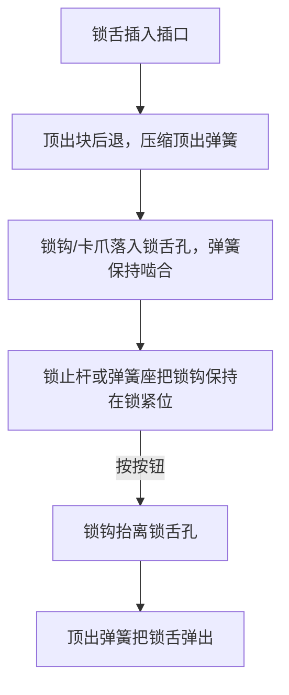

# 汽车安全带带扣：锁钩卡入锁舌孔，按钮解锁后顶出弹簧弹出锁舌

> [!summary] 一句话概述
> 汽车安全带带扣用锁舌（专利里也称锁环、tongue plate）插入壳体插口，先把顶出块压回去并压缩顶出弹簧，锁钩再落入锁舌上的孔或切口，把锁舌留下；按下按钮后，锁钩被抬离锁舌孔，顶出弹簧把锁舌弹出来。Autoliv 在先有技术里还写到：卡爪由弹簧压向啮合方向，并用锁止杆把锁止件保持在锁紧位置，按钮则把锁止杆移到释放位置。碰撞时织带拉力由锁钩/锁止件与锁舌承担，顶出弹簧只负责解锁后的弹出，不承担主约束载荷。

## 配图

![[附件/songyuan-cn207136399-fig2-exploded.jpg]]
*图源：[CN207136399U 说明书附图图 2](https://patents.google.com/patent/CN207136399U/zh)（浙江松原汽车安全系统，2018-03-27 授权）。展开图：上盒体 12、下盒体 11、锁架 2、锁钩 3、按钮 4、第一弹簧 6、转轴 51、转座 52、弹簧卡块 53、第二弹簧 71、顶出块 72*

![[附件/songyuan-cn207136399-fig1.jpg]]
*图源：同上图 1，组装外观。按钮 4 上有 PRESS 字样，下方是供锁环通过的插口 13，插口侧壁有消音凸起 14，壳体为上盒体 12 与下盒体 11*

![[附件/autoliv-us9346433-exploded.jpg]]
*图源：[US9346433B2](https://patents.google.com/patent/US9346433B2)（Autoliv Development AB）爆炸图。锁舌 3 从开口插入，锁止件、顶出组件与解锁按钮装在基框上，上下盖形成外壳；该专利重点还在于上盖一体的弹性件压住锁舌底面，减少上下窜动*

> 图片版权归原作者所有，仅作个人学习收藏；出处见文末「来源与核实记录」。

## 结构原理

> 本节所有数字只写来源里给出的；来源没有就写「来源未给出」。

### 堆叠方案

方向：**沿锁舌插入方向，从插口外侧到带扣内部深处；外壳则从上盖到下盖**

| 层级 | 零件 | 材料 | 厚度/尺寸 | 固定方式 | 依据 |
| --- | --- | --- | --- | --- | --- |
| L1（插入端最外） | 锁舌 / 锁环 / tongue plate | 来源未给出 | 带孔或切口，供锁钩卡入；Autoliv 图中锁舌 3 上有开孔 3a | 织带末端固定，插入带扣插口 | 松原 CN207136399U；Autoliv US9346433 |
| L2 | 解锁按钮 | 来源未给出 | 松原：按钮下端面与壳体内侧壁构成插口；按钮上有开口 41 及前定位凸起 42 | 在壳体前端滑动；Autoliv 写按钮沿基框两侧滑动，一侧露出，按压方向与锁舌插入方向大致相同（CPC 分类亦如此描述此类带扣） | 松原；Autoliv |
| L3 | 上、下壳体 | 来源未给出 | 松原：下盒体 11 与上盒体 12 卡扣连接 | 包裹内部金属机构 | 松原 |
| L4 | 消音凸起（松原方案） | 与壳体一体（来源未另给材料） | 若干个，设在插口侧壁、与按钮相对 | 锁环两侧端面分别与消音凸起、按钮相抵，减少松动异响 | 松原 [0015] |
| L5 | 锁架 / 基框 | 来源未给出 | Autoliv：基框上有铰接孔、顶出槽、按钮导孔等（具体尺寸来源未给出） | 固定在壳体内，作为铰链和滑槽的基准 | 松原锁架 2；Autoliv base frame |
| L6 | 锁钩 / 锁止件（latch member） | 来源未给出 | 松原：后端部铰接于锁架；Autoliv：一端可转动地支承在基框上，带卡爪（claw） | 铰接；弹簧将其压向啮合方向 | 松原锁钩 3；Autoliv BACKGROUND 与权利要求结构 |
| L7 | 弹簧座组件与第一弹簧（松原） | 来源未给出 | 转座 52 + 弹簧卡块 53，转轴 51 定位；第一弹簧 6 压在按钮与弹簧卡块之间；转座后部档条作用于锁钩前端 | 按钮行程经该组件传到锁钩 | 松原 [0016] |
| L8 | 锁止杆（Autoliv 先有技术） | 来源未给出 | 来源未给出截面 | 把已啮合的锁止件保持在锁紧位置；按钮把它移到释放位置 | Autoliv BACKGROUND ART |
| L9 | 顶出组件：顶出块 + 第二弹簧 / ejector | 来源未给出 | 松原：第二弹簧 71 后端固定在壳体，前端顶出块 72，形变方向朝向插口 | 插入时被锁环压缩；解锁后把锁环推出 | 松原 [0017]；Autoliv：ejector assembly 负责锁舌与锁止件之间的锁紧与释放 |

剖面示意：

独立来源对同一动作的表述：

- 松原 CN207136399U：佩戴时锁环由插口推入，挤压顶出块并压缩第二弹簧；顶出块让出间隙后，锁钩前端下压卡接锁环。解戴时按按钮，按钮作用于弹簧座组件，弹簧座直接作用于锁钩前端；锁钩抬起后，第二弹簧经顶出块把锁环推出。
- Autoliv US9346433 在背景技术中概括常见带扣：锁止件带有被弹簧压向啮合方向的卡爪，与锁舌配合；再用锁止杆（locking bar）使锁止件与锁舌保持啮合。按下解锁按钮，锁止杆移到释放位置，锁舌得以退出。该专利本身的改进是在上盖一体做出弹性压舌，抑制锁舌上下窜动，并保留锁止件、顶出组件和解锁按钮这套基本机构。

二者都是「插入→锁钩入孔→按钮把锁钩移开→弹簧顶出」，不是同一专利的转载。松原把按钮力经弹簧座传到锁钩；Autoliv 背景则强调另有锁止杆保持啮合。具体车型采用哪一种保持方式，要以该车零件为准。

### 零件清单

| 零件 | 数量 | 功能 | 材料 | 依据 |
| --- | --- | --- | --- | --- |
| 锁舌 / 锁环 | 每根安全带 1 | 插入并提供锁孔 | 来源未给出 | 松原；Autoliv |
| 上、下壳体 | 各 1 | 形成插口与外观，容纳机构 | 来源未给出 | 松原 11、12；Autoliv upper/lower cover |
| 锁架 / 基框 | 1 | 铰接与导向基准 | 来源未给出 | 松原 2；Autoliv |
| 锁钩 / 锁止件 | 1 | 卡入锁舌孔，承受拉力 | 来源未给出 | 松原 3；Autoliv latch member |
| 解锁按钮 | 1 | 把锁钩或锁止杆带到释放位置 | 来源未给出 | 松原 4；Autoliv release button |
| 第一弹簧及弹簧座（松原） | 弹簧 1 + 转座/卡块 | 传递按钮力并协助回位 | 来源未给出 | 松原 6、52、53、51 |
| 锁止杆（Autoliv 所述常见结构） | 来源未给出数量（通常 1） | 保持锁止件在锁紧位置 | 来源未给出 | Autoliv BACKGROUND |
| 顶出块 + 顶出弹簧 | 各 1 | 插入时让位，解锁后弹出锁舌 | 来源未给出 | 松原 72、71；Autoliv ejector assembly |
| 消音凸起（松原） | 若干 | 抵住锁环侧面，减少异响 | 来源未给出 | 松原 14 |
| 安全带开关（部分带扣） | Autoliv 提到检测佩戴的开关 180 | 感知锁紧/释放 | 来源未给出 | Autoliv 零件说明 |
| 上盖一体弹性压舌（Autoliv 该专利） | 至少 1 | 弹性下压锁舌底面，减少上下窜动 | 与上盖一体 | Autoliv 权利要求与摘要 |

### 装配顺序

按松原说明书的结构关系反推装配（专利未给工厂工艺卡，注明为反推）：

1. 把锁架固定到下盒体内。
2. 将锁钩后端铰接到锁架上。
3. 装顶出组件：第二弹簧后端固定在壳体，前端装顶出块，保证形变方向朝向插口。
4. 用转轴把弹簧座（转座 + 弹簧卡块）装到靠近按钮的锁架一端；转座后部档条对着锁钩前端。
5. 把第一弹簧两端分别定位在按钮的前定位凸起和弹簧卡块的后定位凸起上，再装入按钮。
6. 盖上上盒体并与下盒体卡扣连接。
7. 使用：锁环推入插口 → 顶出块后退、锁钩卡入 → 锁紧。按 PRESS 按钮 → 锁钩抬起 → 顶出弹簧把锁环推出。

Autoliv 的组装逻辑是：基框上先装锁止件、顶出组件和解锁按钮，再与上、下盖结合；其上盖弹性件是与前板一体的，用来减少锁舌窜动，不是另一件要现场粘贴的零件。

### 受力与运动分析

- **受力路径**：碰撞或紧急制动时，织带把锁舌向外拉。拉力由锁钩（或 Autoliv 所称 latch member 的卡爪）传到锁架/基框，再传到带扣在座椅或车身上的固定点。顶出弹簧在锁紧后处于被压缩状态，但不承担这条主约束路径。Autoliv 还用一体弹性件压住锁舌底面，限制与插入方向大致垂直的上下窜动，减少异响和啮合不稳。
- **运动关系**：锁舌沿插口作插入/退出的直线运动。锁钩绕铰轴转动（或带卡爪的锁止件转动），落入或离开锁舌孔。按钮沿插入方向滑动（松原在壳体前端；Autoliv 写滑动设在基框两侧、位于开口上部）。顶出块沿插口方向往返。松原的弹簧座绕转轴摆动，把按钮的平动变成对锁钩前端的抬起。
- **失效风险**：锁钩或卡爪磨损、弹簧力下降，可能导致锁舌在颠簸中脱出——这是安全件失效，不能继续使用。松原写现有复杂解锁结构存在解锁失灵、影响紧急撤离的风险，其方案把按钮力较直接地传到锁钩。Autoliv 指出锁舌上下窜动是既有问题，要用弹性压紧来抑制。带扣固定点松动时，即使内部锁止完好，整条约束路径也会变弱（推断，标注：固定点强度来源未在这两件专利里给出数值）。专利均未给出锁钩强度或弹出行程的牛顿数、毫米数，本文不估算。

## 设计要点与参数

| 要点 | 内容 | 依据 |
| --- | --- | --- |
| 基本动作 | 插入 → 锁钩/卡爪进入锁舌孔 → 按钮使锁钩退出 → 顶出弹簧弹出锁舌 | 松原 [0011][0017]；Autoliv BACKGROUND |
| 顶出弹簧方向 | 第二弹簧形变方向朝向插口 | 松原权利要求 6 与 [0017] |
| 壳体分件 | 下盒体与上盒体卡扣连接 | 松原 |
| 消音 | 插口侧壁若干消音凸起与按钮共同夹住锁环两侧端面 | 松原 [0015] |
| 按钮与弹簧的定位 | 第一弹簧两端分别定位在按钮前凸起和弹簧卡块后凸起 | 松原 [0016] |
| 常见保持方式（Autoliv 所述先有技术） | 卡爪被弹簧压向啮合；锁止杆把锁止件保持在锁紧位置；按钮把锁止杆移到释放位置 | Autoliv BACKGROUND ART |
| 按压方向 | 该类带扣常见为按钮按压方向与锁紧动作同向、且平行于带扣主平面（分类描述）；尺寸来源未给出 | Autoliv 分类/摘要中的按钮布置 |
| 上下窜动抑制 | 上盖一体弹性件：支撑部 + 压凸，压凸含接触面和斜面，压在锁舌底面 | Autoliv |
| 开关 | 该 Autoliv 实施例提到检测佩戴的开关 | Autoliv 零件 180 |
| 强度、行程、弹力数值 | 来源未给出 | 两件专利均未列牛顿或毫米行程 |

## 优缺点

**优点**
- 单手插入力就能完成锁紧，解锁也是一下按钮，符合安全带「快系快解」的使用要求
- 锁钩入孔后，向外的拉力趋向把啮合拉得更紧，而不是推开（从结构直接得出的自锁倾向；定量来源未给出）
- 顶出弹簧让解锁后锁舌自己出来，不必向外拽
- 可在壳体上做消音凸起或一体弹性压舌，用很少的零件处理异响和窜动

**缺点 / 代价**
- 内部零件多（锁钩、顶出、按钮、弹簧、有的还有锁止杆和开关），脏污、弹簧失效或磨损会同时影响锁紧可靠和解锁手感
- 安全件，磨损后不能凑合用，但两件专利都没有给出可检查的磨损限值
- 按钮如果被异物卡住或冰冻，可能出现按不下或锁不牢两类相反故障，现场要用不同的检查项区分

## 可借鉴点

- **把「锁紧承力」和「弹出」分成两个零件**：锁钩/卡爪走拉力，顶出弹簧只在解锁后工作。不要让同一根弹簧既夹紧又承撞。
- **插入动作应自动完成锁紧**：锁舌自己把顶出块推开并让锁钩落下，使用者不应再做第二步才能锁住。
- **解锁要有明确的力传递链**：松原用弹簧座把按钮平动变成抬钩；Autoliv 背景用锁止杆作为保持与释放的中间件。设计时要把「谁保持锁钩不跳开」写清楚。
- **锁舌在孔里的微动也要管**：上下窜动会造成异响和啮合不稳。松原用侧壁凸起抵住锁环端面，Autoliv 用一体弹性件压住底面，都是小结构解决间隙。
- 专利参数不足时，量产件还要另查法规和供应商试验，不能把爆炸图当成已经给出了强度。

## 与库中相似案例对比

| 对比项 | 本案例 | [[FIDLOCK V-BUCKLE：磁吸引导到位后再由机械扣锁死]] | [[侧向释放插扣（ITW SR 1）：双弹性卡臂、母座侧窗与中间翼]] |
| --- | --- | --- | --- |
| 动作 | 锁舌插入，锁钩入孔，按钮解锁，弹簧顶出 | 磁铁引导到位，再由机械扣锁死 | 公头双弹性卡臂卡入母座侧窗，侧向按翼解锁 |
| 承力件 | 金属锁钩/卡爪与锁舌孔 | 机械扣，不是磁力本身 | 卡臂与侧窗 |
| 解锁 | 正面/同向按按钮，顶出弹簧把锁舌推出 | 按压解锁，磁力不负责锁死 | 侧向按中间翼 |
| 设计重点 | 碰撞拉力路径与误解锁、异响 | 磁力只负责引导，锁死必须机械 | 卡臂弹性与侧窗几何 |

## 相关案例

- [[FIDLOCK V-BUCKLE：磁吸引导到位后再由机械扣锁死]]
- [[侧向释放插扣（ITW SR 1）：双弹性卡臂、母座侧窗与中间翼]]
- [[电动工具电池包：滑轨插入与按压锁舌（得伟拆解）]]
- 分类索引：[[04-机构与运动 索引]]

## 来源与核实记录

- 主来源：[CN207136399U 一种安全带锁扣](https://patents.google.com/patent/CN207136399U/zh)（申请 2017-05-17，授权公告 2018-03-27；专利权人浙江松原汽车安全系统股份有限公司；发明人赵轰。锁环、锁钩、按钮、弹簧座、顶出块与第二弹簧的动作及图 1、图 2。PDF：[patentimages 副本](https://patentimages.storage.googleapis.com/72/9e/0f/8035d4c2b46426/CN207136399U.pdf)。中文主来源）
- 补充来源 1：[贤集网转载的同一件实用新型说明](https://www.xjishu.com/zhuanli/04/201720547102.html)（申请号 201720547102，与主来源为同一专利，不另计机构，仅作页面对照）
- 补充来源 2：[US9346433B2 Buckle apparatus for seat belt](https://patents.google.com/patent/US9346433B2)（Autoliv Development AB，发明人 Byoung Gae You；2013-09-26 申请，2016-05-24 授权。背景技术中的卡爪+锁止杆+按钮释放，以及锁止件、顶出组件、解锁按钮和一体弹性压舌。PDF：[patentimages 副本](https://patentimages.storage.googleapis.com/aa/75/56/12632c2db1fb20/US9346433.pdf)。独立第二机构）
- 核实：2026-11-22 下载两件专利 PDF 并抽取附图。打开过比亚迪 CN106031536（带锁止保持机构的另一方案），因其主线是额外的限位按钮/转轮/卡位销，不作为本篇基本带扣的第二来源，也不把两个转载同一专利的网站算两家。
