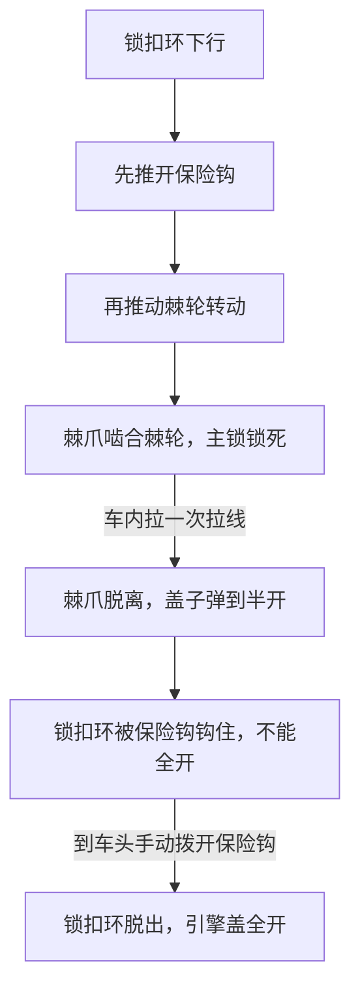

# 汽车引擎盖双级锁：主锁棘轮棘爪与二次安全钩，必须两次操作才能全开

> [!summary] 一句话概述
> 典型汽车引擎盖锁把主锁和二次安全钩做在同一套锁体上：关上时，引擎盖上的锁扣环先推开保险钩，再推动棘轮转到与棘爪啮合，主锁锁死；从车内拉释放拉线只让棘爪脱离棘轮，引擎盖弹到半开并停在保险钩上，必须到车头手动拨开保险钩，锁扣环才能离开，盖子才能全开。美国 FMVSS No. 113 要求：前缘开启且在打开位置会挡住驾驶前方视线的引擎盖，必须有第二锁定位置或第二套锁。主锁承担行驶风压和振动，二次钩是防止主锁失效或误拉时盖子被掀起的安全件，不能在维修里被跳过或拆除。

## 配图

![[附件/haori-cn203142611-exploded.jpg]]
*图源：[CN203142611U 说明书附图图 1](https://patents.google.com/patent/CN203142611U/zh)（江苏皓日汽车零部件，2013-08-21 授权）结构爆炸图。1 底板，2 压板，3 棘爪，4 铆钉，5 衬套，6 棘轮，7 销轴，8 棘爪拉簧，9 棘轮拉簧，10 保险钩拉簧，11 保险钩*

> 图片版权归原作者所有，仅作个人学习收藏；出处见文末「来源与核实记录」。本篇只收这一张专利爆炸图；法规文本和维修手册页没有可下载的结构剖视，不编造示意图冒充实物图。

## 结构原理

> 本节所有数字只写来源里给出的；来源没有就写「来源未给出」。

### 堆叠方案

方向：**从引擎盖上的锁扣环向下到水箱框架上的锁体，再沿拉线回到车内拉杆**

| 层级 | 零件 | 材料 | 厚度/尺寸 | 固定方式 | 依据 |
| --- | --- | --- | --- | --- | --- |
| L1（盖侧） | 锁扣 / striker（U 形锁环） | 来源未给出 | 来源未给出直径 | 固定在引擎盖下缘，与锁体对合 | 濠國：锁扣通常是 U 形锁环；皓日称机盖锁扣环 |
| L2 | 保险钩（二次安全钩） | 来源未给出 | 来源未给出 | 皓日：通过铆钉 4 与底板连接，并配保险钩拉簧 10 | 皓日图 1 与实施方式；濠國：有的整合在锁总成上，有的是装在引擎盖上的独立挂钩 |
| L3 | 棘轮（主锁锁舌/棘轮） | 热处理（皓日） | 来源未给出 | 套在底板一侧销轴 7 上，棘轮拉簧 9 拉向底板 | 皓日 |
| L4 | 棘爪 | 热处理（皓日） | 来源未给出 | 套在另一侧销轴 7 上，棘爪拉簧 8 拉向底板 | 皓日 |
| L5 | 底板、压板、衬套、销轴 | 来源未给出 | 来源未给出板厚 | 锁体总成装在水箱框架上缘中央（濠國） | 皓日零件 1、2、5、7；濠國安装位置 |
| L6 | 回位弹簧（总成级）与拉线接头 | 拉线为钢索（濠國） | 拉线长度来源未给出 | 车内拉杆经钢索拉到锁体，释放主锁（通常是拉动棘爪） | 濠國 |
| L7 | 车内释放拉杆 | 来源未给出 | 来源未给出 | 装在驾驶座附近 | 濠國 |
| L8（可选） | 引擎盖开启侦测开关 | 来源未给出 | 来源未给出 | 部分车型整合在锁总成上 | 濠國；广汽 Aion V 拆装步骤中有接插件 A |

剖面示意：

独立来源对同一动作的表述：

- 江苏皓日 CN203142611U：关闭时，机盖锁扣环推动保险钩，保险钩转到一定角度后，锁扣环再推动棘轮，棘轮转到一定角度后与棘爪啮合，到达啮合位置后锁紧。开启时，棘爪转到一定角度与棘轮脱离；锁扣环钩住保险钩使机盖不能完全打开，必须手动拨动保险钩，保险钩再转过一定角度与锁扣环脱开，才能打开机盖。三根拉簧分别让棘爪、棘轮、保险钩在运动后回位。
- 濠國：主锁是锁舌与棘爪机构，行驶负荷主要由这一组承担；从车内拉开时，引擎盖必须浮起并停在二段安全扣上，不能直接全开；不拨安全扣时用手往上提，应被挡住；拨开后才能全开。关上必须完全扣入主锁。
- FMVSS No. 113 S4.1：每个引擎盖都要有锁系统。S4.2：前缘开启的引擎盖，若在任何打开位置会部分或完全挡住驾驶通过挡风玻璃的前方视线，就必须在锁系统上提供第二锁定位置，或配备第二套引擎盖锁系统。条文本规定安全钩的形状或拉线长度。

有的车型做成「车内拉两次」就能解开第二级（例如部分双拉式机构），那是同一法规目标下的另一种操作方式，不是本篇皓日/濠國所写的「车内一次 + 车头手动拨钩」。不要把两种操作当成同一套零件。

### 零件清单

| 零件 | 数量 | 功能 | 材料 | 依据 |
| --- | --- | --- | --- | --- |
| 底板 | 1 | 安装基准，承受锁环冲击与拉簧力 | 来源未给出 | 皓日 1 |
| 压板 | 1 | 与底板组成锁体骨架 | 来源未给出 | 皓日 2 |
| 棘轮 | 1 | 被锁扣环推动，与棘爪啮合形成主锁 | 热处理（皓日） | 皓日 6 |
| 棘爪 | 1 | 卡住棘轮，由拉线释放 | 热处理（皓日） | 皓日 3 |
| 销轴 | 2（皓日：底板上设置有两个销轴） | 棘轮、棘爪的转轴 | 来源未给出 | 皓日 7 |
| 衬套 | 图中有件 5 | 销轴处衬套 | 来源未给出 | 皓日 5 |
| 棘轮拉簧 | 1 | 使棘轮运动后回位 | 来源未给出 | 皓日 9 |
| 棘爪拉簧 | 1 | 使棘爪运动后回位并保持啮合趋势 | 来源未给出 | 皓日 8 |
| 保险钩 | 1 | 主锁打开后钩住锁扣环，形成第二锁定位置 | 来源未给出 | 皓日 11 |
| 铆钉 | 1（图中 4） | 把保险钩铆在底板上 | 来源未给出 | 皓日 4 |
| 保险钩拉簧 | 1 | 使保险钩回位 | 来源未给出 | 皓日 10 |
| 锁扣环 | 1 | 装在引擎盖上，与棘轮、保险钩对合 | 来源未给出 | 皓日；濠國 |
| 释放拉线与车内拉杆 | 各 1（典型） | 把车内操作传到棘爪 | 钢索拉线（濠國） | 濠國 |
| 开启开关（部分车型） | 可选 1 | 侦测引擎盖是否锁上 | 来源未给出 | 濠國；Aion V 接插件 A |

### 装配顺序

按皓日关闭/开启逻辑，加上濠國的「铰链先、锁扣次之」对位（不是某一车型工艺卡）：

1. 先把引擎盖铰链对位并固定，再装或调整锁体，避免用锁去硬掰已经歪了的盖。濠國写对位顺序：铰链先、锁扣次之、缓冲胶块再次、最后确认扣合。
2. 把锁体（底板总成）装到水箱框架上缘，接上拉线；有开关的车型再接插件。
3. 确认锁扣环与锁体对中。关上引擎盖时，锁扣环应先推开保险钩，再进入棘轮并被棘爪咬住，盖与翼子板平齐。
4. 安装后必须做安全测试（濠國，三项缺一不可）：从车内拉拉杆，盖应浮起并停在二段安全扣上，不得直接全开；不拨安全扣时用手往上提，应被安全扣挡住，拨开后才能全开；按原厂方式关上后，应完全扣入主锁，往上拉不应有明显松动。
5. 拆开时顺序相反：先释放主锁并拨开安全钩，支撑住引擎盖，再拆拉线、开关和固定螺栓。

车型参数只作该车依据，不写成通用值：

- 广汽 Aion V 维修步骤：拆 2 颗固定螺栓，推荐 13 mm 套筒；安装扭矩 18–22 N·m；有接插件 A 和拉索 B。
- 丰田 Tacoma（2015–2018）调整：铰链螺栓 13 N·m；引擎盖锁总成 3 颗螺栓 8.0 N·m；并给出缝隙 A–D 的标准间隙。

### 受力与运动分析

- **受力路径**：行驶中风压和振动先到引擎盖，经锁扣环进入棘轮，再由棘爪和底板传到车身。濠國写：这一组主锁才是真正承受行驶负荷的地方。主锁失效后，负荷转到保险钩与锁扣环的钩挂上，此时盖已经半开，只用于防止完全掀起挡住视线，不能当成正常行驶状态（濠國：行驶中跳动、弹起应视为不可上路）。
- **运动关系**：锁扣环近似竖直插入。保险钩、棘轮、棘爪各自绕固定销/铆接轴转动，由各自拉簧回位。车内拉线通常只驱动主锁释放（棘爪），第二级是到车头拨动保险钩，两次操作才能全开。这与灶具旋钮「先解锁再旋转」类似，都是用两次动作降低误开风险，但这里第二步被有意放到车外。
- **失效风险**：棘轮、棘爪磨损或回位无力，可能只扣到一半或在颠簸中跳到安全钩位置（濠國）。锁扣被撞歪、铰链变形会导致对不齐。拉线卡滞或断裂会造成车内拉不开。安全钩变形、扭簧/拉簧断裂或被人为拆除，会失去第二锁定位置，一旦主锁失效，前开式盖可能被风压掀起挡住视线——这正是 FMVSS 113 S4.2 要防止的情况。任何让安全扣失效或被跳过的维修做法，濠國明确不应出现在现场。行人保护用的弹起式铰链不能用普通铰链替换（濠國援引 UN R127，属另一系统，本篇不展开参数）。

## 设计要点与参数

| 要点 | 内容 | 依据 |
| --- | --- | --- |
| 两级动作 | 关：锁扣环先过保险钩，再入棘轮被棘爪咬住。开：先释放棘爪，盖停在保险钩上，再手动拨钩全开 | 皓日 [0011]；濠國 |
| 热处理 | 棘轮以及棘爪均经过热处理 | 皓日权利要求 2 |
| 保险钩安装 | 通过铆钉与底板连接 | 皓日 |
| 回位 | 棘爪拉簧、棘轮拉簧、保险钩拉簧使三件运动后回位 | 皓日 [0011] |
| 法规（美国） | FMVSS No. 113 适用于乘用车、多用途乘用车、卡车与巴士；S4.1 每个引擎盖须有锁系统；S4.2 会挡视线的前开式盖须有第二锁定位置或第二套锁 | eCFR 49 CFR 571.113；濠國对条文的转述与原文一致 |
| 法规没写的 | 条文本规定安全钩形状、拉线长度或售后检验方法 | 濠國；对照 eCFR 原文确认 S4 只有上述要求 |
| 安装后测试 | 车内拉一次必须停在安全扣；不拨钩提不动；关上完全入主锁 | 濠國 |
| 对位顺序 | 铰链先、锁扣次之、缓冲胶块再次、最后确认扣合 | 濠國 |
| Aion V 锁体螺栓（仅该车） | 2 颗，13 mm 套筒，扭矩 18–22 N·m | 广汽 Aion V 维修手册页 |
| Tacoma 调整扭矩与间隙（仅该车） | 铰链 13 N·m；锁总成 8.0 N·m；间隙 A、D 为 −1.4 至 1.6 mm，B、C 为 4.9 至 7.9 mm | Toyota Tacoma 2015–2018 Service Manual |
| 通用强度、钩深、拉簧力 | 来源未给出 | 皓日与 FMVSS 均未列牛顿或毫米钩深 |

## 优缺点

**优点**
- 两次不同位置的操作（车内 + 车头）大大降低误拉或拉线卡滞造成全开的概率
- 主锁用棘轮—棘爪，能把锁扣环的冲击变成可靠啮合，并用拉簧保持
- 二次钩即使在主锁失效时仍能挡住盖子，满足「第二锁定位置」的法规目标
- 锁体可做成总成，便于整件更换

**缺点 / 代价**
- 开盖必须走到车头拨钩，不如「车内拉两次」方便（方便正是有的车型改双拉的原因，但要另做防误操作）
- 零件和弹簧多，脏污、锈蚀、铰链变形都会让二级对不齐或拨不动
- 如果维修时拆除、绑死或跳过安全钩，法规意图被破坏，行驶风险立刻上升
- 通用强度数据在公开专利和法规里几乎没有，选型必须回到原厂试验

## 可借鉴点

- **会挡视线或有危险后果的盖，不要做成「拉一下就全开」**：把第二级做成必须改变操作位置或改变操作方式，才能称为有效的双重保险。
- **主锁和安全钩要分路径**：主锁走棘轮—棘爪承担行驶负荷；安全钩只在半开位置钩住锁环。不要让同一啮合既当主锁又当安全钩还说不清是第几级。
- **安装完成以三项动作试验收尾**，而不是只看螺栓扭矩：停在安全钩、拨钩后才全开、关上完全入主锁。
- **先铰链后锁体**：对位顺序反了，会用锁去迁就变形的盖，结果是看似能关、实际只扣到一半。
- 引用 FMVSS 113 时要写准：它要求第二锁定位置或第二套锁，并不规定钩的形状；出口到其他市场还要查当地法规。

## 与库中相似案例对比

| 对比项 | 本案例 | [[灶具旋钮轴向解锁：先推或拉解除转动约束，阀芯压紧与解锁分工]] | [[FIDLOCK V-BUCKLE：磁吸引导到位后再由机械扣锁死]] |
| --- | --- | --- | --- |
| 动作 | 车内释放主锁，盖停在二次钩上，再手动拨钩全开 | 先轴向解锁，再旋转阀芯 | 磁力引导到位，机械扣锁死 |
| 为什么要两步 | 防止误拉或主锁失效时引擎盖掀起挡视线 | 防止碰到旋钮就改变火力 | 磁力不可单独作为锁 |
| 承力 | 行驶负荷走棘轮—棘爪；二次钩只在半开位工作 | 阀芯密封与解锁分件 | 机械扣承力 |
| 法规/约束 | FMVSS 113 要求第二锁定位置或第二套锁 | 来源以产品结构为主 | 产品设计原则，不是车规前盖条款 |

## 相关案例

- [[灶具旋钮轴向解锁：先推或拉解除转动约束，阀芯压紧与解锁分工]]
- [[FIDLOCK V-BUCKLE：磁吸引导到位后再由机械扣锁死]]
- [[急停蘑菇头：机械保持、刻意复位与触点脱落向安全侧断开]]
- 分类索引：[[04-机构与运动 索引]]

## 来源与核实记录

- 主来源：[濠國汽材：引擎蓋鎖與引擎蓋鉸鏈：主鎖、二段安全扣、拉線與鉸鏈的診斷、更換與選購](https://www.haoguo.tw/zh/blog/hood-latch-hinge-secondary-catch-diagnosis)（2026-09-28，HAO-GUO / 濠國。主锁与二段安全扣组成、行驶负荷路径、安装后三项安全测试、对位顺序，以及对 FMVSS 113 的转述。中文主来源）
- 补充来源 1：[CN203142611U 汽车机盖锁体总成](https://patents.google.com/patent/CN203142611U/zh)（江苏皓日汽车零部件有限公司；申请 2013-03-04，授权 2013-08-21；发明人顾习明、钱伟、刘芳。棘轮—棘爪主锁、保险钩二次钩、三根拉簧回位、热处理、爆炸图。PDF：[patentimages 副本](https://patentimages.storage.googleapis.com/4a/da/2d/500c66adebd02e/CN203142611U.pdf)。独立第二机构）
- 补充来源 2：[eCFR 49 CFR 571.113 Standard No. 113; Hood latch system](https://www.ecfr.gov/current/title-49/subtitle-B/chapter-V/part-571/subpart-B/section-571.113)（美国联邦法规现行文本。S1–S4.2 适用范围与第二锁定位置要求）
- 补充来源 3：[广汽 Aion V 维修：Engine hood lock assembly](https://www.aionv.app/pages/T00609824.html)（该车拆装：2 螺栓、13 mm 套筒、18–22 N·m、拉索与接插件。只作为车型参数，不写进通用表）
- 补充来源 4：[Toyota Tacoma 2015–2018 Service Manual: Hood Adjustment](https://www.ttguide.net/adjustment-1827.html)（铰链 13 N·m、锁总成 8.0 N·m 及间隙 A–D。同样只作为该车参数）
- 核实：2026-11-22 打开濠國与 eCFR 页面，下载皓日专利 PDF 并抽取图 1。Passat B5 维修页请求失败，未引用。未把「车内拉两次全开」的另一类专利当成本篇的同一结构。
