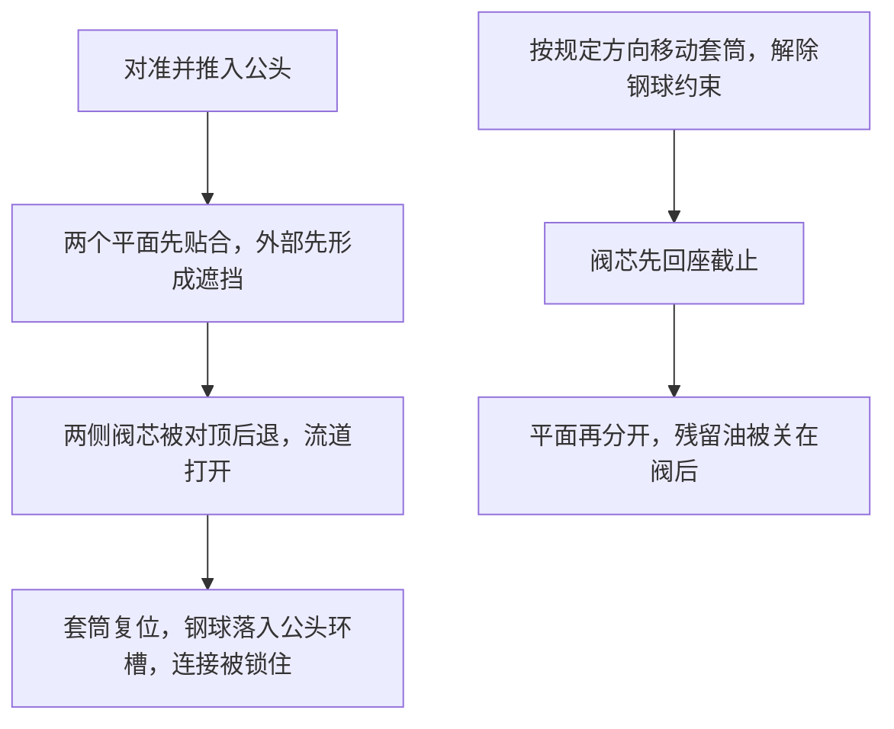

# 液压平面阀快速接头（ISO 16028）：双向截止阀与套筒钢球锁，区别于气管快插

> [!summary] 一句话概述
> ISO 16028 平面阀液压快换的公头（插头）和母头（插座）端面几乎平齐，内部各有一枚弹簧常闭的平面阀：对接时先让两个平面贴合，再同步顶开阀芯通油；分开时阀芯先回座，再离开端面。两半靠母头套筒把锁球压进公头环槽来保持。它和气管快插不是同一类锁——气管快插用卡爪咬住管外壁、断开后管路敞开；这里锁的是接头的两半，断开后两侧各自截止。

## 配图

![[附件/kuriyama-qf-flat-face-pair.jpg]]
*图源：[Kuriyama Hydraulic Connections 目录中的 ARGUS QF（FLAT FACE STANDARD ISO 16028）](https://products.kuriyama.com/Asset/Hydraulic-Connections_Quick-Release-catalog--02-19--18-19.pdf) 第 18 页；左侧为平面插头，右侧为带滚花套筒的插座，端面几乎无凹腔。目录写：推动套筒完成结合，套筒须沿规定方向运动才能拆开或接上，母头带防止意外分离的安全机构。WP 350 bar，DN 6–25（1/4"–1"）*

![[附件/flexq-hpf-iso16028-products.jpg]]
*图源：[FlexQ HPF ISO 16028 Flat-Face 样本](https://flexq-connectors.com/pdf/FLEXQ-HPF-EN.pdf) 封面；可见平齐端面和带滚花的锁定套筒。样本第 2 页写：按规格由钢球提供可靠锁定，锁定套筒负责安全的锁紧与解锁；另有 “disconnecting lock” 防止意外断开*

![[附件/flexq-hpf-materials-pressure.jpg]]
*图源：同上第 3 页（页码 38）；材料表、阀符号（含双向截止示意）、NBR / FPM 温度范围，以及 HPF 06/10/12/16/19/25 的 Flow Size 与 Pressure 行。该页 Pressure 行未用文字写出单位，不能自行补成 bar；同页压降图纵轴为 Pressure Drop (Bar)*

> 图片版权归原作者所有，仅作个人学习收藏；出处见文末「来源与核实记录」。

## 结构原理

> 本节所有数字只写来源里给出的；来源没有就写「来源未给出」。三家厂商的压力和泄漏数据分列，不合并为 ISO 16028「标准值」。

### 堆叠方案

方向：**沿液路轴线，从公头（插头）进入母头（插座）**

| 层级 | 零件 | 材料 | 厚度/尺寸 | 固定方式 | 依据 |
| --- | --- | --- | --- | --- | --- |
| L1 对接端面 | 公、母两侧几乎平齐的平面阀端面 | FlexQ：阀芯镀锌钢；Kuriyama：镀锌钢，易磨损部位硬化 | 来源未给出端面平面度或直径公差（须按 ISO 16028 原文/量规，本文未打开该标准） | 对插时两个平面先接触 | Kuriyama：flush connection；FlexQ：Non-spill flat face；Ehhydraulics：flat metal surfaces make contact first |
| L2 双向截止阀 | 公、母各一枚弹簧加载、常态关闭的平面阀 | FlexQ：Valve 镀锌钢，Spring 不锈钢 | 弹簧力和阀行程来源未给出 | 分开时各自关闭流道；对插到位后互相顶开 | FlexQ 材料表与阀符号；Kuriyama：在零压或低压范围内，通断阀自动动作；Ehhydraulics 写双方阀门均为 spring-loaded and normally closed |
| L3 钢球锁定 | 一周锁球 + 公头环槽 | FlexQ：Balls 不锈钢 | 球数、球径来源未给出（FlexQ 只写 Depending on the size, the balls provide a reliable locking） | 套筒在锁紧位置把钢球压进公头环槽，抵抗内压造成的轴向拉开 | FlexQ；Ehhydraulics 的通用快换文：套筒把锁球推入沟槽 |
| L4 锁定套筒 | 母头外可轴向滑动的套筒 | FlexQ：Sleeve 镀锌钢；Kuriyama 产品图为滚花套筒，材料写镀锌钢 | 套筒行程来源未给出 | 沿规定方向推动或后拉，以允许钢球进出环槽。Kuriyama：母头带防止意外分离的安全机构。FlexQ：另有 disconnecting lock 防止意外断开 | Kuriyama 第 18 页；FlexQ 第 2 页 |
| L5 本体与螺纹尾 | Body Socket / Body Plug | 两家目录均为镀锌钢（Kuriyama 另写 Top Coat Cr-III） | FlexQ 给出通径系列 HPF 06–25（Flow Size 6–25 mm）；Kuriyama DN 6–25，1/4"–1" | 螺纹接到液压软管或阀块，具体螺纹规格见各目录后续页，本任务打开的首页未逐项抄录 | 两份目录 |
| L6 密封与防尘 | 工作密封、挡圈、防尘盖 | FlexQ 默认 Nitrile，可选 FPM；Kuriyama HNBR（可询其他），挡圈 PTFE，并配防尘盖/堵 | 截面尺寸来源未给出 | 密封安装在阀和本体规定槽内；不用时用防尘盖保护平面 | 两份目录 |

剖面示意：

与气管快插的对照（必须分开写）：

- 气管快插（KQ2 一类）：锁的是管子，卡爪咬管外壁，密封圈封管外壁；按下解锁套后把管子拔走。接头里通常没有截止阀，断开后两边都敞开。
- 本案例：锁的是公、母两半接头。保持靠套筒+钢球，不是卡爪咬管。密封和截止靠平面阀，断开后两边各自关闭。管子本身事先已经用螺纹或扣压接到接头尾部，并不插入快换端面。

### 零件清单

| 零件 | 数量 | 功能 | 材料 | 依据 |
| --- | --- | --- | --- | --- |
| 公头（插头 / Body Plug） | 每对 1 | 带平面阀和环槽的插入端 | 镀锌钢（两家目录） | FlexQ；Kuriyama |
| 母头（插座 / Body Socket） | 每对 1 | 容纳阀、锁球和套筒 | 镀锌钢 | 同上 |
| 平面阀阀芯 | 各 1 | 常态关闭，对插后互相顶开 | FlexQ：镀锌钢 | FlexQ 材料表；Ehhydraulics 原理说明 |
| 阀簧 | 各 1 | 使阀芯回座 | FlexQ：不锈钢 | FlexQ |
| 锁球 | 一周，数量来源未给出 | 进入公头环槽，承受拉开载荷 | FlexQ：不锈钢 | FlexQ |
| 锁定套筒 | 1（在母头上） | 控制锁球进出，实现锁紧/解锁 | 镀锌钢 | FlexQ；Kuriyama |
| 防意外断开机构 | 按型号 | 避免套筒被意外拨开 | 来源未给出具体零件名 | Kuriyama “safety system against accidental uncoupling”；FlexQ “disconnecting lock” |
| 工作密封 / 挡圈 / 防尘盖 | 按型号 | 密封、抗挤出、保护平面 | 见 YAML 材料行 | 两份目录 |

### 装配顺序

按已打开目录和 Ehhydraulics 对连接/断开顺序的说明（现场对接，不是出厂装配工艺卡）：

1. 接头尾部先按各型号螺纹接到软管或阀块（具体扭矩来源未给出）。不用时盖上防尘盖。
2. 对接前擦净两个平面（Ehhydraulics 强调平面容易擦干净，是防污染要点）。Kuriyama 写阀在零压或低压范围内自动动作；是否允许带残压对插，须看具体型号——Ehhydraulics 文给出「典型可达 100 bar 残压」是该文表述，不是 FlexQ/Kuriyama 本页的数字，不能当作这两家的额定值。
3. 按该型号要求移动母头套筒（Kuriyama：pushing on a sleeve；Ehhydraulics：有的设计是后拉套筒），插入公头，使环槽对准锁球。
4. 套筒回到锁定位置，钢球被压进环槽，两半不能被内压拉开；此时两侧阀芯已被对顶打开，液路接通。
5. 断开：先按规定方向移动套筒（并解除防意外断开锁，若有），钢球能够退出环槽。Ehhydraulics 写关键顺序是阀芯先回座，平面再分开，从而把残油关在里面。
6. 分开后立即盖上防尘盖。Kuriyama 写详细安装、使用和维护说明另行提供，本文不编造这些步骤。

### 受力与运动分析

- **受力路径**：系统压力作用在已打开的阀后流道和密封上；要把两半拉开的轴向力由锁球传到套筒和母头本体，再传到尾部螺纹。阀簧只负责分开时把阀芯送回阀座，不是用来抵抗工作压力把两半拉开（推断：保持力来自钢球锁，与气管快插的卡爪相当，但对象不同）。
- **运动关系**：套筒相对母头轴向（有的设计还规定转动方向）运动，控制锁球的径向进出；公头相对母头轴向插入。阀芯沿轴线相对本体伸缩。FlexQ 写可单手连接。
- **失效风险**：平面上的污物会被带进液压系统，或妨碍阀关闭导致滴漏。套筒未到位时钢球未进槽，内压可能把公头弹出（推断，故两家都强调防意外断开）。与非 ISO 16028 的锥阀/球锁型快换对插，Ehhydraulics 写不能直接混配。把气管快插的「按套拔管」用到这里会拨开仍带压的油路——对象和后果都不同。Ehhydraulics 给出的 0.02–0.1 mL 每挂一次的「近零泄漏」是该文典型值，FlexQ 只写 Non-spill、Kuriyama 只写 Low leak-oil rates，都没有在已打开页面给出同一毫升数，不能写成标准限值。

## 设计要点与参数

| 要点 | 内容 | 依据 |
| --- | --- | --- |
| 与气管快插的本质区别 | 这里是「带双向截止阀的两半接头 + 套筒钢球锁」；气管快插是「卡爪咬管 + 密封圈封管、断开不截止」 | 对照 KQ2/Festo 篇与本篇目录 |
| 平面阀顺序 | Ehhydraulics：对接时平面先接触再开阀；断开时阀先关再分开面 | Ehhydraulics 2026-06-29 文 |
| 锁紧 | 套筒 + 钢球 + 公头环槽；另有防意外断开 | FlexQ；Kuriyama |
| FlexQ 通径与压力行 | Flow Size：HPF 06/10/12/16/19/25 对应 6/10/12/16/19/25；Pressure 行：400/375/350/350/300/250。**该行未用文字标注单位** | FlexQ 第 3 页 |
| FlexQ 温度 | NBR（N）：–15 °C ~ +100 °C；FPM（V）：–20 °C ~ +200 °C | 同上 |
| Kuriyama 工作压力 | WP 350 bar（5075 PSI） | QF 第 18 页 |
| Kuriyama 尺寸范围 | DN 6–25，1/4"–1" | 同上 |
| Kuriyama 温度 | –22°F（–30°C）至 +257°F（+125°C） | 同上 |
| Kuriyama 介质 | 矿物油液压液 DIN 51524 T1+T2；阻燃液按 VDMA 24317 可询；气、水液压在合适材料下可询 | 同上 |
| 接口标准 | 两家目录均写 ISO 16028 平面轮廓；本文未打开标准原文，不写互换试验细节 | FlexQ；Kuriyama。Ehhydraulics 主张符合该轮廓的不同品牌可互配，这是该文观点 |
| 阀芯行程、球径、泄漏毫升数（目录页） | FlexQ / Kuriyama 已打开页未给出毫升数或球径 | 来源未给出。Ehhydraulics 典型泄漏量不移用到这两家表 |

## 优缺点

**优点**
- 断开后两侧截止，减少喷油和空气、污物进入封闭液压回路
- 平齐端面比深凹的锥阀/球阀腔更容易在对接前擦干净
- 保持和截止分开：钢球锁抵抗拉开，平面阀负责通断与密封
- 有明确的国际轮廓（ISO 16028）可供按系列选型（仍须按所持标准与厂商说明验证）

**缺点 / 代价**
- 结构比气管快插重、贵，零件更多（双阀、钢球、套筒、防松）
- 残压、污物和套筒未锁到位都会造成插不上、弹出或内漏，操作程序更严
- 与非平面阀轮廓不能直接对插
- 各厂压力、温度、泄漏数据不能合成「标准万能表」

## 可借鉴点

- **先问断开后要不要截止**。不要截止：卡爪咬管即可（气管快插）。要截止且要少漏、少进污：把阀做在接头里，并对接顺序做成「先贴面、再开阀；先关阀、再离面」。
- **锁住的对象必须写清楚**：锁管子，还是锁两半接头。套筒钢球锁的是后者，解锁套张开卡爪锁的是前者。
- **防意外解锁要单独做**。只靠套筒摩擦力，在振动或刮蹭下可能被拨开；FlexQ 和 Kuriyama 都单独写了防意外断开。
- 平面在不用时要盖防尘盖——这个「保护密封面」和鲁尔「不要划伤锥面」是同一类纪律。
- 引用压力时写清是哪一型号、哪一页；单位没印出来就写「未标注」，不要替目录补单位。

## 与库中相似案例对比

| 对比项 | 本案例 | [[气动快插接头（SMC KQ2 一类）：卡爪咬管、密封圈密封，按解锁套后拔出]] | [[Southco、DZUS 四分之一转快锁：90° 凸轮与按总材料厚度选钉长]] |
| --- | --- | --- | --- |
| 锁的对象 | 公、母两半接头 | 插入的气管 | 可拆面板与框架 |
| 断开后 | 两侧平面阀关闭 | 管口敞开 | 面板打开，钉可留在板上 |
| 解锁动作 | 移动套筒，钢球退出环槽 | 按解锁套，卡爪离开管壁 | 反向转约 90° |
| 选型关键 | 轮廓（ISO 16028）、通径、各厂压力/温度/密封 | 管外径、管材、该系列压力和温度 | TMT → 钉长，凸轮类型 |

## 相关案例

- [[气动快插接头（SMC KQ2 一类）：卡爪咬管、密封圈密封，按解锁套后拔出]]
- [[鲁尔锁定接头：6% 锥面负责密封，螺纹与锁耳只负责保持]]
- [[电缆防水格兰头：PG 螺纹、夹紧爪与密封圈]]
- 分类索引：[[04-机构与运动 索引]]

## 来源与核实记录

- 主来源：[FlexQ Connectors，HPF ISO 16028 Flat-Face 样本](https://flexq-connectors.com/pdf/FLEXQ-HPF-EN.pdf)（已下载 4 页；非溢流平面、钢球锁定、套筒、disconnecting lock、材料表、HPF 06–25 通径与压力行、NBR/FPM 温度。压力行单位未用文字标出，已在正文注明）
- 补充来源 1：[Kuriyama Hydraulic Connections 目录 ARGUS QF 页](https://products.kuriyama.com/Asset/Hydraulic-Connections_Quick-Release-catalog--02-19--18-19.pdf)（已下载；ISO 16028、WP 350 bar、DN 6–25、推动套筒结合、母头防意外分离、HNBR / PTFE / Cr-III、介质和温度。独立第二机构）
- 补充来源 2：[Ehhydraulics: How Do Flat Face Hydraulic Couplers Work?](https://www.ehhydraulics.com/blog/How-Do-Flat-Face-Hydraulic-Couplers-Work_b26602)（2026-06-29；宁波厂商英文说明。连接/断开顺序、阀门常闭、平面先接触。文中 0.02–0.1 mL、420 bar、100 bar 残压等为该文典型/宣传范围，不移入 FlexQ 或 Kuriyama 表）
- 补充来源 3：[Ehhydraulics: What is a quick disconnect coupling and how does it work?](https://www.ehhydraulics.com/blog/What-is-a-quick-disconnect-coupling-and-how-does-it-work_b37850)（2026-10-19；同一机构，补充套筒-钢球-环槽的通用快换顺序，不另计新机构）
- 核实：2026-11-22 下载两份目录并打开两篇结构文。未获得 ISO 16028 正式文本。未把 ISO-B 锥阀型另开一篇。
