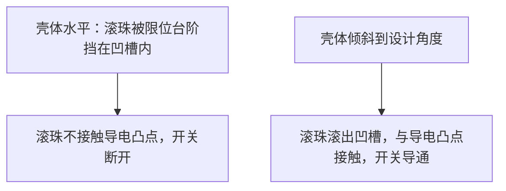

# 滚珠倾斜开关：导电滚珠在重力下滚离凹槽，与导电凸点接触导通

> [!summary] 一句话概述
> 贴片式倾斜滚珠开关在水平放置时，金属滚珠被限位台阶挡在凹槽里，不碰到导电凸点，电路断开；壳体倾斜到设计角度后，滚珠滚出凹槽并与凸点接触，输出一个简单的通断信号。颖鑫把内部零件写成金属座、金属滚珠、绝缘体、金属塞和限制器，并指出它比 MEMS 角度传感器精度低，但更省电、更小、成本更低。百灵 BL-3300 给出可核对的分档：直立时断开，向任一方向超过 25±10° 或 45° 后导通，电压 1.5–12 V，电流 20 mA，寿命 10 万次。它不是水银开关，也不是连续输出角度的惯性传感器。

## 配图

![[附件/ball-yingxin-03.png]]
*图源：[颖鑫电子，《滚珠倾斜开关工作原理》，2021-04-27](https://www.yingxin-dz.com/news/56.html) 结构分解：金属座、金属滚珠、绝缘体、金属塞、限制器*

![[附件/ball-yingxin-02.jpg]]
*图源：同上，贴片式滚珠倾斜开关外观*

![[附件/ball-bl-03.jpg]]
*图源：百灵电子 BL-3300 系列产品页，精密倾斜角度滚珠开关外观；角度和电参数以该页文字为准*

![[附件/ball-oncque-cutaway.png]]
*图源：[大日科技（Oncque）滚珠开关产品页](https://www.oncque.com/) 结构/剖面类配图，仅作另一家接点式滚珠开关的外形对照*

> 图片版权归原作者所有，仅作个人学习收藏；出处见文末「来源与核实记录」。

## 结构原理

> 本节所有数字只写来源里给出的；来源没有就写「来源未给出」。颖鑫讲的是「水平常开、倾斜后导通」这一种；百灵 BL-3300 讲的是「直立断开、向任一方向倾斜超过设定角后导通」。安装基准不同，不要把「水平」和「直立」混成同一个姿态。

### 堆叠方案

方向：**从金属座、滚珠腔到引出端**

| 层级 | 零件 | 材料 | 厚度/尺寸 | 固定方式 | 依据 |
| --- | --- | --- | --- | --- | --- |
| L1 | 金属座 | 金属，牌号来源未给出 | 来源未给出 | 构成凹槽形容腔和导电路径的一部分 | 颖鑫 |
| L2 | 金属滚珠 | 颖鑫未给牌号；百灵写 304 不锈钢（针对其产品） | 来源未给出直径 | 在重力下滚动 | 颖鑫；百灵 |
| L3 | 绝缘体与限制器 / 限位台阶 | 来源未给出 | 来源未给出台阶高度 | 水平或直立时把滚珠限制在凹槽内，使其离开导电凸点 | 颖鑫 |
| L4 | 导电凸点 / 金属塞 | 金属 | 来源未给出 | 倾斜后与滚珠接触形成通路 | 颖鑫 |
| L5 | 封装 | 百灵称完全密封，可防水防尘 | 来源未给出壁厚 | 贴片或插脚引出 | 颖鑫；百灵 |

剖面示意（按颖鑫对贴片水平常开型的文字）：

颖鑫还写：滚珠也可以在磁力等力的作用下滚动，但本页展开的是重力倾斜；输出只有 ON / OFF，可做智能手表抬手亮屏这类场景。安装形式分贴片和插脚，贴片更适合 SMD。

百灵 BL-3300 系列（独立产品，不要把角度写进颖鑫结构）：

| 型号 | 断开状态 | 倾倒方向 | 倾斜角度 | 导通状态 |
| --- | --- | --- | --- | --- |
| BL-3300-25 | 直立 / OFF | 任一方向 | 超过 25±10° | ON |
| BL-3300-45 | 直立 / OFF | 任一方向 | 超过 45° | ON |

Oncque（大日）把产品分成接点式滚珠开关和光电式滚珠开关，以及倾斜、振动、四向旋转、离心冲击等功能分档。该分类页没有给出可引用的动作角度或电参数，本文只用来说明还存在「滚珠遮光」而不是「滚珠当触点」的另一路，不展开未打开的具体型号规格书。

### 零件清单

| 零件 | 数量 | 功能 | 材料 | 依据 |
| --- | --- | --- | --- | --- |
| 金属座 | 1 | 腔体和部分导电 | 金属 | 颖鑫 |
| 金属滚珠 | 1（本页描述为单珠；双珠结构见该站其他文，本文不展开） | 滚动导通 | 百灵产品为 304 不锈钢 | 颖鑫；百灵 |
| 绝缘体 | 1 | 隔开不该导通的部分 | 来源未给出 | 颖鑫 |
| 金属塞 | 1 | 密封并可能提供另一电极 | 金属 | 颖鑫 |
| 限制器 | 1 | 设定滚珠在未动作时的位置 | 来源未给出 | 颖鑫 |

### 装配顺序

来源没有给出工厂装配步骤。使用要点：

1. 先确认产品的基准姿态是「水平常开」还是「直立断开」，再在电路板和整机里固定方向。
2. 贴片器件按 SMD 工艺安装；端子拉力百灵给出 500 gf、1 分钟，这是百灵自己的试验条件，不能当成颖鑫产品的数据。
3. 输出只有通断，若需要连续角度，应改用 MEMS 等传感器（颖鑫原文对比）。
4. 不要用水银开关的装配习惯来套密封滚珠开关，两者介质不同。

### 受力与运动分析

- **受力路径**：重力分量沿壳体倾斜方向推动滚珠，克服限位台阶后滚到导电凸点。没有外加弹簧复位，回到原姿态时滚珠再滚回凹槽。
- **运动关系**：只有「在槽内」和「与凸点接触」两个电状态；角度阈值由腔体几何决定。百灵把 25° 档写成 ±10°，说明这类开关的精度窗口比较宽。
- **失效风险**：安装姿态装错；密封破坏后进灰进液；用滚珠开关去替代高精度倾角测量；振动环境把滚珠抖出凹槽造成误触发。已打开资料没有给出抗振动指标，来源未给出。

## 设计要点与参数

颖鑫原理文没有给出电参数。下表电参数只属于百灵 BL-3300 产品页。

| 要点 | 内容 | 依据 |
| --- | --- | --- |
| 结构 | 金属座、滚珠、绝缘体、金属塞、限制器 | 颖鑫 |
| 水平常开动作 | 水平时滚珠在凹槽内断开，倾斜后接触凸点导通 | 颖鑫 |
| BL-3300 角度 | 直立断开；任一方向超过 25±10° 或 45° 导通 | 百灵 |
| 电压 | 1.5–12 V | 百灵 |
| 电流 | 20 mA | 百灵 |
| 导通时间 | 2 ms | 百灵 |
| 闭路电阻 | <10 Ω | 百灵 |
| 绝缘电阻 | >10 MΩ | 百灵 |
| 寿命 | 100,000 次 | 百灵 |
| 储存温度 | −40 °C 至 85 °C | 百灵 |
| 端子拉力 | 500 gf，1 分钟 | 百灵 |
| 湿度试验 | 95% RH，40 °C，96 小时 | 百灵 |

## 优缺点

**优点**
- 结构简单、只输出通断，不需要一直给 MEMS 供电，适合抬手亮屏、倾倒断电这类场景
- 贴片封装便于上自动线；密封型可以不用水银
- 有明确的直立/水平基准和角度分档时，整机姿态设计比较直观

**缺点 / 代价**
- 精度远低于 MEMS，25° 档甚至带 ±10° 窗口
- 振动和安装姿态会直接影响误动作，已打开资料缺少振动指标
- 不同厂家的基准姿态和腔体几何不能直接替换

## 可借鉴点

- 在零件图上写清「哪个姿态是断开」，不要只写一个角度数字。
- 用滚珠开关做省电触发，把精确测角留给需要时才唤醒的传感器。
- 对密封和端子拉力提出试验条件，而不是口头说「防水」。
- 选型时区分接点式和光电式，不要把遮光式的寿命数据套到金属滚珠触点上。

## 与库中相似案例对比

| 对比项 | 本案例（滚珠倾斜开关） | [[磁浮子液位开关：浮子内磁铁与管内簧管磁耦合]] | [[KSD301 突跳式温控器：蝶形双金属片到位后瞬间切换触点]] | [[轻触开关壳体封装金属弹片：盖板、推杆与锅仔片反转导通（以 Omron B3F 为例）]] |
| --- | --- | --- | --- | --- |
| 触发量 | 壳体相对重力的倾角 | 液位 | 温度 | 手指按压力 |
| 运动件 | 导电滚珠在腔内滚动 | 浮子与磁铁 | 蝶形双金属片 | 锅仔片 |
| 何时用这篇 | 要一个低功耗的倾倒或抬手通断 | 要做液位 | 要做温控 | 要做按键，不是姿态开关 |

## 相关案例

- [[磁浮子液位开关：浮子内磁铁与管内簧管磁耦合]]
- [[轻触开关壳体封装金属弹片：盖板、推杆与锅仔片反转导通（以 Omron B3F 为例）]]
- 分类索引：[[04-机构与运动 索引]]

## 来源与核实记录

- 主来源：[颖鑫电子，《滚珠倾斜开关工作原理》，2021-04-27](https://www.yingxin-dz.com/news/56.html)（2026-11-27 打开。零件五件套和水平常开动作来自该文。页中的电话、邮箱和地址不写入正文。若该 URL 与站内栏目调整不一致，以已保存的页面文本为准。）
- 交叉来源：百灵电子 BL-3300 系列产品页（2026-11-27 打开。独立第二机构。角度分档和电参数来自该页。）
- 交叉来源：[大日科技 Oncque 滚珠开关页](https://www.oncque.com/)（2026-11-27 打开。第三机构。接点式/光电式分类和配图，无可用角度数字。）
- 核实：2026-11-27 打开上述来源。不把百灵的电参数写到颖鑫结构上，不采用与颖鑫正文同质的转载页作为第二机构。
